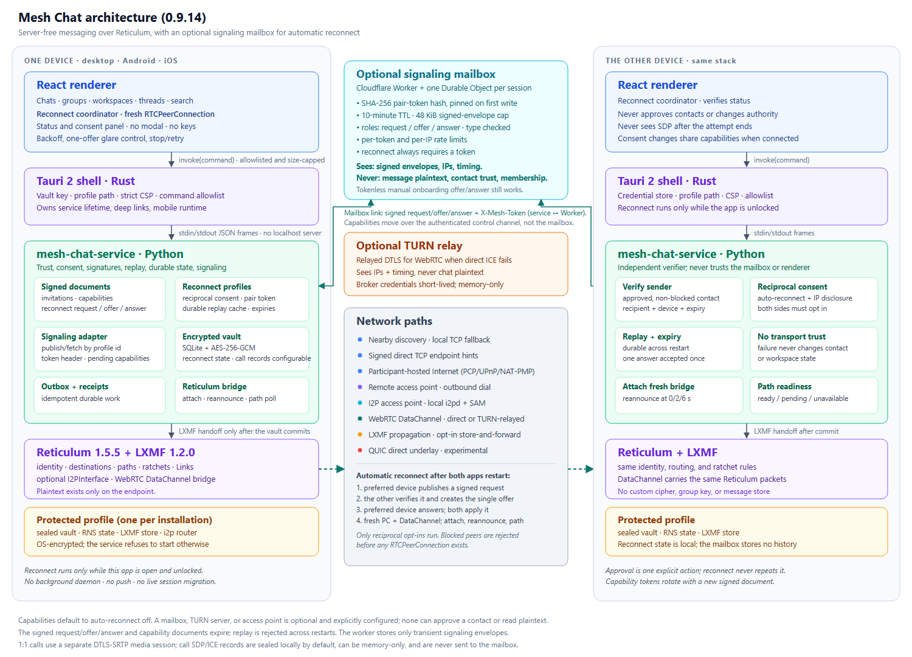

# Architecture

## Connection runtime refactor

The [runtime specification](docs/Mesh_Chat_Connection_Runtime_Spec.md) and
[implementation roadmap](docs/Mesh_Chat_Connection_Runtime_Roadmap.md) describe
the experimental service-owned policy and its qualification boundaries. The
[Mesh Chat Core diagram](docs/architecture/mesh-chat-core.png) shows the target
architecture; it is not a claim that M2–M5 are complete.

[Private connection contracts](contracts/connection/README.md) are separate from
the [experimental application API design](contracts/core-api/README.md). Public
schemas describe proposed requests; they do not grant caller authority or expose
the existing private transport commands.



## Durable connectivity implementation boundary

Workspace joining distinguishes local persistence, LXMF endpoint proof, a signed
application receipt, and admission. The owner atomically saves the validated
request and its receipt delivery in the encrypted vault. The receipt binds the
canonical join digest, original delivery UUID, workspace, invitation authority
and exact recipient device. Only a verified receipt produces approval-pending
UI; the existing admitting manifest still creates membership.

Signed joins and route-setup intent are committed before network work. Ordinary
outbox retries retain the original request, including after native proof when
the application receipt is lost. Legacy joining records resume the same saved
request once after upgrade. Native callbacks cannot manufacture receipt evidence.

[ADR 0018](docs/adr/0018-authenticated-direct-underlay.md) permits a Rust QUIC
underlay for feasibility work. Rust owns native sockets and path upkeep; Python
retains identity, authorization, RNS lifecycle and durable state. The
`experiments/direct-fabric` crate now supplies an app-embedded bounded native host.
The app and mobile plugin explicitly adopt Rust 1.90. Desktop inherited frames and
an Android native-only exchange carry requests independently of renderer commands.
The host owns ephemeral socket/key handles, attempt windows and packet queues.
The defined Phase-1 protocol/adapter proof is qualified at `de110a8`; its
[evidence table](docs/DIRECT_CONNECTIVITY_PHASE1_EVIDENCE.md) includes real
RNS/LXMF traffic, hostile local UDP injection, bounded lifecycle behavior and
Linux syscall provenance with no external addresses. An explicit version-2
email/file setup now connects the underlay to an isolated bootstrap interpreter
(inherited desktop pipes or an Android non-exported secondary process). Admission
allows a bounded control-only handoff to fresh workspace-scoped credentials;
ordinary channel traffic then uses a separately leased main-context adapter.
Existing routes remain available throughout. Native process-boundary packages
compile and Phase 2 integrated-flow CI passes; physical qualification remains open.
Phase 3 recovery is implemented below, with automated qualification tracked separately.

## Participant-hosted Internet invitations

Internet invitation creation is direct-first on desktop and Android, but opening a dialog performs no hosting side effect. After explicit preparation, the protected Python service starts the real invitation-scoped listener, reads the active operating-system default routes, and attempts direct public IPv4/global IPv6 or a local-router mapping in PCP → UPnP IGD → NAT-PMP order. UPnP discovery is source-interface-bound; PCP/NAT-PMP use bounded retransmission; supported IGD2 routers receive an IPv6 firewall-pinhole request. No public discovery, rendezvous, STUN, TURN, account, signaling, key-directory, or Mesh Chat service participates. Failure is explicit; the app does not silently select nearby mode or a configured access point.

Each successful host session creates fresh Reticulum IFAC `network_name` and `passphrase` values, a bounded list of public endpoints, and an expiry no later than the underlying mapping/pinhole lease or inner invitation. Those values are signed together with the complete existing personal/workspace invitation in a v3 envelope. The host record, renewal/cleanup data, listener definitions, and imported recipient credential live in encrypted service records. Renderer snapshots receive only an opaque ID, purpose, endpoint count, method names, effective expiry, allowlisted reason, firewall-configured flag, and state.

The temporary listener is distinct from the same-LAN TCP listener. It permits off-LAN clients only through its invitation-bound IFAC credential, has bounded connection and retry behavior, and is never configured as a general Reticulum transport or LXMF propagation node. Recipient approval persists the signed credential and its exact contact/workspace scope before adding outbound `TCPClientInterface` instances. Candidate failures are reduced to safe indexed outcomes. Stopping, revoking, expiring, failing renewal, changing route addresses, or closing the application detaches the corresponding interface and removes automatic mappings, IPv6 pinholes, and temporary firewall rules where possible.

Connection Doctor is a separate endpoint-free projection of local precondition, IPv6, PCP, UPnP, NAT-PMP, firewall, and listener evidence. A locally prepared listener/mapping remains `prepared_unverified`; only an authenticated client on that invitation's listener changes it to `recipient_connected`. Manual forwarding keeps the same authenticated listener and signed v3 boundary, stores no router credentials, and leaves manual-rule removal to the user. The explicit Windows action runs an elevated watchdog that owns the narrow exact-executable/TCP-port/active-profile rule for the host lifetime.

This mechanism establishes an Internet underlay interface; Reticulum then performs its normal announce, path, Link, ratchet, and delivery work. Reticulum does not itself pierce arbitrary NAT. Direct setup remains best effort and can fail behind provider/shared or symmetric NAT, double NAT, disabled mapping, enterprise filtering, or an inbound IPv6 firewall. The recipient is the first independent reachability check because Mesh Chat intentionally has no external probe service.

## Email-assisted direct routing and role reversal

Email-ready v4 invitations add a signed, single-use role-reversal handshake without adding an email integration or any Mesh Chat infrastructure. Email and other sharing tools remain opaque byte carriers. A v4 envelope contains the complete unchanged v1 personal or workspace invitation, a digest of those exact bytes, a random 32-byte reply challenge, and an optional ordinary `participant_direct` access document. Invitation creation first attempts the existing participant-host listener. On receipt, the invitee is outbound-first: it tries the signed inviter access when present and may use an already-known Reticulum path without opening an inbound listener. The invitee authors and durably queues the ordinary signed contact request or workspace join. Only when no usable path exists may the invitee explicitly reverse the transport direction by creating a short-lived `participant_callback` listener and returning a signed connection response through the same out-of-band sharing path.

The inviter imports that response locally. Verification binds it to the exact stored invitation digest, challenge, purpose, inviter destination, responder identity/destination, callback access owner, and both expiries. Import atomically consumes the pending response and stores its access scope before DNS resolution, probing, or Reticulum interface activation, so a crash cannot leave an activated but unrecorded route and a replay cannot create another scope. The inviter or workspace owner then dials the invitee's callback as an outbound Reticulum TCP client. That full-duplex path lets the invitee deliver its already-authored signed contact request or workspace join; the owner never authors the join on the invitee's behalf. Only the invitee's application request and the existing approval/admission path can create trust or membership; importing a response or opening the callback connection cannot.

After approval, the temporary pending-invitation access scope is promoted to the exact contact or workspace-device scope. Either approved endpoint can later create a signed monotonic route update containing a fresh callback access document. When another authenticated Reticulum path is live, the service carries that signed document in a bounded LXMF application-control payload automatically before the hosted credential expires; when all paths are gone, the identical document is exported for paste, file, or OS sharing. Updates are audience-bound, identity-bound, scope-bound, and rejected when stale, replayed, expired, or unrelated to an approved contact or active workspace device. Replacing one route retires only that scope's old listener/interfaces and does not alter contact verification, workspace membership, message encryption, ratchets, receipts, or other routes. Stored route availability is exposed only as `reconnecting_automatically` or `reconnect_update_required`; raw endpoints and IFAC credentials remain in encrypted service records.

The role-reversal listener reuses the participant-host lifecycle: bounded concurrent sessions and retries, expiry no later than its router lease/pinhole, renewal while active, invalidation on route/address change, and cleanup on cancellation, revocation, expiry, scope removal, or shutdown. Refresh and restart request reuse of the prior external PCP/UPnP/NAT-PMP port when safe; success and the next signed document always use the mapping actually returned after the new listener is live. There is still no rendezvous, relay, public-IP discovery, STUN/TURN, account, hosted signaling, managed gateway, or key directory. Consequently, if neither participant can accept inbound traffic and they share no already-working Reticulum path or explicitly approved access point, two outbound-only devices have nothing to dial and direct email assistance cannot manufacture reachability. Nearby networking, a deliberate manual forward, or a separately approved participant-operated access point are distinct topology choices rather than hidden fallbacks.

## Remote connection profiles

Remote connectivity is an opt-in service capability shared by desktop and Android. The protected Python service, not React or the WebView, owns canonical profile validation, encrypted persistence, consent, DNS resolution, interface lifecycle, path requests, ratchet readiness, retry state, scope cleanup, and optional propagation configuration.

Invitation creation starts in participant-hosted v3 mode and requires the inviter or workspace-owner device to remain online until the recipient reaches it and approval completes. If direct setup is unavailable, nearby/private-network v1 remains an explicit choice. Configuring or importing a Remote Connection Profile never changes the direct-first default; v2 is created only after deliberate per-invitation profile selection.

A profile has a content-derived identifier, normalized label, one or two Reticulum TCP endpoints, optional LXMF propagation recommendation, bounded capabilities and lifetime, origin, consent time, contact/workspace/pending-invitation scope references, and restart-safe connection state. At most four approved profiles exist. Renderer snapshots contain only the label, abbreviated identifier, counts, booleans, safe state names, and safe errors; raw hosts, ports, destinations, invitation bytes, keys, and credentials do not cross that boundary.

The lifecycle is:

1. Parse and fully verify a v1 or v2 invitation locally. Preview performs no DNS or network work.
2. After explicit consent, atomically persist the profile and its exact scope before attaching a standard Reticulum `TCPClientInterface`.
3. Resolve every hostname for every attempt, reject the endpoint if any answer is unsafe, and give Reticulum a validated numeric address.
4. When transport becomes usable, reannounce the local LXMF destination and request only the inviter, contact, authority, or admitted-device paths relevant to the profile's scopes.
5. Track transport connection, path discovery, recipient ratchet readiness, propagation availability, and application delivery separately. Retry with bounded exponential backoff, jitter, and endpoint failover without pinning outbox jobs to the failed route.
6. Release only the removed contact, workspace, or pending-invitation scope. Detach and erase an imported profile only after no approved scope or explicit propagation approval references it.

Remote interfaces use ordinary route gravity. Signed direct-peer TCP hints retain their elevated preference, and nearby discovery stays enabled, so remote access remains a fallback. Exact destination/identity validation and recipient-ratchet enforcement happen in the existing LXMF path regardless of route kind; there is no base-key fallback or private Reticulum ratchet injection.

An optional recommended propagation destination is inert until separately approved. Approval adds only that destination to the bounded existing allowlist, keeps automatic propagation peering disabled, and schedules standard LXMF retrieval on startup, foreground/network recovery, and explicit retry. Propagation storage is not an endpoint receipt or application receipt.

The first supported access point is self-hosted or manually supplied. It is outside the client processes and has no Mesh Chat account, contact, workspace, membership, key-directory, or control API. The example deployment is under `deploy/remote-access`. A managed public Mesh Chat gateway is not part of this architecture.

## I2P access-point transport

I2P is an optional relay path for a first connection when neither device has a public endpoint. It is **not the default** and does not replace nearby/direct/participant-hosted/remote access. A normal invitation still uses the existing direct-first choices; I2P is selected explicitly.

The signed envelope is additive:

- `MESHI2P1:` wraps a complete personal invitation.
- `MESHI2P1W:` wraps a complete workspace invitation.
- The outer document carries the exact inner bytes, their SHA-256 digest, one validated `*.b32.i2p` access point, a bounded expiry, the signer public key, and a signature.
- Verification requires the inner invitation to verify, the outer signer to match the inner owner, the digest to match, the purpose to match, and the outer expiry not to exceed the inner invitation.
- The inner invitation, single-use nonce, replay protection, approval, and membership semantics are unchanged.

Connectivity has two independent requirements:

1. **A local I2P router.** Reticulum's `I2PInterface` talks to a local I2P router through SAM at `127.0.0.1:7656` (overridable with `I2P_SAM_ADDRESS`). A `b32.i2p` address is a destination, not an IP endpoint; a device cannot dial it without an I2P router.
2. **A reachable access point.** The access point is a Reticulum transport node with an `I2PInterface` (`connectable = Yes`). It may be the inviter's own always-on Windows device or a separately operated access point. Both participants must have a path to it.

Windows bundles `i2pd` 2.61.0 and `I2PRouterManager` starts it before Reticulum when I2P is enabled and managed. The managed configuration:

- binds SAM to localhost only;
- disables the web console, HTTP proxy, SOCKS proxy, and UPnP;
- disables transit relaying and uses the low-bandwidth profile;
- runs as a child process, not a Windows service, and stops on shutdown;
- resolves the bundled binary from the Tauri resource path.

Android has the settings, invitation wrapper, preview, and consent UI, but no bundled I2P router and no verified external-SAM path in 0.2.75. It cannot complete an I2P join yet.

### Consent and adoption

The joiner must explicitly consent to the access point. `accept_invitation` and `submit_workspace_join` reject an I2P envelope without `i2p_consent`. The personal, onboarding, and workspace join views show the relay disclosure and keep the action disabled until the box is selected.

The access point is adopted into local I2P settings only after consent. The invitation's creator also adopts the access point when it is not itself the connectable access point, so both sides converge on the same route. Adoption writes the `[[I2P]]` interface and takes effect after restart; the signed request remains queued until then.

The access point sees connection metadata and relay timing, not message plaintext. Reticulum/LXMF encryption and recipient-ratchet enforcement remain end to end. There is no anonymity claim: the I2P network and access point can still observe metadata, and I2P does not create a direct QUIC path.

## Trust and process boundaries

| Component | Owns | Must not own |
| --- | --- | --- |
| React renderer | presentation, drafts in memory, validated public UI models | vault key, private identity, filesystem paths, process launch, arbitrary navigation |
| Tauri Rust shell | desktop sidecar lifecycle, mobile plugin bridge, app-owned data path, native credential entry, IPC validation, deep links | routing, message encryption, chat persistence |
| Android/iOS native plugin | embedded CPython lifecycle, app-private profile path, Keystore/Keychain access, platform network permissions | renderer data, contact policy, routing decisions |
| Python service | private identity, contact/group policy, durable state, Reticulum/LXMF integration | OS credential lookup, arbitrary commands, remote UI |
| Reticulum | paths, announces, interfaces, native transport forwarding | contact trust, chat history, durable-delivery claims |
| LXMF | message wire format, direct/propagated transfer, propagation storage/sync | accepted-conversation or group-membership policy, logical deduplication, application receipts |
| I2P router / access point | I2P tunnels, relay forwarding, connection metadata | message plaintext, contact trust, workspace authority, delivery receipts |

The shell selects the profile path and retrieves or creates a 32-byte vault key in the native credential store. Desktop starts the packaged sidecar without arguments and sends both values in the first private stdin frame. Android and iOS call the same Python service through a narrow JSON boundary in a native Tauri plugin; the key remains in native code and the profile remains inside the app sandbox. The renderer can invoke only an allowlisted Rust command; Rust rejects oversized bodies, filesystem/control keys, and unknown operations.

The desktop sidecar reserves stdout for framed responses/events and discards detailed upstream log text. Mobile events use a bounded in-memory queue drained through the native plugin. There is no HTTP, WebSocket, TCP, named-pipe, or shared Reticulum control service.

## Networking lifecycle

1. The service writes an app-owned Reticulum configuration with `share_instance = No`, `discover_interfaces = No`, no public gateways, and only user-configured interfaces. When I2P is enabled, the configuration includes one `I2PInterface` with `connectable` and bounded `peers`.
2. If I2P is enabled and managed, `I2PRouterManager` starts the bundled `i2pd` and waits for SAM on localhost; an already-running external SAM is used without spawning a process. A missing router is reported as a status, not a startup crash.
3. RNS is initialized inside the protected profile, then LXMF registers the standard `lxmf.delivery` individual destination.
4. Destination ratchets are enabled and enforced before the first announce.
5. An imported invitation is independently signature-checked and its destination is re-derived before its public identity is remembered by RNS. I2P envelopes are verified against the inner owner before any access point is adopted.
6. Sending waits for acceptable recipient ratchet material. Direct messages use LXMF Links; propagated messages are permitted only when a configured approved propagation node exists and recipient ratchet encryption is confirmed before handoff.
7. A native direct proof becomes `received_by_endpoint`; a propagation upload proof becomes `stored_for_delivery`. Only an authenticated Mesh Chat receipt becomes `delivered`. An I2P-relayed path uses the same LXMF evidence; the transport is different, not the delivery semantics.

## WebRTC signaling and automatic reconnect

WebRTC is an optional transport, not an authority. It carries ordinary Reticulum
packets over an encrypted DataChannel after both sides have exchanged signed
documents. A peer with no inbound path can use direct ICE or a consented TURN
relay; an optional signaling mailbox removes the manual offer/answer copy/paste
and provides the rendezvous needed to reconnect after both apps restart.

### Ownership boundary

```text
Device A                                          Optional rendezvous                       Device B
┌─────────────────────────────┐                  ┌──────────────────────────┐              ┌─────────────────────────────┐
│ React renderer              │                  │ Cloudflare Worker        │              │ React renderer              │
│  reconnect coordinator      │                  │  Durable Object / pair   │              │  reconnect coordinator      │
│  RTCPeerConnection          │                  │  SHA-256 token hash      │              │  RTCPeerConnection          │
│         │ invoke()          │                  │  10-min TTL / 48 KiB     │              │         │ invoke()          │
│ Tauri shell                 │                  │  room/IP limits          │              │ Tauri shell                 │
│         │ stdin/stdout      │  signed docs     │  roles: request/offer/   │  signed docs │         │ stdin/stdout      │
│ Python service              │  + X-Mesh-Token  │          answer          │  + token     │ Python service              │
│  consent/capabilities/replay├─────────────────>│  no plaintext / trust    │<─────────────┤  consent/capabilities/replay│
│         │                   │                  └──────────────────────────┘              │         │                   │
│ Reticulum/LXMF              │                                                             │ Reticulum/LXMF              │
└─────────────┬───────────────┘                                                             └───────────────┬─────────────┘
              └──────────────── WebRTC DataChannel: Reticulum packets (direct or TURN) ─────────────────────┘
```

- The **renderer** owns every `RTCPeerConnection`, the DataChannel, and the
  retry loop. It cannot sign, read the vault, or approve a contact.
- The **Python service** owns per-contact consent, signed capabilities,
  signature verification, replay state, and mailbox HTTP. It never owns a peer
  connection.
- The **optional mailbox** owns only transient encrypted envelopes. It cannot
  approve anything, enumerate contacts from public destination hashes, or read
  plaintext.
- The **Tauri shell and vault** are unchanged: reconnect mailbox URLs, access tokens, and encryption secrets live in
  the sealed service store. Initial pairing codes remain in renderer memory
  only while needed for transfer; reconnect secrets are service-owned.

This split is deliberate. A Python supervisor cannot keep a WebView peer
connection alive after the renderer exits, and a renderer cannot be trusted with
contact authorization. Automatic reconnect therefore runs only while the app is
open and unlocked; on lock or quit the coordinator is torn down.

### Capability exchange and consent

Each device signs a `connection_capabilities` document for one contact. It binds
the sender, recipient, device ID, transports, optional mailbox URL and pair
token and independent encryption secret, its own auto-reconnect and direct-IP
disclosure consent, and relay scope. Version 3 personal and workspace capabilities
remain valid until revoked, subject to current authorization. New personal
contacts default to reconnect enabled; saved opt-outs are preserved. Workspace
reconnect requires separate consent.

Capabilities are attached to an invitation when the peer destination is already
known. Otherwise they are exchanged when the invitation is accepted or the owner
approves it, and later consent changes produce a new signed document that is
sent over the authenticated WebRTC control channel. A capability that arrives
before its contact record (for example over the control channel, ahead of the
LXMF request) is held as a signed, expiring, peer-bound document and promoted
only after a contact exists and is approved. Holding never grants trust.

The pair token is a rotating rendezvous capability, not a public identity. A
mailbox change or consent change rotates the room, token, and encryption secret. Direct IP disclosure is a
separate flag: without it, the coordinator requests a relay-only ICE policy when
a consented relay is available; with no relay it reports that reconnect is not
ready instead of leaking host candidates.

### Request, offer, and answer

The signed documents are bound to both identities, the device, an attempt ID, a
nonce, an expiry, and (for the answer) the offer digest.

```text
A coordinator        A service            mailbox             B service            B coordinator
     │ requestCreate ──>│                    │                    │                    │
     │<── signed req ───│                    │                    │                    │
     │ publish("request", token) ──────────>│                    │                    │
     │                    │                    │<── fetch(request) ─┤                    │
     │                    │                    │   verify contact / consent / device / expiry
     │                    │                    │<── publish(offer) ─┤ (creates one PC)
     │ fetch(offer) ─────────────────────────>│                    │                    │
     │ verify offer, create answer (PC now)   │                    │                    │
     │ publish("answer") ────────────────────>│────────────────────┼── fetch(answer) ──>│
     │                    │                    │                    │ verify + apply      │
     │◄────────────────── WebRTC DataChannel established ───────────────────────────────>│
     │ attach bridge, reannounce, wait for path, report connected                          │
```

Only the lexicographically lower device ID publishes the request; the other
side verifies it and creates the single offer. This request-first order follows
the document bindings in `reconnect.py` (the request recipient signs the offer)
and means simultaneous starts cannot produce two offers. There is no probe
takeover: if the preferred device is offline, the other side stays in **Waiting
for peer**.

The prober reuses one attempt ID and one signed request across retries, so a
responder's offer is not invalidated by a concurrent retry. The responder bounds
its offer attempts. One answer is accepted per offer digest; a replayed or
expired document is rejected, including after a restart because the replay cache
is sealed in the vault.

### Mailbox authentication and abuse limits

- Roles are `request`, `offer`, and `answer`; clients sign, encrypt, and verify
  document types and bindings. The Worker only accepts versioned ciphertext.
- Every read and write requires the pair token. The Worker stores its SHA-256
  hash, pinned on first write. A new capability rotates room, token, and secret.
- Each of three slots expires independently after ten minutes. Documents are
  bounded at 48 KiB decrypted / 68 KiB wire. Alarms clean expired state.
- Room limits and edge IP budgets bound reads/writes. Reads never extend TTL.
  Empty reads and invalid tokens create no persistent counter state.
- Encrypted onboarding uses a short-lived capability code. Tokenless and legacy
  plaintext paths are rejected; there is no downgrade fallback.
- The mailbox stores no messages or identities in plaintext. Operators see
  source IPs, room activity, timing, and ciphertext size. Provider recovery
  history may outlive application TTL.

The normative wire protocol, limits, crypto test vector, and release gates are
in [SIGNAL_MAILBOX_SPEC.md](docs/SIGNAL_MAILBOX_SPEC.md).

### State, retry, and failure handling

The coordinator reports `waiting_for_peer`, `probing`, `offer_pending`,
`answer_pending`, `connecting`, `connected`, `retry_wait`, `peer_offline`,
`manual_required`, and `stopped`. It runs at most two concurrent attempts,
backs off at 1, 2, 5, 15, 30, and 60 seconds with jitter, and stops on
cancellation, consent removal, a blocked or deleted contact, capability
rejection, or an explicit stop. Exhausted attempt batches continue with backoff
while a peer remains offline and authorization is still valid. No modal or contact-approval prompt is
shown.

A transport failure never mutates contact, workspace, or membership state. A
blocked or deleted peer is rejected by the service before the renderer allocates
an `RTCPeerConnection`, and no request, offer, or answer is created without
reciprocal consent.

### Reticulum after reconnect

The DataChannel is not a Reticulum path by itself. After the channel opens, the
renderer calls `webrtc_attach`, which installs the bridge interface and
reannounces immediately, then again after 2 and 6 seconds. The coordinator polls
Reticulum path status and reports the result as:

- **ready** - a path/ratchet is available;
- **pending** - the bridge is attached but no path has arrived yet;
- **unavailable** - Reticulum networking itself is unavailable.

The connection is never treated as an in-place migration: every attempt creates
a new peer connection and new DTLS keys, and `approvalPending` remains false for
a transport reconnect.

### 1:1 calls

A call is a separate `RTCPeerConnection` with audio/video tracks. Signed call
invite, answer, candidate, and hangup documents travel over the existing
authenticated contact path; media is peer-to-peer DTLS-SRTP. The same direct or
consented-TURN policy applies, so a relay sees IP addresses, timing, and
encrypted media but no plaintext. Call restart renegotiates a fresh media
session rather than reusing dead ICE. Only approved contacts can call, a call
never changes trust, and there are no group calls, recording, PSTN bridge, or
cloud media store. Call signaling records store the negotiated SDP and ICE
candidates in the vault by default; `store_call_signaling` in call settings can
keep them in service memory only, in which case calls still work but history and
restart state are lost when the service restarts. Physical multi-device call and
TURN qualification remains open.

### Persistence and privacy

Sealed records hold reconnect profiles, consent, capabilities, attempt state,
and replay keys. Reconnect never writes SDP, ICE credentials, or DTLS keys to
the vault or logs. Call signaling records store the negotiated SDP and ICE
candidates in the vault by default, controlled by
`store_call_signaling`; when disabled they stay in service memory only and are
never sent to the mailbox or logs. The mailbox holds only encrypted
offer/answer envelopes during their ten-minute API TTL; it cannot decrypt SDP.
Fresh attempts use fresh transport credentials. Initial pairing codes stay in
process memory, never browser local storage.
Broker-issued TURN credentials are kept in service memory only; a manually
configured TURN credential is sealed in call settings.

See [AUTO_RECONNECT_SPEC.md](docs/AUTO_RECONNECT_SPEC.md) for the full consent
model, wire documents, phases, and test matrix, and
[deploy/cloudflare-signal](deploy/cloudflare-signal/README.md) for the Worker.

## Private groups and channels

Private groups do not introduce another transport or a shared group key. One
logical group message is committed with a child delivery for every other active
member and then fanned out through those members' individual, ratchet-enforced
LXMF destinations. Direct and propagated copies follow the same network policy
as one-to-one messages. Each child's authenticated application receipt updates
only that recipient's state; the UI derives an aggregate without treating one
receipt as group-wide delivery.

The group owner signs a hash-linked sequence of canonical membership manifests.
Members explicitly accept invitations, posting policy is enforced from the
signed manifest, and membership changes do not require the owner to relay chat
traffic. A non-owner leave is a signed request applied by the owner in the next
manifest, and a signed closed manifest is terminal. New members receive no old
history by default. See
[ADR 0004](docs/adr/0004-private-groups-over-individual-lxmf.md) for the scale,
ordering, removal, and owner-loss consequences.

## Workspaces

The workspace feature profile adds
canonical workspace authority, device, invitation, channel and event documents
under the `mesh-chat-workspace` custom type without changing Personal or private
group bytes. The React shell can switch between Personal and workspace views,
but all trust, manifest, paging, unread and delivery decisions remain inside
the Python service. Rust exposes the same explicit named workspace command
allowlist on desktop and mobile. Native-only notification drain,
acknowledgment, permission-state, and lifecycle commands are excluded from the
renderer allowlist.

The service is split into three workspace boundaries:

- `workspace_protocol.py` freezes and verifies canonical signed documents;
- `workspace_wire.py` owns strict LXMF profile framing and dispatch isolation;
- `workspace_service.py` owns authority transitions, bounded indexes, paging,
  scheduler work, derived state, and presentation models.

Increment 12 separates operational administration from manifest authority.
`owner`, `admin`, and `member` are effective only in the exact verified
manifest. Administrators may create and post under `owner_and_admins` and may
operate channels whose manager signing key they legitimately hold while the
owner is offline. They do not gain global channel management, private-channel
discovery/recovery, third-party DM access, or a manifest-signing key.

Invitation, member-removal, and role-change proposals use the additive signed
`workspace_admin_request` request/decision family. Requests bind the exact base
manifest and remain non-authoritative; one owner-authority decision embeds the
one resulting invitation or manifest, or an explicit no-change decline. Sealed
HMAC-addressed workspace/profile indexes bound incoming review, outgoing status,
replay, inert decisions, expiry and 90-day audit retention without scanning an
administrative collection. Request/result legs and durable operation results
commit with their canonical state, so restart and retry cannot mint a second
invitation or manifest. See [ADR 0011](docs/adr/0011-workspace-administrators.md).

Increment 13 keeps one owner and one authority device while allowing the
current authority to offer either rotation to an already admitted device of
that owner or ownership transfer to one exact active member/device. The named
successor countersigns the complete offer. Only the old-authority-signed final
manifest changes effective ownership or signing authority; transfer atomically
recovers the exact `#general` head to the successor and leaves other public,
private and DM state unchanged. Sealed transition/replay records survive
restart, and invitation bootstrap carries at most eight ordered certificate
steps from genesis to its signer. Equivocation suspends the workspace; permanent
authority-key loss freezes administration without stopping ordinary authorized
chat. See [ADR 0012](docs/adr/0012-authority-continuity.md).

An authority-signed, hash-linked manifest controls membership and policy;
independent manager chains control every public and private channel; an
author-device-signed event references both exact heads. Private controls bind a
sorted roster and private events bind that exact audience. Their identifier,
metadata, roster, controls, events and delivery legs are created only for
listed members. A transfer requires the current manager's offer and the named
successor's acceptance. Public recovery requires the owner authority signature;
private recovery additionally requires that owner already be on the signed
roster. The network adapter permits exactly one unknown-source
path: a verified join whose embedded identity and native source agree. Controls
are queued ahead of dependent events, so no event becomes visible merely
because it arrived before its authority data.

Workspace DMs reuse the canonical workspace event, stream, paging, receipt,
expiry, and due-work machinery without creating a channel control or a Personal
contact. Their conversation UUID is UUIDv5 over the workspace UUID and sorted
two-member pair. A signed DM event carries `channel_digest: null` and the exact
sorted two-member audience; verification requires the author and receiver to be
current active participants. Dedicated sealed `workspace_direct` summaries,
conversation indexes, read state, drafts, and local hidden state keep their
presentation independent from Personal. Learning either participant's removal
makes retained history read-only and cancels every unhanded leg for that DM.

The workspace **People → Connectivity** view is advisory. It derives per-device
path and delivery state from the current verified manifest and existing
per-device delivery legs; `workspace_connectivity` is read-only and
`workspace_request_paths` only asks Reticulum for missing paths for active
workspace devices. Neither command changes membership, trust, routes, settings,
or delivery state, and neither converts a path or propagation proof into a
receipt. See [WORKSPACE_CONNECTIVITY_SPEC.md](docs/WORKSPACE_CONNECTIVITY_SPEC.md).

The owner authority can also sign an out-of-band `MESHACCESS1:` workspace access
recommendation over an approved Remote Connection Profile. It binds the
workspace, current manifest digest, canonical profile and expiry. A member must
preview it against the current authority and separately consent before the
profile is attached with workspace scope. The owner may also queue the same
document to active member devices through the per-device workspace delivery
path; receipt still requires preview and consent. Applying a recommendation
changes no membership or authority, and the owner does not become a relay.

Workspace-scoped reconnect reuses the Personal reconnect coordinator without
creating a contact. Each opted-in workspace device exchanges a `MESHWSR1`
wrapper around its signed pair capability with every active peer device; profiles
are keyed by workspace/member/device and default off. Both sides must consent,
the mailbox must be configured, and active membership is rechecked before any
offer or answer is accepted. Removing a member/device or workspace makes the
profile non-ready rather than authorizing a stale peer.

An opted-in workspace device can also act as a **one-hop connection-update
helper**. The sender wraps an existing signed `mesh-recover:` document with the
origin and audience device IDs; the helper checks the native source against the
origin, forwards only to the audience, and marks its own local opt-in. The
recipient verifies the original DirectRecovery document, not the relay wrapper.
A second helper sees a native source that is not the origin and ignores the
wrapper. Helpers see connection endpoints/timing only; they cannot approve
membership, read chat, alter authority, or forge receipts.

0.9.8 adds the Phase 5 owner-offline admission protocol primitives: an
owner-signed, admin-accepted admission grant and a full v2 delegated manifest
signed by that admin. The v2 verifier enforces the owner/authority snapshot,
admission-only diffs, chained grant use, expiry, and admin signature. These
documents are not yet enabled by the workspace service or UI; owner-offline
joins therefore remain queued until the Phase 5.2 service/UI increment.

Edits, author deletion, and reactions are canonical `workspace_event` records,
not mutable renderer commands or replacements for the signed original. The
service first verifies the mutation envelope and current controls, then resolves
the referenced message and repeats author-member, current-entitlement, and
historical-audience checks. Public, private, and DM mutations share the same
per-device sequence/predecessor stream as messages. They advance stream
coverage and receive ordinary per-device delivery legs, but do not add timeline
page entries.

`workspace_message_state` materializes the deterministic winning author
revision, durable deletion tombstone, conflict bit, and equivocation freeze.
`workspace_reaction_state` is independently keyed by target, member, and emoji,
so one member may retain several emojis and each inactive state remains a
tombstone. Candidate ordering is `(revision, signer destination, event digest)`;
a later revision clears a concurrent conflict, while distinct content from one
device at one revision freezes the whole message. These encrypted derived
records are updated in the same vault transaction as the canonical event,
stream head, outbox legs, due-work shards, and durable operation result.
Deleted plaintext is never returned in the public message model. Missing
targets or bases remain bounded and inert until their predecessors arrive.

Mentions are signed event metadata, not text parsing. A message or edit carries
a canonical sorted list of zero to eight active member UUIDs; the service
rejects a target outside the exact DM or private-channel audience. Public
channel targets must be active workspace members. Raw `@name` text has no
authority and does not enter the mention index. An edit's mention list is part
of deterministic mutation content, so concurrent mention changes converge and
same-device equivocation freezes them with the rest of the message.

Each device materializes only mentions of its local member in sealed bounded
`workspace_mention_index` pages. The active page entry is linked to the current
derived message revision so removal and re-addition cannot resurrect or
duplicate a stale inbox row. A separate sealed mention high-water supplies
unread state; sealed per-channel preferences suppress mention presentation for
both subscribed and unsubscribed public channels without changing delivery.
Listing and cursor validation re-check the current manifest, private roster,
channel state, local hide/tombstone state, and mute preference. Draft mention
IDs are local encrypted metadata and are filtered against the same current
authorization before entering a restart snapshot.
The workspace summary persists the derived mention unread count after each
workspace change, so ordinary startup snapshots do not decrypt message bodies;
profiles from the superseded preview builds are re-derived once on migration.

Peer history catch-up is a bounded scheduler layered over the same canonical
event path. Signed requests bind requester, nonce, exact conversation scope,
stream ranges, count/byte limits, expiry and a one-time continuation. A serving
peer uses opaque stream/sequence lookups and rechecks disclosure per body; it
does not enumerate event, message, delivery, or history collections. Signed
responses carry exact stored event bytes, prerequisite controls, checkpoints,
signed peer heads/floors/ranges/gaps, and a digest-linked page continuation.
The receiver validates controls first and then invokes ordinary event
acceptance, so derived messages, mutations, threads, mentions, search and
coverage remain one security boundary. Independently sealed job, replay,
continuation, response-cache and peer-coverage records make retries and restart
idempotent. Two jobs per workspace and four per profile are the fixed scheduler
ceilings. Completion is stated only relative to signed peer heads.

One-level workspace threads reuse the canonical workspace event stream. An
ordinary root retains the existing JSON-null `thread_root`, so its canonical
bytes do not change. A reply signs the root message UUID, and a mutation of a
reply repeats the same root UUID. The service resolves that UUID to a retained
ordinary message in the same workspace and conversation and rejects a root
that is itself a reply. Public-channel replies retain empty audience metadata;
private replies retain the exact signed roster; workspace-DM replies retain the
exact sorted two-member audience.

Reply bodies are materialized in sealed, per-root `workspace_thread_index`
pages instead of the ordinary conversation timeline. `workspace_thread`
stores the encrypted reply count, high-water, unread count, root authorization
metadata, and latest activity time. A capped `workspace_thread_activity_index`
contains at most 1,024 root IDs and metadata-only activity positions. Separate
sealed read and draft records are keyed by root. Thread and activity cursors
bind index high-water, retention generation, workspace authorization, channel
heads/rosters, and DM visibility. Explicit thread listing may decrypt the root
and requested reply page; ordinary startup snapshots read only the bounded
activity summaries and encrypted draft authorization metadata, never message
bodies or complete event/delivery collections.

Every thread entry point treats indexes as hints rather than grants. It
rechecks active workspace membership, root existence and local hide state,
channel state, current private roster, the root channel checkpoint and the
local member's latest admission version, or the exact current DM participants.
This same check gates reply creation, edits, tombstones, reactions, mentions,
read advancement, drafts, activity rows, and cursor continuation. Root/reply
events and their derived pages, unread state, drafts, delivery legs, and
idempotent result commit atomically; missing roots and predecessors remain in
the existing bounded pending queue until they can be verified.

Retained history adds sealed linked indexes for canonical retention order,
message revisions, deletion tombstones, and long conversation archives. The
authority owner signs one cooperative retention preference: 30, 90, or 365
days, or indefinite. It is explicitly a per-device history preference, not a
remote-deletion promise. Each policy change and each prune batch advances a
retention generation used by conversation, mention, thread, activity,
revision, and tombstone cursors; a mismatch returns `stale_cursor`.

The local scheduler prunes at most 1,000 indexed canonical events in one
transaction and persists its next page before yielding. Expired event and
derived bodies, completed delivery detail, operation results, due work, and
index references are removed together. Lightweight event-ID tombstones and
pruned stream markers preserve replay rejection, high-water, retained-floor,
seen-range, and permanent-gap meaning. Author deletion state waits for both the
history boundary and the independent seven-day live-delivery window. Historical
authority and channel controls are retained conservatively while dependents may
reference them. Former-member archives remain read-only, private re-admission
does not bridge roster eras, and owner status never grants workspace-DM access.

Latest-page reads open only bounded pages and use request-local verification
caches for repeated immutable manifests and channel controls. Reaction state is
addressed by exact opaque IDs materialized with each Increment 9 message.
Workspace startup still avoids message/event/delivery collections entirely.

Local search is another sealed derived view, never a network protocol. Frozen
NFKC/casefold/NFC exact tokens become workspace-scoped HMAC identifiers; token
pages contain at most 100 opaque document references. A query selects the
rarest exact token and opens at most eight pages, 256 candidate documents, and
50 results. Candidate message text, person names, and channel names/topics are
decrypted only through exact keyed lookups. Each result then repeats the
canonical historical-entitlement, current workspace/private-channel/DM,
thread-root, hide, deletion, and retention checks used by direct history views.

Search cursors authenticate opaque query and filter digests, authorization and
retention generations, the search generation, selected shard head, and offset;
they never contain the raw query. New messages and winning edits update search
documents with derived message state in the same transaction. Delete, hide,
prune, directory, and access changes remove references or invalidate cursors;
reaction-only events do not add text tokens. A 0.2.29 profile enters an honest
rebuilding state and advances at most 128 retained events per transaction from
the existing retention pages. Startup creates only member/channel directory
metadata and does not scan message or event collections.

Checkpoints are pinned to the genesis owner member, authority device, public
identity, and destination. The initial manifest also pins the genesis name and
description. Each later manifest performs exactly one enabled transition:
admit one member, deactivate one non-owner member, replace one member's
self-signed display-name device card, update workspace metadata, or close.
A same-epoch document is considered a fork only
after its signature and predecessor link validate against the pinned chain.
`#general` is likewise pinned to the epoch-one manifest and genesis authority.
Outside the narrow join path, the native sender must be an active workspace
device even when forwarding another member's signed control or event.

Up to eight people share as many as 32 active channels including `#general`.
Independent invitations may reference
the same older checkpoint; approval appends to the authority's current epoch,
delivers the missing ordered manifest and public-channel chains to the new
device, and sends only the successor epoch to current members. Public-channel
messages always fan out to every active device. Private-channel controls and
messages fan out only to the signed roster. Workspace DMs fan out only to the
two signed participants. Adding a member sends one current
signed admission checkpoint, not predecessor controls or messages, so
pre-admission names, topics and rosters are not disclosed. Removing a member
cancels only that member's unhanded channel legs; retained local history cannot
be revoked. A local public subscription affects
only sidebar presentation, unread state, and later notification policy.
Public message state materializes
per-device legs and derives per-person pending, reached, partial, failed,
expired, and cancelled aggregates without exposing destinations or public
identity material. Member-authored events do not depend on the authority being
online; metadata, membership, and name decisions do.

Workspace startup reads summaries, channels, invitations, join requests,
conversation and mention unread positions, and authorized encrypted drafts,
but no message bodies, mention bodies, or delivery-leg collections. Message
and mention lists use bounded linked pages with MAC-bound cursors.
Public-channel discovery exchanges signed, paged summaries and bounded chain
fetches. A directory remains explicitly incomplete until every tracked active
device has supplied a complete summary equal to local retained heads. Duplicate
normalized names remain separate channels and use their stable UUID-derived
short IDs in presentation. Reversed events stay encrypted and inert until the
referenced channel controls validate. A delayed private event remains
acceptable across later metadata heads only when its signed head is an ancestor
and both the local member and author remain on the current roster. Conflicting
signed heads suspend only the affected channel.
Mutations use durable operation IDs, and sends commit the event, audience,
delivery legs, page/index changes, due-work and result in one vault transaction
before the background scheduler touches LXMF. Workspace changes carry scoped
workspace/conversation/resource invalidations; the renderer coalesces them and
refreshes the bounded workspace summary rather than the full application
snapshot. See
[ADR 0005](docs/adr/0005-workspace-authority-and-bootstrap.md),
[ADR 0006](docs/adr/0006-workspace-events-and-history-safety.md),
[ADR 0007](docs/adr/0007-sealed-workspace-paging-and-outbox.md),
[ADR 0008](docs/adr/0008-cooperative-retention-and-local-history.md), and
[ADR 0009](docs/adr/0009-encrypted-local-search.md), and
[ADR 0010](docs/adr/0010-peer-history-catch-up.md).

## Message reactions

Reactions reuse the existing native LXMF trust, encryption, and routing paths;
they do not add a relay, shared key, custom cipher, or plaintext side channel.
The service derives the actor only from the validated native source, binds a
direct reaction to its approved pairwise conversation, and binds a group
reaction to both the current signed manifest and the target message's signed
historical audience. Group fan-out includes only identities that are both
currently active and entitled to the target message. Announcement-channel
posting restrictions do not prevent active readers from reacting.

The vault keeps one encrypted state record per scope, conversation or group,
message, and actor. That record contains one exact fully-qualified sequence
from the pinned Unicode Emoji 18.0 catalog, an active flag, and a monotonic
revision. The dependency-free generated index is identical on desktop and
mobile, contains 3,963 sequences, and applies 16-codepoint and 64-byte bounds
before membership lookup. An inactive record is a durable tombstone, so
out-of-order delivery cannot resurrect a replaced or removed reaction. Direct
and group domains use separate opaque identifiers. Snapshot aggregation keeps
the original six quick reactions first when present and orders every other
valid emoji deterministically.

Emoji presentation is deliberately separate from reaction identity. The
encrypted vault and LXMF payload continue to store and transmit the exact
Unicode sequence; peers never exchange an artwork URL, sprite coordinate, or
vendor-specific image identifier. In the renderer, a generated lookup maps
validated sequences only to local sprite coordinates. The 0.2.11 assets are
derived from Twemoji 17.0.3 at pinned commit
`b6b55fef1e8636b540a6d016a4729ca8cdf2e60b`, resized to 48-pixel cells,
palette-optimized, and packed into one 253-entry curated picker sheet plus eight
general sheets. They cover every picker choice and 3,944 of the 3,963 accepted
Unicode Emoji 18.0 sequences.

Twemoji 17 predates 19 new Emoji 18 entries. Those exact sequences map to
catalog names and a deterministic neutral tile marked `18` until compatible
open artwork is available. The same neutral tile is shown while an image loads,
if a local asset fails, and in forced-colors mode; controls keep their complete
accessible reaction names. The lookup cannot produce a remote URL. Sprite
sheets, the integrity manifest, attribution, and the CC BY 4.0 graphics license
are bundled with the app, Settings identifies Twemoji and its license, and no
CDN or artwork network request is part of rendering.

A reaction can arrive before its message. The service durably queues a bounded
encrypted pending record, then applies or discards it in the same transaction
that commits the target message. Pending records are capped globally and per
actor, time-bounded, and rechecked against current and historical group
membership before use. Opaque deleted-target markers prevent delayed or
replayed reactions from restoring locally erased content.

## Persistence and crash consistency

`VaultStore` is an authenticated-encryption design over SQLite. Desktop records are sealed independently with AES-256-GCM, a fresh 96-bit nonce, and table/record identity as associated data. Mobile records derive a per-record key with HMAC-SHA-256 and use RNS's encrypt-then-MAC Token construction (AES-CBC plus HMAC-SHA-256); the master key is wrapped by Android Keystore or held as a ThisDeviceOnly iOS Keychain item. SQLite runs with `journal_mode=DELETE`, `synchronous=FULL`, `temp_store=MEMORY`, and `secure_delete=ON`. Rollback journals contain ciphertext values. The one plaintext schema version and opaque UUID keys do not include contact or conversation content.

The inbound message and its durable receipt job are committed in one transaction. Outbound records are committed before LXMF handoff. For groups, the logical message and complete set of recipient child deliveries are committed together before the first child is handed to LXMF. On restart, unconfirmed outbound work is reconciled back to the app queue; repeated logical IDs are deduplicated even if native LXMF IDs change.

A local reaction state change and its direct or per-recipient group delivery
records are also committed atomically. A later revision removes superseded
reaction-only delivery records in that transaction; cancellation of their
native attempts is best-effort cleanup after commit. Reaction deliveries and
their bounded receipt jobs are deleted after endpoint evidence instead of
becoming visible chat history. Older payload-v1 peers may reject the additive
reaction kinds, but the endpoint proof retires this optional work while normal
chat continues unchanged.

The profile is process-locked. Credential-store failure, record authentication failure, profile contention, IPC mismatch, and protected-workspace failure all stop safely.

## Library-owned files

RNS 1.5.5 and LXMF 1.2.0 expose file-oriented persistence for destination ratchets, learned outbound ratchets, known destinations, tickets, transient-ID caches, propagation peers, and stored messages. Before any database, RNS, or LXMF object is constructed, the storage adapter verifies the entire profile workspace: EFS inheritance on Windows, active FileVault on the local macOS user-data volume, fscrypt/dm-crypt/LUKS/a recognized encrypted-filesystem mount on Linux, or an app-private data-protected container selected by native mobile code. Android backup is disabled. iOS applies complete file protection to the profile directory. Unsupported or unprotected storage fails closed, so library-owned child files never silently fall back to an unprotected profile.

Inventoried persistent areas under `profile-v1/`:

- `mesh-chat.vault` and its transient rollback journal — only authenticated ciphertext records;
- `.profile.lock` — no secret content, inside the protected directory;
- `reticulum/config` — interface and role configuration, inside the protected directory;
- `reticulum/storage/**` — paths, known identities, learned ratchets, resources and caches;
- `network-state/lxmf/**` — local ratchets, ticket/cost caches, transient IDs, propagation state and recipient-encrypted message store.

The service does not export private identities to ordinary files, enable crash upload, or write application logs. Memory, swap, unlocked endpoints, and an OS compromise remain outside the at-rest claim.

## Role isolation

`Help route messages` maps only to Reticulum `enable_transport`. `Store encrypted messages for offline contacts` maps only to LXMF propagation enablement and a 100 MiB cache. Both default off and require a service restart. Propagation auto-peering is disabled; only explicit static approved peers are configured for synchronization.

## Linked-device authority path

A linked device is a new cryptographic endpoint under an existing member, not
an identity clone. The sponsor and new endpoint countersign an expiring link;
the sole workspace authority then commits the exact card delta in a manifest.
Until that manifest is durable, the endpoint remains in `linking` state and
cannot authorize workspace traffic. The same transition-evidence-before-state
pattern is used for removal, and the authority endpoint must rotate before it
can be removed.

The signed offer carries only the bounded historical manifest checkpoints
needed to validate each authorized channel's smallest admission-control suffix.
They are installed only after the final authority manifest endorses the exact
offer. This lets a late-linked device validate epoch-one `#general` and recover
history without treating a sponsor's bearer document as membership authority.

The outbox continues to store one sealed child delivery per destination. Event
commit freezes the current manifest's full device set, including the author's
other devices. Removal cancels only the lost destination's unfinished children
and recomputes the message summary from device detail. Authorized history is
recovered through the existing bounded signed catch-up path; neither vault nor
private identity bytes move between devices. Optional read hints are encrypted
same-member controls and are applied only against an identical local event
head.

## Decisions

- [ADR 0001: reference Reticulum and LXMF](docs/adr/0001-reference-stack.md)
- [ADR 0002: protected library workspace](docs/adr/0002-protected-workspace.md)
- [ADR 0003: inherited framed IPC](docs/adr/0003-framed-ipc.md)
- [ADR 0004: private groups over individual LXMF delivery](docs/adr/0004-private-groups-over-individual-lxmf.md)
- [ADR 0005: workspace authority and bootstrap](docs/adr/0005-workspace-authority-and-bootstrap.md)
- [ADR 0006: canonical workspace events and history safety](docs/adr/0006-workspace-events-and-history-safety.md)
- [ADR 0007: sealed workspace paging and asynchronous outbox](docs/adr/0007-sealed-workspace-paging-and-outbox.md)
- [ADR 0008: cooperative retention and retained local history](docs/adr/0008-cooperative-retention-and-local-history.md)
- [ADR 0009: encrypted bounded local workspace search](docs/adr/0009-encrypted-local-search.md)
- [ADR 0010: bounded authenticated peer history catch-up](docs/adr/0010-peer-history-catch-up.md)
- [ADR 0011: workspace administrators and owner-approved requests](docs/adr/0011-workspace-administrators.md)
- [ADR 0012: workspace authority continuity](docs/adr/0012-authority-continuity.md)
- [ADR 0013: linked desktop devices](docs/adr/0013-linked-desktop-devices.md)
- [ADR 0014: mobile lifecycle and local notifications](docs/adr/0014-mobile-lifecycle-and-notifications.md)

## Mobile lifecycle and local notification path

Android and the maintained iOS source embed the same Python workspace service
behind a native plugin. Mobile installations keep fresh identities and use the
Increment 14 device-link exchange unchanged. A canonical live-message commit
may atomically add a sealed notification ledger, opaque route, bounded native
work item, and queue reference. A native 750 ms worker drains at most 16 items
directly from the service; React is not in this path.

Native signals contain only an opaque notification ID/group key, a category,
sanitized bounded presentation strings, sequence, and creation time. The
sealed service route retains raw scope and rechecks authorization on a tap.
Native acknowledgment means only local platform API acceptance.

The sealed lifecycle summary carries transition/reconciliation and
invalidation generations. Resume processes bounded controls, pending events,
and due-work indexes, never full event or delivery collections. Bridge overflow
forces this bounded authoritative path. Suspended or terminated processes have
no availability guarantee; reopening reconciles.

## Phase 3 durable relationship acceptance

Admitted binding acceptance now commits a versioned encrypted relationship and
its existing replay floor together, with current membership reloaded inside
the transaction. A fresh authenticated native path plus a signed peer RNS
announce records historical success. Bootstrap retirement does not prematurely
cancel the opposite-direction admitted confirmation. Runtime sockets, keys and
adapter ownership remain ephemeral.

`DirectRecovery` reconciles encrypted device relationships on startup and foreground,
reserves outgoing generations and bounded jittered backoff before native work, and
owns at most four relationships/attempt workers with room for authenticated
replacement inside the eight-session native budget. Cancelled router workers keep
their worker slots until they exit. Round-robin scheduling prevents a failing peer
from monopolizing attempts. Under contention, five-minute active slots yield to due
peers with an explicit dormant state; idle capacity keeps healthy paths. Suspension
retires ownership; shutdown waits for workers
before closing the vault. A paused relationship stays paused when an update arrives.

Recovery uses fresh native keys with the ADR's provisional TLS/RNS authorization.
The service exchanges signed `mesh-recover:` updates over existing authorized LXMF
paths or explicit import/export. Only the current owned preparation can be exported.
A saved UDP source port is a rebinding preference, never a live socket or adapter
port. Expired remote numeric tuples are bounded dialing hints; only fresh TLS key
possession plus current RNS-signed authority can attach an adapter.

Socket lifetime and router lease lifetime are separate. Renewal checks exact native
ownership around router I/O, signs the actual returned tuple and lease, and commits
cleanup references before export. Crash cleanup references remain sealed and bounded
until lease expiry; startup never blindly deletes an unowned reused tuple. Live
owners remove their own mappings on retirement. Supported client rebind uses QUIC
path validation; server rebind failure schedules a fresh authenticated connection.

A replacement must pass native authorization, signed RNS peer confirmation and
vault confirmation before the old usable path is retired. Membership, application
outbox entries, logical IDs and receipts stay in their existing service mechanisms.
Engine replies, recent authenticated peer announces, RNS readiness and message
receipts remain separate evidence. See
[criterion tracking](docs/DIRECT_CONNECTIVITY_PHASE3_EVIDENCE.md).
