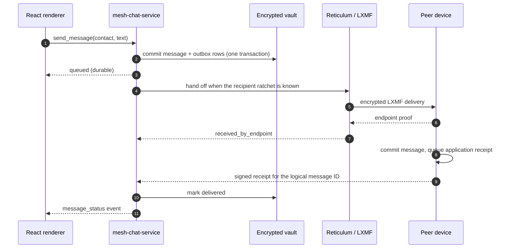

# Mesh Chat

**Server-free, end-to-end encrypted messaging for small groups — built directly on Reticulum and LXMF.**

Mesh Chat is a desktop and mobile messenger with no required account service, signaling service, key directory, hosted relay, or always-on machine. Each installation creates its own Reticulum identity; a message is an ordinary LXMF message addressed to another person's device. The application adds the parts a messenger needs - explicit consent, signed invitations, group and workspace authority, an encrypted local history, and honest delivery evidence. Optional I2P, TURN, and signaling-mailbox infrastructure can be enabled explicitly; none is an authority, message store, or trust decision.

The design accepts real trade-offs. Delivery depends on peers being reachable, history lives only on the devices that received it, and no operator can recover a lost identity. For a small trusted team, that is the point.

An optional **I2P relay path** can bootstrap a workspace or 1:1 connection when neither device has a public endpoint. It is an explicit, consented fallback: the invitation carries one signed `*.b32.i2p` access point, both sides need an I2P router, and the access point relays encrypted Reticulum traffic rather than creating a direct link. I2P is not the default, is not available on Android yet, and does not replace the direct/LAN/access-point paths.

> **Status — security-sensitive prototype.** The source tree is at 0.9.23. It has not been independently audited, and several physical-device and packaging gates are still open. Read [Status and verification](#status-and-verification) before relying on it.

## What problem it solves

Mesh Chat addresses a specific gap: **private small-group messaging without requiring an account provider, signaling service, key directory, hosted relay, or always-on server.**

Reticulum and LXMF already provide identities, routing, and encryption. Mesh Chat adds the messenger/application layer those protocols do not: consent, invitations, group and workspace authority, durable local state, and delivery evidence.

In short, it solves **“how do a few people message and coordinate privately without trusting or paying for a messaging service?”** — while accepting weaker reachability, recovery, and metadata-privacy guarantees than a hosted messenger.

| Problem | What Mesh Chat provides | How it stays server-free |
| --- | --- | --- |
| **Accounts, phone numbers, or a vendor service** | **One-to-one chat.** A signed invitation, a contact request, and an explicit acceptance per person. Every message is one ratchet-encrypted LXMF delivery. | Each installation creates its own Reticulum identity. Both devices talk directly; a receipt means the other app committed the message, not that a person read it. |
| **Unsolicited contact and unclear trust** | **Explicit consent.** Invitations are signed and single-use; the recipient reviews the inviter, fingerprint, and workspace details before approving. | Trust is established peer-to-peer. Delivery never implies approval. |
| **Group chat normally needs a hosted room** | **Private groups.** Up to eight people, owner-signed membership, an announcement-channel mode, and per-recipient delivery state. | One logical message becomes one separately encrypted copy per member. There is no group server and no shared group key. |
| **Workspace collaboration normally needs a server** | **Shared workspaces.** Up to eight people, 32 public/private channels including `#general`, workspace DMs, one-level threads, mentions, edits, deletion tombstones, reactions, local search, and cooperative retention. | One authority-signed manifest chain describes membership; every device receives its own signed copy of each event. |
| **First contact usually needs STUN, TURN, or a rendezvous service** | **Direct Internet invitations.** A temporary listener on the inviter's device asks their router for a mapping, then signs the resulting endpoint and credential into the invitation. | PCP -> UPnP IGD -> NAT-PMP on the participant's router. No rendezvous, STUN, TURN, or Mesh Chat service is contacted. |
| **No public endpoint and no directly reachable access point** | **I2P relay invitations.** A signed `MESHI2P1:` / `MESHI2P1W:` envelope carries one `*.b32.i2p` Reticulum access point; the joiner must consent before traffic is relayed. | Each side runs an I2P router with SAM. The access point relays encrypted Reticulum/LXMF traffic; no public IP or port forward is needed on either participant. |
| **One network path is not enough** | **Explicit fallbacks.** Nearby discovery, signed direct TCP, an operator-run access point, an email/reverse handshake, WebRTC over direct ICE or TURN, and an experimental QUIC underlay. | Each path is a visible choice, never a silent downgrade. See [Reaching another device](#reaching-another-device). |
| **Manual offer/answer copy/paste for WebRTC** | **Optional signaling mailbox.** A signed request/offer/answer rendezvous with rotating pair tokens, role checks, and per-token/per-IP rate limits. | The mailbox holds only transient signed envelopes for ten minutes; it cannot approve contacts or read plaintext. QR/copy still works without it. |
| **Restarting both apps usually means another manual exchange** | **Automatic reconnect with reciprocal consent.** A signed capability carries a rotating mailbox token; the app renegotiates a fresh WebRTC transport while both apps are open. | The mailbox holds the signed envelope, including its ephemeral SDP, only for ten minutes; Mesh Chat never reuses it locally. Contact approval and workspace authority are not touched. |
| **Voice and video usually need a call server** | **1:1 WebRTC calls.** Audio and video use the same direct/TURN policy; signed call documents travel over the existing authenticated contact path. | Media is peer-to-peer DTLS; there is no recording, group call, PSTN bridge, or media store. A consented TURN relay sees IPs and timing, not chat or media plaintext. |
| **Alerts usually require a push provider** | **Local mobile notifications.** Live inbound direct, group, and workspace messages can raise a local notification with an opaque ID, hidden-preview option, and open-time reauthorization. | No push service, token registry, or cloud scheduler. The native plugin raises notifications locally; presenting one never changes delivery or read state. |
| **Cloud chat means cloud-held history and metadata** | **Local-only privacy.** Encrypted vault, sealed local search, no telemetry, analytics, crash upload, CDN, or remote artwork fetch. | Search and history stay on the device; there is no hosted index to query. |
| **Offline peers and unclear delivery** | **Offline-tolerant delivery.** An optional LXMF propagation node stores recipient-encrypted objects until the recipient fetches them. A durable outbox, deduplication, and per-device evidence cover the rest. | The propagation node is separately consented and never becomes an identity, member, or delivery receipt. |
| **Desktop and mobile implementations diverge** | **Desktop and mobile.** Tauri 2 shell with a bundled Python service on desktop; embedded CPython on Android and iOS. | Same Rust/Python/React stack and the same data model, with no platform-specific server. |

### What it deliberately does not solve

- **Universal reachability.** If neither side can accept inbound traffic and no shared path exists, setup fails and says so. It is not a guaranteed NAT-traversal system. I2P helps only when each side can run an I2P router and reach a configured access point; Android does not bundle one yet.
- **Asynchronous delivery without infrastructure.** An offline recipient needs an explicitly approved propagation node; there is no push service.
- **Identity or authority-key recovery.** Lost keys are not recoverable, and lost workspace authority freezes administration.
- **Anonymity.** IP endpoints, timing, and traffic analysis remain exposed; I2P hides participant IP addresses from each other but the access point and the I2P network still see relay metadata. There is no anonymity claim.
- **Broad messenger scope.** Attachments, group calls, discoverable public channels, cloud backup, remote push, and multi-owner membership are out of scope. 1:1 audio/video calls are supported and described below.
- **Background reconnection.** Automatic reconnect runs only while the app is open and unlocked. There is no background daemon, push notification, live session migration, tray keep-alive, or iOS background execution.
- **Production assurance.** The project describes itself as a security-sensitive prototype: it has not been independently audited, and physical-device, packaging, and platform gates remain open. See [Status and verification](#status-and-verification) and [THREAT_MODEL.md](THREAT_MODEL.md).

## Architecture


Diagram source: [docs/architecture/overview.svg](docs/architecture/overview.svg).

The application is four cooperating layers plus the network below them. Reticulum already owns identity, routing, and encryption across very different links, so Mesh Chat does not re-implement any of that: it adds only the application semantics those layers do not provide.

1. **React renderer** - the conversation list, chats, groups, workspaces, threads, search, and settings. It holds UI state, drafts, and the reconnect coordinator that owns every `RTCPeerConnection`. It never receives a private key, the vault key, a filesystem path, or a socket, and it never approves a contact or changes workspace authority.
2. **Tauri 2 shell (Rust)** - the only component allowed to start and stop the messaging service. It retrieves or creates a 32-byte vault key in the operating system's credential store, supplies the app-private profile path, validates every renderer command against a named allowlist and a size limit, and applies a strict content security policy.
3. **`mesh-chat-service` (Python 3.11+)** - the security boundary. It parses and verifies every signed document, owns contact/group/workspace consent, commits state to the vault, runs the outbox and receipt jobs, and hands messages to LXMF only after the local transaction is durable. It also stores per-contact and per-workspace reconnect consent and signed capabilities, admission grants and v2 delegated manifests, workspace call signaling, and the durable replay cache, and publishes or fetches transient signed signaling envelopes with a pair token. It speaks a framed stdin/stdout protocol; there is no localhost HTTP or WebSocket control server.
4. **Reticulum 1.5.5 + LXMF 1.2.0** - the pinned reference stack. Reticulum supplies identities, destinations, paths, Links, and transport; LXMF supplies message serialization plus direct and propagated delivery. Mesh Chat adds no custom cipher, group key, or routing envelope. An optional Reticulum `I2PInterface` can carry the same LXMF traffic over I2P when a local `i2pd` router and an access point are explicitly configured. An optional **community relay** (TURN plus a Reticulum TCP access point) can carry encrypted packets when direct Internet paths fail, and an optional **signaling mailbox** can exchange signed WebRTC rendezvous documents; neither is an authority and neither stores messages.

Automatic reconnect deliberately crosses all four layers. The renderer owns the fresh transport, the service owns consent, signatures, and replay state, and the optional mailbox carries only transient signed envelopes. No layer can substitute for another: a valid signature is not authorization, and the mailbox operator cannot approve a contact.

Underneath them, one **protected profile** holds everything at rest: the sealed vault, Reticulum path/ratchet state, and the LXMF message store. The service verifies OS-level encryption for that directory (and enables NTFS EFS on Windows when needed) and refuses to start if it cannot confirm it — FileVault, fscrypt / dm-crypt / LUKS, or an app-private Android/iOS container.

### Where state lives

All durable application records live in SQLite, but the values are individually sealed: AES-256-GCM on desktop with a fresh nonce and table/record identity as associated data; on mobile, a per-record key derived with HMAC-SHA-256 and RNS's authenticated Token construction. The 32-byte master key is held only in the OS credential store and in service memory. SQLite itself runs in `DELETE` journal mode with `synchronous=FULL`, `temp_store=MEMORY`, and `secure_delete=ON`, so rollback journals contain ciphertext too.

Reconnect profiles, per-contact and per-workspace consent, signed capabilities, attempt state, and replay keys live in the same sealed vault. Reconnect does not persist SDP, ICE credentials, or DTLS keys. Call signaling records store the negotiated SDP and ICE candidates by default so an active call survives a service restart; this can be disabled in **Settings → WebRTC calls → Store call signaling records**, in which case they remain in service memory only. A manually configured TURN credential is sealed in call settings. Broker-issued TURN credentials stay in service memory only.

A mutating command is not acknowledged until its vault transaction commits. That is why retrying a send after a crash reuses the same logical message and operation identifiers instead of creating a duplicate.

## Reaching another device

Reticulum routes packets, but it cannot make an arbitrary NAT accept an inbound connection. Mesh Chat therefore offers several deliberately explicit ways to get the first authenticated path:

| Invitation | Prefix | What it bootstraps | Requirement |
| --- | --- | --- | --- |
| **v1 — nearby** | `MESHCHAT1:` / `MESHWORKSPACE1:` | Reticulum nearby discovery, plus optional signed TCP host/port hints | Both devices on a reachable network |
| **v2 — access point** | `MESHCHAT2:` / `MESHWORKSPACE2:` | Outbound TCP to an explicitly approved operator-run Reticulum transport | A third-party or self-hosted access point |
| **v3 — participant-hosted** | `MESHCHAT3:` / `MESHWORKSPACE3:` | The inviter opens a short-lived, invitation-scoped listener on their device and asks their router to publish it; the signed envelope carries the public endpoints and a fresh Reticulum IFAC credential | Inviter online; router mapping succeeds |
| **v4 — email-ready** | `MESHCHAT4:` / `MESHWORKSPACE4:` | Outbound-first attempt, with an optional signed callback and role reversal if the invitee must host instead | An out-of-band channel to exchange signed documents |
| **I2P relay** | `MESHI2P1:` / `MESHI2P1W:` | A signed outer envelope around the complete inner invitation, carrying one validated `*.b32.i2p` access point, its expiry, and the owner binding | Each side runs an I2P router with SAM; the access point is reachable through I2P |
| **Direct setup** | `mesh-direct:` | Signed offer -> answer -> ready over an experimental QUIC underlay, then an isolated bootstrap interpreter | Both sides can reach each other; physical qualification pending |
| **WebRTC transport** | `meshchat://pair/<code>` (optional) | A signed offer/answer transferred by copy, QR, or the optional signaling mailbox; Reticulum packets then travel over the encrypted DataChannel | ICE reaches a direct pair, or a consented TURN relay is configured |

Accepting an invitation never creates trust by itself. The recipient reviews the inviter, fingerprint, and workspace details, and the request must still be approved. The first contact on a shared path is bounded by invitation expiry, single use, and explicit consent.

Two honest limits follow from having no infrastructure: if neither participant can accept inbound traffic and they share no already-working path, setup fails and says so; and a self-hosted access point or propagation node is a separate deployment, not a Mesh Chat service. See [deploy/remote-access](deploy/remote-access/README.md).

### Optional community relay

Mesh Chat now has an **optional relay** for easier connectivity over the
Internet. It is not a central account, directory, or message store.

- **TURN** relays encrypted WebRTC/DTLS packets for an active call or WebRTC
  onboarding session.
- A **Reticulum TCP access point** can route encrypted Reticulum/LXMF packets
  when no direct path exists.
- Direct/LAN paths are preferred; the relay is a fallback.
- The relay cannot approve contacts or workspace members.
- It sees connection metadata and encrypted traffic, never message plaintext.
- It does not store messages or workspace history.
- Relay failure leaves local state unchanged.
- Users can opt in, opt out, or provide a community/custom relay.

Cloudflare TURN is supported through a small credential broker
([deploy/cloudflare-turn](deploy/cloudflare-turn/README.md)): the long-term
TURN API token stays on the broker, while Mesh Chat receives short-lived
`iceServers` credentials. Self-hosted coturn remains available at
[deploy/relay](deploy/relay/README.md).

In **Settings → WebRTC calls**, users can enter a Cloudflare TURN broker URL,
override the built-in default, or disable the broker. The built-in default is
`https://staether.webtechalex.workers.dev/credentials`; it is **not used until
the user enables relay consent** and can be changed at any time. See
[the community relay spec](docs/COMMUNITY_RELAY_SPEC.md).

### WebRTC and the optional signaling mailbox

WebRTC carries Reticulum packets over an encrypted DataChannel, so a peer with
no inbound path can still message after ICE finds a direct or relayed pair. A
manual flow remains available: create a signed offer, transfer it by copy or QR,
and return a signed answer.

An optional Cloudflare Worker removes that copy/paste for both onboarding and
automatic reconnect:

- One Durable Object per session, a 10-minute TTL, and a 48 KiB cap per signed
  envelope. It stores no messages, contact graph, or history.
- Reconnect documents are a signed `request`, `offer`, and `answer`. They bind
  sender, recipient, device, attempt, session, SDP fingerprint, expiry, and
  signature.
- Reconnect requires a pair capability token, sent as `X-Mesh-Token`. The Worker
  stores only its SHA-256 hash, pins it on first authenticated write, supports
  holder-authorized rotation, and rejects mismatches. The tokenless manual
  onboarding path remains compatible.
- Per-token and per-client-IP rate limits bound abuse. Role and document-type
  matching prevents placing an answer in the offer slot.
- The mailbox cannot approve a contact, workspace member, or device, and never
  sees plaintext. A mailbox URL is configured in **Settings → WebRTC calls**;
  without one the app says **Manual reconnect required** instead of looping.

The same signed capability exchange is what enables automatic reconnect:
capabilities are shared when an invitation is accepted and approved, or over
the authenticated control channel while connected. A capability arriving before
its contact record is held as a signed, expiring document and promoted only
after approval. Tokens rotate with a new signed capability. See
[the automatic reconnect spec](docs/AUTO_RECONNECT_SPEC.md) and
[the mailbox deployment guide](deploy/cloudflare-signal/README.md).

### I2P relay (opt-in)

**I2P is opt-in and not the default.** A normal invitation still starts with nearby/direct/participant-hosted/remote choices. I2P is selected explicitly, and the joiner sees the access point and must consent before traffic is relayed. The access point is a Reticulum `I2PInterface` node addressed by `*.b32.i2p`; it relays encrypted Reticulum/LXMF traffic and does not see message plaintext. Windows bundles and manages `i2pd`; Android has the settings and consent UI but no bundled I2P router yet, so Android cannot complete an I2P join as of 0.9.2.

### 1:1 WebRTC calls

A call is a separate WebRTC session from the Reticulum DataChannel. Signed call
invite, answer, candidate, and hangup documents travel over the existing
authenticated contact path; the media itself is peer-to-peer DTLS-SRTP.
Call restart renegotiates a fresh media session rather than reusing dead ICE.

- Only approved contacts can call; a call never creates or changes trust.
- Call signaling records (SDP and ICE candidates) are stored in the encrypted
  vault by default; **Settings → WebRTC calls → Store call signaling records**
  can keep them in service memory only. Turning it off still allows calls, but
  call history and restart state are lost when the service restarts. Existing
  sealed records are not deleted by the toggle.
- The same direct/TURN policy and relay consent apply. TURN sees IP addresses,
  timing, and encrypted media, never chat or media plaintext.
- No group calls, recording, PSTN bridge, or cloud media store.
- Physical multi-device call, NAT, and TURN qualification remains open; see the
  [WebRTC physical test plan](docs/WEBRTC_PHYSICAL_TEST_PLAN.md).

### Local mobile notifications

Mobile builds with the native notification plugin can raise local notifications
for live inbound direct, group, and workspace messages. The service uses a
durable authorization-first queue, opaque notification IDs, sealed routes,
foreground suppression, an optional hidden preview, native acknowledgement, and
open-time reauthorization. Presenting or tapping a notification never changes
delivery or read state.

There is no cloud push service, device-token registry, or remote notification
scheduler. Android may suspend the embedded runtime, so notification timing is
best effort and no background-delivery guarantee is implied. Physical
permission, lock-screen, tap, and suspension behavior remains unverified; see
[Android parity](docs/ANDROID_PARITY.md).

### Automatic reconnect (open apps only)

After two devices have connected over WebRTC once and exchanged reconnect
capabilities, Mesh Chat can renegotiate a **fresh** WebRTC transport when both
apps are opened again. There is no manual offer/answer copy/paste and no
background daemon.

- Both people must explicitly enable **Reconnect automatically** for that
  contact. Existing contacts default to off, and contact approval alone is not
  consent to reconnect.
- A signed `ConnectionCapabilities` document carries a rotating mailbox pair
  token. The Cloudflare signaling Worker stores only its SHA-256 hash and
  requires it for every reconnect read and write.
- The preferred (lower device ID) side publishes a signed request; the other
  side verifies it, creates the WebRTC offer, and the preferred side answers.
  Only one side probes, so simultaneous starts produce one offer.
- Reconnect never creates or approves a contact, never changes workspace
  authority, and rejects blocked or deleted peers before a peer connection
  exists. Expired, tampered, and replayed documents are rejected, including
  after a restart.
- Consent changes are shared over the authenticated WebRTC control channel.
  If the devices are not connected when a setting changes, the UI says the
  signed settings will be shared on the next live connection.
- With no signaling mailbox, the app reports **Manual reconnect required**
  instead of looping.
- Reconnect only runs while the app is open and unlocked. Locking, quitting, or
  removing consent stops it. Live session migration, push notifications, iOS
  background execution, and an Android foreground service are not implemented.

## Workspaces: authority without a server

A group or workspace is a small signed state machine, not a hosted room:

- A **genesis document** names the workspace, its owner, and the one authority device allowed to sign the next manifest.
- Each **manifest epoch** is hash-linked to its predecessor and normally performs exactly one semantic change: admit a member, deactivate a member, apply a display-name change, update metadata, change a policy, or close. The owner authority signs normal manifests. An accepted, owner-issued admission grant also lets one admin device sign a chained **v2 admission-only** manifest; owner return publishes a v1 `delegation_end` manifest that restores the normal owner-signed chain.
- Each **channel** has its own manager-signed chain of records; a private channel adds a signed roster chain that is delivered only to its members.
- Each **message, edit, deletion, reaction, thread reply, and mention list** is a canonical signed event. It binds its author device, per-device sequence and predecessor, the exact manifest and channel heads it was authorized under, and (for private content) a frozen audience. Events arriving before their controls stay inert in a bounded queue rather than becoming visible.
- **Delivery is per device.** A workspace event is copied to each active recipient device, including the sender's other linked devices. Aggregates count devices ("3 of 4 reached") and never turn one receipt into group-wide proof.
- **Membership is not a route.** Admission bootstraps the joiner to the owner/authority device; ordinary events then need a usable Reticulum path between each sender and recipient device. The owner is not automatically a relay. The workspace **People → Connectivity** panel shows per-device path and delivery state and can request missing paths; a shared access point or approved propagation node is still a separate, consented topology choice. See [Workspace connectivity spec](docs/WORKSPACE_CONNECTIVITY_SPEC.md).
- **Shared access recommendation.** The owner authority can sign a `MESHACCESS1:` recommendation for an approved access point under **Workspace settings → Workspace access point**, then copy it or queue it to active member devices. Members review the operator disclosure and must consent before it is attached to the workspace. A recommendation cannot grant membership or authority, and it does not make the owner a relay.
- **Workspace automatic reconnect.** Each workspace has an explicit, **off-by-default** reconnect consent with a separate direct-IP-disclosure choice. Enabling it exchanges `MESHWSR1` peer capabilities with active member devices and reuses the same opt-in signaling mailbox and WebRTC renegotiation as Personal contacts. It never creates a contact or changes membership/authority, and it runs only while the app is open and unlocked.
- **One-hop connection helper.** An opted-in active workspace device can relay one signed DirectRecovery connection update between two other active devices when both endpoints changed. The helper sees connection endpoints/timing, not chat or authority; forwarding is off by default, audience-bound, one hop only, and the original signed update is still verified by the recipient.
- **Workspace invitation fallbacks.** The invite dialog detects a configured TURN relay and explains that TURN only relays WebRTC, not direct participant hosting; when the direct checks fail, the underlying email-ready invitation remains visible and copyable. The dialog can open WebRTC onboarding to establish a TURN-backed DataChannel before sending the invitation.
- **WebRTC workspace invitations.** With an active WebRTC DataChannel, the owner can create a signed workspace invitation and transfer it over the session control channel. The joiner opens the standard signed join flow; the DataChannel is a transfer path, not trust. Physical transfer qualification remains open.
- **Workspace DM calls.** Workspace direct messages can start 1:1 audio or video calls using the existing call stack and encrypted workspace delivery, without creating a Personal contact. Both devices must be active members; group calls are not supported. Physical call qualification remains open.
- **Bounded retry queues.** 0.9.23 replaces the three-second retry worker’s full decrypted scans of personal and group delivery history with in-memory queues primed once at startup and maintained at commit/terminal state transitions. Each worker tick now reads only outstanding records.
- **Multi-peer WebRTC sessions.** 0.9.21 replaces the single global WebRTC session with a per-peer/device registry. Registering one workspace member no longer closes another member’s bridge, DataChannel, or peer connection, and the reconnect coordinator skips only profiles that already have a live transport. Per-contact reconnect stop closes only that peer’s session.
- **Workspace UX audit fixes.** 0.9.20 makes administrator-at-approval a protocol-compatible two-step admission (member manifest plus owner-signed role change), scopes pending-join snapshots to owners/admins, fixes invitation mode persistence, bounds contact-invitation prompts, and hardens private-mode/local-storage and invitation input handling.
- **Workspace UX streamlining.** 0.9.19 adds a pending-joins inbox with role selection at approval, an explicit invitation-path chooser with per-invitation delivery state, and a dismissible workspace setup checklist. Delegated admission grants cannot create administrators.
- **Verified-contact workspace invitations.** 0.9.18 adds a **Verified contacts** section to **Invite people**. It sends the normal single-use signed workspace invitation over an existing approved/verified contact route, while preserving recipient review, signed join, and owner/admin approval. The recipient sees a review banner, not an automatic membership change.
- **Admission hardening.** 0.9.16 rejects delegated manifests whose grant was not signed by the current workspace authority, rebinds forwarded pending-join IDs correctly, closes the owner's pending request/invitation after v2 admission, always publishes a revocation head, and scopes workspace call signaling to its workspace.
- **Owner-offline admission grants.** 0.9.8 added the signed grant/acceptance and full v2 delegated-manifest protocol verifier. 0.9.9 added owner grant issuance, admin acceptance, and grant visibility. 0.9.10 added backend admin admission, pending-request forwarding, and v2 manifest delivery/application. 0.9.11 added the Workspace settings grant/admission UI: owners create a grant, the selected admin accepts it, and an admin with an accepted grant can approve pending joins. 0.9.12 added owner revocation. 0.9.13 added owner-return normalization to a fresh v1 manifest. 0.9.15 added signed-history conflict details/local removal and a v2-support gate before grant issuance. The owner must forward a pending join request before going offline; a brand-new join sent only to an offline owner cannot reach the admin. Automatic fork merging and retroactive pre-v2 enforcement are intentionally not provided; physical qualification remains open.

Roles are operational, not co-authority: administrators can create and post under an `owner_and_admins` policy and manage channels whose signing key they hold, but only the owner's authority device can change membership, policy, retention, or ownership. The exception is an explicit, owner-issued, accepted admission grant: it lets one admin device admit pending joins through admission-only v2 manifests while the owner is offline. It cannot remove members, change roles/policy/retention, transfer ownership, or move authority. Authority can be rotated to another device of the same owner, or transferred to a named member with that member's countersignature. If the authority key is permanently lost, ordinary chat keeps working and administration freezes - the app explains the replacement-workspace path instead of pretending to recover.

## Message lifecycle



The UI reports evidence, not optimism:

| State | What it means |
| --- | --- |
| `waiting_for_keys` | Stored locally as ciphertext, but the recipient's current ratchet is not known yet. |
| `queued` | Durable and waiting for a route, retry, or a consent-dependent action. |
| `sending` | Handed to LXMF; the recipient has not committed it yet. |
| `stored_for_delivery` | An LXMF propagation node accepted the recipient-encrypted object. Not a receipt. |
| `received_by_endpoint` | Native transport proof that the recipient device received a copy. |
| `delivered` | The recipient's app committed the message and returned a signed application receipt. |
| `expired` / `failed` / `cancelled` | The seven-day live window ended, validation failed, or the recipient left before the leg completed. |

Receipts are ordinary end-to-end encrypted LXMF messages. They are never acknowledged themselves, and a propagation node's acceptance is never displayed as human read state.

## Security model

| Component | Owns | Must not own |
| --- | --- | --- |
| React renderer | Presentation, in-memory drafts, validated view models, the reconnect coordinator and its `RTCPeerConnection` | Vault key, private identity, paths, process launch, arbitrary navigation, contact approval |
| Tauri shell | Credential entry, profile path, IPC validation, process and deep-link lifetime | Routing, message encryption, chat persistence |
| Android/iOS plugin | Embedded CPython lifecycle, app-private path, Keystore/Keychain access | Renderer data, contact policy, routing decisions |
| Python service | Identity, consent, durable state, reconnect profiles/capabilities/replay, Reticulum/LXMF integration | OS credential lookup, arbitrary commands, remote control |
| Optional signaling mailbox | Pair-token hash, transient signed request/offer/answer envelopes, TTL and rate limits | Message plaintext, contact/workspace trust, message history, enumeration from public hashes |
| WebRTC transport / TURN relay | Ephemeral DTLS/ICE and encrypted DataChannel packets | Persisting SDP, ICE credentials, or DTLS keys on the relay; consent decisions; message plaintext |
| Reticulum / LXMF | Paths, Links, transport, wire format, encryption | Contact trust, membership, durable-delivery claims |
| I2P router / access point | I2P tunnels, relay forwarding, connection metadata | Message plaintext, contact trust, membership, delivery receipts |

The wire uses native RNS identities and destination encryption with ratchets enforced before any send. Invitations are re-derived and signature-checked; a destination that does not match the embedded identity is rejected. Every inbound message must pass native signature validation, exact destination matching, schema validation, expiry checks, and a trust-policy check before it enters the vault. Unknown senders may only create a bounded pending contact request; a workspace has exactly one unknown-source exception: a fully verified join.

Reconnect documents are authorized separately from message delivery: the signer must be an approved, non-blocked contact **or a current active workspace device**; the recipient and device must match this installation; reciprocal consent must exist; and the durable replay key must be unused. Those checks happen before any `RTCPeerConnection` is allocated. A transport or mailbox failure never changes trust.

The threat model is explicit about what is *not* protected: traffic analysis, IP endpoints and timing, propagation-node metadata, a compromised unlocked endpoint, and content already delivered to another member. There is no anonymity claim, no remote-erasure promise, and no recovery after permanent authority-key loss. Read [THREAT_MODEL.md](THREAT_MODEL.md) for the full list of adversaries, controls, and residual risks.

## Limits

| Limit | Value |
| --- | --- |
| Workspaces per profile | 16 |
| People per workspace | 8 (including owner) |
| Linked devices per member | 3 |
| Active workspace destinations | 24 per workspace |
| Active channels per workspace | 32 (including `#general`) |
| People per private group / announcement channel | 8 |
| Message text | 16 KiB UTF-8 |
| Live delivery and deduplication window | 7 days |
| Default cooperative retention | 90 days (30 / 90 / 365 / indefinite) |
| Local search | Exact tokens; 25 results by default, 50 maximum |
| IPC frame / renderer payload | 4 MiB / 32 KiB default |
| Signaling mailbox TTL / envelope cap | 10 minutes / 48 KiB |
| Mailbox rate limits | 30 writes and 120 reads per token per minute; 120 and 480 per client IP |
| Reconnect capability / document expiry | 7 days / 1 hour maximum |
| Reconnect concurrency / backoff | 2 concurrent attempts; 1/2/5/15/30/60 s jittered, capped at 60 s |
| Reconnect attempt budget | Bounded per profile; stopped by the user, consent removal, block/deletion, capability rejection, or expiry |
| Reconnect window | While the app is open and unlocked only; mailbox envelopes expire after 10 minutes |
| Optional propagation cache (client) | 100 MiB |
| I2P access points per device | 4 |
| Managed I2P router | Local `i2pd` with SAM on `127.0.0.1:7656`; low-bandwidth, no transit, no web console/proxies |
| Attachments, group calls, discoverable public channels, push notifications | Not supported |
| 1:1 calls | WebRTC audio/video over direct ICE or a consented TURN relay; no group calls, recording, or PSTN |
| Call signaling records | Stored in the encrypted vault by default; optional memory-only mode (no SDP/ICE persistence) |

## Status and verification

| Platform | What exists | Recorded verification |
| --- | --- | --- |
| Windows x64 | MSI and NSIS installers, standalone executable plus service sidecar, bundled/managed `i2pd`, I2P invitation and consent UI, 1:1 audio/video call surface, automatic reconnect UI | 0.9.23 published; CI tests/build passed; installer launch and device testing not performed |
| Android arm64 | Debug APK, plus release/AAB signing path; I2P settings and invitation preview, 1:1 audio/video call surface, automatic reconnect UI | Debug-signed 0.9.23 release APK published; no bundled I2P router; no physical call or reconnect test in the recorded run |
| macOS | Build path, FileVault adapter | No package built or run in this repository |
| Linux | Build path, fscrypt/dm-crypt adapters | No package built or run in this repository |
| iOS | Plugin and build script | Requires macOS and Xcode; not built or run in this repository |

Automated verification is substantial: Python, Vitest, Worker, and Rust suites, plus opt-in real-stack harnesses - a four-process A -> B -> C -> D Reticulum/LXMF topology, a two-process direct-LAN harness, a three-process remote-access harness, a packaged-sidecar harness, and QUIC fabric/recovery runs in CI. The recorded evidence, exact hashes, and per-version notes are in [TESTING.md](TESTING.md).

Still open: physical Windows and Android runs, real router/NAT and cellular traversal, physical multi-device calls, propagation independence, crash-injection matrices, hostile-input fuzzing, accessibility review, macOS/Linux/iOS packages, and an independent security review. Automatic reconnect has automated coverage only: no two-device restart, NAT/TURN, Android/iOS lifecycle, or battery/backoff test was performed on hardware. CI passing is not a substitute for those gates.

## Repository map

| Path | Contents |
| --- | --- |
| [`service/src/mesh_chat/`](service/src/mesh_chat/) | Protocol documents, vault, RNS/LXMF adapters, I2P router/invitation support, reconnect profiles/capabilities/signaling, personal/group/workspace/remote services |
| [`service/src/mesh_chat/reconnect.py`](service/src/mesh_chat/reconnect.py), [`reconnect_service.py`](service/src/mesh_chat/reconnect_service.py) | Signed reconnect request/offer/answer, capability verification, per-contact consent, durable replay, mailbox commands |
| [`src/`](src/) | React messenger interface; no identity or vault access |
| [`src/reconnect-coordinator.ts`](src/reconnect-coordinator.ts), [`src/reconnect-runtime.ts`](src/reconnect-runtime.ts), [`src/ReconnectSettings.tsx`](src/ReconnectSettings.tsx) | Renderer-owned RTCPeerConnection coordinator, production wiring, and per-contact consent/status UI |
| [`src-tauri/`](src-tauri/) | Rust shell: command allowlist, IPC, sidecar lifecycle, CSP, deep links |
| [`vendor/`](vendor/) | Bundled Windows `i2pd` binary and its BSD-3-Clause license |
| [`plugins/tauri-plugin-mesh-runtime/`](plugins/tauri-plugin-mesh-runtime/) | Android/iOS embedded-Python bridge and native device key storage |
| [`experiments/direct-fabric/`](experiments/direct-fabric/) | Rust QUIC underlay proof used by the direct-setup path |
| [`deploy/cloudflare-signal/`](deploy/cloudflare-signal/) | Optional Worker + Durable Object signaling mailbox: pair-token auth, request/offer/answer roles, rate limits, and tests |
| [`deploy/cloudflare-turn/`](deploy/cloudflare-turn/) | Short-lived TURN credential broker; the long-term API token stays server-side |
| [`deploy/remote-access/`](deploy/remote-access/) | Example self-hosted Reticulum transport and LXMF propagation host |
| [`deploy/turn/`](deploy/turn/) | Example self-hosted coturn relay for cross-network WebRTC calls |
| [`docs/architecture/`](docs/architecture/) | Architecture diagram as editable SVG source plus the rendered PNG |
| [`scripts/`](scripts/) | Build, packaging, release, and verification drivers |
| [`docs/adr/`](docs/adr/) | Twenty-three architecture decision records |
| [`service/tests/`](service/tests/) | Unit, integration, and opt-in real-stack harnesses |

## Build and test

Prerequisites: Node.js 20+, pnpm 11.25.0, Python 3.11-3.14, Rust 1.90+, and the [Tauri 2 platform prerequisites](https://v2.tauri.app/start/prerequisites/).

```sh
python -m venv .venv
. .venv/bin/activate                      # Windows: .\.venv\Scripts\activate
python -m pip install -r service/requirements-dev.lock
pnpm install --frozen-lockfile

python scripts/test.py                    # Python + frontend + Worker + artwork + typecheck + build
node --test deploy/cloudflare-signal/worker.test.mjs   # mailbox tests on their own
python scripts/release.py build --platform all
```

Desktop installers must be built on their target operating system. Android builds on Windows, macOS, or Linux; iOS requires macOS with Xcode. Development packages are not code-signed.

## Documentation

| Document | Why read it |
| --- | --- |
| [ARCHITECTURE.md](ARCHITECTURE.md) | Component boundaries, signaling/reconnect internals, workspace internals, persistence, crash consistency |
| [PROTOCOL.md](PROTOCOL.md) | Exact signed documents, LXMF fields, limits, delivery evidence |
| [WORKSPACE_SPEC.md](WORKSPACE_SPEC.md) | Product scope, roles, requirements, and release gates for workspaces |
| [docs/WORKSPACE_UX_STREAMLINING.md](docs/WORKSPACE_UX_STREAMLINING.md) | Pending-joins inbox, role-at-approval, invitation chooser, delivery status, setup checklist |
| [docs/WEBRTC_MULTI_SESSION.md](docs/WEBRTC_MULTI_SESSION.md) | Per-peer WebRTC session registry, cleanup, and reconnect concurrency |
| [docs/CONTACT_WORKSPACE_INVITATIONS.md](docs/CONTACT_WORKSPACE_INVITATIONS.md) | Verified-contact workspace invitation delivery, prompt, and consent boundaries |
| [docs/WORKSPACE_CONNECTIVITY_SPEC.md](docs/WORKSPACE_CONNECTIVITY_SPEC.md) | Workspace reachability, signed access recommendations, scoped reconnect, and the one-hop helper |
| [docs/PHYSICAL_QA_SCENARIOS.md](docs/PHYSICAL_QA_SCENARIOS.md) | Physical-device scenarios and evidence gates for reconnect, helper, owner-offline admission, calls, WebRTC invitations, Android, and packaging |
| [THREAT_MODEL.md](THREAT_MODEL.md) | Adversaries, controls, metadata leakage, and open security blockers |
| [TESTING.md](TESTING.md) | Recorded verification, acceptance matrix, and exact artifact evidence |
| [docs/RELEASES.md](docs/RELEASES.md) | Release-by-release notes and installation history for earlier versions |
| [docs/adr/](docs/adr/) | Why the stack, IPC, groups, workspaces, retention, and connectivity work this way |
| [Direct connectivity roadmap](docs/DIRECT_CONNECTIVITY_ROADMAP.md) | Invitation bootstrap, traversal, recovery phases, and qualification status |
| [I2P support specification](docs/I2P_SUPPORT_SPEC.md) | I2P access-point architecture, Windows/Android roadmap, consent, and limits |
| [WebRTC adapter roadmap](docs/WEBRTC_ADAPTER_SPEC.md) | DataChannel connection bootstrap, STUN/TURN policy, 1:1 call increments, and decision gates |
| [C5 DataChannel bridge spec](docs/C5_DATACHANNEL_BRIDGE_SPEC.md) | Reticulum-over-DataChannel bridge, IPC, signaling, onboarding, and TURN policy |
| [Relay deployment](deploy/relay/README.md) | One-command TURN relay with TCP/UDP 443, credentials, and VPS hardening |
| [Cloudflare TURN broker](deploy/cloudflare-turn/README.md) | Short-lived Cloudflare TURN credentials without shipping the API token |
| [Cloudflare signaling mailbox](deploy/cloudflare-signal/README.md) | Optional 10-minute signed request/offer/answer mailbox with pair tokens, rotation, rate limits, and tests |
| [Community relay spec](docs/COMMUNITY_RELAY_SPEC.md) | Opt-in default/community relays, TURN + Reticulum access point, consent, failover, and no central store |
| [Connection UX architecture](docs/CONNECTION_UX_ARCHITECTURE.md) | Unified connection object, transport/signaling adapters, inline relay consent, and approval UX |
| [Automatic reconnect spec](docs/AUTO_RECONNECT_SPEC.md) | Independent rendezvous, capabilities, consent, glare control, mailbox hardening, and lifecycle policy |
| [WebRTC physical test plan](docs/WEBRTC_PHYSICAL_TEST_PLAN.md) | Windows/Android call, TURN, foreground-service, and privacy qualification matrix |
| [docs/ANDROID_PARITY.md](docs/ANDROID_PARITY.md) | Android capability status and the physical test matrix |
| [deploy/remote-access](deploy/remote-access/README.md) | Running an access point or propagation node without becoming a Mesh Chat service |
| [deploy/turn](deploy/turn/README.md) | Self-hosted coturn relay and quota boundary for cross-network calls |

Third-party artwork, emoji data, and their licenses are listed in [THIRD_PARTY_NOTICES.md](THIRD_PARTY_NOTICES.md).

## License

Mesh Chat is released under the [MIT License](LICENSE). Third-party artwork and data remain under their own licenses, listed in [THIRD_PARTY_NOTICES.md](THIRD_PARTY_NOTICES.md); the bundled Reticulum, LXMF, Python, and JavaScript dependencies keep their upstream licenses. The license does not grant rights to the Mesh Chat name or logo.


