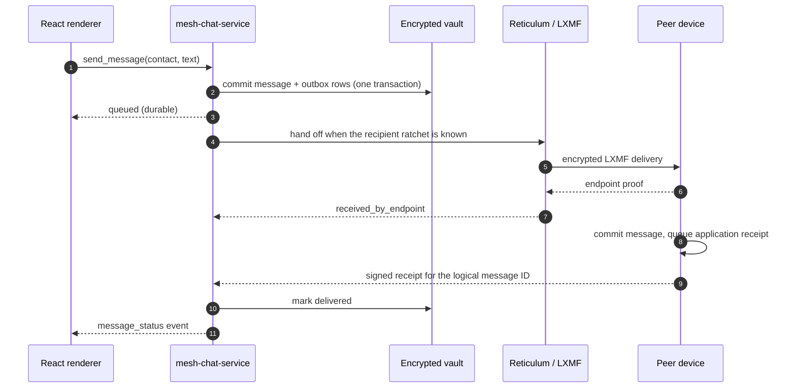

# Mesh Chat

**Server-free, end-to-end encrypted messaging for small groups — built directly on Reticulum and LXMF.**

Mesh Chat is a desktop and mobile messenger with no account service, no signaling service, no key directory, no hosted relay, and no required always-on machine. Each installation creates its own Reticulum identity; a message is an ordinary LXMF message addressed to another person's device. The application adds the parts a messenger needs — explicit consent, signed invitations, group and workspace authority, an encrypted local history, and honest delivery evidence.

The design accepts real trade-offs. Delivery depends on peers being reachable, history lives only on the devices that received it, and no operator can recover a lost identity. For a small trusted team, that is the point.

> **Status — security-sensitive prototype.** The source tree is at 0.2.63. It has not been independently audited, and several physical-device and packaging gates are still open. Read [Status and verification](#status-and-verification) before relying on it.

## What it enables

| Capability | What you get | How it stays server-free |
| --- | --- | --- |
| **One-to-one chat** | A signed invitation, a contact request, and an explicit acceptance per person. Every message is one ratchet-encrypted LXMF delivery. | Both devices talk directly; a receipt means the other app committed the message, not that a person read it. |
| **Private groups** | Up to eight people, owner-signed membership, an announcement-channel mode, per-recipient delivery state. | One logical message becomes one separately encrypted copy per member. There is no group server and no shared group key. |
| **Shared workspaces** | Up to eight people, 32 public/private channels including `#general`, workspace DMs, one-level threads, mentions, edits, deletion tombstones, reactions, local search, and cooperative retention. | One authority-signed manifest chain describes membership; every device receives its own signed copy of each event. |
| **First contact over the Internet** | A default "direct to this device" invitation opens a temporary listener on the inviter's device, asks their router for a mapping, and signs the resulting endpoint and credential into the invitation. | PCP → UPnP IGD → NAT-PMP on the participant's router. No rendezvous, STUN, TURN, or Mesh Chat service is contacted. |
| **Explicit fallback paths** | Nearby discovery, signed direct TCP, an operator-run access point, an email/reverse handshake, and an experimental QUIC underlay. | Each path is a visible choice, never a silent downgrade. See [Reaching another device](#reaching-another-device). |
| **Offline-tolerant delivery** | An optional LXMF propagation node stores recipient-encrypted objects until the recipient fetches them. | The node is separately consented and never becomes an identity, member, or delivery receipt. |
| **Local-only privacy** | Encrypted vault, sealed local search, no telemetry, no analytics, no crash upload, no CDN or remote artwork fetch. | Search and history stay on the device; there is no hosted index to query. |
| **Desktop and mobile** | Tauri 2 shell with a bundled Python service on desktop; embedded CPython on Android and iOS. | Same Rust/Python/React stack and the same data model, with no platform-specific server. |

Attachments, calls, discoverable public channels, cloud backup, remote push, and multi-owner membership are deliberately out of scope in this increment.

## Architecture


The application is four cooperating layers plus the network below them. Reticulum already owns identity, routing, and encryption across very different links, so Mesh Chat does not re-implement any of that: it adds only the application semantics those layers do not provide.

1. **React renderer** — the conversation list, chats, groups, workspaces, threads, search, and settings. It holds UI state and drafts only. It never receives a private key, the vault key, a filesystem path, or a socket.
2. **Tauri 2 shell (Rust)** — the only component allowed to start and stop the messaging service. It retrieves or creates a 32-byte vault key in the operating system's credential store, supplies the app-private profile path, validates every renderer command against a named allowlist and a size limit, and applies a strict content security policy.
3. **`mesh-chat-service` (Python 3.11+)** — the security boundary. It parses and verifies every signed document, owns contact/group/workspace consent, commits state to the vault, runs the outbox and receipt jobs, and hands messages to LXMF only after the local transaction is durable. It speaks a framed stdin/stdout protocol; there is no localhost HTTP or WebSocket control server.
4. **Reticulum 1.5.5 + LXMF 1.2.0** — the pinned reference stack. Reticulum supplies identities, destinations, paths, Links, and transport; LXMF supplies message serialization plus direct and propagated delivery. Mesh Chat adds no custom cipher, group key, or routing envelope.

Underneath them, one **protected profile** holds everything at rest: the sealed vault, Reticulum path/ratchet state, and the LXMF message store. The service verifies OS-level encryption for that directory (and enables NTFS EFS on Windows when needed) and refuses to start if it cannot confirm it — FileVault, fscrypt / dm-crypt / LUKS, or an app-private Android/iOS container.

### Where state lives

All durable application records live in SQLite, but the values are individually sealed: AES-256-GCM on desktop with a fresh nonce and table/record identity as associated data; on mobile, a per-record key derived with HMAC-SHA-256 and RNS's authenticated Token construction. The 32-byte master key is held only in the OS credential store and in service memory. SQLite itself runs in `DELETE` journal mode with `synchronous=FULL`, `temp_store=MEMORY`, and `secure_delete=ON`, so rollback journals contain ciphertext too.

A mutating command is not acknowledged until its vault transaction commits. That is why retrying a send after a crash reuses the same logical message and operation identifiers instead of creating a duplicate.

## Reaching another device

Reticulum routes packets, but it cannot make an arbitrary NAT accept an inbound connection. Mesh Chat therefore offers several deliberately explicit ways to get the first authenticated path:

| Invitation | Prefix | What it bootstraps | Requirement |
| --- | --- | --- | --- |
| **v1 — nearby** | `MESHCHAT1:` / `MESHWORKSPACE1:` | Reticulum nearby discovery, plus optional signed TCP host/port hints | Both devices on a reachable network |
| **v2 — access point** | `MESHCHAT2:` / `MESHWORKSPACE2:` | Outbound TCP to an explicitly approved operator-run Reticulum transport | A third-party or self-hosted access point |
| **v3 — participant-hosted** | `MESHCHAT3:` / `MESHWORKSPACE3:` | The inviter opens a short-lived, invitation-scoped listener on their device and asks their router to publish it; the signed envelope carries the public endpoints and a fresh Reticulum IFAC credential | Inviter online; router mapping succeeds |
| **v4 — email-ready** | `MESHCHAT4:` / `MESHWORKSPACE4:` | Outbound-first attempt, with an optional signed callback and role reversal if the invitee must host instead | An out-of-band channel to exchange signed documents |
| **Direct setup** | `mesh-direct:` | Signed Offer → Answer → Ready over an experimental QUIC underlay, then an isolated bootstrap interpreter | Both sides can reach each other; physical qualification pending |

Accepting an invitation never creates trust by itself. The recipient reviews the inviter, fingerprint, and workspace details, and the request must still be approved. The first contact on a shared path is bounded by invitation expiry, single use, and explicit consent.

Two honest limits follow from having no infrastructure: if neither participant can accept inbound traffic and they share no already-working path, setup fails and says so; and a self-hosted access point or propagation node is a separate deployment, not a Mesh Chat service. See [deploy/remote-access](deploy/remote-access/README.md).

## Workspaces: authority without a server

A group or workspace is a small signed state machine, not a hosted room:

- A **genesis document** names the workspace, its owner, and the one authority device allowed to sign the next manifest.
- Each **manifest epoch** is hash-linked to its predecessor and performs exactly one change: admit a member, deactivate a member, apply a display-name change, update metadata, change a policy, or close. Only the authority device signs it.
- Each **channel** has its own manager-signed chain of records; a private channel adds a signed roster chain that is delivered only to its members.
- Each **message, edit, deletion, reaction, thread reply, and mention list** is a canonical signed event. It binds its author device, per-device sequence and predecessor, the exact manifest and channel heads it was authorized under, and (for private content) a frozen audience. Events arriving before their controls stay inert in a bounded queue rather than becoming visible.
- **Delivery is per device.** A workspace event is copied to each active recipient device, including the sender's other linked devices. Aggregates count devices ("3 of 4 reached") and never turn one receipt into group-wide proof.

Roles are operational, not co-authority: administrators can create and post under an `owner_and_admins` policy and manage channels whose signing key they hold, but only the owner's authority device can change membership, policy, retention, or ownership. Authority can be rotated to another device of the same owner, or transferred to a named member with that member's countersignature. If the authority key is permanently lost, ordinary chat keeps working and administration freezes — the app explains the replacement-workspace path instead of pretending to recover.

## Message lifecycle



The UI reports evidence, not optimism:

| State | What it means |
| --- | --- |
| `waiting_for_keys` | Stored locally as ciphertext, but the recipient's current ratchet is not known yet. |
| `queued` | Durable and waiting for a route, retry, or a consent-dependent action. |
| `sending` | Handed to LXMF; the recipient has not committed it yet. |
| `stored_for_delivery` | An LXMF propagation node accepted the recipient-encrypted object. Not a receipt. |
| `received_by_endpoint` | Native transport proof that the recipient device received a copy. |
| `delivered` | The recipient's app committed the message and returned a signed application receipt. |
| `expired` / `failed` / `cancelled` | The seven-day live window ended, validation failed, or the recipient left before the leg completed. |

Receipts are ordinary end-to-end encrypted LXMF messages. They are never acknowledged themselves, and a propagation node's acceptance is never displayed as human read state.

## Security model

| Component | Owns | Must not own |
| --- | --- | --- |
| React renderer | Presentation, in-memory drafts, validated view models | Vault key, private identity, paths, process launch, arbitrary navigation |
| Tauri shell | Credential entry, profile path, IPC validation, process and deep-link lifetime | Routing, message encryption, chat persistence |
| Android/iOS plugin | Embedded CPython lifecycle, app-private path, Keystore/Keychain access | Renderer data, contact policy, routing decisions |
| Python service | Identity, consent, durable state, Reticulum/LXMF integration | OS credential lookup, arbitrary commands, remote control |
| Reticulum / LXMF | Paths, Links, transport, wire format, encryption | Contact trust, membership, durable-delivery claims |

The wire uses native RNS identities and destination encryption with ratchets enforced before any send. Invitations are re-derived and signature-checked; a destination that does not match the embedded identity is rejected. Every inbound message must pass native signature validation, exact destination matching, schema validation, expiry checks, and a trust-policy check before it enters the vault. Unknown senders may only create a bounded pending contact request; a workspace has exactly one unknown-source exception — a fully verified join.

The threat model is explicit about what is *not* protected: traffic analysis, IP endpoints and timing, propagation-node metadata, a compromised unlocked endpoint, and content already delivered to another member. There is no anonymity claim, no remote-erasure promise, and no recovery after permanent authority-key loss. Read [THREAT_MODEL.md](THREAT_MODEL.md) for the full list of adversaries, controls, and residual risks.

## Limits

| Limit | Value |
| --- | --- |
| Workspaces per profile | 16 |
| People per workspace | 8 (including owner) |
| Linked devices per member | 3 |
| Active workspace destinations | 24 per workspace |
| Active channels per workspace | 32 (including `#general`) |
| People per private group / announcement channel | 8 |
| Message text | 16 KiB UTF-8 |
| Live delivery and deduplication window | 7 days |
| Default cooperative retention | 90 days (30 / 90 / 365 / indefinite) |
| Local search | Exact tokens; 25 results by default, 50 maximum |
| IPC frame / renderer payload | 4 MiB / 32 KiB default |
| Optional propagation cache (client) | 100 MiB |
| Attachments, calls, public channels, push notifications | Not supported |

## Status and verification

| Platform | What exists | Recorded verification |
| --- | --- | --- |
| Windows x64 | MSI and NSIS installers, standalone executable plus service sidecar | Built, hashed, and version-matched; the recorded verification did not launch the installer |
| Android arm64 | Debug APK, plus release/AAB signing path | Built and package-inspected (signature, manifest, assets); no device was attached in the recorded run |
| macOS | Build path, FileVault adapter | No package built or run in this repository |
| Linux | Build path, fscrypt/dm-crypt adapters | No package built or run in this repository |
| iOS | Plugin and build script | Requires macOS and Xcode; not built or run in this repository |

Automated verification is substantial: Python, Vitest, and Rust suites, plus opt-in real-stack harnesses — a four-process A→B→C→D Reticulum/LXMF topology, a two-process direct-LAN harness, a three-process remote-access harness, a packaged-sidecar harness, and QUIC fabric/recovery runs in CI. The recorded evidence, exact hashes, and per-version notes are in [TESTING.md](TESTING.md).

Still open: physical Windows↔Android runs, real router/NAT and cellular traversal, propagation independence, crash-injection matrices, hostile-input fuzzing, accessibility review, macOS/Linux/iOS packages, and an independent security review. CI passing is not a substitute for those gates.

## Repository map

| Path | Contents |
| --- | --- |
| [`service/src/mesh_chat/`](service/src/mesh_chat/) | Protocol documents, vault, RNS/LXMF adapters, personal/group/workspace/remote services |
| [`src/`](src/) | React messenger interface; no identity or vault access |
| [`src-tauri/`](src-tauri/) | Rust shell: command allowlist, IPC, sidecar lifecycle, CSP, deep links |
| [`plugins/tauri-plugin-mesh-runtime/`](plugins/tauri-plugin-mesh-runtime/) | Android/iOS embedded-Python bridge and native device key storage |
| [`experiments/direct-fabric/`](experiments/direct-fabric/) | Rust QUIC underlay proof used by the direct-setup path |
| [`deploy/remote-access/`](deploy/remote-access/) | Example self-hosted Reticulum transport and LXMF propagation host |
| [`scripts/`](scripts/) | Build, packaging, release, and verification drivers |
| [`docs/adr/`](docs/adr/) | Nineteen architecture decision records |
| [`service/tests/`](service/tests/) | Unit, integration, and opt-in real-stack harnesses |

## Build and test

Prerequisites: Node.js 20+, pnpm 11.25.0, Python 3.11–3.14, Rust 1.77.2+, and the [Tauri 2 platform prerequisites](https://v2.tauri.app/start/prerequisites/).

```sh
python -m venv .venv
. .venv/bin/activate                      # Windows: .\.venv\Scripts\activate
python -m pip install -r service/requirements-dev.lock
pnpm install --frozen-lockfile

python scripts/test.py                    # Python + frontend + artwork + typecheck + build
python scripts/release.py build --platform all
```

Desktop installers must be built on their target operating system. Android builds on Windows, macOS, or Linux; iOS requires macOS with Xcode. Development packages are not code-signed.

## Documentation

| Document | Why read it |
| --- | --- |
| [ARCHITECTURE.md](ARCHITECTURE.md) | Component boundaries, workspace internals, persistence, crash consistency |
| [PROTOCOL.md](PROTOCOL.md) | Exact signed documents, LXMF fields, limits, delivery evidence |
| [WORKSPACE_SPEC.md](WORKSPACE_SPEC.md) | Product scope, roles, requirements, and release gates for workspaces |
| [THREAT_MODEL.md](THREAT_MODEL.md) | Adversaries, controls, metadata leakage, and open security blockers |
| [TESTING.md](TESTING.md) | Recorded verification, acceptance matrix, and exact artifact evidence |
| [docs/RELEASES.md](docs/RELEASES.md) | Release-by-release notes and installation history for earlier versions |
| [docs/adr/](docs/adr/) | Why the stack, IPC, groups, workspaces, retention, and connectivity work this way |
| [Direct connectivity roadmap](docs/DIRECT_CONNECTIVITY_ROADMAP.md) | Invitation bootstrap, traversal, recovery phases, and qualification status |
| [docs/ANDROID_PARITY.md](docs/ANDROID_PARITY.md) | Android capability status and the physical test matrix |
| [deploy/remote-access](deploy/remote-access/README.md) | Running an access point or propagation node without becoming a Mesh Chat service |

Third-party artwork, emoji data, and their licenses are listed in [THIRD_PARTY_NOTICES.md](THIRD_PARTY_NOTICES.md). The repository does not currently include a license file.
