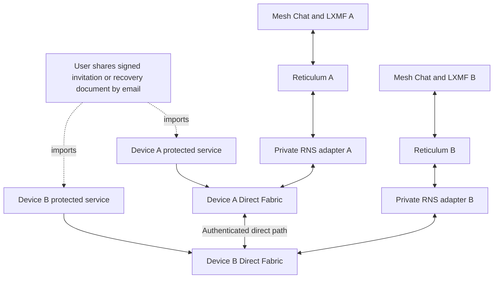

# Durable direct connectivity architecture and roadmap

Status: implementation in progress. Date: 2026-10-15; updated 2026-10-16. Scope: Windows and Android first; iOS follows physical-device validation.

### Implementation evidence, 2026-10-16

Phase 0 is implemented in shared service/renderer code: an authority-signed
`workspace_join_receipt` binds the exact saved join and delivery UUID; owner
request/receipt storage is atomic; route work follows durable join/intent
storage; retries and upgrade/restart preserve the original request; only verified
application receipt displays waiting for approval. Source tests include forged
and misbound receipts, duplicates, lost replies, expiry, revocation, restart,
upgrade and approval. The real RNS/LXMF source harness received the acknowledgment
before approval. Existing import normalization remains shared across text,
file, deep link and QR.

Phase 1 has [ADR 0018](adr/0018-authenticated-direct-underlay.md), a bounded
protocol design, an isolated Quinn/Rustls feasibility crate with a committed
lockfile, a stock UDP boundary probe, and Windows/Linux/Android GitHub jobs.
The service now has an isolated RNS-signed transport-binding verifier with strict
canonical parsing, exact local scope/peer/certificate authorization, bounded
numeric candidates and validity, and monotonic replay checks. Its source tests
pass. A cross-language CI proof gives only native public certificates to Python
for RNS authorization before mutual TLS and a DATAGRAM exchange. The native
jobs now pass on Windows and Linux, including the real QUIC/LXMF topology, and
Android ARM64 cross-compilation passes. See the
[successful owned-socket proof run](https://github.com/ahouchens/mesh-chat/actions/runs/38854581893)
at `cbcf659`. The crate is not linked into the app;
production binding authorization/lifecycle integration, the private runtime control channel, and a qualified
production Reticulum adapter remain open. A socket-free adapter proof now uses
bounded inherited packet channels, rejects retired/cross-peer callbacks, and
requires an isolated non-routing RNS context for pending bootstrap. Its source
topology passed signed join acknowledgment before approval, admission, fresh
workspace-scoped credential rotation, bidirectional LXMF messages, ratchets,
endpoint receipts, and offline state after carrier death. The GitHub workflow
now builds a native QUIC packet bridge and runs that same topology through it;
this native variant passes on both desktop CI platforms. The adapter filters exact RNS
destinations and path requests, bounds Link/receipt tracking, and uses a shared
profile session/adapter-queue budget. The source topology passes with those
checks enabled. **Phase 1 is not complete. Phase 2 has UDP mapping groundwork;
phases 3–5 remain unimplemented.** Native embedding, new email controls, traversal, durable
Direct Fabric relationships, optional helpers, and physical release qualification
remain open. Existing TCP routes/reconnect updates remain available.

The existing router-mapping layer now supports explicit TCP/UDP selection for
PCP, NAT-PMP, UPnP and IPv6 pinholes, persisting the protocol through renewal and
cleanup. Legacy records still mean TCP; UDP results cannot become legacy TCP
invitation endpoints. This has source-level protocol tests, not physical router
or Internet traversal evidence. Native-owned socket candidate collection and
advertisement are not yet connected to these mapping APIs.

Binding acceptance now has an encrypted vault transaction that reloads local
scope authorization and compares the persisted generation before committing.
Replay history is keyed to the exact issuer, audience and scope, retained across
restart, and independent of transport certificate rotation. Concurrent conflicting
imports have one winner; failed encryption or commit returns no acceptance.
The isolated harness uses this path. Admitted bindings now call a private service
loader within the transaction: it checks the current signed manifest, active
workspace and members, exact local device/member and unlocked local identity,
and the issuer identity and audience destination. It rejects foreign manifests
and self-connections. The joiner now reloads pending authority from its durable
signed join and submitted invitation, checking exact local device/identity,
invitation digest/expiry and authority destination before acceptance. The harness
saves the join before authorizing its carrier. The owner now persists a random
challenge and at most five-minute negotiation deadline against its live invitation.
The first valid signed binding atomically selects one responder and saves replay
history; competing peers cannot replace it, including after restart. Current owner
authority and invitation state are rechecked before each acceptance. No join request
or membership is created by this private selection step. A pure signed Offer
codec now validates an unbound invitation-scoped descriptor with canonical
16 KiB parsing and the same transport/candidate limits as audience-bound bindings.
It is not registered as an import command and cannot itself authorize a path.
Pure signed Answer/Ready envelopes now reference the exact preceding canonical
document digest and carry an independently signed audience-bound binding. Chain
verification rechecks every signature/certificate, peer, scope, challenge and
validity, and Ready requires a newer owner generation than Offer. Import/export
integration, monotonic attempt windows, native socket
ownership checks and activation/revocation reconciliation remain open. Owner-side
Offer/Answer acceptance now persists the exact Offer and public certificate before
verifying an Answer against it. One vault transaction rechecks invitation authority,
selects the responder, and stores both envelope and binding replay records. The
real source harness uses this path; selection still creates no membership or join
request. The joiner now saves its verified Offer/Answer and accepts Ready only
against that durable chain and current pending-join authorization. A replacement
Answer clears old Ready evidence while retaining the replay high-water mark.
This is document acceptance only; it cannot re-arm an interface or socket.
Private expired-negotiation replacement now compares the previous
challenge, atomically rotates challenge/deadline, and preserves selected identity
and replay history. Identical replacement retries are idempotent; stale or
conflicting replacements, active attempts and revoked invitations are rejected.
Replacement does not create sockets or advertise candidates.

The Rust proof now owns a `BoundSocket` before peer authorization and consumes
that exact socket when creating the QUIC endpoint. It exposes no clone/read API
that could create a competing receiver. Tests compare its candidate address
before authorization with the live endpoint address. No native build runs locally.

Mesh Chat should use an email invitation to establish a lasting device relationship, then maintain and restore direct connections automatically wherever the network permits. Workspace membership, identity, and queued work survive a disconnected socket. A new address must not require a new workspace invitation or another membership approval.

The proposed **Direct Fabric** is a connectivity layer below Reticulum. It finds and validates a direct path, presents that path as a Reticulum interface, and repairs it after interruption. Reticulum and LXMF continue to carry application traffic. Email remains an explicitly user-operated channel for initial setup and exceptional recovery.

The baseline requires no additional third-party discovery service and uses no chat relay. The chosen email provider still carries invitation and recovery documents. A public distributed hash table (DHT) would involve third-party peers and is an optional future design, not a dependency of this roadmap.

## Product contract

The intended promise is: **join once, retain membership, and reconnect automatically whenever a known or discoverable direct path is available.**

| Property | Intended behavior | Boundary |
| --- | --- | --- |
| Workspace membership | Survives app restart, sleep, network changes, and route expiry | Ends through existing leave, removal, closure, or identity-loss rules |
| Direct connectivity | Retries known paths and exchanges fresh addresses automatically while a path survives | Requires compatible reachability and sufficient overlap in device availability |
| Queued messages | Remain in the existing encrypted outbox during interruptions | Existing delivery expiry and retention policies still apply; this does not promise indefinite delivery |
| Initial setup | Share an invitation; return a connection reply only when needed | Some networks need both apps open and a timely exchange |
| Recovery | Reuse established trust; share a scoped connection update if automatic recovery is exhausted | If all usable addresses change while disconnected, email or another surviving discovery path is necessary |
| Notifications | Show a join request after the owner service actually receives and validates it | Email arrival, local queuing, or a working socket alone is not proof of application receipt |

This feature does not promise universal NAT traversal, instant notifications while the app is terminated, or a connection that remains open forever. Reinstalling without preserving the device identity is not a network-reconnection case.

## Current implementation and the gap

[ADR 0017](adr/0017-email-assisted-direct-routing.md) defines the existing v4 email flow. The joiner tries the owner's signed TCP endpoint or another known Reticulum path and saves its signed join request in a durable queue. If no route works, an explicit connection reply can reverse the TCP hosting direction. Both directions still depend on one endpoint accepting an inbound connection.

After approval, that route is scoped to the approved contact or workspace device. Signed route updates can travel automatically over a surviving Reticulum path; with no remaining path, the user exports a reconnect update. These are existing capabilities, not milestones still to implement.

The observed failure is that a phone can save a join request while the PC receives nothing. Hosting the callback on the phone may fail for the same reachability reason. The new work must improve both the connection mechanisms and the distinction between local progress and remote receipt.

The relevant existing seams are:

| Area | Existing source | Proposed use |
| --- | --- | --- |
| Identity and workspace authority | [workspace_service.py](../service/src/mesh_chat/workspace_service.py), especially `submit_workspace_join`, `_receive_workspace_join`, and `approve_workspace_join` | Preserve the existing signed join and admission checks |
| Route authorization and lifecycle | [service.py](../service/src/mesh_chat/service.py), especially `_route_update_binding`, `_start_network`, and `close` | Validate scopes and reconcile the new engine on startup, lock, and shutdown |
| Runtime RNS interfaces | [network.py](../service/src/mesh_chat/network.py), especially `apply_participant_interfaces` and `route_kind` | Add scoped direct interfaces and distinguish their actual reachability |
| App-owned RNS configuration | [reticulum_config.py](../service/src/mesh_chat/reticulum_config.py) | Add transient adapter configuration without exposing it in public settings |
| Router and interface inspection | [connectivity.py](../service/src/mesh_chat/connectivity.py) and [participant_service.py](../service/src/mesh_chat/participant_service.py) | Reuse local candidate evidence and lease cleanup; extend explicitly for UDP |
| Native runtime | [src-tauri/src/lib.rs](../src-tauri/src/lib.rs) and [mobile plugin](../plugins/tauri-plugin-mesh-runtime/) | Own native sockets and platform lifecycle integration |
| User-visible connection state | [src/App.tsx](../src/App.tsx) and [src/status.ts](../src/status.ts) | Render evidence supplied by the service |

## Architecture

The protected Python service owns authorization, signed documents, durable records, and the RNS lifecycle. A reusable Rust core owns network sockets, connection attempts, path validation, and native network-change handling. React receives safe state and available actions.

### Direct engine and Reticulum adapter

Use an authenticated QUIC connection as the proposed new Internet transport. Bind its transport public key to the existing Reticulum identity through a signed, scoped descriptor. The Python service retains the Reticulum private identity and vault key; it signs the binding without giving those keys to the engine. QUIC authentication proves control of the bound transport key, not workspace admission.

Use per-session transport keys, generated by the native engine. The durable trust anchor is the remote RNS identity, not its last TLS key. On restart or key rotation, the service signs a fresh binding with the new key, scope, generation, and expiry; the handshake presents it and proves possession before an RNS adapter is attached. A peer with a working address can therefore authenticate a new session without an email key exchange. Retire old keys on session teardown and reject stale bindings. Loss of the RNS identity requires the existing device-admission/recovery process; transport-key rotation cannot repair compromise of that identity.

The preferred data adapter preserves packet boundaries: one opaque RNS packet per QUIC DATAGRAM. Reticulum remains responsible for its packet and Link behavior. DATAGRAM support and size limits must be negotiated; these frames are not retransmitted or fragmented by QUIC. Validate the pinned RNS wire size, including IFAC and encapsulation overhead, against the available payload size. Reject an incompatible path cleanly. See [RFC 9221](https://www.rfc-editor.org/rfc/rfc9221.html#section-5).

For the first adapter proof, use a stock RNS `UDPInterface` restricted to loopback, with fresh scoped IFAC credentials and bounded forwarding. Create one isolated interface and local port pair per authenticated peer session; never broadcast one shared adapter's packets to all connected peers. A loopback socket does not prove that the remote engine is alive: engine health must drive interface attachment, removal, and UI state. Random ports alone are not local authentication. Test injection and denial of service from another local process before choosing this adapter for release.

The production target is a small `MeshDirectInterface` adapter if the loopback proof cannot provide adequate health, isolation, or resource control. Keep traversal and QUIC outside that adapter. A loopback TCP bridge is a contingency for proving integration, with explicit evaluation of framing and ordered-stream stalls; it is not a separate product architecture. Such a bridge must preserve the stock RNS TCP framing rather than treating arbitrary stream chunks as packets.

Prefer embedding the Rust core in the existing native host. A separate executable is an optional desktop isolation choice, not a mobile requirement. Use the existing private native/service boundary for control; packet transport must not become a renderer-accessible command API. Choose and pin the QUIC library during the feasibility phase, including compatibility with the declared Rust toolchain and Android targets.

### Candidate collection and connection attempts

Try paths in bounded parallel attempts, preserving useful existing routes until a replacement is verified:

1. Existing nearby or direct routes to the authenticated peer.
2. Signed public IPv6 or public IPv4 candidates, including appropriate firewall policy.
3. Local-router mappings through PCP, UPnP, or NAT-PMP for the actual UDP socket. Existing TCP mapping success is not evidence of UDP reachability.
4. Coordinated UDP hole punching when both peers possess usable candidates and overlapping attempt windows. In this baseline, candidates must come from global addresses, explicit mappings, or an already reachable authorized participant; two unknown carrier-NAT mappings are an expected discovery failure.
5. Existing direct TCP hosting when UDP is blocked and a signed TCP endpoint is reachable.

The engine must retain ownership of the socket whose mapping it advertises and probes. Closing a discovery socket and opening a different one for QUIC can invalidate the candidate. A single socket receiver dispatches checks and QUIC packets; competing read loops must not steal each other's traffic. Specify authenticated check framing, initiator roles, conflict resolution, and session deduplication in phase 1. Failed attempts have per-peer and global budgets, cancellation, and jittered backoff. Outgoing packet queues have byte and item limits so a stalled peer cannot exhaust memory or starve others.

Email transports candidate information; it does not discover an external address. A private address reported by a home router is not the public mapping of an upstream carrier NAT. Under the baseline policy, do not call public STUN servers, public-IP services, or bundled bootstrap nodes. A reachable participant can report an observed endpoint, but that observation may be specific to the destination and is not proof of reachability from another peer. Endpoint discovery and packet traversal are separate problems; [RFC 5128](https://www.rfc-editor.org/rfc/rfc5128.html#section-3.3) describes their relationship.

Do not classify every restrictive NAT pair as impossible, or promise that ordinary punching will traverse every pair. Multi-observer inference, port prediction, and large probing campaigns belong in a later research gate with measured benefit and explicit resource limits.

### Identity and interface lifecycle

Persist the verified scope and accepted generation before creating network side effects. A pending invitation authorizes only bounded bootstrap connectivity with its bound participant. Admission promotes the relationship to the exact workspace-device scope; it does not make the original invitation capability permanent.

Before admission, enforce a lifetime no longer than the invitation and candidate validity, one session for the selected response, and hard packet/byte/rate budgets defined in phase 1. Allow only the expected peer's bootstrap application actions; do not enable helper service or unrelated RNS transport forwarding through that interface. Request only the signed expected destinations. Test this isolation even when another interface has routing enabled. If the stock adapter cannot enforce the boundary, a constrained adapter or isolated bootstrap context is a prerequisite for release. Decline, revocation, and expiry close the pending scope; approval atomically replaces it with fresh admitted-scope credentials.

Attach an RNS interface only after the direct path and remote key binding pass verification. Then announce and request the expected peer's RNS path on that interface. Keep transport readiness, RNS path readiness, and application delivery as separate events.

On path loss, mark the interface unavailable promptly and let the existing outbox retain pending work under its existing deadlines. A restored path resumes ordinary RNS/LXMF processing. Lock, shutdown, expiry, cancellation, or learned revocation closes relevant sessions and removes mappings where possible. A crash may leave a router lease until expiry.

## Email invitation experience

The normal successful case is one invitation and an owner approval. Additional email exchanges are explicit recovery steps when reachability requires them.

1. The owner chooses **Invite**. The service creates the existing signed invitation and gathers candidates. The dialog reports what is prepared locally without calling it Internet-verified.
2. The joiner opens a file, scans a QR, or pastes the complete invitation. All methods feed the same bounded parser and preview. Preview performs no networking.
3. On **Request to join**, the service durably saves the existing signed join, then tries available routes. The joiner sees **Connecting to the owner** until remote receipt is established.
4. If another exchange is needed, **Share connection reply** produces a signed candidate-and-challenge response. Unlike the current callback-only reply, this new document can describe a punching attempt without requiring the phone to host a public TCP listener. If no usable candidates exist, the UI says so; producing a file does not imply that connection will succeed.
5. The owner imports the response. Both apps attempt the agreed direct path during a bounded window. Once RNS is ready, the joiner sends its original signed join through the existing path.
6. The owner service validates and stores the join request, then sends an authenticated application acknowledgment. Only that evidence allows the joiner to show **Request received — waiting for approval**. The owner's normal approval creates membership.
7. After admission, each device stores the durable relationship and offers **Share connection update** only when later automatic recovery needs it.

An imported connection reply can show the host that setup is in progress. It must not create an approval request by fabricating a received workspace join. Carrying the complete signed join or approval in email would be a separate application-control import design, not an implicit effect of this transport change.

### Email timing and stale candidates

Email can arrive after a socket closes or a mapping expires. Separate invitation validity from each candidate's generation and expiry. A valid invitation with stale candidates remains identifiable but needs refreshed connection information; an expired or revoked invitation cannot be revived by refreshing candidates.

Use a bounded attempt window after each import. If the participants need to coordinate another window, return a fresh signed response; do not require exact clock synchronization or keep the phone probing indefinitely. Keep both apps open during initial establishment. A short NAT binding cannot be made durable simply by recording it in an email.

Specify three transport controls, independently of membership: **Offer**, **Answer**, and **Ready**. An Offer contains the owner's current candidates and challenge. Sharing an Answer starts the joiner's bounded attempt window and identifies its candidate generation. Importing that Answer starts the owner's window. If those windows overlap and the candidates work, no third document is needed.

If the owner imports too late, **Share ready response** returns a fresh owner generation referencing that Answer and starts a new bounded owner window. Importing Ready re-arms the joiner only if its referenced socket and generation are still valid. Otherwise the joiner generates a fresh Answer. Both screens show expiry and **Keep Mesh Chat open**; each explicit share/import starts its own monotonic timer, with document validity checked separately. No app claims to know when an email was delivered. If repeated exchanges arrive too late, explain that both people must open the apps and exchange a fresh document while available; asynchronous email cannot guarantee overlap in any fixed number of rounds.

### User-visible state

| Display | Required evidence |
| --- | --- |
| Invitation ready to share | Valid invitation saved locally |
| Connecting to the owner | Join saved; connection attempts active |
| Connection reply needed | Current attempts exhausted; a useful next exchange is available |
| Request received — waiting for approval | Owner acknowledgment after durable validation of this exact join |
| Joined — connecting | Valid admission manifest accepted, but a required peer path is unavailable |
| Connected directly | Authenticated direct path and usable RNS path to the relevant peer |
| Reconnecting | Membership retained; bounded recovery attempts active |
| Connection update needed | No usable known route or reachable authorized helper can restore discovery |

Report reachability per device or recipient. A connection to the owner does not mean that every workspace member is reachable. An acknowledgment is bound to the join digest and attempt identity, survives duplicate delivery, and never implies approval or a human read receipt.

## Durable reconnection

Store a relationship independently of any socket. Its encrypted record includes the workspace and device scope, remote RNS identity, transport-key binding, accepted candidate generation, last successful route evidence, candidate expiry, retry state, and cleanup references. Local adapter ports and live socket handles remain runtime-only. Invalidate local candidate generations when their socket or interface is lost; after resume or restart, revalidate and advertise a new generation. Stored remote candidates remain hints that must pass fresh path validation.

When connected, exchange audience-bound signed candidate updates before planned route changes or lease expiry when possible. Preserve the last usable path until the replacement has been authenticated. Unexpected network changes may provide no opportunity to send a final update.

Define bounded keepalive, authenticated remote-liveness, and idle-timeout policies separately from router lease renewal. A local engine heartbeat is not evidence that a peer remains reachable. Idle sessions should either maintain the path within a measured battery/traffic budget or visibly enter a dormant/reconnecting state; they must not remain labeled connected after remote evidence expires. Suspension stops active upkeep. On resume, revalidate before reporting connectivity and stop all probing when the scope loses authorization.

QUIC can preserve a connection across some NAT rebindings and client address changes. QUIC v1 does not provide general server migration; it cannot rediscover two endpoints that have both lost their known addresses, and process restart can require a new handshake. Treat migration as an optimization over explicit reconnection. See [RFC 9000 section 9](https://www.rfc-editor.org/rfc/rfc9000.html#section-9).

| Event | Recovery strategy | Expected limit |
| --- | --- | --- |
| Short packet outage | Keep the session within its timeout and retry | No new invitation |
| App restart | Load trust and fresh candidate records; create a new authenticated session | Socket state does not survive restart |
| Phone changes network | Attempt supported migration, then reconnect using known peer candidates | Works only if a usable remote endpoint remains |
| Router lease renewal | Request reuse where supported; sign the actual returned mapping | Reuse is a preference, not a guarantee |
| One endpoint changes while another route works | Send a new signed generation over the surviving path | Authenticate the replacement before retiring the old path |
| Both endpoints change while disconnected | Ask a reachable authorized workspace helper, if enabled; otherwise share a connection update | Membership remains intact while discovery is unavailable |
| Every direct path is filtered | Preserve pending work within delivery policy and explain the blocked state | No silent relay or claim that retries guarantee success |

### Workspace participants as optional helpers

After admission, an opted-in reachable workspace participant may carry a small encrypted, audience-bound connection capsule between two current devices. It can also help coordinate overlapping punch windows. This is participant-assisted signaling and involves a third device, even though it introduces no external service operator.

The helper never carries chat, attachments, history, or message receipts through this protocol, never grants membership, and does not automatically enable Reticulum transport forwarding. Limit it to one helper hop, bounded records and lifetimes, and exact authorized audiences. Recheck current authorization at both sender and receiver; helpers can delay, drop, or replay capsules without gaining authority.

This improves recovery only while the relevant endpoints can reach the helper. In a two-device workspace there is no third participant to help. A helper's observation of a NAT mapping is not automatically reusable with another destination.

For larger workspaces, establish direct device paths on demand for actual recipient fan-out. Membership identifies authorized devices but does not supply their current endpoints. Each new pair still needs signed candidate exchange through email, a surviving authorized path, or the optional helper protocol. Do not turn the owner into a compulsory hub or keep every possible pair alive continuously. Preserve existing workspace/device caps and use fair scheduling so one unreachable device cannot stall other recipients.

## Protocol and security requirements

Existing v1–v4 invitation formats have exact schemas. Define a separately versioned envelope and connection documents; do not append fields to `MESHWORKSPACE4`, reinterpret `MESHCONNECT1`, or silently alter their semantics. Retain existing import compatibility and a clear unsupported-version message.

The proposed document contract binds protocol version, purpose, invitation digest or admitted scope, issuer identity, intended audience when known, transport public key, negotiated application protocol, session identifier, challenge, monotonic generation, candidate set, and validity period. The first invitation has an unknown recipient; its response binds the joiner's identity, and subsequent controls have an exact audience. Signature and scope verification precede network work.

Phase 1 must specify canonical encoding and hard limits for document bytes, nesting, candidates, simultaneous sessions, retries, probe rates, and queue sizes. Runtime policy uses those limits consistently on both platforms. Do not adopt unreviewed wire prefixes or arbitrary packet formats from a prototype.

Required invariants:

- The existing workspace signatures and manifest rules remain the authority for admission and removal. Underlay readiness, email import, IFAC access, and transport-key possession cannot grant membership.
- A peer signature authenticates a claim about an address, not ownership or reachability of that address. Validate candidate address classes and constrain probing before authenticated return traffic. Keep Internet candidates separate from explicitly scoped nearby discovery to prevent private-network probing through imported documents.
- Replayed, stale, expired, wrong-audience, or wrong-workspace updates cannot activate a route. Commit generation changes atomically; duplicate imports are idempotent across crashes.
- Reject revoked scopes according to the latest verified local membership state. An offline device cannot enforce a revocation it has not learned; revalidate when controls arrive.
- Keep private identities, endpoints, capabilities, and canonical control documents in the protected service/native boundary. Renderer summaries and exported diagnostics omit secrets and raw endpoints.
- Use established cryptographic primitives and the chosen QUIC/TLS implementation. Define key rotation and key-binding verification before shipping; do not design a replacement message cipher. Disable QUIC 0-RTT for both control actions and RNS frames in the first release.
- Respect rate limits before path validation. Prevent connection descriptors from turning peers into arbitrary scanners or traffic amplifiers; authenticated senders can still submit malicious addresses. See [RFC 5128 section 6](https://www.rfc-editor.org/rfc/rfc5128.html#section-6).
- In direct mode, verify the actual RNS route and permitted topology. A live local adapter or some unrelated Reticulum path must not be mislabeled as the intended direct peer connection.

Signed email documents are not inherently confidential. Their endpoint metadata and any embedded capability can be visible to the email provider and anyone receiving a forwarded copy. Keep scope and expiry narrow, preserve owner verification, and never include private keys. The feature makes no anonymity claim.

## Implementation roadmap

Each phase is independently reviewable. Completion means its exit criteria have evidence; the ordering is not a calendar estimate.

| Phase | Deliverable | Exit criteria |
| --- | --- | --- |
| 0 — Accurate invitation state | Distinguish local queue, connection setup, owner receipt, and admission; add the authenticated join acknowledgment | An unreachable owner never produces “waiting for approval”; acknowledgment and restart tests preserve the exact request; text, file, deep-link, and QR imports converge |
| 1 — Protocol and adapter proof | Specify bounds and identity binding; select the Rust library; prove the packet adapter with two controlled peers | Ordinary LXMF messages, ratchets, receipts, joins, and approval pass unchanged; peer-key mismatch, engine death, oversized packets, and local injection fail safely; baseline makes no external discovery calls |
| 2 — Email bootstrap and direct paths | Add the new versioned documents, public IPv6/IPv4 and UDP mapping candidates, bounded punching, and existing direct TCP fallback | Windows and Android connect in supported test topologies; delayed email and stale candidates recover explicitly; same-socket ownership is verified; failed phone hosting is not required to author a reply |
| 3 — Persistent relationship recovery | Add encrypted relationship state, generation updates, lease renewal, startup reconciliation, and supported migration | Restart, sleep, network switch, route replacement, and partial crashes recover without new admission when reachability remains; both-address loss reaches the correct recovery state |
| 4 — Optional participant assistance | Add scoped connection-capsule forwarding and scheduling through admitted helpers | A three-device test restores a direct A-to-B path through C's signaling; C carries no chat payload; removing or losing C leaves honest queued/recovery state |
| 5 — Release qualification | Complete lifecycle, compatibility, security, usability, and physical network tests | GitHub builds install and upgrade on Windows and Android; measured topology results support the release claims; disabling the feature retains workspace identity and existing routes |

Phases 0–3 are the core feature. Phase 4 improves multi-member recovery and is not required for a two-device release. Phase 5 applies to whichever capabilities ship.

Before phase 1 changes runtime behavior, record the narrow underlay extension in a new ADR that explicitly supersedes the no-additional-handshake restriction in [ADR 0001](adr/0001-reference-stack.md) for this authenticated RNS underlay. Update [ARCHITECTURE.md](../ARCHITECTURE.md) to assign native underlay connectivity to Rust while preserving Reticulum routing and service-owned authority. Describe the loopback adapter as a private data interface, preserving the control-service restrictions in [ADR 0003](adr/0003-framed-ipc.md). Until that decision is adopted, existing accepted architecture remains the implementation baseline.

Before each release, update [PROTOCOL.md](../PROTOCOL.md), [THREAT_MODEL.md](../THREAT_MODEL.md), [TESTING.md](../TESTING.md), and [Android parity](ANDROID_PARITY.md) to describe implemented behavior and recorded evidence. Native/package/release builds run in GitHub Actions; do not perform local builds. Local review and appropriate non-build checks may support development. A published artifact still needs physical-device testing.

## Validation matrix

| Scenario | Required evidence |
| --- | --- |
| Public IPv6 and reachable mapped IPv4 | Exact peer authenticated; direct RNS path; bidirectional LXMF message and application receipt |
| Punching with known candidates | Record the source of both candidates and verify the advertised sockets; report repeated success and failure counts |
| Both NAT mappings unknown | Fail candidate discovery explicitly; email or another retry must not be presented as discovering an unknown public tuple |
| Direct transport provenance | Controlled network capture confirms that chat follows only peer-to-peer paths and that no discovery or relay service is contacted by the baseline |
| Double NAT or carrier NAT | Outcomes separated by observed topology and candidate source; unsupported cases terminate cleanly |
| UDP blocked but direct TCP reachable | Existing TCP path works without choosing a relay |
| Expired invitation versus expired candidate | Invitation authorization enforced independently; refresh cannot revive an invalid invitation |
| Both old addresses lost | No false connection or receipt; scoped email update restores discovery when a usable path exists |
| App or engine crash during route replacement | Trust and generation records remain consistent; orphaned runtime adapters are retired |
| Transport-key rotation or restart | Fresh RNS-signed key binding accepted at a reachable address without reapproval; old or substituted bindings rejected |
| Idle NAT path | After representative idle periods, a message delivers directly or the UI reports reconnection; keepalive traffic and battery cost measured |
| Android foreground, background, Doze, termination, and resume | Reconciliation uses fresh sockets/candidates; no notification or availability claim while the runtime cannot execute |
| Removed device, wrong scope, replay, tampering, and concurrent import | No unauthorized interface or membership; no duplicate logical joins/messages |
| Pending invitation abuse | An invitation bearer cannot forward unrelated RNS traffic, exceed bootstrap budgets, or retain pending credentials after admission, decline, revocation, or expiry |
| Workspace helper online, malicious, or unavailable | Endpoints verify controls independently; helper never forwards chat through its assistance protocol |
| Two and multiple member/device workspaces | Per-recipient reachability, no cross-peer adapter delivery, and fair fan-out; owner offline does not prevent already-reachable members from chatting |
| Old and new app combinations | Old formats still import; unsupported new formats fail clearly; no silent protocol downgrade |

Collect connection success by topology, time to first direct path, time to owner receipt, reconnection delay, number of manual exchanges, probe volume, idle traffic, and mobile battery impact. Use test-run evidence and redacted local diagnostics; this roadmap does not add production telemetry. Set release targets after phase 1 establishes a baseline, and record failures alongside successes.

Android can suspend or terminate the runtime. Offer an optional foreground service only as a separately specified product choice with its required visible OS notification. Without a runnable process or an explicitly chosen push mechanism, invitation and chat notifications may wait until reopening. iOS must have its own implementation and physical evidence before equivalent claims.

## Deferred extensions and decision gates

Public DHT rendezvous, external address observers, and advanced NAT prediction can be evaluated later. Any such mode must disclose third-party participation and remain separately selectable; disabling it must leave email setup and recovery usable. It may exchange bounded encrypted connection controls but must not become a hidden chat relay.

Before adding advanced prediction, demonstrate a reproducible improvement on a named test matrix over ordinary direct paths and punching. Record socket counts, probe traffic, battery cost, mapping behavior, and failure rate. Do not infer a traversal guarantee from a NAT label or a single successful experiment.

The remaining implementation decisions are the QUIC library and toolchain, final adapter, exact wire schema and budgets, platform socket-binding APIs, and whether optional participant assistance ships with the first release. Resolve these in phases 1–2 with small proofs and documented results; none requires introducing a public server as the baseline.

### Native attempt gate increment

The isolated Rust proof now includes a non-cloneable `PreparedAttempt` owning
one socket and session key. Starting requires the exact local session/generation
and saved Answer digest. A verified Ready can re-arm that same Answer for at most
60 monotonic seconds, capped by the original authorization lifetime (at most
five minutes). Duplicate start/Ready calls do not extend the window; conflicting
or older Ready generations and expired authorization fail. Activation consumes
the original socket/key once. A new process cannot re-arm from saved Ready alone.
Native tests pass for these transitions and an authenticated QUIC packet
transfer after activation on Windows and Linux; Android ARM64 compilation also
passes at `f797d01` in
[run 38923294960](https://github.com/ahouchens/mesh-chat/actions/runs/38923294960).
The initial transfer regression dropped its sender handle before reception;
retaining both handles through the assertion fixed that test-lifetime failure. The gate
is not yet connected to shipping service IPC or scheduling. Later increments below
add proof cancellation and teardown; none is part of the shipping app.

The controlled packet bridge now prepares sockets before publishing certificates,
uses the service's exact local session IDs/generations, and waits for accepted
Offer/Answer (or admitted-binding) digests before consuming both native gates.
It checks socket addresses across activation. The joiner durably saves its own
Offer/Answer chain in the source/native harness. This inherited-pipe integration
is CI-only: shipping runtime IPC and Ready-driven re-arming remain unimplemented.
Later proof increments below add cancellation and teardown. The updated source topology passes; native qualification
for this bridge increment passed on Windows/Linux, including real RNS/LXMF, and
Android ARM64 compilation at `7824fd2` in
[run 38924221050](https://github.com/ahouchens/mesh-chat/actions/runs/38924221050).

### Cancellation and authorization-expiry proof

`PreparedAttempt` now has terminal, idempotent cancellation that drops its retained
socket and key. Further address/certificate access, start, re-arm and activation
fail closed. Expiry checks release pending resources; the owner must poll expiry
while idle. The controlled bridge also closes active peers at the authorization
deadline or on private cancellation. Normal harness teardown requests cancellation
and requires a successful graceful exit; forced termination remains cleanup only.
Source topology passes. Native cancellation and strict graceful teardown passed
on Windows/Linux, and Android ARM64 compilation passed at `0c3884c` in
[run 38925223083](https://github.com/ahouchens/mesh-chat/actions/runs/38925223083).
Shipping lifecycle events, mapping cleanup and service IPC remain unintegrated.

The controlled native bridge now applies the authorization deadline while waiting
for service authorization and while handshaking, as well as during active traffic.
A short remaining lifetime cannot be extended by the fixed authorization wait or
handshake timeout. New native process tests leave stdin open and send no cancel,
checking expiry both before authorization and after activation, including offline
notification to both packet consumers. The native expiry probes and real topology
passed on Windows/Linux; Android ARM64 compilation passed at `839b40a` in
[run 38926921146](https://github.com/ahouchens/mesh-chat/actions/runs/38926921146).
The source topology also passes.

The controlled worker now reloads durable authorization immediately before RNS
adapter activation under the service dispatch lock. A failed recheck clears the
cached authorization and retires the pending adapter. The source topology attempts
to reuse both peers' accepted pending credentials after admission and confirms
rejection/offline state, then establishes fresh admitted credentials and exchanges
messages. Native qualification passed on Windows/Linux and Android ARM64 compilation
at `0af3059` in
[run 38927826917](https://github.com/ahouchens/mesh-chat/actions/runs/38927826917).
This closes an activation-time gap in
the proof, not continuous production revocation monitoring or shipping IPC.

The controlled worker now polls current admitted-device authority every 250 ms
under the service dispatch lock while its adapter is online. A failed authority
read retires the adapter and stops its packet pump without rewriting binding
acceptance records. The source topology removes the admitted member after
bidirectional messaging and verifies the owner's adapter goes offline while the
carrier is still running, without another activation request. Native topology
qualification passed on Windows/Linux, with Android ARM64 compilation, at
`88094ec` in [run 38928825216](https://github.com/ahouchens/mesh-chat/actions/runs/38928825216). This bounded polling proof does not provide instantaneous revocation,
or pending-invitation lifecycle monitoring. Shipping lifecycle integration remains open.

The controlled worker now signals admitted-authority loss through a dedicated
process event, independent of bounded packet queues. The carrier controller watches
these events and requests native cancellation automatically. The topology requires
a successful native process exit before explicit cleanup; a source regression also
checks cancellation with full packet queues. Source validation passed (2 passed,
2 native-only skips). Windows/Linux native tests and Android ARM64 compilation
passed at `7bce7d9` in
[run 38929519471](https://github.com/ahouchens/mesh-chat/actions/runs/38929519471). This is private harness lifecycle wiring, not shipping
service IPC or pending-invitation lifecycle integration.

Carrier-loss notification now uses dedicated process events rather than packet
queue sentinels. Native EOF, forwarding failure, explicit close and revocation
all signal both workers even when packet queues are full. Workers check the event
before processing more packets; replacement clears it only after the old pump has
joined. Full-queue and repeated-close regressions accompany the topology. Source
validation passed (3 passed, 2 native-only skips). Windows/Linux native tests and
Android ARM64 compilation passed at `3f159e7` in
[run 38930632785](https://github.com/ahouchens/mesh-chat/actions/runs/38930632785).
This remains private harness lifecycle wiring.

The owner service now saves Ready only after revalidating its live invitation,
selected peer and full saved Offer/Answer chain inside the encrypted vault
transaction. Duplicate saves are idempotent; conflicting or stale generations
fail, including after restart. Changed Offers clear saved child documents, and
changed Answers clear saved Ready documents, while replay history is retained.
Failed writes return no acceptance. Source authority and direct-boundary tests
pass (6 authority tests and 112 direct-boundary tests). Windows/Linux native CI
and Android ARM64 compilation passed at `15c002e` in
[run 38931048072](https://github.com/ahouchens/mesh-chat/actions/runs/38931048072).
This private persistence step does not export Ready or activate a runtime adapter.

The controlled topology now creates owner Ready with a fresh native socket,
certificate, session and generation after accepting the saved Answer. Both services
persist and verify the full chain before native activation. The joiner retains
its exact Answer socket/key; the native gate re-arms it using the accepted Ready
digest and generation. Conflicting Answer references, duplicate activation and
repeated owner refresh fail. Source topology and focused controller checks pass.
Native qualification, including expiry before and after Ready activation, passed
on Windows/Linux with Android ARM64 compilation at `fa5186e` in
[run 38931467624](https://github.com/ahouchens/mesh-chat/actions/runs/38931467624).
This is controlled private-channel integration, not public email or shipping IPC.

The controlled carrier now watches its service owners and requests cancellation
if a service process exits unexpectedly. The topology separately injects member
revocation, service kill and native-engine kill after bidirectional messaging;
surviving services must stay alive and retire their adapters before explicit
cleanup. Source revocation/service-crash tests pass. Native crash qualification
and the rejection cases below passed on Windows/Linux, with Android ARM64 compilation,
at `42d85ca` in [run 38931951270](https://github.com/ahouchens/mesh-chat/actions/runs/38931951270). Additional native Ready tests send conflicting Answer digests, wrong
generations, repeated refresh, early packets and oversized frames directly to
the private bridge, requiring rejection and loss notification. Shipping process
supervision and durable crash recovery remain open.

Admitted runtime leases are now owned by the protected service through a private,
ephemeral registry capped at eight sessions. Registration follows durable binding
acceptance and copies the authority snapshot; a lease cannot outlive its signed
document. Monotonic expiry and failed current-authority checks are terminal.
Service close cancels all leases without native I/O or waiting for authority
callbacks; mobile suspension retires current leases, and resume requires fresh
registration. The controlled adapter consumes these leases. This does not enable
native host embedding, shipping IPC or pending-scope lifecycle handling. Source
validation passed: 612 non-integration tests, 7 environment-dependent skips,
plus 5 source topology/controller tests. At `8b8546b`, Linux native tests and
Android compilation passed; Windows found an expected dead-pipe flush error during
intentional engine-kill cleanup. Cleanup now continues through all dead-process
stream handles, while strict graceful qualification still rejects a nonzero exit.
The follow-up passed on Windows/Linux with Android ARM64 compilation at
`956e3c9` in [run 38934040766](https://github.com/ahouchens/mesh-chat/actions/runs/38934040766).

Controlled suspension/resume and process-restart topologies now queue an ordinary
workspace message while offline, reject reuse of retired authorization, create
fresh native credentials and recover the same logical message and endpoint receipt
without another admission. The restart case reopens the encrypted profile with
its Python-only test custodian key and fresh process channels; durable identity
and member/device IDs must remain unchanged. Both new source cases pass, along
with a dead-pipe cleanup regression. Native qualification passed on Windows/Linux,
with Android ARM64 compilation, at `956e3c9` in
[run 38934040766](https://github.com/ahouchens/mesh-chat/actions/runs/38934040766). These tests
use a trusted coordinator and known controlled paths; they do not implement
shipping automatic candidate recovery or qualify physical Android lifecycle behavior.

The joiner's pending Ready session now uses a protected-service lease bound to
its exact durable Offer/Answer/Ready chain and the shortest document lifetime.
Polling reloads pending join authority without rewriting acceptance records;
admission, changed chain, suspension and shutdown retire the lease. The controlled
adapter consumes that lease and requires automatic carrier cancellation after
admission, then fresh admitted credentials before completing channel bootstrap.
Registry retirement also invalidates registrations already checking authority,
including suspension followed by resume. Owner-side pending lifecycle integration,
atomic native credential handoff and shipping IPC remain open. Source validation
passed (614 non-integration tests and 8 topology/controller tests). Native
qualification passed on Windows/Linux with Android ARM64 compilation at `ec482d0`
in [run 39042273906](https://github.com/ahouchens/mesh-chat/actions/runs/39042273906).
No phase is complete.
