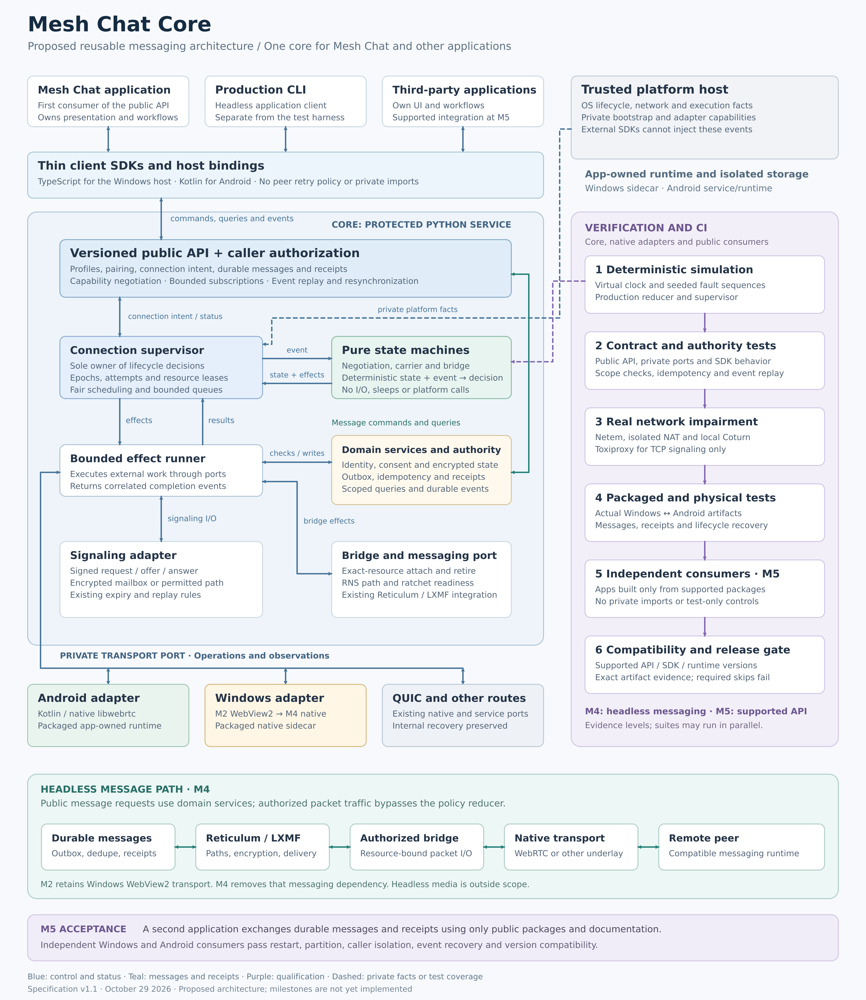

# Connection runtime implementation and qualification

Feature branch: `codex/mesh-chat-core-refactor`.

The supplied [specification](Mesh_Chat_Connection_Runtime_Spec.md) remains the
requirements baseline. Its referenced companion roadmap was not supplied; this
file records implementation work and evidence without claiming that missing
roadmap's PR numbering or approvals.



## Baseline and diagram review

Implementation starts at v0.9.66, `7c40f7b23eab3e9d83ff7ca1075c90c4d84ce516`,
one release after the specification's v0.9.65 review. The working tree was clean
when the feature branch was created. Later unrelated link-preview edits in the
shared checkout are excluded from the refactor's commits.

The diagram agrees with the specification: a protected service owns lifecycle
policy; private hosts provide platform facts; message payloads bypass the
policy reducer; and external API qualification follows headless transport.
The diagram is a **target**, not evidence that all illustrated components ship.
The green bridge/path states do not represent authenticated message delivery.

`AUTO_RECONNECT_SPEC.md` and the Android background ADR describe the legacy
implementation. Statements that the renderer always owns reconnect, or that
background execution needs a separate policy owner, are superseded for the
experimental `shared-native` composition. They still describe the default
legacy composition until migration is qualified. Existing QUIC recovery and
media-call ownership are unchanged.

## Baseline policy inventory

| Concern | Renderer | Android background | Experimental shared policy |
| --- | --- | --- | --- |
| Concurrent attempts/work | 2 | 2 | 2 effect reservations |
| Disconnect grace | 10 s | 10 s | 10 s |
| Backoff | 1/2/5/15/30/60 s | 1/2/5/15/30/60 s | Same sequence and cap |
| Mailbox poll | 5 s | 5 s | 5 s; one fetch per effect |
| Request/answer wait | 25 s | 45 s | 45 s per phase |
| Native gathering | Native operation bound | 20 s native; 45 s following phase | 25 s gather budget; 45 s following phase |
| Actor/native limits | Per-coordinator bounded workers | Native host limit 16 | 256 actor records; native host limit unchanged |

The shared policy intentionally uses background phase budgets initially;
platform latency parity remains a qualification item. No native session capacity
is raised. Runtime epoch is fresh; actor keys retain scope, profile and device
identity. Monotonic deadlines never enter persistent storage.

## Milestones

| Milestone | Implementation status | Required remaining evidence/work |
| --- | --- | --- |
| M0 baseline | Spec and diagram imported; baseline regression corpus passes | Record platform timing baselines in CI |
| M1 policy/contract foundation | Immutable model, pure phase reducer, fair supervisor, bounded effects, native domain adapters, simulator, strict model checks, executing snapshot schema and initial public request/error design contracts | Complete public result/event schemas and facade design; extend adversarial corpus to all invariant classes |
| M2 shared policy | Experimental service composition, renderer fencing, native manual-carrier adoption, isolated contact onboarding and private Windows transport registration/rebinding | Remaining manual-pairing modes, Windows/Android interoperability, full native authority conformance, broader restart/fault cases and removal of migrated legacy loops |
| M3 qualification gates | Deterministic inventory/evidence gate; shared conservative workflow selector and final execution gate | Narrower dependency selection after isolation is qualified; complete cross-suite evidence and exact-artifact release aggregation |
| M4 headless messaging | Existing Android native transport reused | Production native Windows DataChannel adapter, packaged fault matrix and receipt soak |
| M5 supported consumers | Not implemented | Public authenticated facade, durable idempotency/event cursors, packaged SDKs/CLI, independent Windows and Android consumers and compatibility matrix |

The user has specified emulation and GitHub CI only. Physical devices and an
isolated physical test network are unavailable. Physical acceptance items in the
original specification remain explicitly unqualified; emulator results cannot
be relabeled as physical evidence.

## Migration and rollback

The private `MeshChatService(..., connection_policy="shared-native")` composition
requires a native host and selects exactly one policy owner for that service.
It is not exposed as a renderer command or a live toggle. Default construction
continues to select `legacy`. Starting the experimental composition does not
promise Windows native support: an unavailable native host fails explicitly.
The private constructor can receive a host object from trusted composition;
required transport methods are checked before service workers start. Android
class loading is isolated in the host adapter and remains the default binding.
No JSON command selects or replaces this object. Constructor-level regressions
exercise explicit and Android-default binding, missing capabilities, idle startup
without a profile, and exclusive shared ownership. A test host is not evidence
of a production Windows transport.

The new runtime uses existing signed request/offer/answer and consent methods;
it does not alter peer wire formats, mailbox choices, vault schema, or receipts.
Explicit Stop closes the in-memory gate before persistence. A failed write
cannot allow the current runtime to restart that profile. Shutdown retains keys
until native effects and cleanup have finished; late allocation is retired by
exact handle.

Native callbacks for service-owned profiles report transport facts; the reducer
alone admits attachment and retirement. Periodic native/channel/route inspection
uses the same bounded effect runner, with a poll-interval deadline. Failed or
late inspection cannot restore readiness. A missing route invalidates readiness
while preserving a healthy carrier for bridge repair. Default activation cannot
clear an explicit Stop, including one issued before the first profile scan.

Before mailbox negotiation, a bounded private discovery effect can claim an
existing native manual carrier. The protected service checks current approval,
privacy policy, exact local/remote device profile,
signed onboarding SDP against the actual applied remote description, and signed
capabilities received on that carrier. The reducer then requires fresh native
inspection, bridge attachment and path readiness. Mailbox configuration is not
required to retain this established carrier. Pending onboarding in the shared
composition keeps its control channel and a limited isolated contact-handshake
scope; it cannot attach the main messaging bridge before ownership transfer.
UI close/detach commands cannot
retire it after transfer; explicit Stop still does. Failed durable Stop also
retires verified manual peers awaiting transfer while retaining the memory fence.
Native attachment evidence requires the exact online interface to remain in the
current RNS registry with a running network. Missing, detached or unregistered
bridges are repaired on the same carrier. Stale interface callbacks cannot send
through its replacement, and packets are not fed into an unregistered interface.
Shared bridge attachment and packet forwarding additionally require the owner's
current exact-resource lease. Stop revokes that lease synchronously, including
before a failed durable write or delayed native disposal. This read-only lease
check uses a profile index and does not run policy transitions for packet traffic.
Manual carriers can be adopted when automatic reconnect is disabled locally or
by the peer. The composition derives this limited authority from the actual
signed, live carrier; it is absent from public commands and profile responses.
Adoption does not change saved reconnect preferences, activate automatic intent,
or allow signaling/new peer allocation. Losing that carrier ends this authority.
Explicit Stop and failed durable Stop still fence it. Signed control cannot
rebind a carrier to another scope or local/remote device. Desktop WebView carriers
remain outside this adoption path.

`DISCOVER` and `Adopted` extend the private in-process effect contract. Its
producers are the native executor and simulator; its consumers are the reducer,
supervisor and bounded effect runner. No public event injection or peer wire
version changes accompany this addition. The Android signaling instrumentation
includes a production-service/composition adoption scenario with real signed
control, JNI channels and packet traffic. It injects execution availability and
path readiness, seeds approval, and cannot qualify invitation UI or LXMF receipts.
Its passing emulator result must be recorded against the tested commit.
An additional emulator scenario covers disabled automatic reconnect; its result
is not claimed until that exact source passes CI.

JNI ingress has separate lifecycle (512 events / 64 KiB) and data (256 events /
2 MiB) budgets. Packet overflow records loss; lost lifecycle or consent control
quarantines the adapter. Android metadata callbacks admit at most 64 tasks plus
a reserved disposal task per native session. Stalled effects retain their
reservations and protected key lifetime; the UI reports `adapter_quarantined`
until a new runtime is started. These bounds do not qualify all other legacy
queues or constitute a packaged saturation result.

Shared native carriers retain early encrypted packets while bridge attachment is
pending or RNS registration is being repaired. A separate private buffer admits
at most 16 physical allocations, 16 packets and 16 KiB per allocation, with a
1,064-byte packet bound. Overflow drops incoming data and counts the loss without
evicting lifecycle events. Unadopted manual peers cannot populate this buffer.
Attachment installs the registered consumer, rechecks the current owner lease,
and drains packets before announcing. Closing or releasing an exact allocation
discards its queued packets even if native disposal fails. Public ID reuse cannot
replay packets from an earlier allocation. The producer is the private JNI message
callback and the consumer is the existing RNS interface; peer wire and public
API contracts are unchanged. Unit regressions cover bounds, authorization,
generation isolation and same-carrier repair. The emulator fixture delays the
attachment port and checks an actual JNI packet reaches the replacement RNS
interface; this does not assert valid RNS routing or authenticated LXMF receipts.

Android's 16-session capacity includes pending creation and physical disposal.
Duplicate native IDs cannot replace an existing peer. Empty-candidate gathering
fallback retains its original reservation, waits for the exact old peer to be
disposed, and cannot restart after cancellation. Native observers capture their
session instance rather than resolving an ID that may have been reused. A
failed physical disposal retains capacity and reports adapter overflow. JVM
concurrency tests cover these reservation rules; Android instrumentation also
checks duplicate creation and cancellation during real ICE gathering.

The service maps public session IDs to private native identities containing a
fresh service epoch and increasing allocation number. It resolves callbacks
only when dequeued, and removes mappings after creation/cleanup accounting.
Reusing a public session ID therefore cannot redirect queued native events,
late answers, inspections, close completions or old bridge sends to the new
peer. The registry admits at most 16 resources; native creation/disposal retains
its separate capacity enforcement. This changes the private host binding only;
public session IDs and signed peer wire documents remain unchanged. Instrumentation
uses private test access to resolve native handles, which is absent from public
commands and packages.

Adopted runtime resources carry the physical allocation identity rather than the
reusable public session ID. Composition resolves that identity for inspections
and attachment, and retirement verifies the expected physical allocation inside
the native lock. Delayed cleanup cannot close a later public-ID reuse. The
supervisor retains bounded retirement reservations until successful cleanup and
rejects rediscovery of a resource pending disposal. The production runtime and
deterministic simulator both acknowledge exact cleanup; failed cleanup retains
the reservation. This refines private handle semantics without changing the
versioned observation schema or signed peer protocol.

Compatibility wrappers owned by this branch: `background_reconnect.py`, the
renderer coordinator/runtime, and renderer bridge repair remain until M2
adoption and parity checks pass. Removing them before desktop and manual-pairing
adoption is implemented would break the surviving-carrier recovery guarantee.
In the shared composition the ordinary dispatcher rejects legacy negotiation,
signaling, raw renderer bridge/packet operations and status writes before reading
the persistent command cache. Managed control/answer injection is also rejected.
Private effect/domain methods remain available to the owner. Ephemeral native
results and signed onboarding verification are not replayed from a previous
process's persistent command cache. Start/Stop and durable user operations retain
their existing command semantics. The default legacy dispatch is unchanged.
Rollback uses a complete service stop and cleanup before selecting legacy in a
new runtime; live switching and dual supervision are unsupported.

Local consent/token changes, verified peer capability writes (including workspace
capabilities), and contact block/unblock/delete writes use a bounded private
authority transaction fence. Effects and packet leases are denied before the
write; only its matching successful commit permits a fresh domain scan. An old
scan cannot restore authority after a concurrent mutation. Failed writes keep
the in-memory denial until that authority change is successfully retried; they
do not claim a durable preference change. Explicit Stop fences remain independent.
The shared consent path no longer invokes native close directly: exact cleanup
is owned by the supervisor. Default legacy behavior retains its compatibility
wrapper. Blocked, missing and unapproved contacts now report
`contact_not_approved` in the existing reason-list field, consumed by reconnect
settings and both diagnostic filters. No signed document version changes.

Workspace domain writes now pass through a narrow application persistence
adapter. A change to the workspace's active state, pinned manifest/genesis,
local identity or authorization generation fences every connection in that
workspace before the existing vault transaction. The private scope key is a
typed workspace tuple, so it cannot collide with a contact/profile identifier.
The same rule covers verified incoming manifests, member/device revocation,
leaving, closure, fork quarantine and deletion. Failed writes keep the denial;
cached operation results and unrelated unread/status updates cannot clear it.
The vault still owns atomic persistence and durable replay and does not import
connection policy. Only a matching successful authority commit releases the
fence for a fresh domain scan. Domain transaction tests and an architecture
guard prevent workspace writes from bypassing this boundary. The full workspace
suite is included in the required connection evidence inventory.

The transitional desktop transport component now owns bounded browser allocations,
SDP operations, exact callback fencing and packet/control admission. It preserves
the supplied ICE policy and has no negotiation signatures, authority decisions or
peer retry timers. Failed lifecycle admission or disposal quarantines the host;
bulk overflow is counted separately. Its production module is bundled into the
Android instrumentation APK to exercise both offer roles against native WebRTC.
Unit tests cover cancellation, deadlines, resource/operation limits, error
redaction and disposal failure. The instrumentation source compiles locally;
actual Chromium/JNI execution is a separate CI gate. A private inherited-pipe
binding and browser protocol now translate the existing native method contract,
fence process epochs and monotonic requests, bound admission, and quarantine
unknown outcomes without waiting for a blocked writer. Pipe tests exercise
reordered replies and callbacks while ordinary dispatch waits. The browser
protocol is included in both emulator offer roles. Chromium/JNI instrumentation,
standard CI, policy/layout gates and Direct Fabric tests passed for
`7e3c1e5a7a00394119712bf146efecce56c326dc`. This is component evidence;
service-restart adoption is not yet connected to this component. Existing
renderer compatibility paths remain active until those parity gates pass.
The service entry point can bind this channel at private process launch with
`--shared-webview`; it selects the shared owner before workers start. JSON
initialization rejects host/policy selectors. An executing inherited-pipe test
covers replies and callbacks while dispatch waits, and shutdown wakes pending
work. The opt-in Windows Cargo feature `experimental-shared-webview` now selects
this launch mode and registers a separate hidden transport window. Default builds
still use the legacy composition. The trusted host binds a random capability to
the exact window label, fixed local document and service PID; JSON cannot choose
these identities. The broker bounds pending work, validates whole reply batches
before consuming them and reserves reset admission. A bounded browser pump keeps
lifecycle and packet budgets separate. Lost windows or stalled IPC quarantine the
Python adapter. Unexpected service exit now suspends eligible carriers in that
window; explicit shutdown and host faults dispose it. Full surviving-carrier
restart adoption remains required before M2 promotion.

The private desktop host now exposes a bounded carrier inventory for recovery
reconciliation. It reports a stable adapter epoch, exact physical resources,
description hashes, channel states and pending work without SDP/ICE credentials
or identity claims. Browser snapshots are rejected if a resource or operation
changes during hashing. The Python binding validates the complete inventory and
fences a changed adapter epoch; ordinary snapshot races remain retryable.
Cross-language digest vectors, stale-resource tests, real WebView2 observations
and both Android Chromium offer roles cover this port. This is a prerequisite,
not full restart adoption. Protected binding checkpoints and invalidation use
the encrypted vault as described below; packaged restart and receipt evidence
remain open.

Conflicting browser SDP operations now have one admitted operation per peer.
Overlap is rejected before native dispatch without retiring the active resource;
different peers retain the shared bounded operation budget. Exact retirement can
still interrupt gathering or answer application. No adapter retry queue is added.

Before the experimental desktop adapter attaches a leased messaging carrier, it
checks the native inventory against the service's signed-exchange descriptions,
current profile/device/peer binding and privacy policy. The bounded checkpoint
stores only hashes and binding identifiers in one encrypted vault record. Native
inventory I/O runs outside the dispatch lock; authority and exact resource are
rechecked before the atomic write and attachment. Stop and contact/profile/
workspace authority changes invalidate matching records before the authority
write. A persisted revision rejects stale checkpoint completions even after
permission is restored. Unrelated records remain intact; native retirement also
removes its exact checkpoint. Write failures cannot claim durable success or
prevent attempted native disposal. New private adapter incarnations discard
obsolete host records on checkpoint. Failed checkpoint retirement retains the
exact registry reservation for cleanup retry even after the native peer closes.
Startup now reconciles that protected journal against the private inventory
before profile scanning or native allocation. It rechecks current scope, peer,
device, intent, expiry and privacy authority, retires unmatched or ambiguous
resources even when no profile remains, and registers survivors under fresh
logical handles. Current journal membership is checked again after orphan
cleanup, preserving unrelated survivors while rejecting Stop/revocation races.
Recovered evidence contains no SDP and cannot bypass a new supervisor lease or
bridge/path readiness checks. Failure quarantines startup admission. Controlled
tests run this preparation and adoption through the production supervisor,
including manual carriers with automatic reconnect disabled. These component
and vault-reopen tests do not qualify packaged service-crash recovery: the
combined vault, supervisor, RNS/LXMF and receipt restart test remains required.

Windows process retirement now captures the originating PID and detaches its
transport host, native host and pending requests before a replacement is
published. Delayed cleanup cannot retire the replacement. The lifecycle guard
does not wait for a blocked stdin writer; exact process termination and deferred
handle cleanup remain available. Regression tests cover stale retirement,
delayed disposal and blocked writers. This fixes host cleanup isolation; it does
not by itself qualify surviving-carrier adoption.

The private Rust host now suspends the browser pump after an unexpected process
exit and rebinds that same window to a replacement process with a fresh service
epoch. Bounded generation controls precede new requests; obsolete completions,
queued packets and old-process observations cannot cross the boundary. Only
stable connected peers without unfinished operations survive. Each stays held
until the service checkpoints its evidence and activates the exact resource under
a fresh supervisor lease. Control or lifecycle changes while held retire the peer;
bulk packets are dropped. Explicit lock/exit also closes a retained host when no
service PID remains, without terminating a recycled OS PID. Window destruction
uses window identity across process rebinding. No retry policy moves into this
mechanism, and the experimental selector remains unpromoted.

The native WebRTC application adapter is now separated from the main service
class in `native_webrtc_service.py`. Its 26 allocation, callback, bridge and
retirement methods retain their existing behavior and command signatures.
It composes the existing signed control mixin and depends on the native host,
Reticulum interface and current owner lease. It does not import the concrete
service or move lifecycle decisions out of the reducer. Legacy compatibility
paths remain until the same M2 parity gates pass.

The experimental Windows host supplies a read-only UI routing hint before the
application loads. Manual pairing then uses the existing service transport
commands rather than allocating a second renderer peer. This hint is not a host
capability: private IPC still requires the registered window and process binding.
Pairing observes DataChannel openness independently from bridge attachment, so a
pending invitation can be reviewed without a premature transport timeout. The
dialog reports a connected path; service authority still controls packet leases
and messaging attachment. Component regressions cover both Android and Windows
routing with an open channel and no bridge. Full Windows pairing and restart
parity remain qualification requirements.

The separate `transport-qualification` executable exercises the real Windows
WebView2 host, production Python pipe binding, both offer roles, bidirectional
packets/control, actual Python process replacement, retained adapter/resource
identity, held traffic before activation, and exact retirement without opening
a vault. Windows CI requires
this result and records the source revision and binary/source hashes. Its evidence
level is `windows_webview2_private_host_component`: it does not qualify packaged
application messaging, LXMF receipts, supervisor restart adoption or headless Windows native
transport. Missing execution or missing checks fail qualification. The executable
and its report command are test tooling, absent from normal shipping builds.

## Local validation

Initialized packaged-service qualification exposed a shutdown crash hidden by
the earlier startup/EOF smoke test: the private reader could remain blocked on
buffered stdin while Python finalized. The inherited input adapter now uses
cancellable, single-reader pipe reads from the first frame onward, and private
reader shutdown joins the worker within a bounded deadline. It borrows the file
descriptor; it never closes a parent's writer or bypasses framing limits.
Regression cases cover partial headers/bodies, EOF, queued initialization frames
and actual process exit while the parent retains its writer.

Windows CI now requires an exact-build packaged lifecycle report in addition to
the real WebView2 report. It initializes protected profiles in default/shared
mode, verifies clean shutdown, force-terminates a shared-mode process tree, and
reopens the encrypted profile with the same identity and committed preference.
Private service epochs must change. The adapter fixture reports an empty
inventory, and its only other supported action is reset. Its evidence level is
`windows_packaged_service_lifecycle_empty_adapter`; it does not qualify surviving
carriers, bridge readiness, message delivery or receipts. The gate verifies a
clean source revision, the packaging input fingerprint, tested binary digest,
execution counts and source tree. Missing, partial or stale reports fail the
aggregate gate.

The combined Windows scenario now runs two frozen services through production
private WebView2 hosts with isolated, pre-approved encrypted fixture profiles.
LAN discovery, TCP and other alternate routes are disabled. Ordinary service
commands exchange signed onboarding descriptions and durable messages; both peers
must receive authenticated receipts. After killing one service process tree,
the replacement opens the same protected profile, reclaims the same physical
carrier binding and delivers another message with a receipt. Host operation
counts must prove that recovery performed no new offer/answer negotiation. A
second forced exit permits journal comparison without bypassing the profile lock.
The original delivered message must remain present exactly once.

Its evidence level is `windows_packaged_webview2_preapproved_peers`. Windows CI
requires all three checks, three process starts, two forced exits and three
authenticated receipts. The aggregate gate requires the same frozen binary/build
inputs as the lifecycle suite and the same native host as the component suite.
This closes that narrow packaged Windows recovery gap. Windows-to-Android packaged
interoperability, independent public consumers and release qualification remain open.

Shared first-time contact onboarding now uses an isolated RNS interpreter with
one exact peer and only the existing signed LXMF contact request/accept/decline
payloads. The workspace bootstrap mechanism is extracted from its workspace
scope; workspace scope behavior and peer formats are preserved. The new private
`initialize_contact` worker operation is absent from public service commands.
The worker has no alternate interfaces or routing, a five-minute/signed-expiry
ceiling and bounded packet/control queues. Only one pending scope per service
may run. Main-profile chat, workspace traffic and application receipts cannot
cross it. The existing durable outbox retains all retry decisions.

The parent revalidates exact resource, signed peer, current execution and contact
authority before each exchange, outbound packet and completion event, and
independently verifies inbound LXMF signatures. Shutdown during a host send
discards the remaining packets and events in that worker batch.
Lock, shutdown, expiry, cancellation and revocation stop the scope. Endpoint
status cannot claim an application receipt. Adoption waits for contact-handshake
completion and current authorization, and retires the isolated scope before
granting the main messaging owner its carrier. Capability/control JSON alone
never approves a contact.

The separate `windows_packaged_webview2_explicit_pairing` scenario starts with no
contacts, receives an invitation without granting authority, explicitly accepts
it, receives the signed contact request, explicitly approves, and verifies both
approved states without granting direct-IP messaging. Both sides then opt into
direct-IP messaging and transfer the initial pending carrier to the authorized
messaging owner for bidirectional messages and authenticated receipts. Private
host operation counts on both sides must show no replacement negotiation or
closure during that transfer. It does not yet qualify workspace pairing,
pairing cancellation/restart faults or Android bootstrap integration.
Its report is required separately from the pre-approved crash test,
with a distinct run identity and the same tested binaries.

`connection-qualification.yml` is the common PR, main-branch and merge-queue
entry point. It invokes the existing policy, verification/Windows, Android,
Direct Fabric and layout workflows; each remains manually runnable. Code,
contracts, build dependencies, selector changes and unknown paths select the
complete matrix. Only isolated documentation changes may omit Android, Direct
Fabric and layout; policy and normal verification still run. Missing diff bases,
empty changes and manual/merge-queue events expand coverage. Rename detection is
disabled for selection so both old and new paths participate. No code boundary
is assumed safe to narrow merely from its directory name.

The final `Required connection qualification gate` re-derives the plan from the
same checkout, source tree and event, then rejects absent, failed, canceled or
unexpectedly skipped workflows. This is the check to require in repository
branch protection when adopting this workflow layout; repository rules are not
changed by this source refactor. The gate downloads policy, Windows and selected
Android evidence from that workflow run. It revalidates the policy JUnit against
its complete inventory, the actual Windows transport checks and component
digests, and Android source/tree, APKs, scenario counts, run identities and
cleanup. Its manifest includes component report hashes and execution counts;
missing required reports fail. Evidence retains its component labels.
The native Direct Fabric recovery, packet-carrier and setup suites also record
their full pytest collection before execution on Linux and Windows. Required
native binaries are hashed before and after the tests; missing binaries, skips,
filters, changed source/binaries and partial execution fail. The final gate
revalidates all six JUnit inventories and requires recovery/setup to identify
the same shipping dispatcher on each platform. Source-pipe setup cases run in
that complete setup selection, without a second filtered native invocation.
This evidence covers controlled native QUIC and Python components, not packaged
consumer or physical qualification. Other Direct Fabric unit/build checks and
Linux NAT/network-provenance checks still retain their workflow gates.
The workflow result manifest is not a release qualification:
uniform scenario/count/artifact evidence across every suite and exact release
artifact aggregation remain outstanding.

Android qualification now uses one required inventory for its 16 optimized native
WebRTC cases and eight signaling/runtime cases. Each invocation writes a fresh
run marker into its instrumentation log. Evidence requires exactly the expected
class/method, one started and successful test, no skip/failure status, and the
same source/tree and optimized host/instrumentation APK digests recorded before
execution. The reporter verifies emulator identity and that the isolated test
app's processes stopped. Missing or stale logs, changed APKs and cleanup failure
fail the job. Its evidence level is
`android_emulator_optimized_native_and_python_components`; these test-host APKs
are not proof of physical-device or independently packaged consumer acceptance.

Private observation contracts live in `contracts/connection/`; experimental
application request/error contracts and the permission inventory live separately
in `contracts/core-api/`. JSON Schema tests validate real policy projections and
reject private fields and incompatible public requests. Public schemas are design
artifacts, not shipping host capabilities: the operation inventory advertises
none as host-accessible. A private read-only facade component now negotiates
capabilities and returns caller-scoped profile/connection observations. Current
grants are checked under the service dispatch lock and handles are bound to caller
and profile. It has no public bootstrap, native/event injection or mutation path.
OS-authenticated host bindings, durable mutations/events and consumers remain
required. JSON Schema validation is a development-only dependency and
does not replace trusted caller authentication or domain authorization.

From the repository root:

```powershell
.\.venv\Scripts\python.exe -m pytest service/tests/connection -q
```

From `service/`:

```powershell
..\.venv\Scripts\python.exe -m mypy --config-file mypy-connection.ini
..\.venv\Scripts\python.exe -m tools.connection_harness simulate --scenario stale_completion --seed 42
..\.venv\Scripts\python.exe -m tools.connection_harness simulate --scenario fault_sequence --seed 48 --output trace.json
..\.venv\Scripts\python.exe -m tools.connection_harness replay --trace trace.json
```

Saved traces include their schema version, policy constants and an implementation
digest. Replay rejects incompatible code, malformed actions and incomplete resource
cleanup; it executes the saved actions through the production supervisor and oracle.
Reproducing an older trace requires its matching source revision. This CLI is a
qualification tool, not a shipping private-event injection endpoint.

The simulator runs the production reducer/supervisor with virtual time. Its
resource oracle and Hypothesis state machine exercise 1,000 sequences of up to
100 actions, including successful and failed manual adoption, duplicated
completion, cancellation and recovery. The CI policy runner records every
collected node ID before execution and binds JUnit results to that run. Filters,
collection failures, missing suites, skipped cases, stale reports, duplicate
results and partial execution fail the gate. The inventory is retained beside
the report and evidence JSON. These are policy tests, not native transport, cryptographic,
application-receipt, real-clock, or packaged interoperability evidence.
