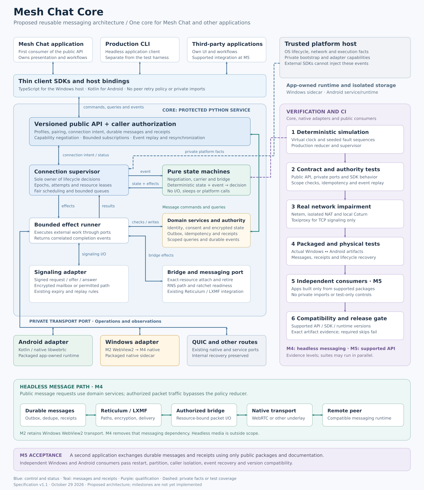

# Connection runtime implementation and qualification

Feature branch: `codex/mesh-chat-core-refactor`.

## Current integration checkpoint (2026-11-09)

Wave 1 is accepted at `174728e` after full qualification run `42644737670`
and independent retained-artifact validation. Wave 2 is active for durable
composer state, independent SDK distributions and upgrades, supervisor-owned
native lifecycle/pairing, and the remaining packaged transport/fault matrix.
The ledger records exact scope; this is not full M2–M5 completion.

The next candidate integrates reviewed artifact-read correction `503b18e`.
An exact HTTP 503 at inventory, archive API or signed-blob open may retry at most
twice, using the existing three-second cadence within the original wait deadline.
Each open retains a ten-second maximum clipped to remaining time, including the
redirect. Reads and artifact verification completed at or after the deadline
cannot admit setup. Retry eligibility is private and tied to the exact exception;
optional diagnostic observers cannot drive behavior. Uploads, other HTTP errors,
identity checks, cryptographic validation and native product behavior are unchanged.
Every retry obtains a fresh same-run inventory/archive response, and the repository
token is never forwarded to the signed blob request.

The focused artifact module passes **130 cases**, retaining all 120 prior cases
and adding ten retry/deadline controls. The original code fails the deterministic
single-503-then-success regression. Fresh combined local qualification is pending;
the full native gate remains unmet. This correction tolerates a transient read
failure; it cannot repair a persistent provider limit or upstream DNS outage.
The optional APT hardening remains outside this candidate. Another full CI run
will wait for recovery of the upstream package infrastructure.

The latest completed qualification is `11213ee5dde971ad7cacfdee153793fab6ff519b`
(tree `72bc64f7ac50841c334d64672c80cc453508962e`), full manual run
[43050419628](https://github.com/ahouchens/mesh-chat/actions/runs/43050419628).
All fresh scoped local checks pass: SDK staging/upgrade, strict policy types,
**5,612 policy cases**, **1,828 Python UI + 12 rendered cases**, **nine Windows
boundary cases**, and **six source-carrier setup cases**, with zero skips.
Policy and Python UI inventories match CI exactly; all 28 lifecycle composition
controls remain. The broader service result remains historical at `67a5210`.

Eight CI jobs pass. Retained artifacts independently verify Windows direct
**25 transport + 10 recovery + 12 setup** cases, Android **56 emulator + 83 JVM
cases and 17 artifact hashes**, and the policy/UI checks above. Windows installed
public-SDK pairing now passes, including two authenticated receipts, shared SDK
session lifetime, pending-message/key preservation across owner reopen and clean
host exits. This pass does not establish a cause or repair of the prior timeout.

Five jobs fail. Linux direct and browser layout again fail Ubuntu package DNS
before their required tests. Canonical's [official status feed](https://status.canonical.com/rss)
reports a DNS major outage from 14:26 UTC on November 11, before these failures;
the [runner incident](https://github.com/actions/runner-images/issues/15296)
corroborates matching failures elsewhere. This is consistent with an upstream
outage, without proving the runners' exact failing DNS hop. Optional APT
fail-fast hardening `b1dc7ee` is reviewed separately and held out of integration;
it cannot restore DNS or replace required package and font installation.

Android native initialization fails at `initialize_key_wait`: the signed GitHub
artifact blob download returns **HTTP 503**. The 48-second native step is below
the original 900-second key-wait ceiling. The new diagnostic projection exposes
`blob_request/http_rejected/503`; the current read path aborts immediately.
Windows subsequently retires at `wait_answer/tick/phase_timeout`. Neither role
reaches TURN/TCP, and the aggregate gate fails. A separate lead artifact download
also returned 503, then succeeded on one later read; its precise cause is not
assumed to match Android's failure.

The next bounded correction retries only selected transient read failures within
the existing deadline, with unchanged uploads and immutable artifact validation.
It requires independent review and fresh qualification. Full native acceptance,
bootstrap helper retirement and later roadmap promotion remain pending. A new
full run must also wait for recovery of the upstream package infrastructure.

The preceding candidate integrated reviewed component `f8e4e9f`: at most five
public pairing/diagnostics observations during invitation wait, scheduled at
0, 1, 5, 20 and 90 seconds. A single-flight observer leaves the original snapshot
predicate, 100-millisecond polling and 240-second work deadline intact. Each
sample has a two-second request budget and preserves a work-deadline reserve;
stopping the wait discards late results and prevents further diagnostic reads.
Selected fields exclude handles, codes, addresses and raw errors. Actor state
is current and unassociated; it is not a pairing-specific first-cause history.

The focused module has **419 passing cases**, with no failures or skips.
Regression controls cover stalled observations, late completion, earlier state
surviving later retirement, strict fixed offsets and real bytes output from the
installed checker. Fresh combined local qualification and full native CI remain
pending. The Linux package DNS failures warrant fresh runners without a mirror
override. This component adds evidence; it does not establish a pairing repair.
Bootstrap helper retirement remains on hold until the full native gate passes.

The preceding completed qualification is `bc26ec45b9e6fc99c4b1c41052bf48e0bb2b6128`
(tree `5f69bf4b02298e9c26ea358ebb46d4ea94852fd7`), full manual run
[43040952044](https://github.com/ahouchens/mesh-chat/actions/runs/43040952044).
Fresh scoped local checks pass: SDK staging/upgrade, strict policy types,
**5,596 policy cases**, **1,828 Python UI + 12 rendered cases**, **nine Windows
boundary cases**, and **six source-carrier setup cases**, all with zero skips.
All 28 lifecycle composition controls remain. Policy and Python UI inventories
match CI exactly. The broader 6,811-pass/49-skip service result remains historical
evidence at `67a5210`; it was not rerun or relabeled for this diagnostic-only delta.
An initial local rendered-UI startup was blocked by sandbox filesystem access;
its report is retained separately and the same-source boundary rerun passes.

Seven CI jobs pass. Independently retained evidence includes Windows direct
**25 transport + 10 recovery + 12 setup** cases, Android **56 emulator + 83 JVM
cases and 17 distribution/binary hashes**, the policy/UI slices above, and nine
Windows boundary cases plus normal installed public-SDK bootstrap with DPAPI/EFS.
The recurring Windows `address_loss` case passes in CI and in one separate local
native reproduction using the exact CI-built dispatcher. That single local pass
and this CI pass do not establish a repair of the intermittent failure.

Four jobs fail and one is skipped. Linux direct and browser layout fail Ubuntu
package downloads with DNS resolution errors for `azure.archive.ubuntu.com`,
before their required transport/layout tests run. APT already attempted multiple
Ubuntu endpoints; no repository mirror override, signature failure or product
cause is established. Windows desktop fails public pairing at `invitation_wait`
after the original 240-second work deadline. Its final probe sees both pairing
sessions retired with unexpired leases; cached earlier snapshots and current
stopped/ineligible actor state cannot recover the preceding failure reason.
The Reticulum interface warning describes a separate path and is not evidence
of the cause of native mailbox/WebRTC pairing failure. Later receipts, shared
host lifetime and clean exits are not qualified by this run.

The native cross-platform job is skipped because the Windows desktop prerequisite
failed; neither initial-key nor TURN/TCP diagnostics execute. The aggregate gate
fails. The next bounded change records earlier public pairing/connection states
without delaying invitation polling or changing the work deadline, acceptance,
network policy or SDK contract. Helper retirement and later roadmap promotion
remain deferred until independently verified full native qualification.

The preceding completed qualification is `67a521053772ccdac437cf6ae4e771a79eafea4e`
(tree `ac0447e24597d15102f862aa008c63ae055aa6f1`), full manual run
[42973285262](https://github.com/ahouchens/mesh-chat/actions/runs/42973285262).
All fresh local gates pass: SDK staging/upgrade, strict policy types, **6,811
service cases with the same 49 optional/platform skips**, **5,577 policy cases**,
**1,824 Python UI + 12 rendered cases**, and **nine Windows boundary cases**.
Required suites have zero skips. All 28 composition controls remain, and all
baseline cases are retained with exactly 59 additions since `fed31cc` (29 since
`ce96840`). CI policy and Python UI inventories exactly match local execution.

Nine CI jobs pass. Independently verified components include the policy/UI and
packaged Windows public-SDK slices above, **56 Android emulator cases, 83 JVM
cases, 17 distribution/binary hashes**, Linux direct **25 transport + 10 recovery
+ 12 setup**, and 72 zero-overflow layout report cases. Screenshots were not
visually reviewed. Windows direct recovery has **nine passes and one failure**:
`address_loss` recovers the connection but the queued workspace message remains
absent at the receiver through the existing 45-second delivery wait. The same
case failed at `fed31cc` and passed at `6b3fb8e` and `ce96840`; affected recovery,
network and workspace source blobs match the last passing candidate. The report
contains receiver state, not sender outbox/send evidence, so no cause or repair
is inferred. Windows fabric/setup do not run after this failure.

Native Windows fails at `initialize_key_wait` with `RendezvousUnavailable`.
Its entire controller step lasts 68 seconds, below the configured 900-second
initial key wait; normal key-wait deadline exhaustion is ruled out. Artifact
metadata records Windows key publication at 06:58:40 UTC and Android publication
at 06:59:37 UTC. No key contents were downloaded. The existing reporter omits
transport failure details at this initialization site. Android subsequently
reports `partner_wait/deadline_exhausted` while awaiting Windows's first direct
offer. Neither peer reaches TURN/TCP, so the earlier `ce96840` failure remains
unclassified and the new path diagnostic is not native-qualified.

The next bounded changes cover initial-key diagnostic projection and both-peer
workspace-event failure evidence. A separate one-day retained Windows dispatcher
artifact will enable scoped native reproduction without rebuilding Rust locally.
These preserve existing retries, deadlines and acceptance checks. Bootstrap
helper retirement and later roadmap implementation remain deferred pending full
native qualification. The aggregate gate is failed; historical runs remain below.

The reviewed diagnostic components are now integrated: `8a4c4ae` projects
the existing bounded artifact-transport failure details at `initialize_key_wait`,
and `94b5d05` adds failure-only snapshots of both recovery peers. The snapshots
include at most eight workspace-event delivery rows with capped attempts and
due/future/terminal scheduling, plus a 16-entry trace with explicit truncation.
Status and acceptance outcomes describe literal handler returns; they do not
claim new message materialization. The original 45-second delivery wait, native
deadlines, retries and acceptance criteria are unchanged. The already-built
Windows dispatcher is retained for one day in a separate source-named CI artifact.

Component evidence verifies **734 controller cases**, including root reproduction
of three missing-projection failures before the correction and four passes after
it; D's **45 focused diagnostic cases and all six source-carrier setup cases**
also pass. There are exactly 19 new cases relative to `67a5210`. Fresh combined
SDK/type, full required policy/UI, Windows boundary and six source-carrier checks
are pending. The broader 6,811-pass/49-skip service result remains prior-source
evidence at `67a5210`; it is not rerun or relabeled for this six-file diagnostic
delta. Full native CI qualification remains required before helper retirement.

The preceding completed qualification is `ce96840ee8f138190e1a1048e5deeb5997edee88`
(tree `c8a272e1b3fec9f24741ca3542093284410c018e`), full manual run
[42961670166](https://github.com/ahouchens/mesh-chat/actions/runs/42961670166).
Fresh local SDK staging/upgrade and strict policy types pass. The full local
service suite has **6,782 passes, 49 unchanged optional/platform skips**, and
zero failures/errors; all 28 composition controls and all 6,801 baseline cases
remain with exactly 30 new cases. Required local gates pass **5,548 policy**,
**1,795 Python UI + 12 rendered**, and **nine Windows boundary** cases, with
zero required skips. CI policy and Python UI inventories exactly match local.

All ten non-native CI jobs pass. Independently validated evidence includes
**56 Android emulator cases, 83 JVM cases and 17 distribution/binary hashes**,
packaged Windows and its installed public-SDK lifetime slice, and both Linux
and Windows direct **25 transport + 10 recovery + 12 setup** cases. The two
previous Windows setup failures now pass. All 72 layout report cases have zero
overflow; screenshots were not visually reviewed.

Both native roles and the required aggregate fail. Android reports `ValueError`
at `turn_tcp_authenticated_receipts`; Windows reports `scenario_deadline` at the
same phase. The source places the Android failure before the named kernel block
negative control, but the retained report and job log do not distinguish kernel
path construction from authenticated receipt validation. The earlier `ccd3b51`
negative-control failure is a different phase; a common cause is unproven.
Progress markers show initialization and earlier direct/TURN-UDP work advanced,
but do not establish final scenario, cleanup or full native acceptance. The
prior DNS failure did not stop this run; no underlying DNS repair is inferred.

Reviewed diagnostic commit `6af9e81` adds fixed, exception-bound labels to
the existing kernel-path constructor and receipt checks. Socket correlation
distinguishes no owned match from ambiguous owned matches without exposing
endpoints, PIDs or inodes. Observer construction is optional, cleanup replacement
cannot inherit the original error's label, and all acceptance criteria and
deadlines remain unchanged. Independent source/artifact review verifies **805
focused passes**, retaining 776 prior cases and adding 29; the new module is
included in the fast boundary gate. This is diagnostic instrumentation, not a
repair of the still-unidentified CI cause. Fresh local gates later pass at
`67a5210`; full CI fails earlier in initialization as recorded above.

The next bounded task is native failure attribution and correction, preserving
socket uniqueness, native receipt requirements and all deadlines. Bootstrap
helper retirement and later roadmap implementation remain deferred until full
native qualification passes. Historical failures below remain retained.

The preceding completed qualification is `6b3fb8e2f5b92858ca62935066f8b607e3edecd9`
(tree `ecc484ffa393e45de96ae14d8390d3bae8fcedae`), full manual run
[42932168650](https://github.com/ahouchens/mesh-chat/actions/runs/42932168650).
The runtime-host source-selection correction is confirmed: all **56 Android
emulator cases**, **83 JVM cases** and **17 distribution/binary hashes**
independently validate. CI also passes **5,522 policy cases**, **1,770 Python UI
+ 12 rendered cases**, packaged Windows and its installed public-SDK lifetime
slice, Linux direct **25 transport + 10 recovery + 12 setup**, and 72 zero-overflow
layout cases. Policy inventory equals the retained `fed31cc` baseline; the prior
full local Python results remain labeled `fed31cc`. Current-source targeted
evidence is the affected Kotlin compile plus 410 existing boundary tests.

The run nevertheless fails. Android native initialization reports the actual
`ice_servers` operation at `broker_open`, category `network_unavailable`, cause
`name_resolution`. Runner outbound preflight completed earlier; the report does
not identify broker-versus-proxy hostname or prove a DNS configuration defect.
Android exits before key publication; Windows later fails `initialize_key_wait`.
No full native scenario, paired receipt, cold-restart or zero-accounting acceptance
follows. Windows direct transport and all ten recovery cases pass, including the
previous address-loss failure. Two of twelve setup cases fail at the same
25-second general-channel discovery wait: the joining workspace is active but
has no channel; the owner's channel-record delivery remains sending after three
attempts, with a future retry and no endpoint receipt. Its stored
`transport_unavailable` may persist after a later accepted send and does not
identify the current attempt's cause. The revocation/cancellation branches have
not yet run. These two failures remain separate from Android DNS.

The reviewed corrective batch contains C's `4523f43` payload-aware workspace
readiness repair and D's `5988882` private Android postfailure network snapshot.
Actual source-transport traces show a channel record admitted by bootstrap
readiness even though that payload uses the ordinary transport and its ratchet
is absent. Workspace preflight now checks the exact payload before spending a
send attempt; it retains the existing five-second key wait. Once bootstrap
delegation is skipped, the ordinary send branch requires its own identity and
ratchet even if bootstrap becomes ready concurrently. Both old behaviors have
semantic failing regressions; the corrected focused network/workspace suite
passes 94 cases. Six source setup cases passed on `7de1a54`; a representative
source setup case passes on the final correction. The two prior native Windows
setup failures subsequently pass in the `ce96840` CI run recorded above.

The Android snapshot adds one nonce-authenticated, same-publication inspect only
after the correlated ICE broker-open name-resolution failure. Within at most
two seconds of the existing controller deadline, it returns fixed app network
capability/DNS-presence booleans and current broker/proxy/unknown route selection.
It preserves the original failure and emits no raw network values. Custom opener
or proxy-handler behavior yields unknown. This is postfailure diagnostic context,
not a DNS repair or proof of the historical failing hostname. All 928 focused
Python cases pass, retaining all prior 903; the focused Android source compile
exits zero with its declared close-time android.jar warning. Actual packaging
and native acceptance still require CI.

The first combined local candidate `9708104` staged fresh SDK/upgrade artifacts
and passed strict model/reducer typing. Its full service run executed 6,831 cases:
6,780 passed, two failed, and the same 49 optional/platform cases skipped. All
6,801 baseline cases and exactly 30 new cases were present; all 28 composition
cases passed. Both failures were benchmark `RecordingNetwork` doubles missing
the new payload-readiness method. The reviewed `6c89920` correction adds only
that method to their shared `NoRouteNetwork` base, delegating to the subclass's
existing readiness behavior. The affected three-test benchmark selection now
passes; limits and assertions are unchanged. The failed run is retained. The corrected candidate subsequently passes
fresh full local gates; its full CI result is recorded above.

Combined fresh SDK, strict policy types and full service/policy/UI/Windows
gates subsequently pass at `ce96840`; full six-family CI fails at the native gate. No deadline,
bootstrap allowlist, public API or acceptance requirement is relaxed. Bootstrap
helper retirement and later roadmap implementation remain deferred until full
native qualification passes.

The preceding completed qualification source is
`fed31cc1a3104b0333bdfc8ed5251691002827e3` (tree
`3ec75b3aad730b470a1ed6a38b24c418fb830ba1`). Fresh local SDK staging and
strict policy types pass, as do **5,522 required policy cases**, **1,770 Python
UI + 12 rendered cases**, and **nine Windows boundary cases**, without required
skips. The full local service run passes **6,752 cases with 49 unchanged
optional/platform skips**, zero failures/errors, including all 28 composition
controls. All prior cases remain alongside exactly 116 new controls.

Full manual run
[42926669465](https://github.com/ahouchens/mesh-chat/actions/runs/42926669465)
completed **failed** on November 11 at 00:13:07 UTC. CI policy has exact
local/remote inventory parity; UI, packaged Windows and its installed public
SDK pairing/receipt/same-application lifetime slice independently validate.
Linux direct **25 transport + 10 recovery + 12 setup cases** pass. All 72 layout
report cases have zero overflow; screenshots were not visually reviewed.

Android runs **83 JVM cases** and **54 successful emulator case reports**,
including all four new optimized local Binder/Chaquopy diagnostic controls.
Those reports and their seven available binary hashes independently validate.
The separately packaged runtime host then fails Kotlin compilation because
its explicit source selection omits `CoreFailureObservationState.kt`, now
referenced by `CoreDispatch` and `MeshCoreApiService`. The two independent
consumer cases, complete 17-artifact distribution and final platform/cleanup
acceptance are unavailable. Cross-platform native interoperability is skipped;
the original `379e38a` ICE initialization cause remains unknown.

Windows direct recovery has **nine passes and one failure**: `address_loss`
does not observe the queued workspace message within its existing 45-second
delivery wait after the recovered-connection checks pass. Fabric and setup
do not run after that failure. The relevant test and direct-recovery/workspace
source blobs match the earlier passing `379e38a` run, but this does not explain
the failure or establish an environmental cause. No product repair is inferred.

D's narrow packaging correction `e552dd9` adds only the missing private state
source. Its isolated compiler reproduces the unresolved-reference failure and
passes after the change; 32 existing boundary cases pass. Independent review
approved the one-file source selection fix, integrated at `10d08c3`. The app
facade, bridge and host client remain excluded from this distribution. The
full local results above remain evidence for `fed31cc`; they are not relabeled
as a new-source run. The correction receives targeted validation and fresh full
six-family CI, including actual Gradle compilation and published-host checks.
The Windows recovery failure remains separate and unexplained. Bootstrap
retirement remains deferred until full native qualification passes.

The preceding completed checkpoint is `379e38ae385a398bfc5a6ec878ac12bc7969560a`
(tree `2cea47a5971980ac34e63949e5f221a2ced09184`). Fresh SDK staging and
strict policy types pass. Exact-source local gates pass **5,406 required policy
cases**, **1,752 Python UI + 12 rendered cases** and **nine Windows boundary
cases**, without required skips. The full local service run passes **6,636
cases with 49 unchanged optional/platform skips**, zero failures or errors,
including all 28 composition controls. The previous inventories are preserved
with the 95 new initialization diagnostic controls.

Full manual run
[42899863270](https://github.com/ahouchens/mesh-chat/actions/runs/42899863270)
completed **failed** on November 10 at 21:29:30 UTC. All non-native families
pass and independently validate, including exact local/CI policy inventory
parity, UI/Windows boundaries, packaged Windows and the installed public SDK
pairing/two-receipt/same-application lifetime slice, **52 Android emulator
cases**, **71 JVM cases**, all **17 Android distribution hashes**, and each
Linux/Windows **25 transport + 10 recovery + 12 setup cases**. All 72 layout
report cases have zero overflow; screenshots were not visually reviewed.
The exact broader service counts above belong to the local run. Existing
separate-caller/process, helper-retirement, physical and media limits remain.

The new failure labels narrow Android to `initialize_ice_servers` /
`PeerFailure` / `internal`. Windows reports `initialize_key_wait` /
`RendezvousUnavailable`. Both failed during initialization and retain no
successful native scenario rows, paired authenticated receipts, cold-restart
iterations or final zero accounting. Bounded inspection of both job logs adds
no fixed diagnostic discriminator. The typed SDK performs an implicit
`runtime.capabilities` exchange before the requested `call.ice_servers`, so
the failing inner operation and exception remain unknown. Existing broker/TLS
and response-encoding paths are possibilities, not established causes.

The private same-exchange diagnostic is now integrated from producer
`c6a31bb` plus reviewed correction `6246303`, Android/controller consumer
`364eb313`, and required Android inventory registration `a996252`. It selects
only bounded operation, stage, category and cause enums for an existing
correlated internal failure. The original local caller, cached Core client,
initialized qualification publication and each frame's isolated result must
still match; timeout, replacement, success or malformed metadata omits the
diagnostic. Public Core bytes, errors, request count and deadlines are preserved.
No broker/TLS repair or claim about the observed CI cause follows.

Independent component evidence preserves the prior selected inventories:
**285 producer Python cases** (207 prior plus 78 new), **903 consumer Python
cases** (885 prior plus 18 new), **24 JVM cases**, and **239 required-inventory
cases** (219 prior plus 20 new) pass. The producer corrections have three
semantic RED controls; the producer, consumer and required-inventory additions
also retain their initial semantic RED evidence. All source and final artifact
hashes were independently checked. Four new Android local Binder/Chaquopy
instrumentation methods compile and are required by the optimized emulator
inventory, increasing it from 52 to **56**; they have not yet run on a device.
This is component evidence, not combined qualification or native acceptance.

The exact-source combined local and failed full CI outcome at `fed31cc`
is recorded above. No unchanged-source retry was dispatched. Full native
acceptance remains open; bootstrap retirement remains deferred until it passes.

The preceding checkpoint is `30c9e4d996715aec9459da803119d1697bfba086`
(tree `3e30ef753eef5ab20940bbb242494f715a9f81d2`). The reviewed private v2
producer, controller and 28-case real Windows composition are integrated.
Fresh local SDK staging and strict policy types pass, alongside **5,311 required
policy cases**, **1,657 Python UI + 12 rendered cases** and **nine Windows
boundary cases**, without required skips. The full local service inventory is
**6,541 passing cases and 49 unchanged optional/platform skips**, zero failures
or errors. All 28 composition controls pass; prior inventories remain present
after the 16 explicitly recorded earlier uploader-vector renames.

Full manual run
[42886878229](https://github.com/ahouchens/mesh-chat/actions/runs/42886878229)
completed **failed** on November 10 at 20:13:24 UTC. All non-native families
pass and their retained evidence independently validates: exact local/CI policy
inventory parity, the UI/Windows boundaries, packaged Windows and installed
public-SDK pairing/two receipts/same-application lifetime, **52 Android emulator
cases**, **71 JVM cases**, all **17 Android distribution hashes**, and both
Linux and Windows **25 transport + 10 recovery + 12 setup cases** without skips.
The 72 layout report cases show no overflow; screenshots were not visually
reviewed. General CI verification passes, but the exact broader service counts
above belong to the independently retained local run. Existing separate-caller,
process, helper-retirement, physical and media limits remain unchanged.

Native Android reports `initialize` / `PeerFailure` / `internal`. Windows later
reports `initialize` / `RendezvousUnavailable`. Both reports are hash-verified;
neither retains successful native scenario rows, paired authenticated receipts,
cold-restart iterations or final zero accounting. The initialization phase spans
peer startup, five Core setup operations, ordinary inventory and the initial
key publication/partner binding. It does not identify the failing Android call.
Bounded in-memory inspection of both job logs exposes no fixed failure message,
script frame or additional safe discriminator. No aggregate acceptance follows.

Independent producer and consumer source audits find no concrete new defect
explaining this failure. Startup errors ordinarily become
`android_host_start_failed`; a later correlated Core `internal` response is a
source-consistent route, not a retained operation trace. An unchanged broker
credential error path is one possibility, not the selected cause. Reviewed failure-only diagnostics `7058909` are now integrated. Ten fixed
initialization call-site labels preserve the same escaping error, call order,
cleanup and budgets. All **1,093 focused cases pass without skips**, preserving
the prior 998 and adding 95. Eleven original-source semantic failures demonstrate
the missing labels. Tests execute actual initialization/run/reporting paths with
scripted external boundaries and check both roles, errors and guards, unchanged
successful reports, stale-label rejection, sensitive-data omission and cleanup
failure custody. Independent source comparison preserves the underlying calls
and explicit raised expressions. This is diagnostic component evidence, not a
repair or identification of the original Android cause.

The labels add no probe, retry, raw exception text, credential export or Core
error remapping. A Core call-site label cannot distinguish the SDK's implicit
capability request from its requested operation. Exact-source combined qualification at `379e38a` is recorded above; its
full native run fails during initialization. Bootstrap retirement remains deferred until
full native qualification.

The preceding checkpoint is `ccd3b5164181aae6de47e1a939f52a2a05464378`
(tree `39fd544a48f0461a4828f3f6339d274902f9e7b1`). Reviewed fixture
serialization `c4e6036` is integrated. Fresh SDK staging and strict policy types
pass; **5,068 required policy cases**, **1,482 Python UI + 12 rendered cases**
and **nine Windows boundary cases** pass with zero skips. The complete local
service inventory executes 6,347 cases: **6,298 pass, 49 optional/platform skips,
zero failures or errors**, including all 18 retirement composition controls.
The two new policy cases remove no prior inventory entries. Two failed local
launcher attempts (missing tooling import path, then missing Windows spawn
guard) are retained separately; neither is passing qualification evidence.

First full run
[42857623266](https://github.com/ahouchens/mesh-chat/actions/runs/42857623266)
fails installed Windows public-SDK pairing at `explicit_approval` /
`invitation_wait`, with a preserved local `wait_deadline` at 240,008 ms.
Both pairing probes find acknowledged retirement before caller cleanup, with
`expired:false`; current stopped/idle/ineligible actors do not identify the
first retirement cause. The zero remaining cleanup budget does not establish
positive host shutdown or a separate permanent shutdown defect. Nine Windows
boundary cases and installed DPAPI/EFS bootstrap pass; later Windows packaged
gates do not run. Native interoperability is **skipped**. Other required suites
pass and are independently verified. Frozen service, SDK archive and consumer
application hashes exactly match the prior passing Windows run at `36466e0`;
three source audits find no new concrete caller/producer/harness defect. The
invitation cause remains unresolved, including after the following retry.

One unchanged-source full retry,
[42862760087](https://github.com/ahouchens/mesh-chat/actions/runs/42862760087),
passes installed Windows public-SDK pairing, receipts and the recorded
same-application/caller lifetime slice, plus later packaged Windows gates.
All required non-native evidence independently validates: the exact 5,068-case
policy inventory, UI/Windows boundaries, **52 Android emulator cases**, **71 JVM
cases**, all **17 Android distribution hashes**, and Linux/Windows each
**25 transport + 10 recovery + 12 setup cases** with zero skips. The 72 layout
report cases show no overflow; screenshots were not visually reviewed. Existing
separate-caller/process, isolated-helper, physical and media limits remain.

The retry nevertheless **fails native interoperability**. Android reports an
unclassified `ValueError` while its phase is
`turn_tcp_kernel_block_negative_control`. That phase also remains selected
during post-negative observation, traffic validation and kernel-fault cleanup;
the failing assertion/producer boundary is not identified. Windows subsequently
reports `turn_tls_supervisor_owned_pairing_windows` with
`supervisor_pairing_retired`; its exact first-retirement diagnostic is
`wait_answer` / `tick` / `phase_timeout`. This is consistent with a partner
stopping in the previous scenario, not proof of the Android cause. The bounded
Android job-log inspection exposes no fixed exception message or script frame.
Failed reports retain no successful case rows for independent receipt/path
replay, 100 iterations, cold restarts or final zero accounting. No full native
acceptance or aggregate pass follows from source-reachable progress.

There is no third unchanged retry. A deterministic two-controller reproduction
on the unchanged `ccd3b51` source now demonstrates the coordination defect:
one peer enters retirement while its partner still needs its final selected-path
measurement or fault cleanup. Both runs contain **one passing ordered control
and two intentional semantic failures**, with no errors or skips. The actual
controller methods and strict checks execute; Core delivery, native observations,
kernel faults, transport, retirement effects and acknowledgments are scripted.
The lead verified all 14 source/evidence artifacts. This establishes ordering
vulnerability under those boundaries, not native proof or the CI failure cause.

Failure-only diagnostics `b7f323e4cd3874ca685e038472c2f652b280842b`
(tree `5789a83cfbdca3df3c503d710d3ca302b12a1180`) are integrated at `508198f`
after lead evidence verification and an independent review with no new findings.
All **739 focused cases pass with zero skips**: 667 prior cases remain and 72 are
added. Three original-source semantic failures demonstrate missing classified
evidence while preserving the original exception and phase. The separate
16-failure launcher attempt omitted the pinned Node runtime; its evidence is
retained, and the same source passes with the correct runtime. All literal
exception-message multisets are unchanged. The optional failure field contains
only a scenario, one of 23 fixed stages and an optional actual-branch reason.
Unknown causes stay unclassified; cleanup replacement uses its own exception.
This is component evidence, not native qualification or a fix for the race.

The independently reviewed private v2 preparation/completion/commit contract is
implemented at the common checkpoint below. After successful measurements and
fault cleanup, each role prepares its exact fresh transferred owner without disposal, publishes
then receives one sealed `case_complete_<scenario>_<initiator>` marker with exact
`{completed:true}`, commits the same request, and requires real exact owner/native
cleanup proof plus fresh clearance and independent global zero. Preparation
retains cleanup receipts across remote closure before local commit and denies
replacement while preserving current packets, inspection and genuine cleanup.
Only the witnessed manual-carrier True-to-False authority-signature successor is
allowed; all other active-ticket fences remain sticky. Existing owned-host
failure teardown supplies abandonment, never positive acknowledgment. Completed
historical receipts cannot admit or retire a later generation or satisfy its nonce.

The new marker budget is 17 Windows/15 Android uploads including reports for the
full workload and eight per role for quick; the run inventory cap remains 100.
Producer `3172d02` and consumer `b3751ae` are integrated unchanged at `6459710`,
after independent source reviews with no actionable findings. Producer evidence
contains **445 passing component cases**, strict model/reducer types and four
meaningful safeguard-removal failures. Consumer evidence contains **998 passing
cases**, preserving 895 prior cases (16 explicit uploader-vector renames) and
adding 103. Its two actual controllers independently gate the slow final sample
or fault cleanup; native, kernel, receipt and cleanup boundaries remain scripted.
The producer exercises actual service/owner/private-dispatch paths with modeled
native callbacks. Neither focused suite establishes real native completion.
Independent composition `ce4b9c4` is now reviewed and integrated, with all
**28 cases passing without skips**: the original 18 controls remain and ten are
added. Both role labels use actual Windows native hosts on localhost. The tests
retain and forward the host's actual closed callback after mapping removal,
commit the slow original owner after normal remote-loss cleanup, and require
matching native/owner/cleanup proof plus real global zero. They also cover
close-start projection before native cleanup, sticky Stop invalidation with
normal disposal, and historical receipts across an actual later generation.
Dropping the real closed notification produces the intended semantic failure
despite successful cleanup and zero host counts. Review corrected one stale-target
negative to exercise initial preparation; both variants and the complete suite
pass on the corrected commit. No native receipt, owner generation, acknowledgment
or zero count is synthesized. Approval/Reticulum boundaries remain modeled and
runtime steps are driven synchronously; this is not Android/JNI, authenticated
message receipt, full controller/path-case or packaged qualification. Combined local qualification passes at `30c9e4d`; its full native run fails
during initialization as recorded above. No public SDK/grant, JNI/host protocol, timeout,
retry-budget, kernel-drop, receipt or global-zero relaxation is assigned. Bootstrap retirement remains
deferred until full native qualification.

The preceding completed checkpoint is `36466e0245ec9c35d0e7b1bdaf2c544b40c050e0`
(tree `404089a57be9a1feb8cf1ec830331dc8c3123720`), full run
[42843336931](https://github.com/ahouchens/mesh-chat/actions/runs/42843336931).
Fresh local SDK staging, strict policy types, **5,066 required policy/adapter
cases**, **1,482 Python UI + 12 rendered cases** and **nine Windows boundary
cases** pass with zero skips. Inventory comparison retains every prior case
except the explicitly reviewed artifact-budget test rename accompanying the
signed cold-setup phase; the required selection gains 306 cases net.

CI independently verifies the same 5,066 policy cases, UI boundary reports,
Windows packaged/installed public-SDK pairing and receipt/lifetime slice,
**52 Android emulator cases**, **71 JVM cases**, all 17 Android distribution
hashes, and Linux/Windows **25 transport + 10 recovery + 12 setup cases** each.
The 72 layout report cases show no overflow; screenshots were not visually
reviewed. Existing platform, helper-retirement and media limits still apply.

The full gate nevertheless **fails general verification**. Its broader Python
run reports 6,271 passed, 52 skipped and two setup errors in the independent
native-retirement composition fixture; this broader count comes from retained
text, not a complete general-suite XML. Both errors occur before their test
bodies: the Windows-labeled loopback peer adopts while the Android-labeled peer
remains in pairing checks. Both labels use Windows native hosts. The trace omits
the exact rejected readiness condition. Native interoperability is **skipped**
because its verification prerequisite failed; this run provides no native
owner-retirement or cold-start acceptance.

Source audit identifies a fixture defect: direct setup consent and injected
control calls bypass the dispatch serialization used by production entry points,
allowing concurrent signed-capability read/modify/write effects. Normal native
control maintenance is already running, so an omitted explicit pump is not an
established cause. Fixture-only correction `c4e6036` now holds the complete consent preparation
and control receive under the same dispatch serialization as their production
callers; peer locks are released before entering the target service. Independent
review closes the finding with no new findings. Two deterministic signed-capability
regressions first reproduce stale consent publication and lost remote association,
then pass with the correction. All original 16 composition controls remain and
the complete owned file passes 18 cases with zero failures, errors or skips.
The lead verified all ten retained evidence file hashes, immutable source/tree,
the two semantic failures and exact original case preservation. No product code,
native maintenance, adoption deadline or retirement assertion changed. The exact
historical CI interleaving remains unknown. Fresh broader service, required policy,
boundary and full native qualification remain pending on the integrated source.
No product timeout, retry, authority or acceptance relaxation is assigned.

The preceding completed checkpoint is `5e6d0dac9f9cbee8ebdd986d85a4394dbf7b45c0`
(tree `eac21be7c638e72e2eb6f65a92adef5821b61f96`). Its first full run
[42819716492](https://github.com/ahouchens/mesh-chat/actions/runs/42819716492)
failed installing the Android 35 system image: the SDK installer reported an
unknown ZIP archive before emulator tests. No Android qualification report was
produced, and native interoperability was skipped. Every other available suite
passed and was independently validated. The archive/download cause is unknown;
no product change or acceptance relaxation was made for that failure.

The separate unchanged-source full run
[42824231976](https://github.com/ahouchens/mesh-chat/actions/runs/42824231976)
passes **4,760 policy cases**, **1,239 Python UI + 12 rendered cases**, **nine
Windows boundary cases**, **52 Android emulator cases**, **71 JVM cases**, and
Linux/Windows **25 transport + 10 recovery + 12 setup cases** each, all with zero
skips. All 17 Android binary/distribution hashes validate. The 72 layout cases
report no overflow; screenshots were not visually reviewed. Exact-source local
SDK staging, strict types and full policy/UI/Windows gates pass. The 109 added
policy/UI cases remove no prior inventory entries. Installed Windows bootstrap,
public pairing, two receipts and the same-application/caller lifetime slice pass;
the previously recorded isolation, helper-retirement and media limits remain.

The full required gate nevertheless **fails native interoperability**. Both actual
peers report `PeerFailure` / `scenario_deadline` at
`direct_native_lease_retirement`. Source reachability implies a direct case had
completed its transferred/adopted cancellation checks, authenticated exchange and
post-receipt selected-path/counter validation before entering retirement. Failed
reports do not retain those case samples, the direct initiator/index, close reply
or last inventory/counters. This progress is not independently replayable scenario
acceptance, both-direct-initiator coverage, the full relay/fault matrix, 100 receipt
iterations, cold starts or final accounting. No new rendezvous failure is reported;
the historical `c0b3cf7` acknowledgment cause remains unknown.

Read-only source audit establishes a controller/dispatch contract mismatch:
`native.command` / `native_webrtc_close` returns `state:managed` for an adopted
shared-native carrier and does not call the protected physical close method.
The controller ignores that reply and then waits for globally empty inventory
and zero native leases. Disabled automatic reconnect does not revoke an existing
verified manual carrier. The guard is intentional and must remain. The reports
do not retain the actual close result, so no exclusive runtime cause, disposal
leak or replacement allocation is asserted. Existing owner Stop can retire the
carrier but also persists a stopped profile/contact fence; restarting a later
manual case therefore needs a coherent, reviewed admission contract. A simple
command substitution or raw-close bypass is insufficient.

The reviewed follow-up implements private, current-owner carrier retirement
(`b4cd5a6`, corrected by `b06f26c`) and correlated controller acknowledgment
(`95005ca`). Successful cleanup and a fresh, revision-checked absence projection
clear only the temporary hold. Permanent Stop, quarantine and authority fences
remain independent; uncached handoff targets now carry their trusted contact
association into the atomic fence check. The managed-close guard is unchanged.
Each manual case requires both owner acknowledgment and the original global zero
accounting. Terminal cleanup uses the current scoped Core Stop (`7182e58`).

The separately reviewed `a093ca8` exchanges the existing signed cold-start
consent documents in a distinct sealed setup phase after the last manual zero
gate. Both peers publish before receiving; each imports through the existing
product validator and checks unchanged association and mutual consent before its
own first crash. Manual consent, workload, receipts and deadlines are unchanged.
Root verified 737 controller cases, 343 contact-fence follow-up cases and 691
cold-setup cases, including their failing pre-change regressions. These overlapping
component suites are not an aggregate qualification count. Independent sequential
composition (`ba3a7eb`) passes all 16 controls: real Windows loopback native hosts,
actual private request/owner acknowledgment and correlated controller zero checks,
opposite initiators, stale requests, delayed disposal, sealed-journal failure and
Stop/quarantine preservation. Contact approval rows, mailbox and Reticulum
readiness remain modeled; both role labels use Windows hosts. This does not prove
Android execution, full path-case receipts or cold-process behavior. Combined
exact-source local/full native qualification is still pending. SC26 remains
partial; isolated-helper retirement remains deferred.

The rendezvous diagnostic follow-up integrates `bdd2ff6` and `b0888ec` at
`b8d77e6`. It records fixed stage/reason labels at known transport origins,
bound in memory to the exact escaping receive error. An HTTP status is optional
and comes only from an observed standard HTTP error during an initial API or
redirected blob open; it must be an exact integer in 100..599. The controller
checks the same receive error and validates the complete allowed projection.
Foreign, stale, replaced, malformed or throwing observations add no fields.
Raw error text, URLs, headers, bodies and handshake material are never projected.

The existing failure type, wrapper messages, phase/site/substage and cleanup
remain intact. New calls, success and close clear the observation. Upload and
success reports gain no fields. Response context entry/read/exit has a fixed
`read_failed` label; non-decoding parser failures retain `transport_failed`,
while known JSON/encoding decode failures use `json_invalid`. Root review caught
and corrected a stale read label across that parser boundary. All request counts,
receive/open/poll budgets, bearer separation and provenance/digest/envelope checks
are preserved. The receive budget remains a polling deadline with in-flight I/O,
not a newly strict end-to-end cutoff. There is no retry or acceptance change.

The focused suite passes **645 cases**, zero failures/skips. It includes actual
controller report paths with scripted transport faults, negative identity and
redaction controls, and pre-change regressions for the missing fields and parser
mislabeling. Root independently verified XML/inventory/hashes; final immutable
review found no remaining actionable issues. These are offline controls, not a
repair for the unobserved `c0b3cf7` cause. Exact-source local and non-native CI
gates pass at `5e6d0da`; full CI fails native lease retirement as recorded above.
The revised helper-retirement interface has A/B design acceptance
after C's post-fence retirement-only registration correction; production remains
unassigned pending full native qualification.

The earlier completed checkpoint is `c0b3cf7558972b8560bac52e5154674d25603c86`
(tree `4304e0adbee1da7e694fc58b90bf05e933fce518`), full run
[42810308484](https://github.com/ahouchens/mesh-chat/actions/runs/42810308484).
The required gate **failed native Windows–Android interoperability**. Windows
reports `RendezvousUnavailable` during explicit contact approval, at
`rendezvous_receive` / `approval_acknowledgment`. Android reports `PeerFailure`
with `scenario_deadline` during `direct_authenticated_receipts`. These reports
do not establish a common cause. Transport code collapses HTTP, redirect, read,
response/inventory validation and polling failures into the Windows error type;
the exact branch and HTTP status are absent from both retained report and bounded
log inspection. Partner artifact metadata does not prove what Windows received.

Source reachability shows Windows accepted its initial local ready/path
observation before waiting for acknowledgment. That observation did not enforce
the later scenario-specific candidate type or positive traffic deltas. The failed
report retains no sample to replay independently. Neither this progress nor
Android's later phase qualifies correlated receipts, the full native scenario
matrix, impairment, repeated cycles or final resource accounting.

Independently verified passes: **4,651 policy cases**, **1,130 Python UI + 12
rendered cases**, **nine Windows boundary cases**, **52 Android emulator cases**,
**71 JVM cases**, and Linux/Windows **25 transport + 10 recovery + 12 setup cases**
each, all with zero skips. All 17 Android binary/distribution hashes validate.
The 72 layout cases report no overflow; screenshots were not visually reviewed.
Exact-source local SDK staging, strict types and policy/UI/Windows gates pass.
Both worker-deselected installation cases executed in the full policy gate.

Installed Windows bootstrap, public pairing and two authenticated receipts pass.
The lifetime slice covers two sessions in the same Node application/caller,
detach-survivor/reattach, competing-owner refusal with exit status 2, and original
pending-message/key identity across trusted owner stop/reopen. Three owned hosts
exit positively and the runtime lock is reacquired. This does not prove separate
consumer-process exit, cross-caller/user/app isolation, isolated-helper retirement,
pending-message delivery after restart, Android credential UI or media coexistence.
The earlier `1b3a2be` invitation failure remains unexplained by this later pass.

The follow-up recorded above retains fixed rendezvous stage/reason and an observed,
validated HTTP status only for the same escaping transport error. It adds no
request, retry, timeout, fallback or acceptance change and exports no raw error,
URL, header, body or handshake material. SC26 remains partial. Helper-retirement
production remains deferred; its private-interface review separately requires
retirement-only registration to remain legal after fencing productive startup.

The Windows pairing diagnostic follow-up integrates `1f73cdf` at `93a1448`.
It preserves the original thrown value and its phase, subphase, safe error code,
deadline flag and first timing before failure probes and final cleanup. Owned
budget/wait errors use identity-bound fixed origins; unknown thrown values remain
unknown. Cleanup-only failure still fails qualification. Separate bounded records
distinguish the original hosts, rejected contender and reopened offerer; attempts
are counted, while detach, stop and budget fields describe the latest attempt.
Positive process stop does not turn failed client detach into successful retirement.

Failure probes use the existing public `diagnostics.query` permission and
operation, with at most four selected current actor observations per role.
They expose fixed categories without handles, payloads, cursors or timestamps,
and cannot identify an actor with a pairing intent or establish first cause.
Roles run concurrently. Because the SDK serializes requests per client, pairing
status runs first and diagnostics receives only the positive time remaining in
the same two-second monotonic probe allowance. Exhaustion omits that request;
no new timeout window, client, retry or authority is introduced.

The focused worker gate passed **578 cases**, zero failures/skips; two installation
cases were explicitly deselected and remain required in full qualification.
The lead verified the complete XML/inventory and hashes. Actual application
controls reproduce the old masking failure and cover primitive throws, secondary
probe/cleanup failures, queue serialization, distinct owner incarnations and the
unchanged 4096-byte report bound. Independent immutable review found no actionable
issues. This is offline component evidence, not installed Windows acceptance or
a proven repair for the original invitation failure. Exact-source SDK staging,
types, local gates and installed Windows CI passed at `c0b3cf7`; full CI failed
native interoperability as recorded above. Success checks,
work/stop/outer deadlines, consent and positive shutdown requirements are unchanged.

The earlier completed checkpoint is `1b3a2be94816958d3fe26052e9fbaf5d2f42245c`
(tree `e1ac699f1b0bd32c07037f5eb9d5dcf5b29b1267`), full run
[42802755780](https://github.com/ahouchens/mesh-chat/actions/runs/42802755780).
The required gate **failed Windows installed public-SDK pairing**; native
interoperability was **skipped**, not passed. The report records retirement
failure after the first work failure at 240,043 ms. Source review proves that
the application's `finally` could replace the primary exception, phase and
subphase with cleanup failure. Its exhausted work deadline leaves a zero-ms
stop-observation budget; this is not proof of a host shutdown defect. The
original failed operation and producer cause are not recoverable from this
report. Earlier saved pairing states are not current failure-time observations;
the subsequent probes found both intents retired before expiry, without a cause.

The installed sidecar, SDK archive and application file hashes are identical
to the passing `902b12d` Windows checkpoint. This neither establishes an
environment cause nor excludes a latent timing defect. Nine Windows boundary
cases and installed DPAPI/EFS bootstrap pass, but this run does not qualify
pairing, shared-host lifetime or the later packaged gates. The earlier passing
Windows lifetime evidence remains explicitly bound to `902b12d`.

Independently verified current passes: **4,563 policy cases**, **1,130 Python UI
+ 12 rendered cases**, **52 Android emulator cases**, **71 JVM cases**, and
Linux/Windows **25 transport + 10 recovery + 12 setup cases** each, all with zero
skips. All 17 Android binary/distribution hashes validate. The 72 layout cases
report no overflow; screenshots were not visually reviewed. Exact-source local
SDK staging, strict types and all local gates passed. The 81 net added policy
and UI cases retain the prior root-identity controls and add strict root-command
diagnostic coverage. The new Android root diagnostic path itself did not run
in native CI because the Windows prerequisite failed.

The diagnostic follow-up recorded above preserves original work-failure identity
and observations, reports cleanup independently, and uses existing public current
diagnostics with a bounded projection. It is diagnostic work, not a proven product repair
or first-cause history. No timeout, consent, receipt, positive shutdown, native
authority or success criterion is relaxed. SC26 remains partial; the separately
reviewed helper-retirement implementation stays deferred.

The preflight diagnostic follow-up integrates `2fef6f3` at `88ea975`.
It preserves the single checked `adb root` invocation, fatal outcome, UID
requirement, command order, deadlines and cleanup. Only that root invocation
captures stderr in memory. Failure reports may include a strict bounded nonzero
exit status and a fixed diagnostic-family label, selected only for the same
escaping checked exception and validated preflight site. Raw command/output,
private suffixes and environment values are not exported. Unknown, conflicting
or overlong diagnostic text remains unclassified. The 4096-byte bound applies
to classification, not total subprocess stderr capture.

The worker's complete focused controller/peer/preflight suite passed **484
cases**, zero failures/skips; the lead independently verified XML and inventory
hashes. Immutable source review found no actionable issues. This is a reporting
change with scripted-boundary regression evidence, not a fix for the unknown
`902b12d` root-command cause. The exact-source local gates and CI components
passed as recorded above, but installed Windows pairing failed before the native
interop job. No retry, root bypass or native acceptance is added.

The earlier completed qualification checkpoint is `902b12d1470177fe4207e027bf3d44fbe839cc91`
(tree `ad829c7716cb2b4c15620a9d69504c6ce114922e`), full run
[42796005344](https://github.com/ahouchens/mesh-chat/actions/runs/42796005344).
The required gate **failed native interoperability**. Android failed during
`platform_outbound_preflight`, at the checked `android_root` command, with
`CalledProcessError`. Its subsequent root-identity, pairing and native sample
checks were not reached. Windows reported `RendezvousUnavailable` at
`initialize`. The retained Android output does not contain the exit
status or cause: stderr was discarded and captured stdout was not serialized.
No transience, root-privilege rejection or successful cross-platform freshness
validation is inferred. The failed attempt remains recorded.

All other families independently verified **PASS** on that exact source:
**4,482 policy cases**, **1,049 Python UI + 12 rendered cases**, **nine Windows
boundary cases**, **52 required Android emulator cases**, and **71 JVM cases**,
with zero skips. The JVM inventory retains all 62 prior cases and executes all
nine new sampling controls, including the actual invocation helper. All 17
Android binary/distribution hashes validate. Linux and Windows each pass the
25 transport, 10 recovery and 12 setup cases; 72 layout cases have no overflow
(runner reports checked; screenshots not visually reviewed). Local SDK staging,
strict types and all full local gates also passed.

Installed Windows public-SDK lifetime acceptance is reconfirmed on `902b12d`:
two same-application/same-caller SDK sessions, detach/reattach, refusal of a
competing owner, pending-message/key preservation across trusted owner restart,
positive host exits and native-host shutdown acknowledgement. This does not
prove separate consumer-process isolation or isolated-helper completion.
The separate helper-retirement draft has independent architecture review but
remains unimplemented. Its exact-completion proposal covers helper child/I/O,
pipes, protected temporary directory, executor and registered local carrier/
handoff work; native preparation and router-mapping cleanup retain their current
best-effort scope. SC26 remains partial. A narrow preflight diagnostic follow-up
preserves the checked failure, one root invocation, UID guard and all deadlines;
no rerun or diagnostic label retroactively assigns the failed attempt's cause.

The native sample freshness follow-up combines producer `14e10f4`, consumer
`a542589` and independent composition regression `ae585ec` at `377ab38`.
Source inspection proves the former controller compared native monotonic ticks
with wall-clock time. The retained `65b0872` failures do not prove either job
reached that comparison, so the exact CI cause remains unassigned.

Each existing private path RPC now carries a fresh `sample_request` challenge
through the actual native sampling operation. The producer and service require
its exact echo; a cached first response cannot acquire the current request.
Observation v1 retains a bounded opaque timestamp. Producers validate original
capture, request window and timestamp binding at full resolution in their own
clock domains; Android encodes the capture relative to its adapter origin.
Its actual callback uses one invocation owner for capture, result publication,
completion and exact-slot release. Late or duplicate callbacks cannot take a
new request's slot. The consumer keeps its finite, nonnegative local two-second
round-trip bound and existing service elapsed, identity, sequence, readiness,
selected-path and counter checks. No clock synchronization, additional RPC,
retry, deadline extension, public SDK operation or authority grant is added.

Failure-only fixed enums identify the approval/adoption substage and sample
rejection reason for the same escaping exception. Original phase, error code
and nested pairing/rendezvous attribution remain intact; private sample values
and arbitrary exception text are not exported. Independent consumer review
found no actionable issues.

The lead ran **706 combined focused cases**, all passing with zero skips in
9.96 seconds, including **19 real Python producer/service/controller composition
cases with modeled native effects** and all 45 Windows host conformance cases.
The old clock comparison fails the retained behavioral regression. Nine new
Android JVM vectors invoke the production callback helper and subsequently
passed in the exact-source CI run recorded above. All local gates and platform
suites passed; packaged cross-platform acceptance remains blocked by native
Android preflight. No receipt-matrix or helper-retirement acceptance is promoted;
the separate bootstrap-retirement implementation stays deferred.

The preceding qualification checkpoint is `65b08727264f463f7337b9be06e36799f5a3a364`
(tree `77cedce295df08a7be13cec774bea289ac302ee5`). Full manual run
[42784376932](https://github.com/ahouchens/mesh-chat/actions/runs/42784376932)
completed **failed in native interoperability**. All six families and native
`full` were selected. Every other family passed; duplicate PR run `42784377833`
was confirmed canceled. There is no aggregate pass or experimental-default promotion.

Exact-source SDK staging, strict types, **4,263 policy cases**, **913 Python plus
12 rendered UI cases**, and **nine Windows boundary cases** passed locally with
zero skips. CI independently verifies the same policy inventory and UI results.
The policy inventory adds 134 cases to `606f68d`, removing none. The preliminary
`46e34af` policy run was intentionally interrupted for a review correction; it is
neither a product failure nor qualification evidence.

Installed Windows evidence now verifies the shared-host lifetime slice: two SDK
sessions in one Node application, session close with a surviving client,
reattachment, refused concurrent ownership with positive rejected-process exit,
and original pending-message identity and idempotency key across trusted owner
stop/reopen. All 25 exact predicates passed in 46.14 seconds, including three
clean normal-host exits and native shutdown acknowledgments, one refused-owner
exit, and two EFS-protected profile directories and vaults. Existing public
pairing and two authenticated receipts remain required and passed. The report,
SDK, executable, bootstrap report and source bindings were independently checked.
The tested sidecar is 54,599,551 bytes, SHA-256
`4abb51d142a5d747f21832120fe2b86d8393c6735fa75faaa9e8be03a3ecf28f`.

Android independently verifies **52 required emulator cases**, including the
previously failing manual-carrier replacement case, **62 JVM cases**, and all
17 retained binary/distribution hashes, with zero skips. Both Linux and Windows
direct suites verify **25 fabric, 10 recovery and 12 setup cases**, with zero
skips. Layout reports 72 cases without overflow; archive entries were hashed,
but PNGs were not retained or visually reviewed. Direct binary and WebView2
probe hashes retain their runner-claim limitations.

Both native peer reports fail at `explicit_contact_approval` with `ValueError`.
This reaches beyond the earlier negotiation failure, but the retained reports
do not distinguish approval, observation freshness, resource identity or other
validation failures within that phase. No complete native pairing, adoption,
selected-path receipt matrix or underlying root cause is inferred. The clock-contract repair and precise
content-free diagnostic follow-up are integrated above.

The Windows lifetime result remains narrower than full SC26: it does not prove
independent consumer-process exit, caller/cross-user/multi-application isolation,
isolated bootstrap-helper retirement or delivery of the pending message after
restart. Android credential UI, independent public Windows–Android receipts,
media coexistence and physical qualification remain open. C's read-only audit
found missing retained helper completion across both bootstrap producers; A is
reviewing constructor races, lock order and existing capacity semantics. No
helper-retirement implementation or stronger Android exit claim is included.

The implementation checkpoint combines Android fixture repair `adc6f41`
and Windows consumer lifetime slice `911ed8c` at `2d99222`. The lead reviewed
the immutable changes; worker focused reports pass **99 Android retirement and
related component cases** and **492 Windows consumer/evidence cases after review
correction**, with zero
skips. The latter include 26 actual subprocess protocol controls. These results
precede the combined exact-source gates and do not qualify native execution.

The Android fixture retains the original ten-second wait but now checks routing,
creation and both exact registry bindings under the existing dispatch/native
locks. The actual post-Stop callback is exercised against a gated production
close adapter and real registry. The old callback admits premature reuse; the
new one stays false until confirmed release. The same logical ID then receives a
new physical identity, and a stale old callback cannot retire that replacement.
Production resource limits, admission, disposal and authority remain unchanged.

The Windows application preserves public pairing and two authenticated receipts,
then checks two SDK sessions sharing one host, session-close independence,
reattachment, refused concurrent-owner positive exit and original pending-message
identity/key preservation across trusted owner stop/reopen. Three normal host
exits and one refused-owner exit are required. Work is enqueued only after the
receiver positively exits. All shutdown requests use trusted inherited EOF; no
SDK runtime-stop grant is added. Advertised operations describe bound ports,
not permission-filtered grants, so advertised `runtime.stop` alone is not owner
authority. Operation inventories remain stable and private `native.command`
remains absent. The original 240-second main budget is preserved.

This is a same-application, two-session scenario. Independent consumer-process
exit, caller/cross-user/multi-application isolation, isolated-bootstrap-helper
retirement and subsequent delivery of the preserved pending message remain
outside its scope. Strict report predicates reject the prior two-exit report and
unexecuted claims. Independent review found that a conflicting replay could add
an extra message while still returning the expected error. Follow-up `846da34`
compares copied outbound message-ID sets before and after replay; a new fault
inserts that extra record and then throws the expected conflict. The old producer
fails this control, and the corrected 492-case focused suite passes. Combined exact-source gates and actual CI results are recorded above.
SC26 remains partial and no experimental selector is promoted.

The preceding qualification checkpoint is
`606f68df05cd0538dbff0b76e6c6745eeda4c24b` (tree
`7c3cdde2a07108df9c9f8ec58852b98f286bc10c`). Full manual qualification
[42776359931](https://github.com/ahouchens/mesh-chat/actions/runs/42776359931)
completed **failed** in the required Android gate. All six families and native
`full` were selected. Native interoperability was **skipped** because Android
failed; neither reserved-only creation waiting nor the preceding pending-adoption
repair received device qualification in this run. Duplicate PR run `42776365861`
was confirmed canceled. No aggregate pass or acceptance promotion is claimed.

Exact-source local SDK staging, strict types, **4,129 policy cases**, **912 Python
plus 12 rendered UI cases** and **nine Windows boundary cases** passed with zero
skips. Policy completed in 406.95 seconds. The inventory adds exactly 46
controller cases and 11 actual-Core allocation cases to the prior checkpoint,
removing none. CI independently verifies the identical policy inventory, UI
results and packaged Windows reports, including independent public-SDK bootstrap,
pairing and two authenticated receipts. These Windows reports precede the planned
shared-host SDK-session lifetime scenario and do not qualify it.

Both Linux and Windows direct reports independently verify **25 fabric, 10
recovery and 12 setup cases** with zero skips. Layout reports 72 cases without
overflow; all archive entries were hashed, but PNGs were not retained or visually
reviewed. The tested Windows sidecar remains 54,599,551 bytes, SHA-256
`4abb51d142a5d747f21832120fe2b86d8393c6735fa75faaa9e8be03a3ecf28f`.
WebView2 probe and direct binary hashes retain their runner-claim limitations.

Android failed-run diagnostics independently reconstruct **51 passing and one
failing report among 52 required emulator cases**, with no missing/unvalidated
reports, plus **62 passing JVM cases** with zero skips. Seventeen inventory
artifact hashes match the retained debug archive. This is failed-run diagnostic
evidence, not Android platform, cleanup or overall acceptance. The failing case is
`SignalMailboxAndroidTest.sharedRuntimeAdoptsVerifiedManualNativeCarrierWithoutMailbox.none`.
The retained stack reaches `run_manual_native_adoption` line 484's replacement
offer, then `_claim_native_session` and `NativeResourceRegistry.reserve`, which
raises `NativeUnavailable: Native resource reservation unavailable`.

The fixture waits for absence from the live-routing set before reusing the
logical session. Production deliberately removes routing before confirming
physical disposal and releasing the reservation. This identifies a plausible
fixture observation gap, not proof of the precise native callback ordering or
the registry's duplicate-versus-capacity branch in this run. The subsequent fixture repair and
Windows shared-host lifetime implementation are recorded above. No early
resource reuse, capacity relaxation or arbitrary retry was introduced. The
Windows scenario excludes
independent consumer-process exit and isolated-bootstrap-helper retirement.

The reserved-creation follow-up is integrated: controller `a872e7f` and
allocation regressions `a92e69a` are combined at `24f0b1b`. The lead
reviewed the changes and independently ran **522 focused cases**, all passing
with zero skips. The controller inventory now contains 287 cases, and the new
allocation-observation module contains 11 cases through the actual Core
request, native adapter and service lifecycle boundaries with explicitly modeled
native/mailbox effects. These are offline component results, not device evidence.

The guard reuses the existing operation-bound pairing status call. Only an exact
string `reserved` defers inventory and stats through the unchanged wait. Other
states and malformed metadata preserve their original behavior; retirement,
foreign operation identity and stats failures still propagate. No extra RPC,
exception retry, owner, timer, authority grant or public contract is introduced.
Stats success still does not establish approval, attachment or messaging readiness.
Exact-source local gates passed; the full CI outcome and its Android failure
are recorded above. Native qualification remains open.

The previous shared checkpoint is `82aaf19c3671777724d7da5e8cab0e5b2a5d6de2`
(tree `c489caaa361329d9dd50d1d26590bbe2d691fdd8`). Full manual qualification
[42770728559](https://github.com/ahouchens/mesh-chat/actions/runs/42770728559)
completed **failed** in native interoperability. All six families and the native
`full` workload were selected; duplicate PR run `42770735359` was confirmed
canceled. No aggregate pass or release/default promotion is claimed.

Every exact-source local gate passed: SDK staging, strict model/reducer types,
**4,072 policy cases**, **866 Python plus 12 rendered UI cases**, and **nine
Windows boundary cases**, with zero skips. Policy completed in 410.49 seconds.
The inventory adds exactly 51 pending-handoff producer cases and 90 controller
cases, removing none. CI independently verifies the identical 4,072-case policy
inventory and 866-plus-12 UI results, all passing with zero skips.

Packaged Windows reports, independent SDK bootstrap/pairing/receipts and the
sidecar binding pass independent validation. The sidecar is 54,599,551 bytes,
SHA-256 `4abb51d142a5d747f21832120fe2b86d8393c6735fa75faaa9e8be03a3ecf28f`.
Android verifies **52 emulator cases**, **62 JVM cases** and **17 artifact
bindings**. Both Linux and Windows direct verify **25 fabric, 10 recovery and
12 setup cases**, with zero skips. The previous Linux package-install timeout
did not recur. Layout reports 72 cases without overflow; every archive entry was
hashed, but PNGs were not retained or visually reviewed. WebView2 probe and direct
binary hashes remain runner claims. These results do not establish successful
native credential UI, public-SDK cross-platform delivery, media or physical acceptance.

This native attempt failed before the repaired approval-stage window. Android
reports `direct_supervisor_owned_pairing_windows`, `PeerFailure/invalid_request`,
at `negotiate_native_stats`. Windows reports the same scenario and
`supervisor_pairing_retired` at `pairing_status`, with
`wait_answer/tick/phase_timeout`. The Android report has no retirement DTO or
underlying native exception. `NativeUnavailable` is a `ValidationError`; a
directly raised domain failure through `ServiceNativeCommands` reaches the Core
session's validation mapping and can become `invalid_request`. That source trace
does not identify the actual device cause. C and D reproduce a valid stats
request failing while the pairing reservation is visible before native creation.
Retirement before or during stats can produce the same code. A narrow follow-up
is assigned: defer inventory/stats only for an exact `reserved` pairing state,
under the existing operation identity and wait deadline. Other states, malformed
metadata, retirement and stats errors preserve their existing behavior. C owns
the actual Core-path regression; D owns the controller guard and its tests. No
retry, authority, timeout or evidence relaxation is authorized. The pending-
adoption repair remains locally proven, not demonstrated as a device fix by
this earlier-failing run.

The pending-adoption repair is integrated: producer `b268842` and consumer
`f0da5d6` are combined at `32f6061`. The lead reviewed both complete diffs and
independently ran **465 focused cases**, all passing with zero skips in 10.29
seconds. The producer contributes 51 offline cases; the controller inventory is
now 241 cases. Pure observations require an exact committed pairing handoff,
current running DISCOVER work, matching deadlines and unfenced authority.
Inventory metadata grants no path permission. A unique `pending_adoption` row
defers one readiness poll through the existing wait; malformed, ambiguous,
missing and nonpending metadata retain the existing sampling and exceptions.
Actual path pre/post authority checks and all readiness/traffic evidence remain.

The producer's preliminary full suite had two Git Bash fixture permission
failures; both passed outside the sandbox without source/assertion changes.
That preliminary run is not final-source qualification. C subsequently passed
3,631 final-source connection tests with zero skips. Integrated local gates and
CI component evidence are recorded above; native acceptance remains open.
The offline reproduced scheduling gap is consistent with the retained native failure, whose exact substage was not
recorded; it is not proof of the sole device failure cause. No-handoff recovery
and automatic pending windows remain outside this narrowly proven contract.

The previous shared checkpoint is `994e4b488ba88935569970ac0adfb15c237f621d`
(tree `70c7ce3b052b0338737010bab628fb6b0b153e94`). Full manual qualification
[42763177698](https://github.com/ahouchens/mesh-chat/actions/runs/42763177698)
selects all six families and native `full`; duplicate PR run `42763183634` was
confirmed canceled. The workflow completed **failed**: both native jobs failed,
and Linux direct was canceled at its 40-minute job limit during `apt-get update`
in the syscall-observer installation step. The retained log shows Ubuntu mirror
index fetching followed by cancellation; the underlying mirror/network cause is
unproven. Required Linux NAT, fabric, recovery and setup steps were skipped and
no direct execution reports were produced. This is not a Linux transport pass.
No aggregate pass or release/default promotion is claimed.

The corrected candidate passes every exact-source local gate: SDK staging,
strict model/reducer types, **3,931 policy cases**, **776 Python plus 12 rendered
UI cases**, and **nine Windows boundary cases**, with zero skips. Local policy
takes 417.68 seconds. Independent inventory comparison finds exactly the three
new bootstrap startup regressions and no removed cases. The same three cases
are present in CI's independently reconstructed **3,931-pass** policy inventory.
The retained CI UI evidence also confirms **776 plus 12 passes**, with no skips.

Windows packaged reports and the sidecar binding pass independent validation,
including actual DPAPI/EFS independent-consumer bootstrap and Windows pairing
receipts. The sidecar is 54,596,632 bytes, SHA-256
`dc4373f98ac9b8c2e634af655f4bde630340b7b7fc147e95d8a49875dd2aa265`.
Android's **52 emulator and 62 JVM cases** pass with **17 artifact bindings**,
including the corrected instrumentation APK. Windows direct's **25 fabric,
10 recovery and 12 setup cases** pass with zero skips. Layout reports 72 cases
without overflow and every archive entry was hashed; PNGs were not retained or
visually reviewed locally. WebView2 probe and direct binary hashes remain runner
claims. These component/platform results do not establish cross-platform receipts,
selected relay paths, OS authentication, media coexistence or physical acceptance.

The startup repair advances both actual native peers through `negotiate()` to
`explicit_contact_approval`: the previous `gather_answer/failed/transient`
retirement does not recur. Both reports now contain `PeerFailure` with
`error_code: contact_not_approved`, without a retirement DTO or substage. This
phase includes explicit decisions, approval polling, a reconnect-consent update,
and private path-readiness inspection. Its label alone does not prove the decision
RPC failed. Ordinary Core/domain error mapping differs from the private path
route, narrowing source review toward native carrier authority during inspection.
C completed a guarded offline review of the actual fresh-profile consent,
handoff and adoption sequence. The integrated repair above preserves consent,
authority and deadlines and is based on the reproduced claim/adoption window.

The integrated bounded repair adds private inventory `owner_state` metadata while
preserving the existing mapping-based `adopted` flag and every resource row.
`pending_adoption` must be proven from an existing committed pairing handoff
lease and the exact current, authorized, unfenced target DISCOVER operation,
with matching resource/runtime/generation/revision and unexpired deadlines.
The query has no effects or new custody registry. Readiness polling will defer
only a strict positive pending result for one uniquely matching resource;
other, missing, malformed or ambiguous states and `ready=False` retain protected
path sampling and its errors. Current path authority checks remain intact.
An offline gated claim reproduces the gap between publishing the service mapping
and applying the worker's Adopted completion. Releasing that gate authorizes the
same physical resource. Consent-retirement controls establish valid denial but
do not explain the initial-direct sequence. The actual CI substage is not retained.
No-handoff manual/recovered/automatic pending windows lack this exact proof and
remain unavailable under this narrow repair. C owns the read-only producer and
D the consumer; implementation and local qualification are complete, while
native qualification remains open after the earlier negotiation failure above.

The previous shared checkpoint is `55e6b1924a31b978403555aa6be83487ce86553d`
(tree `81d4ab8f07cc488d3cab09037226e9a7e6eab5ae`). Full manual qualification
[42758745281](https://github.com/ahouchens/mesh-chat/actions/runs/42758745281)
completed **failed** on 2026-11-10. Selection confirms all six families and the
native `full` workload; duplicate PR run `42758746355` was canceled. The final
gate fails because native Windows–Android pairing remains unqualified.

All exact-source local gates pass: SDK staging, strict model/reducer types,
**3,928 policy cases**, **776 Python plus 12 rendered UI cases**, and **nine
Windows boundary cases**, with zero skips. Local policy takes 396.66 seconds.
The lead independently reconstructs the corresponding CI policy/UI inventories,
the complete Windows packaged report set, Android's **52 emulator and 62 JVM
cases** with **17 artifact bindings**, and **25 fabric, 10 recovery and 12 setup
cases on each of Linux and Windows**. These pass. The previous Windows setup
channel-discovery failure does not recur; this does not establish its cause.
The Windows sidecar remains 54,596,632 bytes with SHA-256
`dc4373f98ac9b8c2e634af655f4bde630340b7b7fc147e95d8a49875dd2aa265`.
WebView2 probe and direct binary hashes remain runner claims. Layout reports
72 no-overflow cases; all archive entries were hashed, but PNGs were not retained
or visually reviewed locally. Native control cycles are not durable-message
receipts, and requested relay policy does not establish the selected ICE path.

Both native failure reports now contain exact-actor retirement metadata.
Android reports `{phase:gather_answer,event:failed,reason:transient}`; Windows
reports `{phase:wait_answer,event:tick,reason:phase_timeout}`. Both retain
`failure_site: pairing_status`, `pairing_state: retired` and
`error_code: supervisor_pairing_retired`. Android startup and bootstrap-key
exchange completed; the previous pre-controller startup failure did not recur.
The Android exception itself was not retained, so the transient reason alone
does not identify its source or prove a native transport timeout.

C's source audit finds a concrete instrumentation prerequisite omission:
`PackagedNativeInteropBoundaryTest` attaches WebRTC without configuring
`BootstrapClient`, although ordinary Android startup configures both. Answer
gathering binds signed onboarding and constructs `AndroidBootstrapProcess`,
whose client requires that context. A guarded offline control reproduces the
exact retirement signature without configuration and reaches `awaiting_approval`
with `initialize_contact` after configuration, with zero external I/O. This is
a harness defect consistent with the CI evidence, not proof of its sole cause.
C is assigned the missing initialization call and narrow regression coverage.
No policy/deadline relaxation or additional live probe is assigned. Native
pending-action recovery, document-bound authority, positive resource-owner
retirement, cross-platform receipts and full acceptance remain open.

The narrow follow-up `6b81322` is integrated as `db10298`: the Android
interop controller now calls `BootstrapClient.configure(context)` before
WebRTC attachment and Python initialization. The only other changed file adds
three offline regressions: startup composition and configured/unconfigured
factory controls through the real gather/sign/bind path. The source guard fails
on the previous harness. C reports 101 focused passes; the lead reviewed the
complete two-file diff and independently reran 73 pairing/runtime/diagnostic
cases with zero failures or skips. The Java client and native/mailbox boundaries
are doubles; this is not device evidence. Full exact-source local and CI
qualification of the corrected candidate is next.

The previous shared checkpoint is `e7630c8b6ed1feda6b3ef049336be309179b6075`
(tree `07beb0ed2d1859b66fe14b19f6ee7fbb4ec2663b`). Full manual qualification
[42752889278](https://github.com/ahouchens/mesh-chat/actions/runs/42752889278)
completed **failed**. Selection independently confirms all six families and the
native `full` workload; duplicate PR run `42752866780` was canceled. There is no
aggregate pass or release/default promotion.

All exact-source local gates pass: SDK staging, strict model/reducer types,
**3,859 policy cases**, **737 Python plus 12 rendered UI cases**, and **nine
Windows boundary cases**, with zero skips. The policy run takes 399.07s and
includes all six installed-runtime SDK cases, 33 independent admission cases,
133 controller cases and 32 new retirement diagnostic cases, separately checked
against the retained XML and inventory.

The lead independently reconstructs the corresponding CI policy/UI inventories,
complete Windows packaged report set, Android's **52 emulator and 62 JVM cases**
with **17 artifact bindings**, and Linux direct's **25/10/12 cases**. These pass.
The frozen Windows executable is 54,596,632 bytes with SHA-256
`dc4373f98ac9b8c2e634af655f4bde630340b7b7fc147e95d8a49875dd2aa265`.
The WebView2 probe and direct binaries retain runner-reported hashes; the layout
job passes with 72 no-overflow report cases and all archive entries hashed, but
its PNGs were not retained or visually reviewed locally.

Windows direct fabric and recovery pass **25 and 10 cases** respectively. Its
setup inventory contains **12 executed cases, 11 passes, one failure and zero
skips**; no passing setup JSON exists. The `unhosted_joiner-native-suspend` case
fails at `test_direct_setup_pipeline.py:258`, awaiting the general channel after
membership becomes active. This happens **before** the suspension branch runs.
Both retained peer diagnostics show authenticated, connected recovery paths;
the channel-bootstrap receive/pending-control boundary is under read-only review.
Neither a suspension defect nor a timing-only explanation is established.

Native Android fails **before controller construction or pairing**, with
`phase: platform_outbound_preflight` and `failure_type: CalledProcessError`.
The retained report does not identify the checked command. Eleven offline
scripted-subprocess controls reproduce that attribution gap; they do not identify
the CI cause. Native Windows then fails in `initialize` with
`RendezvousUnavailable` while awaiting its partner's bootstrap artifact. No new
pairing-retirement cause, successful cross-platform pairing, selected path or
receipt is demonstrated. The earlier `supervisor_pairing_retired` cause remains
unproven; the new exact-actor diagnostics were not reached in this run.

D is assigned bounded, fixed-literal startup failure-site attribution with exact
exception identity and privacy controls. A extends the existing test diagnostic response with bounded workspace
bootstrap metadata. Startup commands, retries, checks, deadlines, cleanup and
successful report shapes must remain unchanged unless a separate reproduced
defect justifies a reviewed repair. No additional live probe or heavy local build
is introduced. Native pending-action recovery remains unavailable; document-bound
authority and positive resource-owner retirement remain separate prerequisites.

The follow-on startup patch `5b28833` adds a separate
`preflight_failure_site` with eleven fixed literals, tied only to the exact
exception escaping a checked Android startup/environment command. It preserves
the previous phase, exception type, error code and pairing diagnostic fields.
Successful reports omit the new field. Command order/count/options, fatal guards,
the 600-second boot deadline, polling interval and cleanup are unchanged. The
lead reviewed the complete patch and reran **211 focused cases**, all passing
with zero skips, including the actual scripted startup and report paths, stale
and foreign exceptions, cleanup substitution and private-data exclusion.

The separate test-only patch `b237e47` extends the existing
`recovery_diagnostic` response with bounded workspace bootstrap metadata. It
reads at most nine workspace rows and 65 rows from each of five other tables,
then projects at most eight workspaces and 64 rows per kind with explicit
truncation. Attempts cap at 32; states/reasons are fixed literals and times become
due/future/terminal classifications. Identifiers, documents, keys, certificate
material, message text and raw errors are omitted. Incomplete/malformed reads
remain unknown. The unchanged failure path makes no additional RPC, sends or
reconciliation call; its 25-second bound and original assertions remain intact.
The lead reviewed both changed test files and reran **30 offline cases**, all
passing with zero skips. These include privacy, limits, cross-workspace presence,
malformed inputs and bounded read-only collection.

Neither patch identifies or repairs the underlying CI failure. Complete
exact-source local and full CI qualification of the combined candidate is next;
the passing focused controls are not native or cross-platform acceptance.

The previous shared checkpoint is `33d30884ef900e6649c7fcec80e2eb7ce9fef83b`
(tree `f6168f0d8600cefc2078ff85113f9aecf543b04a`). Full manual qualification
[42745577407](https://github.com/ahouchens/mesh-chat/actions/runs/42745577407)
completed **failed** at 03:17:11 UTC on November 10. All six families and the
native `full` workload were selected; duplicate PR run `42745583983` was canceled.
There is no aggregate pass or release/default promotion.

Exact-source local SDK staging and strict policy types pass. All **3,784 policy
cases**, **694 Python plus 12 rendered UI cases**, and **nine Windows boundary
cases** pass with zero skips. Policy takes 393.61s and includes all six installed
runtime-SDK lifecycle cases, all 33 independent admission/restart cases and all
90 controller cases, separately checked in the XML.

The lead independently reconstructs the corresponding CI policy/UI inventories,
the complete retained Windows report set, Android's 52 emulator and 62 JVM cases
with 17 artifact bindings, and both direct platforms' 25/10/12 cases. All pass.
The actual frozen Windows executable is 54,592,111 bytes with SHA-256
`e27b71dea27686005252a12da03403544073343b48b4457c1c8e33364010a1fe`.
Direct binaries and the absent WebView2 probe retain runner-reported hashes.
Layout is runner PASS with all archive entries hashed; images were not retained
or visually reviewed locally. These results do not establish successful OS
authentication, cross-platform receipts, media or physical-device qualification.

Both actual native peers fail in `direct_supervisor_owned_pairing_windows` with
`PeerFailure`, `supervisor_pairing_retired` and the new fixed diagnostic
`failure_site: pairing_status`. Android gets through settings, offer receive and
answer admission before observing terminal pairing state. The previous Android
`invalid_request` does not reproduce in this run. The status projection does not
identify why the pairing retired; source and guarded offline diagnosis continue.
No timeout, authority check, payload validation or workload requirement is relaxed,
and no additional live relay/TURN probe is introduced.

This candidate includes the ordinary-host containment, independent restart
regressions, fixed call-site diagnostics and seven-line test-only clock correction
described below. Native pending-action recovery remains unavailable; resource-owner
retirement and document-bound native authority are still separate prerequisites.

The follow-on diagnostic producer `507a1c7` and consumer `d701905` retain the
first retirement-causing transition for the exact pairing actor, runtime,
generation and original source resource. Storage is bounded by registered actors;
the existing payload-free global ring and ordinary status projection are unchanged.
Only authenticated private qualification status for `retiring` or `retired`
exposes `retirement={phase,event,reason}` with strict fixed literals. The controller
retains actual `pairing_state` and the validated optional `pairing_retirement`
only for the same active status exception. Missing or stale bindings remain
unknown; no identifiers, timestamps, exception text, SDP, keys or URLs are exported.
These observations neither change execution nor prove physical cleanup complete.

The lead reviewed both immutable patches and their tests. C reports 172 focused
passes, including 32 new diagnostic cases; D reports 133 controller passes and
186 combined producer/private-port/controller passes, all with zero skips.
Guarded actual-service controls distinguish invalid offer, native answer failure,
gather deadline, execution pause and cancellation; first-cause retention survives
later `ineligible` reconciliation and global-ring eviction. Foreign/stale bindings,
capacity, successful handoff omission and privacy are covered. Native answer errors
can map to `invalid_document`, so this reason alone is not malformed-signaling proof.
Full exact-source qualification of the combined candidate is still required.

The previous shared checkpoint is `a3b6ebc5836128a39bb1cd98bcbca39410f00d42`
(tree `cfb4d1e92e819193a98f5f62995d0c79fdad3432`). Full manual qualification
[42736168066](https://github.com/ahouchens/mesh-chat/actions/runs/42736168066)
completed failed at 01:58:59 UTC on November 10. Retained selection confirms all six families and native workload
`full`; duplicate PR run `42736166905` was canceled. Exact SDK staging and strict
policy types pass locally, followed by **3,739 required policy cases**, **675
Python plus 12 rendered UI cases**, and **nine Windows components**, all with
zero skips. The policy run takes 437.19s and includes all six installed-SDK
cases omitted from workers' earlier focused runs, plus all 19 independent
profile-recovery cases. The lead separately checked those cases in the XML.

This source integrates B's unused internal-wrapper cleanup, C's pure exact
lifecycle-completion lookup, A's sealed private recovery ledger and admission
correction, D's independent regressions and the narrow Android generated-output
ignore repair. Independent review reproduced invalid non-selected lock/unlock
requests stranding later valid actions; correction `874db1a` rejects those new
requests before admission. Proven fresh pre-effect denial releases custody;
denial after an earlier uncertain effect preserves it until explicit recovery.

The first local attempt exhausted disk: 675 Python UI cases passed, six rendered
cases failed with database/disk-full errors, and policy execution aborted. Those
logs and reports are retained. Lossless compression of verified worktree files
preserved content hashes/Git state; the complete repeated gates above pass.
No source or evidence deletion was used to change a result.

Native pending-action recovery remains unavailable. C's reviewed direct-JNI
design can share native Started/dispatch authority, but document-bound ingress
and reply delivery remain separate prerequisites. No native wiring, successful
OS authentication, renderer-crash recovery, public capability expansion or
release/default promotion is inferred from these component passes.

The lead independently validates all 3,739 CI policy cases, the 675/12 UI
boundary, the complete retained Windows report set, Android's 52 device and 62
JVM cases with 17 artifact bindings, and both direct platforms' 25/10/12 cases.
The frozen Windows executable hashes to
`076ebfc0b883647fdbe52e742d2e7e8a78bc81c6d78156b42249af64bd5c4fed`.
The direct binaries and absent WebView2 probe remain runner-reported hashes.

Native interoperability now passes source/artifact admission and reaches
`direct_supervisor_owned_pairing_windows`. Android reports `PeerFailure` with
`invalid_request`; Windows reports `PeerFailure` with
`supervisor_pairing_retired`. The phase spans multiple calls and does not identify
the root cause. Offline payload-path controls pass with explicit native/mailbox
doubles; no extra live probe or cross-platform receipt success is claimed.
D's fixed-enum failure-site diagnostics `539d5b2` are integrated at `918131a`.
Eight literal sites bind to the exact active exception; successful calls clear
the tag. Requests, checks, deadlines and workload are unchanged, and reports
include no sensitive payloads. All 90 controller cases pass in the attempted
local qualification described below; the native CI cause remains unproved.

A/D independently reproduced an ordinary-host cold-restart regression introduced
by the protected dispatch fence. Containment `4018fca`, integrated at `197392d`,
restores prior behavior only for ordinary catalogs without protected-admission
authority or private evidence. Configured catalogs use the sealed monotonic
`host_profile_admission_policy/current` authority; missing ports or a new Core
UUID cannot downgrade it. Existing ambiguous dispatch slots remain protected.
D's `fda1283` and `cf2d0e2` regressions are integrated at `6ab9d92`; all 33
independent cases pass locally with zero skips. A reports 182 focused passes,
with six installed-SDK cases omitted from that focused run. New exact-source
staging and full gates are still required. This containment is not a native
owner-retirement protocol, migration of old ambiguous protected catalogs, or an
older-binary rollback guarantee.

Candidate `918131add72471b99631b76a04a150f8fb89b873` passes exact SDK staging
and strict policy types, but its first complete local policy attempt is **not
qualified**: 3,777 pass, six fail, one setup error, zero skips, in 430.98s. Five
SDK-upgrade failures report disk-full or unavailable database files; npm's setup
exit maps to `ENOSPC`. All six installed runtime-SDK lifecycle cases, all 33
independent admission cases and all 90 controller cases pass within that failed
run. Original log, XML and source-bound collection inventory are retained as
`containment-policy-attempt1` artifacts.

The separate eight-person workspace case reaches an assertion with seven sends
instead of one after 5.810s. Its recording network leaves sends unacknowledged;
the scheduler retries all due deliveries after five seconds, and the observed
extra payload includes an older manifest. No workspace-specific disk exception
is present. A controlled module-local clock run passes the entire scenario with
one decline decision. Advancing that clock past outstanding due times instead
produces one new decision and 15 old manifest deliveries with original logical
IDs and exactly incremented attempt counts. The relevant service and test sources
are identical between `a3b6ebc` and `918131a`; the containment did not introduce
this behavior. The bounded test correction pins only this scenario's workspace
clock, keeping production retry behavior unchanged. Correction `938d7ed` passes
four focused cases, including existing retry and due-batch controls; a separate
5.1-second real delay also preserves exactly one decline decision.

Explicit user-authorized cleanup removes rebuildable Gradle/pip caches and the
stopped Mesh test emulator's old Quick Boot snapshot. Current emulator data disks,
configuration, source and qualification evidence are retained; free space reaches
1,899,499,520 bytes immediately afterward. Full exact-source policy, UI and
Windows qualification remains required before the next shared push/full CI.


The previous shared checkpoint is `733c38b0d084435557ae1d40e640038c8f3e1aa2`
(tree `c6f51445f0049b42b95138c2c168ee5394475c22`). Full manual qualification
[42728488792](https://github.com/ahouchens/mesh-chat/actions/runs/42728488792)
completed failed at 01:04:44 UTC on November 10. Retained selection confirms all six families and native workload
`full`; duplicate PR run `42728497275` was canceled. The lead independently
passes all 225 consumer regressions, then exact SDK staging, strict policy types,
**3,650 required policy cases**, **670 Python plus 12 rendered UI cases**, and
**nine Windows components**, with zero failures/skips.

CI policy independently reconstructs all 3,650 required cases with zero skips.
Windows also independently passes strengthened normal bootstrap, public SDK
pairing and two authenticated receipts, packaged WebView2 pairing/transport and
service recovery, native control/lifecycle and nine boundary components. Desktop
archive `13724620154` has SHA-256
`c19f1ff5d70b109e48a8a6a6f5c5818083c8bedba85305427645906f0f57d32f`;
native archive `13722764946` has
`182dcd4752844ac050d6d0afbf0a97eb1d25c08674f1efa52d35618d6d74a88f`.
The exact frozen executable is unchanged from `d0babe9`, independently hashed as
`3a4c634df666abe2d8db33838fc74b39858089fe08502e185ac225718f179d10`.
The source-bound report set is a new run; no older report is relabeled. The
WebView2 probe digest remains a runner claim, and neither Windows result proves
selected paths, Android receipts or physical execution.

D's repair accepts the exact signature protection value, whether rendered
symbolically as `signature` or numerically as `0x2`. It does not mask extra flags.
The actual decoded APK manifest and negative authority/process cases cover the
failure; production manifests and runtime behavior are unchanged. Android now
independently passes **52 exact installed-device cases**, **62 JVM cases** with
zero skips, and **17 distribution/binary hash bindings**. This includes both
ordinary app-owned independent-consumer cases, Maven publication, application
lifecycle and cold-process restart. Both direct platforms independently pass
25/10/12 transport/recovery/setup cases. The separate native interoperability
gate failed before Android preflight: source/artifact admission reports
`RuntimeError`. Exactly 25 downloaded runtime-host publication files were outside
the generated-output ignore rules; D reproduces the clean-source rejection in
an isolated Git checkout. The Windows partner later reports
`RendezvousUnavailable` in initialization. No cross-platform receipt result is
claimed. Successful OS credential UI, media and physical execution remain open.

D's narrow `.gitignore` repair `975a034` is integrated and independently passes
all 50 native-evidence checks, including rejection of tracked source changes,
unrelated untracked files, adjacent host source and wrong revisions. Source and
artifact validators are unchanged. A new exact-source CI run is still required.

Previous full combined qualification
[42723779984](https://github.com/ahouchens/mesh-chat/actions/runs/42723779984)
completed failed at checkpoint `d0babe9a137bd49c79eb0bbbe8849b942b3632f7`
(tree `66fe66421328f2c75e21b0729f9ab9878a5ae8ab`). Retained selection independently
confirms all six families and native workload `full`; duplicate PR run
`42723762938` was canceled. Exact SDK staging, strict policy types, **3,612
required policy cases**, **670 Python plus 12 rendered boundary cases**, and
**nine Windows components** pass locally with zero skips. The full policy rerun
takes 397.23s. The original restricted run had two Bash filesystem-access failures;
both isolated controls and the entire repeated suite pass with normal access.
The rendered UI gate likewise passes after its sandbox configuration-read block.

CI policy independently reconstructs all 3,612 exact required cases with no
failures/skips. Windows retained evidence now independently passes strengthened
normal bootstrap (including two constructed-network observations), public SDK
pairing and two authenticated receipts, packaged WebView2 pairing/transport,
service lifecycle/crash, native control and native lifecycle. All reports bind
to the exact 54,572,232-byte frozen executable independently hashed in its archive.
Native lifecycle includes 100 channel pairs/controls and three cold starts;
these remain control/resource evidence, separate from public message receipts.
The WebView2 probe executable is not retained, so its digest remains a runner
claim. The run completed with Android failure: the verifier incorrectly required
the literal `signature`, while the actual compiled permission was `0x2`. The
runtime-host Maven publication and both independent APK builds succeeded, but
the two new installed cases did not execute. All 50 existing device cases, 62
JVM cases and seven existing APK/AAR hashes independently pass. Linux and Windows
direct transport/recovery/setup each independently pass 25/10/12 cases. Native
interoperability was skipped after the Android failure; no full combined platform
acceptance is claimed.

The lead has integrated C's startup repair `a62ad39` and Android generated-source
repair `44e74a3`, plus D's bootstrap regression gate `62ceee0`. C and A independently
reproduce the real source failure: fresh public profile creation runs on a worker
thread, where RNS and LXMF each attempt forbidden process signal registration.
The repair scopes adapters to those two upstream modules, preserves Python's
global signal API and main-thread behavior, and does not swallow other startup
exceptions. The lead passes **65 focused startup/network/bootstrap/config cases**
with zero skips in 13.54s; A's six fenced offline controls independently confirm
the failure and repair. The repaired frozen Windows execution is independently qualified above.

Android now registers a tracked generated-directory property through the Variant
API. Actual cached AGP/Gradle checks cover debug/release registration, producer
dependencies, all 14 selected Kotlin inputs and the sources-jar archive. D's
independent review finds no blocker; 26 focused distribution checks pass. This
does not replace the actual Maven/AAR/APK build and two new installed cases.

Normal Windows bootstrap now requires network construction in both already-read
post-profile snapshots, with a strict count of two in retained evidence. It allows
the expected `network_interface_unavailable` status, rejects missing/invalid
networks and startup errors, and adds no RPC. D passes 187 focused consumer checks,
including producer privacy/request/cleanup controls and strict evidence rejection.
Exact-source local gates and full CI status are recorded above.
No release, default or scenario promotion follows from these component results.

The preceding diagnostic checkpoint is `d411eb5e8a2bd72e36254011f26c4cbc992ce4a9`
(tree `830d3af24ffb5299a8d76dd48c34d069c338249f`). Its only implementation delta
is D's selected network health diagnostics: `network_present` and a fixed
`service_error` enum from existing snapshots, preserving observation subphase.
No requests, request order, deadlines or public APIs change. The lead passes
**367 focused cases**, zero skips, in 18.02s. Existing broad/Windows CI
[42720210733](https://github.com/ahouchens/mesh-chat/actions/runs/42720210733)
completed failed at **23:35:00 UTC**. Broad verification passes, and its exact
670 Python plus 12 rendered boundary cases independently pass with zero skips.
Duplicate PR run `42720186216` was canceled. This is not full combined qualification.

The independently validated existing snapshots show **both hosts have no network
object and report `network_start_failed`**. The offerer observation is from
`pending_request_wait`; the answerer observation is from `invitation_guard`.
Acceptance returns in ten milliseconds (27,674–27,684 ms), followed by 1,947
completed offerer snapshot reads before failure at 240,071 ms. The missing
network causes contact bootstrap to skip initialization. Its caught exception
is still under investigation; this evidence does not yet establish the precise
startup defect by itself. The source-level signal-registration cause and repair
are now independently established above; the repaired frozen Windows execution now passes the platform gates recorded above.

The preceding full-qualification checkpoint is `677b6bf9e9ea0f50d4465e04cca9f79038632187`
(tree `0e2516336d33d0febd5b152a25ab9b6972f7212b`). Full manual qualification
[42716355520](https://github.com/ahouchens/mesh-chat/actions/runs/42716355520)
completed failed at **23:25:11 UTC**. Retained selection independently confirms all six suite families and
native workload `full`; duplicate PR run `42716363961` was canceled.

This exact source passes SDK staging, **3,554 required policy tests**, **670 Python
plus 12 rendered App/Core cases**, and **nine Windows component cases**, with
zero failures and skips. It integrates C's public AGP DSL receiver fix `595b1bf`
and D's bounded stage timing/read-count/provenance diagnostics `1f177e4`.
The independent Android build and two installed cases remain unqualified;
Windows pairing's cause remains unproven. C repairs Android generated-source
registration; A reviews frozen main-network startup offline. B/D hold source.
No release, default or scenario promotion.

Current CI independently passes all 3,554 policy cases and the 670/12 boundary;
broad verification also passes. Windows public pairing fails again, but its new
timing evidence excludes late acceptance in this run: acceptance starts at
28,701 ms and returns at 28,714 ms. The pending-request wait completes **1,945
snapshot reads** before failure at 240,072 ms; no clipping occurs and its entry
deadline flag is false. The final offerer snapshot is explicitly from that wait
and contains zero contacts. Both final pairing probes are retired, not expired.
This establishes a real post-accept observation period without the required
request; it does not establish delivery failure or retirement cause.

Android independently passes all 50 existing emulator cases, seven APK/AAR
hash bindings and 62 JVM cases. The DSL receiver repair clears the earlier cast;
configuration now rejects a Provider passed to the legacy source-set API at
`runtime-host/build.gradle.kts:33`. Its two new independent cases never build or
run. C will use the generated-source Variant API with task dependencies intact.
Linux and Windows direct transport/recovery/setup each independently pass
25/10/12 cases with zero skips. No overall Android or
combined platform acceptance is claimed.

The previous feature-branch checkpoint is `577250e7b0dad8fca7a9d460f5e990dcc29af8dc`
(tree `2ff3f7c8aac2d558e9af05a1d3aaca04e0a6048b`). Full manual CI
[42711039872](https://github.com/ahouchens/mesh-chat/actions/runs/42711039872)
completed failed at **22:46:32 UTC**. Its retained selection confirms all six families
and native workload `full`; duplicate PR run `42711014339` was canceled.

At this exact source, SDK staging and **3,529 required policy tests** pass using
only the service source path. The App/Core boundary passes **670 Python plus
12 rendered cases**, and the Windows component boundary passes **nine cases**,
all with zero failures and skips. These local results do not qualify actual
Android execution, frozen Windows pairing, or cross-platform receipts.

The completed run independently passes **3,529 policy cases**, the **670 Python
and 12 rendered boundary cases**, normal Windows bootstrap with actual DPAPI/EFS,
nine Windows components, and both direct-platform suites (25 transport, ten
recovery and 12 setup cases each), all zero skips. Broad verification also passes.
Android independently passes **all 50 existing emulator cases**, including the
three repaired cleanup cases, with seven retained APK/AAR hashes and 62 JVM
passes. Its two new independent-consumer cases never run because runtime-host
Gradle configuration fails on an AGP 9.3.1 source-set type cast. There is no
overall Android acceptance. Native interoperability is skipped after prerequisite
failure; later Windows packaged gates also do not run.

Windows public pairing fails after 245.79s at **pending_request_wait**. An
invitation reached the answerer and its accept call returned. Last snapshots may
predate acceptance: the wait checks the shared deadline before its first read,
so no post-accept poll is proven. Both fresh public probes report `retired` with
`expired: false`. Neither acceptance timing nor delivery/retirement cause is
established. A finds no missing public operation or dropped effect wiring.
C's controlled direct-permitted source reproduction delivers the request quickly;
it does not reproduce the CI relay route.

D's isolated diagnostics `1f177e4` are integrated at `f0372da`, with **349 focused
lead checks passing** without skips in 16.23s. Monotonic stage offsets, bounded
post-accept read counts and snapshot provenance preserve existing requests,
deadlines, original failures and cleanup. C owns the narrow Gradle configuration
repair. The next source still requires exact local gates and full CI.

C's one-file repair `595b1bf` is now integrated: runtime-host uses the public
`com.android.build.api.dsl.LibraryExtension` receiver, preserving its configuration
body, generated-source provider, task dependencies and publication. An actual
cached AGP 9.3.1 object rejects the old cast and accepts the new one; the exact
configuration body compiles against cached AGP/Gradle APIs. Twenty-six focused
distribution checks pass. This is API/component evidence; the independent
publication, APK build and two installed cases still require CI execution.

This checkpoint includes the clean SDK import repair, ordinary independent
Android consumer and ADB stdin repair, supported Windows readiness query and
bounded pairing failure diagnostics, and the Android cancellation test repair.
The Android inventory now requires **52 cases and 17 artifact hashes**, retaining
all previous 50 cases. Production native disposal and timing bounds are unchanged.
The single instrumentation test ownership has returned from C to D.

Previous full CI `42704405112` at `32cc1d5` completed **failed**. Its retained
evidence independently passes the 670/12 App/Core boundary, normal installed
Windows bootstrap with actual DPAPI/EFS, and both direct-platform suites.
Policy/broad collection failed on SDK import; public Windows pairing timed out;
three of 50 Android cases failed in native-offerer cleanup. The import and helper
repairs need this new CI run. The pairing timeout's root cause remains unproven.

Protected pending-action recovery and personal direct-IP consent remain reviewed
proposals. Workers hold source unless assigned a specific review or repair; the
lead owns artifact validation and the next integration decision. No Wave 2,
SC21, default selector, release or physical-device promotion follows from these
component results.

The following paragraphs retain earlier checkpoint history.

Current public pairing source `787b6aa` passes 79 actor/installed-SDK checks and
50 TypeScript SDK tests, but its full policy run fails nine inventory checks
(3,359 pass). Repairs must pass the complete gate. Android exact peer/channel
disposal and WebRTC effect-owner wiring are integrated with component evidence;
device cleanup and actual native credential interaction remain unqualified.
The required normal Windows installed-runtime/EFS producer is wired into CI;
standalone Android host packaging and the native profile UI remain underway.
Completed CI `42683615511` at older `21bb99c` fails native interoperability;
the invalid controller pipe namespace is repaired locally, awaiting a fresh run.
No default selector or scenario promotion follows from these component passes.

Both inventory repairs and native profile controls are integrated at `5ea2949`.
Complete policy now passes 3,379 tests; exact boundary passes 664 Python plus ten
rendered-App cases, and all nine Windows host components pass without skips.
Full CI `42693457737` completed failed despite independently validated policy,
exact boundary and both controlled direct-platform suites. Windows bootstrap,
Android test-module compilation and broad CSS guards have local repairs. Atomic
group composer producer/SDK and UI are integrated at `02f83b8` with focused
passes, pending independent boundary inventory/fixture repairs and queued-send
retirement handling. Ordinary Windows pairing now explicitly requests relay-only
operation through public settings; persistent personal direct-disclosure consent
has no public Core operation yet. Standalone Android runtime packaging, actual
installed-SDK pairing traffic, protected action-key recovery across renderer
restart and trusted browser-media ownership remain work.

Wave 2 local source `538ba226` passes 2,815 required policy cases and strict
model/reducer typing. Composer recovery, retained call-operation tickets,
private inspector bindings, profile retirement and standalone SDK staging are
integrated. Source `7b4dc3f` adds pinned component upgrades and bounded packaged
peer drivers. Remaining work includes concrete initial-pairing composition,
private profile-host admission, the finite mutation-key audit and actual
cross-platform/fault execution before default promotion or legacy-loop removal.

The interim `dcac85e` CI policy inventory passes 2,871 cases, but packaging,
frontend-test and Android instrumentation dependency failures prevent workflow
acceptance. Runtime catalog/lifecycle composition at `8ef8dd5` passes 239
installed-client, upgrade and contract cases; `d8869d0` adds verified older-client
selected-profile behavior. Actual OS-slot provider installation and renderer
unknown-call recovery remain work, alongside concrete pairing and the topology
matrix. The ledger separates these component checkpoints from packaged evidence.

Full CI `42676194199` at `da81565` exposes a Windows first-time pairing failure
after successful preapproved receipts, plus two synthetic context-fixture
failures. The fixtures are repaired locally; pairing diagnosis takes priority
before another dispatch. Exact `a899b85` passes 640 Python and eight rendered-App
boundary cases, and `50474ec` passes nine independent app staging checks. Public
app-owned host bootstrap, actual cross-platform consumer traffic and trusted
media-retirement recovery remain implementation and qualification work.

The workflow is now finished and failed overall. Both direct-network platforms
pass retained, independently validated component inventories. Local call recovery
at `5556cc0` passes 248 focused checks while remaining disabled without a complete
trusted media owner. Android fixture/Kotlin package repairs await a fresh CI run;
actual profile-provider wiring remains held for cold catalog key separation.

The first-contact runtime fault is repaired narrowly at `e7f6497`, with 31
passing real-native pairing/runtime checks. Prior combined policy `6875b00`
passes 3,251 cases; current `efbddfa` passes 649 Python and ten rendered-App
boundary cases. Full packaged requalification follows. Provider acceptance still
requires separate catalog-key authority and dedicated native auth-result routing.

Integration begins at `435b497150e5f0d12cb1c5dc7b4602da7a66ec4c` on a
separate lead branch. The [coordination inventory](Mesh_Chat_Core_Integration_Coordination.md)
assigns exclusive ownership and defines the two-wave implementation gates.
Existing checked items below are historical implementation records. They are
not evidence that the current Windows and Android UI paths work end to end:
the baseline audit identified production parser/session, mobile routing and UI
serialization/idempotency defects despite passing component tests.
The acceptance reconciliation and ledger will record repaired behavior against
exact integrated source and artifacts. Full M2–M5 completion is not claimed.

Executed automated evidence for the current commit is recorded in the
[qualification ledger](Mesh_Chat_Connection_Qualification_Ledger.md);
it separates automated runs from physical and packaged limits.

The supplied [specification](Mesh_Chat_Connection_Runtime_Spec.md) remains the
requirements baseline. Its referenced companion roadmap was not supplied; this
file records implementation work and evidence without claiming that missing
roadmap's PR numbering or approvals.



## Baseline and diagram review

Implementation starts at v0.9.66, `7c40f7b23eab3e9d83ff7ca1075c90c4d84ce516`,
one release after the specification's v0.9.65 review. The working tree was clean
when the feature branch was created. Later unrelated link-preview edits in the
shared checkout are excluded from the refactor's commits.

The diagram agrees with the specification: a protected service owns lifecycle
policy; private hosts provide platform facts; message payloads bypass the
policy reducer; and external API qualification follows headless transport.
The diagram is a **target**, not evidence that all illustrated components ship.
The green bridge/path states do not represent authenticated message delivery.

`AUTO_RECONNECT_SPEC.md` and the Android background ADR describe the legacy
implementation. Statements that the renderer always owns reconnect, or that
background execution needs a separate policy owner, are superseded for the
experimental `shared-native` composition. They still describe the default
legacy composition until migration is qualified. Existing QUIC recovery and
media-call ownership are unchanged.

## Baseline policy inventory

| Concern | Renderer | Android background | Experimental shared policy |
| --- | --- | --- | --- |
| Concurrent attempts/work | 2 | 2 | 2 effect reservations |
| Disconnect grace | 10 s | 10 s | 10 s |
| Backoff | 1/2/5/15/30/60 s | 1/2/5/15/30/60 s | Same sequence and cap |
| Mailbox poll | 5 s | 5 s | 5 s; one fetch per effect |
| Request/answer wait | 25 s | 45 s | 45 s per phase |
| Native gathering | Native operation bound | 20 s native; 45 s following phase | 25 s gather budget; 45 s following phase |
| Actor/native limits | Per-coordinator bounded workers | Native host limit 16 | 256 actor records; native host limit unchanged |

The shared policy intentionally uses background phase budgets initially;
platform latency parity remains a qualification item. No native session capacity
is raised. Runtime epoch is fresh; actor keys retain scope, profile and device
identity. Monotonic deadlines never enter persistent storage.

## Milestones

| Milestone | Implementation status | Required remaining evidence/work |
| --- | --- | --- |
| M0 baseline | Spec and diagram imported; baseline regression corpus passes | Record platform timing baselines in CI |
| M1 policy/contract foundation | Immutable model, pure phase reducer, fair supervisor, bounded effects, native domain adapters, simulator, strict model checks, executing snapshot schema and complete public request/result/event contracts with a scoped facade | Extend the adversarial corpus to the remaining invariant classes |
| M2 shared policy | Experimental service composition, renderer fencing, native manual-carrier adoption, isolated contact onboarding, private Windows transport registration/rebinding, and complete workspace/device administration through the facade | Windows/Android packaged interoperability, shared-composition workspace onboarding, full native authority conformance, broader restart/fault parity and removal of migrated legacy loops |
| M3 qualification gates | Deterministic inventory/evidence gate; conservative workflow selector with isolated documentation, connection-test and TypeScript-SDK narrowing; final execution gate; release aggregator refuses to publish without the qualification manifest | Tagged release execution/publication (branch-build release qualification is executed); production-source narrowing after per-component isolation |
| M4 headless messaging | Android native transport, native Windows DataChannel implementation, and historical packaged WebView2 crash/pairing/receipt scenarios | Supervisor-owned native Windows promotion, Windows/Android interoperability, complete packaged impairment and receipt/cold-start matrix |
| M5 supported consumers | Public authenticated facade with packaged TypeScript and
Python component smokes, durable idempotency/event cursors, Python/TypeScript/Kotlin clients, console client, version and package binding, installed Windows wheel and independent Android AAR/APK consumer components | Combined public-SDK Windows-Android pairing, transport receipts/restart/partition qualification, published SDK/package artifacts and a supported compatibility matrix |

The user has specified emulation and GitHub CI only. Physical devices and an
isolated physical test network are unavailable. Physical acceptance items in the
original specification remain explicitly unqualified; emulator results cannot
be relabeled as physical evidence.

## Migration and rollback

The private `MeshChatService(..., connection_policy="shared-native")` composition
requires a native host and selects exactly one policy owner for that service.
It is not exposed as a renderer command or a live toggle. Default construction
continues to select `legacy`. Starting the experimental composition does not
promise Windows native support: an unavailable native host fails explicitly.
The private constructor can receive a host object from trusted composition;
required transport methods are checked before service workers start. Android
class loading is isolated in the host adapter and remains the default binding.
No JSON command selects or replaces this object. Constructor-level regressions
exercise explicit and Android-default binding, missing capabilities, idle startup
without a profile, and exclusive shared ownership. A test host is not evidence
of a production Windows transport.

Mobile initialization now accepts the experimental policy only as a trusted
Python host argument, before constructing the service. JSON initialization still
rejects policy and host selectors, default initialization remains legacy, and a
second initialization cannot switch the running owner. Failed profile creation
closes the unpublished service and its workers before releasing storage.
Android's two manual-carrier adoption scenarios now use this bootstrap and the
owner it starts, including the production execution-availability binding. They
no longer mutate a legacy service's policy or install a replacement runtime.
Remote path readiness remains synthetic and approval is seeded: these scenarios
are native composition evidence, not first-time pairing or application-receipt
qualification. Legacy wrappers remain until the other M2 gates pass.

The new runtime uses existing signed request/offer/answer and consent methods;
it does not alter peer wire formats, mailbox choices, vault schema, or receipts.
Explicit Stop closes the in-memory gate before persistence. A failed write
cannot allow the current runtime to restart that profile. Shutdown retains keys
until native effects and cleanup have finished; late allocation is retired by
exact handle.

Connection Start/Stop now delegates to one domain intent component, separate
from signed signaling and retry policy. Each operation commits its selected
profile intents as one sealed batch; a global Stop includes the global status in
that transaction. Profile preparation and legacy preference migration precede
Start's intent batch. No resume notification happens before a successful commit,
and Start without reciprocal consent cannot clear a Stop fence. Start-all resumes
only the contacts whose Start intent was committed, preserving failed-Stop fences
on excluded manual peers. Automatic activation cannot release explicit fences.
Stop still fences before storage access and independently invalidates surviving
carrier checkpoints before attempting the intent batch. A failed batch retains
those safety effects but reports persistence failure; it does not claim durable
Stop. Legacy native disposal runs after the complete batch and attempts every
target even if one close fails. These compatibility methods still exist; they are
not public facade mutations and do not add a second retry owner.

Native callbacks for service-owned profiles report transport facts; the reducer
alone admits attachment and retirement. Periodic native/channel/route inspection
uses the same bounded effect runner, with a poll-interval deadline. Failed or
late inspection cannot restore readiness. A missing route invalidates readiness
while preserving a healthy carrier for bridge repair. Default activation cannot
clear an explicit Stop, including one issued before the first profile scan.

Before mailbox negotiation, a bounded private discovery effect can claim an
existing native manual carrier. The protected service checks current approval,
privacy policy, exact local/remote device profile,
signed onboarding SDP against the actual applied remote description, and signed
capabilities received on that carrier. The reducer then requires fresh native
inspection, bridge attachment and path readiness. Mailbox configuration is not
required to retain this established carrier. Pending onboarding in the shared
composition keeps its control channel and a limited isolated contact-handshake
scope; it cannot attach the main messaging bridge before ownership transfer.
UI close/detach commands cannot
retire it after transfer; explicit Stop still does. Failed durable Stop also
retires verified manual peers awaiting transfer while retaining the memory fence.
Native attachment evidence requires the exact online interface to remain in the
current RNS registry with a running network. Missing, detached or unregistered
bridges are repaired on the same carrier. Stale interface callbacks cannot send
through its replacement, and packets are not fed into an unregistered interface.
Shared bridge attachment and packet forwarding additionally require the owner's
current exact-resource lease. Stop revokes that lease synchronously, including
before a failed durable write or delayed native disposal. This read-only lease
check uses a profile index and does not run policy transitions for packet traffic.
Manual carriers can be adopted when automatic reconnect is disabled locally or
by the peer. The composition derives this limited authority from the actual
signed, live carrier; it is absent from public commands and profile responses.
Adoption does not change saved reconnect preferences, activate automatic intent,
or allow signaling/new peer allocation. Losing that carrier ends this authority.
Explicit Stop and failed durable Stop still fence it. Signed control cannot
rebind a carrier to another scope or local/remote device. Desktop WebView carriers
remain outside this adoption path.

`DISCOVER` and `Adopted` extend the private in-process effect contract. Its
producers are the native executor and simulator; its consumers are the reducer,
supervisor and bounded effect runner. No public event injection or peer wire
version changes accompany this addition. The Android signaling instrumentation
includes a production-service/composition adoption scenario with real signed
control, JNI channels and packet traffic. It injects execution availability and
path readiness, seeds approval, and cannot qualify invitation UI or LXMF receipts.
Its passing emulator result must be recorded against the tested commit.
An additional emulator scenario covers disabled automatic reconnect; its result
is not claimed until that exact source passes CI.

JNI ingress has separate lifecycle (512 events / 64 KiB) and data (256 events /
2 MiB) budgets. Packet overflow records loss; lost lifecycle or consent control
quarantines the adapter. Android metadata callbacks admit at most 64 tasks plus
a reserved disposal task per native session. Stalled effects retain their
reservations and protected key lifetime; the UI reports `adapter_quarantined`
until a new runtime is started. These bounds do not qualify all other legacy
queues or constitute a packaged saturation result.

Adapter quarantine is now a terminal runtime fence, separate from persisted user
intent. Private native admission also covers manual offers/answers, onboarding
binding, control delivery and pending contact interpreters before a connection
profile exists. A missing, quarantined or stopped shared owner cannot admit this
work. Late native allocations are retired by exact handle, late answer/control
results cannot claim success, and pending-worker completions cannot update
message status after admission closes. Serialized worker requests recheck
admission after acquiring their lock, including activation and packet exchange.
That recheck now uses the complete pending-scope admission rule: cancellation,
signed/monotonic expiry, blocked identity, exact carrier ownership, scope removal
and execution availability, as well as the terminal runtime fence. An expired
scope cannot allocate an interpreter. Scope loss during allocation closes the
new worker before identity-key access or initialization. The change implements
the specification's limited onboarding scope and stale-work/revocation rules
(sections on ownership, cancellation and admission); it adds no retry owner.
Regression traces cover each denial after serialized waits, a real contended
worker lock, startup expiry and allocation cleanup. They are in-process evidence;
the existing isolated-worker exchange test also passes, while JNI and packaged
onboarding still require their matching CI run.
Existing native maintenance disposes
unmanaged carriers; supervisor-owned carriers keep their existing cleanup owner.
Explicit disposal and closed-resource callbacks remain available. These checks
extend the shared policy fence without promoting it or removing legacy wrappers.

The terminal fence remains separate from persisted user
intent and diagnostic failures. Neither a contact Start nor Start-all can release
it, including before the first actor scan. Shutdown has the same permanent
admission boundary. Terminal runtimes cannot activate profiles, admit recovered
carriers or begin startup inventory reconciliation. A later cleanup failure or
driver exception cannot replace the quarantine classification. Exact-resource
disposal still retries on the existing bounded schedule while quarantine is in
effect; cancellation retains the allocation reservation until its completion is
consumed. A late allocation is retired and cannot regain a messaging lease.
Only a new runtime can re-evaluate stored intent and current authority. These
in-process fault regressions cover the lifecycle requirements in section 5.3 and
INV13; they do not constitute packaged adapter saturation evidence or remove any
remaining legacy-policy wrapper.

Shared native carriers retain early encrypted packets while bridge attachment is
pending or RNS registration is being repaired. A separate private buffer admits
at most 16 physical allocations, 16 packets and 16 KiB per allocation, with a
1,064-byte packet bound. Overflow drops incoming data and counts the loss without
evicting lifecycle events. Unadopted manual peers cannot populate this buffer.
Attachment installs the registered consumer, rechecks the current owner lease,
and drains packets before announcing. Closing or releasing an exact allocation
discards its queued packets even if native disposal fails. Public ID reuse cannot
replay packets from an earlier allocation. The producer is the private JNI message
callback and the consumer is the existing RNS interface; peer wire and public
API contracts are unchanged. Unit regressions cover bounds, authorization,
generation isolation and same-carrier repair. The emulator fixture delays the
attachment port and checks an actual JNI packet reaches the replacement RNS
interface; this does not assert valid RNS routing or authenticated LXMF receipts.

Android's 16-session capacity includes pending creation and physical disposal.
Duplicate native IDs cannot replace an existing peer. Empty-candidate gathering
fallback retains its original reservation, waits for the exact old peer to be
disposed, and cannot restart after cancellation. Native observers capture their
session instance rather than resolving an ID that may have been reused. A
failed physical disposal retains capacity and reports adapter overflow. JVM
concurrency tests cover these reservation rules; Android instrumentation also
checks duplicate creation and cancellation during real ICE gathering.

The service maps public session IDs to private native identities containing a
fresh service epoch and increasing allocation number. It resolves callbacks
only when dequeued, and removes mappings after creation/cleanup accounting.
Reusing a public session ID therefore cannot redirect queued native events,
late answers, inspections, close completions or old bridge sends to the new
peer. The registry admits at most 16 resources; native creation/disposal retains
its separate capacity enforcement. This changes the private host binding only;
public session IDs and signed peer wire documents remain unchanged. Instrumentation
uses private test access to resolve native handles, which is absent from public
commands and packages.

Adopted runtime resources carry the physical allocation identity rather than the
reusable public session ID. Composition resolves that identity for inspections
and attachment, and retirement verifies the expected physical allocation inside
the native lock. Delayed cleanup cannot close a later public-ID reuse. The
supervisor retains bounded retirement reservations until successful cleanup and
rejects rediscovery of a resource pending disposal. The production runtime and
deterministic simulator both acknowledge exact cleanup; failed cleanup retains
the reservation. This refines private handle semantics without changing the
versioned observation schema or signed peer protocol.

Compatibility wrappers owned by this branch: `background_reconnect.py`, the
renderer coordinator/runtime, and renderer bridge repair remain until M2
adoption and parity checks pass. Removing them before desktop and manual-pairing
adoption is implemented would break the surviving-carrier recovery guarantee.
In the shared composition the ordinary dispatcher rejects legacy negotiation,
signaling, raw renderer bridge/packet operations and status writes before reading
the persistent command cache. Managed control/answer injection is also rejected.
Private effect/domain methods remain available to the owner. Ephemeral native
results and signed onboarding verification are not replayed from a previous
process's persistent command cache. Start/Stop and durable user operations retain
their existing command semantics. The default legacy dispatch is unchanged.
Rollback uses a complete service stop and cleanup before selecting legacy in a
new runtime; live switching and dual supervision are unsupported.

Local consent/token changes, verified peer capability writes (including workspace
capabilities), and contact block/unblock/delete writes use a bounded private
authority transaction fence. Effects and packet leases are denied before the
write; only its matching successful commit permits a fresh domain scan. An old
scan cannot restore authority after a concurrent mutation. Failed writes keep
the in-memory denial until that authority change is successfully retried; they
do not claim a durable preference change. Explicit Stop fences remain independent.
The shared consent path no longer invokes native close directly: exact cleanup
is owned by the supervisor. Default legacy behavior retains its compatibility
wrapper. Blocked, missing and unapproved contacts now report
`contact_not_approved` in the existing reason-list field, consumed by reconnect
settings and both diagnostic filters. No signed document version changes.

Workspace domain writes now pass through a narrow application persistence
adapter. A change to the workspace's active state, pinned manifest/genesis,
local identity or authorization generation fences every connection in that
workspace before the existing vault transaction. The private scope key is a
typed workspace tuple, so it cannot collide with a contact/profile identifier.
The same rule covers verified incoming manifests, member/device revocation,
leaving, closure, fork quarantine and deletion. Failed writes keep the denial;
cached operation results and unrelated unread/status updates cannot clear it.
The vault still owns atomic persistence and durable replay and does not import
connection policy. Only a matching successful authority commit releases the
fence for a fresh domain scan. Domain transaction tests and an architecture
guard prevent workspace writes from bypassing this boundary. The full workspace
suite is included in the required connection evidence inventory.

The transitional desktop transport component now owns bounded browser allocations,
SDP operations, exact callback fencing and packet/control admission. It preserves
the supplied ICE policy and has no negotiation signatures, authority decisions or
peer retry timers. Failed lifecycle admission or disposal quarantines the host;
bulk overflow is counted separately. Its production module is bundled into the
Android instrumentation APK to exercise both offer roles against native WebRTC.
Unit tests cover cancellation, deadlines, resource/operation limits, error
redaction and disposal failure. The instrumentation source compiles locally;
actual Chromium/JNI execution is a separate CI gate. A private inherited-pipe
binding and browser protocol now translate the existing native method contract,
fence process epochs and monotonic requests, bound admission, and quarantine
unknown outcomes without waiting for a blocked writer. Pipe tests exercise
reordered replies and callbacks while ordinary dispatch waits. The browser
protocol is included in both emulator offer roles. Chromium/JNI instrumentation,
standard CI, policy/layout gates and Direct Fabric tests passed for
`7e3c1e5a7a00394119712bf146efecce56c326dc`. This is component evidence;
service-restart adoption is not yet connected to this component. Existing
renderer compatibility paths remain active until those parity gates pass.
The service entry point can bind this channel at private process launch with
`--shared-webview`; it selects the shared owner before workers start. JSON
initialization rejects host/policy selectors. An executing inherited-pipe test
covers replies and callbacks while dispatch waits, and shutdown wakes pending
work. The opt-in Windows Cargo feature `experimental-shared-webview` now selects
this launch mode and registers a separate hidden transport window. Default builds
still use the legacy composition. The trusted host binds a random capability to
the exact window label, fixed local document and service PID; JSON cannot choose
these identities. The broker bounds pending work, validates whole reply batches
before consuming them and reserves reset admission. A bounded browser pump keeps
lifecycle and packet budgets separate. Lost windows or stalled IPC quarantine the
Python adapter. Unexpected service exit now suspends eligible carriers in that
window; explicit shutdown and host faults dispose it. Full surviving-carrier
restart adoption remains required before M2 promotion.

The private desktop host now exposes a bounded carrier inventory for recovery
reconciliation. It reports a stable adapter epoch, exact physical resources,
description hashes, channel states and pending work without SDP/ICE credentials
or identity claims. Browser snapshots are rejected if a resource or operation
changes during hashing. The Python binding validates the complete inventory and
fences a changed adapter epoch; ordinary snapshot races remain retryable.
Cross-language digest vectors, stale-resource tests, real WebView2 observations
and both Android Chromium offer roles cover this port. This is a prerequisite,
not full restart adoption. Protected binding checkpoints and invalidation use
the encrypted vault as described below; packaged restart and receipt evidence
remain open.

Conflicting browser SDP operations now have one admitted operation per peer.
Overlap is rejected before native dispatch without retiring the active resource;
different peers retain the shared bounded operation budget. Exact retirement can
still interrupt gathering or answer application. No adapter retry queue is added.

Before the experimental desktop adapter attaches a leased messaging carrier, it
checks the native inventory against the service's signed-exchange descriptions,
current profile/device/peer binding and privacy policy. The bounded checkpoint
stores only hashes and binding identifiers in one encrypted vault record. Native
inventory I/O runs outside the dispatch lock; authority and exact resource are
rechecked before the atomic write and attachment. Stop and contact/profile/
workspace authority changes invalidate matching records before the authority
write. A persisted revision rejects stale checkpoint completions even after
permission is restored. Unrelated records remain intact; native retirement also
removes its exact checkpoint. Write failures cannot claim durable success or
prevent attempted native disposal. New private adapter incarnations discard
obsolete host records on checkpoint. Failed checkpoint retirement retains the
exact registry reservation for cleanup retry even after the native peer closes.
Startup now reconciles that protected journal against the private inventory
before profile scanning or native allocation. It rechecks current scope, peer,
device, intent, expiry and privacy authority, retires unmatched or ambiguous
resources even when no profile remains, and registers survivors under fresh
logical handles. Current journal membership is checked again after orphan
cleanup, preserving unrelated survivors while rejecting Stop/revocation races.
Recovered evidence contains no SDP and cannot bypass a new supervisor lease or
bridge/path readiness checks. Failure quarantines startup admission. Controlled
tests run this preparation and adoption through the production supervisor,
including manual carriers with automatic reconnect disabled. These component
and vault-reopen tests do not qualify packaged service-crash recovery: the
combined vault, supervisor, RNS/LXMF and receipt restart test remains required.

Windows process retirement now captures the originating PID and detaches its
transport host, native host and pending requests before a replacement is
published. Delayed cleanup cannot retire the replacement. The lifecycle guard
does not wait for a blocked stdin writer; exact process termination and deferred
handle cleanup remain available. Regression tests cover stale retirement,
delayed disposal and blocked writers. This fixes host cleanup isolation; it does
not by itself qualify surviving-carrier adoption.

The private Rust host now suspends the browser pump after an unexpected process
exit and rebinds that same window to a replacement process with a fresh service
epoch. Bounded generation controls precede new requests; obsolete completions,
queued packets and old-process observations cannot cross the boundary. Only
stable connected peers without unfinished operations survive. Each stays held
until the service checkpoints its evidence and activates the exact resource under
a fresh supervisor lease. Control or lifecycle changes while held retire the peer;
bulk packets are dropped. Explicit lock/exit also closes a retained host when no
service PID remains, without terminating a recycled OS PID. Window destruction
uses window identity across process rebinding. No retry policy moves into this
mechanism, and the experimental selector remains unpromoted.

The native WebRTC application adapter is now separated from the main service
class in `native_webrtc_service.py`. Its 26 allocation, callback, bridge and
retirement methods retain their existing behavior and command signatures.
It composes the existing signed control mixin and depends on the native host,
Reticulum interface and current owner lease. It does not import the concrete
service or move lifecycle decisions out of the reducer. Legacy compatibility
paths remain until the same M2 parity gates pass.

The experimental Windows host supplies a read-only UI routing hint before the
application loads. Manual pairing then uses the existing service transport
commands rather than allocating a second renderer peer. This hint is not a host
capability: private IPC still requires the registered window and process binding.
Pairing observes DataChannel openness independently from bridge attachment, so a
pending invitation can be reviewed without a premature transport timeout. The
dialog reports a connected path; service authority still controls packet leases
and messaging attachment. Component regressions cover both Android and Windows
routing with an open channel and no bridge. Full Windows pairing and restart
parity remain qualification requirements.

The separate `transport-qualification` executable exercises the real Windows
WebView2 host, production Python pipe binding, both offer roles, bidirectional
packets/control, actual Python process replacement, retained adapter/resource
identity, held traffic before activation, and exact retirement without opening
a vault. Windows CI requires
this result and records the source revision and binary/source hashes. Its evidence
level is `windows_webview2_private_host_component`: it does not qualify packaged
application messaging, LXMF receipts, supervisor restart adoption or headless Windows native
transport. Missing execution or missing checks fail qualification. The executable
and its report command are test tooling, absent from normal shipping builds.

## Local validation

Initialized packaged-service qualification exposed a shutdown crash hidden by
the earlier startup/EOF smoke test: the private reader could remain blocked on
buffered stdin while Python finalized. The inherited input adapter now uses
cancellable, single-reader pipe reads from the first frame onward, and private
reader shutdown joins the worker within a bounded deadline. It borrows the file
descriptor; it never closes a parent's writer or bypasses framing limits.
Regression cases cover partial headers/bodies, EOF, queued initialization frames
and actual process exit while the parent retains its writer.

Windows CI now requires an exact-build packaged lifecycle report in addition to
the real WebView2 report. It initializes protected profiles in default/shared
mode, verifies clean shutdown, force-terminates a shared-mode process tree, and
reopens the encrypted profile with the same identity and committed preference.
Private service epochs must change. The adapter fixture reports an empty
inventory, and its only other supported action is reset. Its evidence level is
`windows_packaged_service_lifecycle_empty_adapter`; it does not qualify surviving
carriers, bridge readiness, message delivery or receipts. The gate verifies a
clean source revision, the packaging input fingerprint, tested binary digest,
execution counts and source tree. Missing, partial or stale reports fail the
aggregate gate.

The combined Windows scenario now runs two frozen services through production
private WebView2 hosts with isolated, pre-approved encrypted fixture profiles.
LAN discovery, TCP and other alternate routes are disabled. Ordinary service
commands exchange signed onboarding descriptions and durable messages; both peers
must receive authenticated receipts. After killing one service process tree,
the replacement opens the same protected profile, reclaims the same physical
carrier binding and delivers another message with a receipt. Host operation
counts must prove that recovery performed no new offer/answer negotiation. A
second forced exit permits journal comparison without bypassing the profile lock.
The original delivered message must remain present exactly once.

Its evidence level is `windows_packaged_webview2_preapproved_peers`. Windows CI
requires all three checks, three process starts, two forced exits and three
authenticated receipts. The aggregate gate requires the same frozen binary/build
inputs as the lifecycle suite and the same native host as the component suite.
This closes that narrow packaged Windows recovery gap. Windows-to-Android packaged
interoperability, independent public consumers and release qualification remain open.

Shared first-time contact onboarding now uses an isolated RNS interpreter with
one exact peer and only the existing signed LXMF contact request/accept/decline
payloads. The workspace bootstrap mechanism is extracted from its workspace
scope; workspace scope behavior and peer formats are preserved. The new private
`initialize_contact` worker operation is absent from public service commands.
The worker has no alternate interfaces or routing, a five-minute/signed-expiry
ceiling and bounded packet/control queues. Only one pending scope per service
may run. Main-profile chat, workspace traffic and application receipts cannot
cross it. The existing durable outbox retains all retry decisions.

The parent revalidates exact resource, signed peer, current execution and contact
authority before each exchange, outbound packet and completion event, and
independently verifies inbound LXMF signatures. Shutdown during a host send
discards the remaining packets and events in that worker batch.
Worker completion events are selected before draining outbound packets and remain
held across full packet batches. This preserves delivery-proof ordering when a
contact completion transfers the carrier and retires the isolated interpreter.
Regressions cover a completion arriving during the drain and a proof beyond the
32-packet response limit.
Lock, shutdown, expiry, cancellation and revocation stop the scope. Endpoint
status cannot claim an application receipt. Adoption waits for contact-handshake
completion and current authorization, and retires the isolated scope before
granting the main messaging owner its carrier. Capability/control JSON alone
never approves a contact.

The separate `windows_packaged_webview2_explicit_pairing` scenario starts with no
contacts, receives an invitation without granting authority, explicitly accepts
it, receives the signed contact request, explicitly approves, and verifies both
approved states without granting direct-IP messaging. Both sides then opt into
direct-IP messaging and transfer the initial pending carrier to the authorized
messaging owner for bidirectional messages and authenticated receipts. Private
non-relay adoption requires both current signed direct-IP permissions, preventing
one side from transferring while the other's initial consent update is pending.
Relay-only carriers do not require direct-IP consent.
Private
host operation counts on both sides must show no replacement negotiation or
closure during that transfer.
The required packaged scenario now also closes both unapproved native sessions
after receipt of the invitation, checks that inspection/control on their retired
IDs fail with the expected service error, and confirms that the host executed
native disposal. It crashes and restarts the receiving service, verifies the same
pending invitation survives without contact approval or messages, then reuses the
logical session names for a fresh signed exchange. Only a subsequent explicit
acceptance and approval may enable messaging. Its report requires both fault
checks, three process starts, one forced exit and two authenticated receipts;
an older success-path-only report cannot satisfy the gate. Controller and scenario
negative controls are in-process evidence; this extended packaged sequence is
qualified only when the matching CI artifacts execute it successfully.
Workspace pairing, cancellation at other handshake phases and Android bootstrap
integration remain unqualified.
The `00628a0` CI run failed the pre-approved Windows crash/restart scenario during
transport admission with `transport_host_unavailable`; no Python startup failure
was captured. The packaged harness now retains up to eight host fault outcomes
per peer, distinguishing a WebView-reported fault from a pipe failure, with only
allowlisted codes and a boolean flag in failure artifacts. This improves diagnosis
of the recurring restart failure; it does not establish a root cause or fix. The
same WebView2 host failure recurs intermittently rather than deterministically: it
failed at `44af158` and `af4b1ce` with `NativeUnavailable`, `pending: 1, polls: 0,
queued: 1, registered: true` during offer, while the same job passed at `4a2c52c`,
`16a0dea`, `874c805` and `fea361b`. Both failing revisions were unrelated to the
Windows host (documentation and Python-client changes). The cause remains open; no
retry is masked and no successful matrix is claimed for a revision whose Windows
job failed.
Broker regressions now reproduce a process-publication race: the new process ID
is visible before trusted host rebinding, so a retained window could be rejected
as an unauthorized caller while still suspended. Poll routing now keeps the
suspended binding's process identity until explicit rebinding. Suspended polls
discard old replies and cannot admit replacement-service work; window/capability
checks and fresh-epoch admission remain enforced. Both new regressions failed
with the previous routing and pass with the fix. This establishes the broker
race and its local correction, not resolution of the recurring packaged failure;
fresh packaged crash/restart and pairing evidence is still required.
Its report is required separately from the pre-approved crash test,
with a distinct run identity and the same tested binaries.

`connection-qualification.yml` is the common PR, main-branch and merge-queue
entry point. It invokes the existing policy, verification/Windows, Android,
Direct Fabric and layout workflows; each remains manually runnable. Code,
contracts, build dependencies, selector changes and unknown paths select the
complete matrix. Only isolated documentation changes may omit Android, Direct
Fabric and layout; policy and normal verification still run. Missing diff bases,
empty changes and manual/merge-queue events expand coverage. Rename detection is
disabled for selection so both old and new paths participate. No code boundary
is assumed safe to narrow merely from its directory name.

The final `Required connection qualification gate` re-derives the plan from the
same checkout, source tree and event, then rejects absent, failed, canceled or
unexpectedly skipped workflows. This is the check to require in repository
branch protection when adopting this workflow layout; repository rules are not
changed by this source refactor. The gate downloads policy, Windows and selected
Android evidence from that workflow run. It revalidates the policy JUnit against
its complete inventory, the actual Windows transport checks and component
digests, and Android source/tree, APKs, scenario counts, run identities and
cleanup. Its manifest includes component report hashes and execution counts;
missing required reports fail. Evidence retains its component labels.
The native Direct Fabric recovery, packet-carrier and setup suites also record
their full pytest collection before execution on Linux and Windows. Required
native binaries are hashed before and after the tests; missing binaries, skips,
filters, changed source/binaries and partial execution fail. The final gate
revalidates all six JUnit inventories and requires recovery/setup to identify
the same shipping dispatcher on each platform. Source-pipe setup cases run in
that complete setup selection, without a second filtered native invocation.
This evidence covers controlled native QUIC and Python components, not packaged
consumer or physical qualification. Other Direct Fabric unit/build checks and
Linux NAT/network-provenance checks still retain their workflow gates.
The workflow result manifest is not a release qualification:
uniform scenario/count/artifact evidence across every suite and exact release
artifact aggregation remain outstanding.

Android qualification now uses one required inventory for its 16 optimized native
WebRTC cases and ten signaling/runtime cases. The buffered contact-bootstrap case checks
the private service manifest and exchanges signed contact requests and accepts
through the real Android Binder/Python worker while RNS is already active in the
calling interpreter. It rejects ordinary chat, retires the worker and checks
process cleanup. Packets are routed by the test; this is isolated worker evidence,
not Android first-time pairing over JNI or application-receipt qualification.
The additional native contact-bootstrap case runs the same signed request/accept
and ordinary-chat rejection through two real JNI DataChannels and the private
Binder worker. Its instrumentation-only callback capture has bounded queues and
packet sizes, fails on native errors or overflow, requires native receive counts
in both directions, retires both native handles and restores the callback on
exit. It cannot intercept a running application. The required report inventory
includes this case; the previous 25-case report cannot satisfy the updated gate.
This tests native contact-scope transport, not main-service approval, carrier
transfer, Windows-to-Android pairing or application receipts. Desktop harness
tests and isolated-worker checks do not substitute for its emulator execution.
Each invocation writes a fresh
run marker into its instrumentation log. Evidence requires exactly the expected
class/method, one started and successful test, no skip/failure status, and the
same source/tree and optimized host/instrumentation APK digests recorded before
execution. The reporter verifies emulator identity and that the isolated test
app's processes stopped. Missing or stale logs, changed APKs and cleanup failure
fail the job. Its evidence level is
`android_emulator_optimized_native_and_python_components`; these test-host APKs
are not proof of physical-device or independently packaged consumer acceptance.

Private observation contracts live in `contracts/connection/`; experimental
application request/error contracts and the permission inventory live separately
in `contracts/core-api/`. JSON Schema tests validate real policy projections and
reject private fields and incompatible public requests. Public schemas are design
artifacts, not shipping host capabilities: the operation inventory advertises
none as host-accessible. A private facade component now negotiates
capabilities and returns caller-scoped profile/connection observations. Current
grants are checked under the service dispatch lock and handles are bound to caller
and profile. Its message port now atomically commits text outbox records and
caller/profile/operation-scoped idempotency receipts, with bounded query indexes
and quotas. Retried enqueue resolves the original logical message after restart;
conflicts, expired/deleted results and current authority failures are explicit.
Message queries project current domain delivery state without fabricating a receipt.
Regression coverage includes concurrent callers, failed commits, lost replies,
restart, deletion, revocation, bounded UTF-8 payloads and actual signed messages
and application receipts through the deterministic two-peer service harness.
This is internal component evidence, not an authenticated or packaged public API.
It has no public bootstrap or native/event injection. OS-authenticated host bindings,
other durable mutations/events, long-term idempotency storage policy and consumers remain
required. JSON Schema validation is a development-only dependency and
does not replace trusted caller authentication or domain authorization.

The private facade now also implements bounded message snapshots and durable
change replay for its own outbound text messages. A domain journal is attached
before service startup recovery; a storage projection port commits content-free
change records in the original message transaction across every mutation path.
The encrypted ring holds at most 2,048 changes, with a seven-day replay window.
Snapshots expose their replay watermark only after the final consistent page;
concurrent changes during pagination require an explicit resynchronization.
Caller/profile/purpose-bound encrypted cursors survive ordinary service restart,
and expiry, overwritten records and changed contact authority fail explicitly.
Queries scan at most 128 entries plus index lookahead and bound encoded responses
to one MiB. Consumer acknowledgments now atomically commit a caller/profile
checkpoint, idempotency receipt and bounded quota. Null-cursor polling resumes the
last confirmed position across service restart. Lost-reply replay is stable even
when newer progress exists; new acknowledgments cannot rewind it. Polling never
advances progress or renews its seven-day lifetime. Retention gaps, expiry and
changed authority require an explicit fresh snapshot. Acknowledgments cannot
change peer delivery state. Request validation is separated from session authority,
and cursor encoding is separated from durable progress and snapshot/replay adapters.
This is component evidence only. Incoming-message access, authenticated host
bindings, long-term key storage and mixed-version cursor compatibility remain
unfinished; old journal-unaware binaries cannot claim replay compatibility.

The private facade also provides `diagnostics.query` behind a separate `diagnose`
grant. It exposes current shared-policy observations with caller/profile-scoped
connection handles, explicit availability, allowlisted runtime failures and
truncation metadata. Requests return at most 256 entries within 256 KiB; an
oversized source fails rather than being silently truncated. Legacy-only runtimes
report diagnostics unavailable. This read-only adapter cannot expose application-wide
history, scan messages, persist retention changes, inspect native peers or alter
lifecycle policy. Contract, scope, revocation, malformed-result and no-effects
regressions qualify the component only; host authentication remains unfinished.

A private framed-session adapter now drives the facade over host-supplied binary
streams. Strict single-line UTF-8 JSON decoding rejects duplicate members, invalid
Unicode/numbers and oversized/deep/over-complex requests before dispatch. It reads
one bounded frame and completes one response before another request; short writes
do not reexecute commands. Malformed frames and stream errors detach the session.
Read/write waits occur outside the service dispatch lock. Lost enqueue replies are
resolved with the same durable key on a new authenticated session. The adapter adds
no listener, bootstrap authority, peer retry policy or runtime ownership. Its tests
use component/in-memory streams; authenticated OS endpoints, SDK packaging and
independent consumers remain required.

From the repository root:

```powershell
.\.venv\Scripts\python.exe -m pytest service/tests/connection -q
```

From `service/`:

```powershell
..\.venv\Scripts\python.exe -m mypy --config-file mypy-connection.ini
..\.venv\Scripts\python.exe -m tools.connection_harness simulate --scenario stale_completion --seed 42
..\.venv\Scripts\python.exe -m tools.connection_harness simulate --scenario fault_sequence --seed 48 --output trace.json
..\.venv\Scripts\python.exe -m tools.connection_harness replay --trace trace.json
```

Saved traces include their schema version, policy constants and an implementation
digest. Replay rejects incompatible code, malformed actions and incomplete resource
cleanup; it executes the saved actions through the production supervisor and oracle.
Reproducing an older trace requires its matching source revision. This CLI is a
qualification tool, not a shipping private-event injection endpoint.

The simulator runs the production reducer/supervisor with virtual time. Its
resource oracle and Hypothesis state machine exercise 1,000 sequences of up to
100 actions, including successful and failed manual adoption, duplicated
completion, cancellation and recovery. The CI policy runner records every
collected node ID before execution and binds JUnit results to that run. Filters,
collection failures, missing suites, skipped cases, stale reports, duplicate
results and partial execution fail the gate. The inventory is retained beside
the report and evidence JSON. These are policy tests, not native transport, cryptographic,
application-receipt, real-clock, or packaged interoperability evidence.

## Received-message visibility

The private facade could enumerate only the messages a caller had enqueued, so a
consumer could not read an authorized conversation. That gap blocked external
integration independently of host authentication. The service now maintains a
second transaction-local projection over the message namespace: an ordered,
content-free index of inbound chat messages. The index stores the message identity,
its contact and its creation time; text and delivery state stay in the
authoritative message record and are read from it. Outbound messages, receipts and
every other message kind are excluded, so the surface cannot enumerate another
direction or unrelated domain records. Deleting a message removes its index entry
in the same transaction, and a projection failure aborts the message commit rather
than leaving an unlistable message.

`message.received` pages that index oldest first, after capability negotiation and
the `read` grant, and reuses the profile-scope and contact-authority checks of the
recovery adapter. Each item returns caller-scoped opaque message and peer handles,
the retained text, the committed delivery state and `created_at`. Cursors are bound
to caller, profile, purpose and the current contact-authority signature; they
survive ordinary service restart, expire with the seven-day replay window, cannot
be exchanged with snapshot or replay cursors, and return `resync_required` after
contact revocation rather than silently skipping a hidden message. A request scans
at most 128 index entries, returns at most the requested 1-128 items, and keeps the
encoded page within one MiB. The vault now accepts several independent projections
per source namespace; each observes the same committed changes, sees no sibling's
derived records, and any failure rolls back the whole transaction.

Replay extends to those messages: a journal record now carries the message
direction, so `events.poll` emits `message.changed` and `message.removed` events
for inbound text with the same opaque handle `message.received` returns. Events
select the direction explicitly; records written before the field existed are
treated as the caller's outbound stream, which is the only stream they could have
belonged to. Authority changes still invalidate the cursor instead of skipping a
now-hidden message, and the snapshot watermark closes the inbound query/subscribe
race.

Evidence: 18 in-process regressions cover atomic commit and rollback, content-free
index records, chronological pagination without duplicates, direction and kind
filtering, contact-authority hiding and resync, caller-scoped handles and cursors,
cursor-purpose confusion, state changes, deletion, bounds, request validation,
service restart, inbound replay for changes and removal, hidden changes after
blocking, the watermark handshake and outbound direction. Journal tests pin the
stored direction, including its removal with the message. AST guards keep the
received index free of ambient I/O and outer-layer imports, and keep the
application facade from importing the service, workspace, native or reducer
modules. The complete required inventory passed at 1,208 tests with zero skips and
the strict model type check passed; these remain in-process and component
results. Four further vault regressions cover multiple projections, one
failing sibling rolling back the batch, duplicate binding rejection and the binding
cap. The full connection directory passed locally (850 tests), the strict model
type check passed, and the contract vectors and schemas were updated. This closes
inbound text enumeration for the private component only. Incoming-message events,
other message kinds, connection intent commands, authenticated host bindings, SDKs
and independent consumers remain open.

## Uniform qualification and release evidence

The final gate manifest now carries a uniform `suites` array in addition to the
component summary. Every required component contributes one record with the same
keys: source commit and tree, evidence level, executed test counts or check count,
artifact digests, cleanup outcome and the report digest. A suite record with a
failed or skipped case, a non-positive check count, a missing or malformed digest,
or a duplicate identity fails the gate instead of being summarized away. The
records keep their component labels; they do not promote emulator, packaged or
native packet-count evidence to another level.

`scripts/release_qualification.py` implements the exact-artifact step that
publication needs. It accepts the gate manifest, the source commit and tree, the
semantic release version and exactly three artifacts (NSIS installer, MSI and the
signed Android APK), verifies each file's name binds the version, refuses empty or
oversized files, and records size and SHA-256 for each. It rejects a manifest that
did not pass, belongs to another source or tree, skipped a required job, omitted a
required component, contains failed or skipped counts or reports an unsupported
public API contract version. Its output binds the exact binaries to the qualified
source, API contract, internal contract and the component records, and states its
scope rather than implying release or physical qualification.

Its thirteen tests cover the accepted path and every refusal: wrong source, wrong
tree, unpassed manifest, failed required job, skipped case, missing component,
missing, empty or version-mismatched artifact, incomplete inventory and unsupported
API major. Publication wiring is still required: the release workflow does not yet
run this step, so INV20 is not enforced for a real publication.

## Qualification status at this revision

The run for `14b79f3` (`41118651018`) reported a real failure, not an infrastructure
one: the Android emulator job failed both manual-adoption scenarios
(`sharedRuntimeAdoptsVerifiedManualNativeCarrierWithoutMailbox` and
`sharedRuntimeAdoptsManualCarrierWithAutomaticReconnectDisabled`) with a bare
`AssertionError` at the fixture assertion that the shared owner holds exactly one
state whose carrier resource is the exact adopted allocation. The previous complete
Android matrix predates `469c727`, which moved shared-owner construction to trusted
startup; the intervening runs were canceled before Android executed, so this failure
had not been observed. An in-process reproduction explains it: trusted startup
registers the profile while its signed remote device is still unknown, and when the
capabilities bind that device the reconciler registers the new connection key and
retires the old one. `ConnectionSupervisor.retire` intentionally keeps a bounded
stopped tombstone so a late completion cannot recreate the actor (specification
section 3.1), so two states now exist where the fixture began from one. The fixture
assertion counted states instead of checking ownership; it now requires exactly one
carrier, that the carrier is the exact adopted physical allocation, and that every
other state is a stopped tombstone, and it reports the observed keys and carriers on
failure. A new in-process regression pins that behaviour: one live actor for the
current key, one stopped tombstone, no duplicated actor on repeated reconciliation,
and no carrier on the tombstone. Production policy is unchanged. The emulator rerun
that would confirm the corrected assertion had not executed when this entry was
written. Policy, verification,
Windows packaged checks, layout, Android compilation and the final policy gate passed
on the same run; the Direct Fabric jobs were still executing when this entry was
written.

## Host binding component

`core_api/host.py` lets a trusted host hand the private facade a binary stream
pair it already accepted, with the caller identity, permission subset and profile
scope that host authenticated. The grant is captured before serving, so a frame
cannot select a caller, widen its permissions or change scope; runtime ownership
is not an available permission. Serving runs until EOF and detaches that one
session without stopping the app-owned runtime or its outbox. Ten in-process
regressions cover negotiated requests, a caller-injection attempt, caller-scoped
handles, permission bounding, invalid caller/permission/scope forms, EOF detach
and malformed-frame detach.

This is a component binding only. No operating-system access control is implied:
a Windows named pipe or Android Binder endpoint must still supply the streams and
prove the peer's identity, and no SDK or packaged consumer exists. The checklist
below therefore keeps authenticated host bindings open.

## Windows host endpoint

`core_api/pipe_endpoint.py` binds the facade to a private Windows named pipe.
The security descriptor grants only SYSTEM and the current user, remote clients
are rejected, and the endpoint refuses to reuse an existing pipe name, so a
squatter cannot serve a caller first. A connection is admitted only when the
client's real executable image matches a host-supplied allowlist exactly; the
observed image is not assumed to equal a launcher path, and rejection happens
before any frame is read. A bounded number of authenticated clients (one to
eight, four by default) is served concurrently, each session carrying the fixed
caller and permission set the trusted host supplied; the endpoint never starts or
stops a runtime, and every client shares the one app-owned runtime. An
inactivity deadline (sixty seconds by default, bounded to one hour) closes an
idle connection so one silent client cannot hold a worker slot indefinitely.

All pipe I/O is overlapped so shutdown cancels a pending accept or read instead
of blocking on a synchronous handle close. The endpoint is Windows-only by
construction; its portable rules live in `pipe_policy.py` and are checked on every
runner. Seven Windows integration tests cover an allowed client negotiating
through the real service, rejection of an unlisted image without a session,
sequential and concurrent clients, the client budget, idle disconnection and its
bounds, refusal to reuse a live pipe name, and untrusted configuration. Three portable tests cover the name
namespace, allowlist validation and exact image matching. This is component evidence: no packaged consumer, Android Binder
endpoint, SDK distribution or support matrix exists.

## Experimental TypeScript client

`sdk/typescript/` is a thin, strict client for the same frame contract: it
negotiates capabilities, serializes requests because the host binding reads one
frame at a time, correlates each response with its own request id, maps stable
error codes to typed errors with their retry hint, and turns malformed,
oversized, uncorrelated or closed-stream responses into distinct failures. Typed
helpers cover profile query, connection snapshot, received pages, durable
enqueue, event polling, acknowledgment and diagnostics; out-of-bounds limits and
a missing idempotency key fail before anything is written. A resynchronizing
consumer walks every snapshot page, deduplicates redelivered events, clears its
position on `resync_required` and acknowledges only a caller-confirmed position;
an AbortSignal cancels before dispatch without writing, or reports an unknown
outcome without resending. Twenty-two Node tests cover those paths, including
abort, timeout, deduplication and confirmation. A cross-language conformance
test runs the compiled client against the real Python facade over inherited
stdio: capability negotiation, profile query, received pages, snapshot watermark
and replay all traverse the production frame contract. General verification runs
it after building the client.

It carries no host authentication, socket, runtime ownership, peer retry or
private import. It is not wired into CI, no package is published, no Kotlin
client or production CLI exists, and no independent consumer uses it. It does
not qualify M5.

## Experimental Python client and CLI

`core_api/client.py` is a strict synchronous client for the same frames: it
negotiates capabilities, checks the response version and correlation, raises a
typed error carrying the stable code and retry hint, and treats malformed or
truncated responses as protocol failures. `core_api/cli.py` exposes
`capabilities`, `profile`, `received`, `events`, `enqueue`, `ack` and
`diagnostics` over a host-owned Windows pipe, prints selected JSON and exits
non-zero on a typed failure without raising. `core_api/pipe_client.py` is the
minimal blocking Windows transport; it never listens and never starts a runtime.

Ten portable tests cover negotiation, typed failures, malformed and misrouted
responses, helper parameters and idempotency keys, CLI output and error mapping,
and command rejection. Four end-to-end tests run the client and CLI against the
real framed facade over OS pipes: negotiated capabilities, durable enqueue and
query, replay from a snapshot watermark, null-cursor resynchronization, and handle
rejection. One Windows test runs the CLI against the real endpoint through its
pipe. This is not a packaged console script: there is no installed
entry point, no versioned distribution, no Android transport and no support
matrix.

## Contact-wide connection intent

A consumer could observe and message but could not ask the runtime to connect or
stop. `connection.start` and `connection.stop` now apply contact-wide desired
state to an approved peer handle. The domain keeps ownership of durable intent
and its fences; `ServiceIntent` only rechecks current caller, profile and peer
authority, applies the domain command and projects the resulting state. A start
that no current consent or capability makes eligible reports `stopped`/inactive
rather than claiming intent, and a failed write returns `unavailable` without
reporting a stop. Both commands converge on the same state, so the contract
declares them convergent mutations instead of inventing a receipt that could not
share the domain transaction.

Seven in-process regressions cover convergent stop, truthful ineligible start,
applied start/stop after both consents exist, blocked and unknown peers, the
connect grant and caller scope, failed-persistence honesty, and capability
advertisement. This is contact-wide intent; per-device selection, workspace
pairing and the shared-runtime parity gates remain open.

## Compatibility declaration and packaged entry point

`contracts/core-api/compatibility-v1.json` now states the compatibility posture
explicitly: public API major 1 with additive minors, internal IPC 1, the signed
peer wire unchanged, TypeScript `0.1.0-experimental`, Python an unversioned
component and Kotlin absent. Incompatible combinations are rejected before side
effects and no upgrade window is promised before M5. A declaration test compares
the file with the operations inventory, so the namespaces cannot drift.

Both clients refuse an unsupported public API major during negotiation, before
any other command, and accept additive minors inside major 1. The service also
declares a `mesh-chat-core` console entry point and `python -m
mesh_chat.core_api` runs the CLI; neither is a published distribution, and the
CLI reports `unsupported_platform` rather than a traceback where no Windows pipe
exists. Eight Python regressions and one TypeScript regression cover the rules,
the client refusal, the entry-point help path, the declared script and the typed
platform failure.

## CLI commands over the pipe

The console client now covers the whole experimental surface instead of only the
message path: `capabilities`, `profile`, `received`, `events`, `enqueue`, `ack`,
`diagnostics`, plus `approve`, `revoke`, `pairing-create`, `pairing-accept` and
`stop`. `pairing-accept` reads a signed invitation file with a bounded read and
reports `invalid_document` instead of a traceback when the file cannot be read;
`stop` asks the owning host to shut down and the stream closes after the reply.
The CLI still owns no policy: it opens the pipe, negotiates, sends one command and
prints the selected result or typed error.

Two additional regressions cover the new dispatch envelopes (including the exact
pairing-accept parameters) and the unreadable-document path, on top of the earlier
entry-point, script and platform-failure checks.

## Release publication gate

Publication no longer depends only on a green build. The release workflow now
calls the connection qualification workflow for the tag commit, requires its
final manifest, stages the exact Windows and Android artifacts, and runs the
release aggregator to bind their names, sizes and SHA-256 digests to the qualified
source, tree and API contract. Publication then downloads that manifest and
re-hashes the staged files with `scripts/verify_release_assets.py` immediately
before upload; a changed byte, missing asset, unpassed manifest or different
release version fails the job instead of publishing.

Seven asset-verification regressions cover the accepted bytes and every refusal
(changed byte, missing asset, unpassed manifest, wrong version, incomplete
inventory), and three narrow packaging guards keep the workflow wiring present:
the qualification workflow is callable, publication depends on it, and the
pre-upload digest check still points at the manifest. No release run has executed
this path yet, so it is wiring evidence rather than an executed release
qualification.

## Peer approval and revocation

The relationship family now has its explicit, convergent half: `peer.approve`
accepts a pending request (a no-op for an already approved or verified peer, a
refusal for any other trust state) and `peer.revoke` blocks the peer. Both address
the caller-scoped peer handle, require the `approve` grant, and reuse the existing
domain transactions: approval queues the signed acceptance, revocation fences
connection work before the trust write commits, and a failed write returns
`unavailable` without reporting the change. No consent default, disclosure
preference or workspace membership is modified.

Seven in-process regressions cover pending approval and convergence, an already
verified peer, refused states (blocked, awaiting consent, identity changed),
revocation and its convergence, the approve grant with caller scope, failed-write
honesty and capability advertisement. Pairing-document creation/acceptance and
workspace relationships remain open.

## Inbound pairing acceptance

`peer.pairing_accept` lets an authenticated caller submit a signed invitation the
user obtained out of band. Verification stays in the existing domain rules:
signature, destination, expiry and kind are checked before a contact exists, a
self-invitation is refused, and I2P invitations are refused because their consent
cannot be inferred from a request. The result returns only the peer handle and its
trust state; accepting the same document again converges on the same contact, so
the operation is declared convergent. The contact remains unapproved until the
ordinary explicit approval flow completes, and no disclosure or reconnect consent
is changed.

Four in-process regressions cover acceptance into an unapproved contact plus
convergence, invalid/self/oversized documents, the pair grant with caller scope,
and capability advertisement. Outbound pairing creation, per-peer documents,
workspace invitations and the Android binding remain open.

## Outbound pairing material

`peer.pairing_create` exposes the profile's signed invitation in the forms the
application already displays (`file`, `link`, `expires_at`). It is a query: no
durable state changes, it is declared `query` in the manifest rather than a
mutation, and it requires the `pair` grant. The returned material is public
onboarding data, not identity key material, and the adapter re-checks the type,
size and timestamp before the view accepts it.

Two in-process regressions verify that the returned file verifies to the local
destination and that repeated calls succeed, plus refusal without the grant or
for another caller's profile. The Python, TypeScript and Kotlin clients expose the helper, and the Python and TypeScript clients pin its exact envelope. Per-peer documents, workspace invitations and the
Android binding remain open.

## Owner-authorized stop

`runtime.stop` is available to the trusted host that holds the `runtime_owner`
grant. It sets the service's existing shutdown event, replies with
`{stopping: true, already_stopping}` and lets `FramedSession` close the stream
after the reply; the owning host still performs resource cleanup, because calling
`close()` under the dispatch lock would be a deadlock rather than a graceful stop.
Afterward the same session answers `forbidden` and other sessions on that service
become `unauthenticated`, since the grant callback returns nothing once shutdown is
requested. The operation is convergent, rejects a caller key rather than ignoring
it, and its result is bounded by `stop-result-v1`.

Five regressions cover the shutdown request and refusal of further work, the
adapter's already-stopping observation, owner-only access, caller-key rejection and
a framed stream that returns the stop reply and then closes. Actual process exit is
the host's responsibility and is not claimed by this component.

## Workspace invitation preview and join

`workspace.invitation_preview` returns only safe presentation fields and
`workspace.join` maps the caller's idempotency key to a caller-scoped UUID
operation id before calling the existing domain join transaction, so a replay
returns the same workspace instead of joining twice. Results carry a caller-scoped
workspace handle, name and join state; internal ids, manifests and member
identities never cross the boundary. Preview needs `read`, join needs `pair`, and
I2P invitations are refused because their consent cannot be inferred from a
request.

Three in-process regressions cover preview and join with replay, the grants and
caller scope, and invalid material. The Python, TypeScript and Kotlin clients
expose both helpers, and the Python and TypeScript clients pin their exact
envelopes. Per-peer pairing documents and workspace
roles beyond joining remain open.

## Android Binder host binding

The Python half of the Android host binding now exists: one framed session per
authenticated Binder caller, bound to a fixed grant that excludes runtime
ownership and approval, with a bounded caller table, fail-closed typing for
malformed or oversized input, and explicit `unavailable` before the embedded
service is initialized. Caller identity is a host decision: the Kotlin side must
derive it from `Binder.getCallingUid` behind the signature permission and never
from the frame. Four in-process regressions exercise that half. The AIDL service,
manifest permission, instrumentation suite and a packaged consumer remain open,
so the endpoint is not yet an authenticated Android binding.

## Android Binder endpoint

The plugin now carries the other half of the Android binding: an AIDL exchange
method, an exported service behind the signature permission
`com.meshchat.runtime.permission.CORE_API`, caller identity from
`Binder.getCallingUid`, a 256 KiB pre-dispatch cap and typed fail-closed frames.
Same-UID callers are the owning application and skip the permission check; every
other caller must hold the signature permission. Four instrumentation tests run
in the Android qualification job on the API 35 emulator and passed: the declared
permission/export, empty and oversized refusals, and the typed `unavailable`
reply from an uninitialized bridge. The suite now runs once per scenario through
the real instrumentation runner, emits run-bound reports and is a required suite
in the gate inventory, tied to the exact source commit and test APK digest. No
packaged consumer exists yet, so the roadmap item stays open.

## Kotlin client component

A Kotlin client now wraps the same frame contract as the Python and TypeScript
clients: one `CoreTransport` line channel, a single negotiation, typed
`CoreException` codes with retry hints, the declared envelope and caller key only
on keyed mutations, and helpers for queries, enqueue/ack, relationships, pairing
and owner stop. Five JVM unit tests run in the Android qualification job through
`testDebugUnitTest`, covering negotiation, an unsupported major, typed errors,
key placement and pre-dispatch refusals. The compatibility declaration now says a
Kotlin client exists as an experimental component. The later remaining-work
audit records its AAR packaging and independent APK build; publication and
supported version pairs remain open.

## Per-peer pairing request

`peer.pairing_request` exposes the domain's existing signed contact request for a
peer awaiting consent or with a pending request. The domain reuses an unexpired
outbound request and re-attempts it, so repeated calls converge while the window
is open; the result is only `{profile, peer, state: requested}` and never returns
the signed document. Two in-process regressions cover convergence with a single
queued request, and refusal for approved peers, missing `pair` grants and another
caller's profile.

## Workspace administration

The facade can now list caller-scoped workspaces, review pending join requests and
approve one with a caller key. Views expose only names, roles, states and the
applicant's display name; handles stay caller-scoped and request handles remain
resolvable after a decision so a replayed key returns the same state instead of
failing or approving twice. Decline and member visibility complete the review loop: `workspace.join_decline`
is keyed and replay-safe, and `workspace.members` exposes caller-scoped handles
with display name, role and status only. Three regressions drive real join traffic
through approval, replay, decline, replay and the member list, and cover the
approve grant, role requirement and caller scope. `workspace.member_role` lets the
active owner assign administrator or member with a caller key; the domain applies
a manifest transition and the facade returns only the member handle and applied
role. `workspace.channels`, `workspace.channel_create`, `workspace.channel_members`,
`workspace.channel_members_update` and `workspace.channel_update` cover public and
private channel basics, private rosters and channel edits for owners and
administrators, and `workspace.channel_archive` adds the archive transition.
`workspace.device_link_create`/`workspace.device_link_preview` expose signed
device-link material and its safe preview, `workspace.device_link_submit` admits it
on the new device as `linking`, and `workspace.device_links` plus
`workspace.device_link_approve`/`decline` let the owner decide the pending link.
The component flow is complete end to end and tested with two services and real
delivery; packaged multi-device qualification remains open. Per-peer pairing returns the signed invitation
document, so callers can exchange it out of band.

## Component versions

The Python, TypeScript and Kotlin clients now declare `0.2.0-experimental`, and the
compatibility declaration carries those versions. A regression binds each source
(the Python package attribute, `sdk/typescript/package.json` and the Kotlin
constant) to the declaration, so a bump cannot drift between code and contract.
The TypeScript package stays private and unpublished; none of the clients is a
redistribution promise, and no supported version pairs exist yet, so SC25 remains
open. A package-shape regression now pins the private flag, the contract-bound
version and the dist-only entry points, so packaging cannot silently leak sources
or drift from the declaration.

## Remaining work checklist

Reconciled against the specification's invariant list, SC01-SC26 and definition of
done. A checked item has executing evidence at the named level and never implies a
higher evidence level. The per-invariant and per-scenario status table, including
every `partial`, `open` and `unavailable` entry, is maintained in the
[acceptance reconciliation](Mesh_Chat_Connection_Runtime_Acceptance.md) and is
enforced by a test so it cannot silently drift or overclaim.

M2 - shared policy

- [x] One policy owner for the experimental Android composition, including startup
      construction, quarantine fencing and stale-scope rejection.
- [x] Manual native carrier adoption with signed control, exact resource identity
      and bridge repair (in-process and emulator component evidence).
- [ ] Windows-Android packaged interoperability (no shared runner topology).
- [ ] Full Android application onboarding/approval/carrier transfer through the
      application path; the isolated worker and the native contact-scope transport
      are component evidence only.
- [x] Workspace pairing through the supported facade: owner creates signed
      invitation material, joiner previews/joins, owner approves, and both
      members are visible; consumer write grants stay denied.
- [x] WebRTC, email and I2P workspace invitation modes through the facade.
- [x] Participant workspace invitation contract returns typed unavailable when no
      direct host exists; participant connectivity remains unqualified.
- [ ] Manual workspace pairing mode and participant connectivity qualification.
- [x] Packaged pairing cancellation and unapproved-restart checks (WebView2
      component evidence).
- [x] Native host cancellation after offer, accept and answer, Android
      closeAll retirement, and fail-closed frame/channel bounds, with exact
      session absence and reusable capacity.
- [x] Contact deletion retires the bound native carrier in a two-sidecar test,
      leaves the other peer untouched and both sidecars exit cleanly.
- [ ] Partition and broader revocation/disposal parity across both platforms.
- [ ] Removal of migrated legacy loops and promotion of the shared owner. Neither is
      permitted before the gates above pass.

M3 - qualification

- [x] Deterministic inventory-bound policy evidence and a required final gate.
- [x] Uniform per-suite scenario/count/artifact manifest for every required suite.
- [x] Publication requires the qualification manifest and re-hashes the staged
      assets against it before upload.
- [x] Release qualification executed end-to-end on a branch release build (Windows
      setup/MSI and signed Android APK) and the generated exact-source connection
      manifest; the artifacts were **not published**.
- [ ] A tagged release run and published supported-pair matrix; no tag has
      exercised publication.
- [x] Isolated documentation, test-module-only connection, TypeScript-SDK,
      Windows-pipe, CLI, and native Windows messaging-host diffs narrow to policy
      and verification; mixed, host, Android, frontend and unknown paths keep the
      full matrix.
- [ ] Broader production-source isolation for the remaining components; the
      conservative full matrix remains the default.
- [x] The three existing public Kotlin client sources have an isolated AAR build
      and retain policy, verification and Android qualification when changed alone.
      Packaging, contracts, new files, mixed changes and release/merge-queue events
      still require the full matrix. The independent APK consumer is mandatory.

M4 - headless messaging

- [x] Android native transport and the private Windows WebView2 host with packaged
      crash, pairing and receipt scenarios.
- [x] Packaged crash/reopen, forced-exit, receipt and transport-fault checks on the
      WebView2 host (component only).
- [x] Native Windows data-channel host behind trusted mode, with packaged
      two-sidecar control exchange and no WebView in the messaging process tree
      (component; rollback host retained).
- [x] Durable two-process Reticulum messages and application receipts over the
      native DataChannel (component; legacy bridge policy).
- [x] Relay-only native offers and answers expose relay candidates only; with no
      TURN server the filtered SDP has no direct candidates. Actual
      TURN/forced-relay connectivity remains unqualified.
- [ ] Full native messaging promotion: supervisor-owned policy, Windows-Android
      and Windows-WebView interoperability, TURN and forced relay.
      The isolated native bootstrap and payload-aware workspace handoff are
      implemented with source/component evidence. Full Windows-Android native
      setup, lifecycle and transport qualification remain required before
      supervisor promotion; component success does not close this item.
- [x] 100 packaged native transport offer/answer/open/control/close cycles with
      three cold starts and bounded cleanup (CI max open 716 ms, max control 1,230 ms).
- [x] 100-message alternating authenticated-receipt soak over the native
      DataChannel, with no duplicate visible messages.
- [x] Component native fault checks: queued-message recovery after bridge
      replacement and full peer-process restart, duplicate-packet deduplication,
      and five- and thirty-second native packet partitions recovering within 30
      and 240 seconds.
- [ ] Full fault matrix, restart/cold-start receipt soak and the distinct
      real-clock budgets under the specified 150 ms RTT impairment: 20-second
      bridge repair; recovery within 240 seconds after a 30-second partition;
      receipts within 30 seconds after messaging readiness.

M5 - supported reusable core

- [x] Private facade with scoped capabilities, durable enqueue/idempotency, message
      snapshots, replay cursors, acknowledgments, diagnostics, bounded framing and
      received-text enumeration.
- [x] Trusted host grant binding over a host-owned stream pair (component only).
- [x] Private Windows named-pipe endpoint with OS access control, an executable
      allowlist and installed-wheel consumer evidence (component only; not a
      graphical application).
- [x] Authenticated Android Binder endpoint with signature permission,
      caller-derived grant and four instrumentation tests on the API 35 emulator.
- [x] Independent APK built outside the checkout from the public Kotlin AAR,
      with four cross-UID Binder cases on the API 35 emulator at `461c2e9`.
- [x] Independent Android consumer enqueues and reads a message through the
      public Binder SDK against a host-owned approved fixture contact, queries
      the same message after a host-process force-stop and rebind, rejects a
      changed payload for the repeated key, and leaves no duplicate record.
- [x] Installed-wheel Windows consumer performs the enqueue/query round trip,
      repeated-key handle reuse, changed-payload conflict and unknown-peer
      rejection over the named pipe in consumer and owner scopes, and queries
      the saved handle from a host restarted on the same vault.
- [ ] Full independent Android messaging consumer: pairing, transport delivery,
      delivery receipts, partition recovery and the remaining SC21–SC26
      qualification.
- [x] Contact-wide connection start/stop intent with convergent semantics
      (component only; no per-device selection or workspace-scoped connection
      intent; the facade workspace-pairing flow is recorded separately above).
- [x] Explicit convergent peer approval and revocation (component only).
- [x] Convergent inbound signed-invitation acceptance (component only).
- [x] Profile-level outbound invitation material (query, component only).
- [x] Owner-authorized runtime stop that closes the host stream (component only).
- [x] Workspace invitation preview and idempotent join (component only).
- [x] Workspace member visibility, role changes and join review (component only).
- [x] Per-peer signed contact request with bounded convergence (component only;
      the signed document is returned for out-of-band exchange).
- [x] Workspace listing, join review, approval/decline and public channel
      creation (component only).
- [x] Per-peer signed pairing document returned to the caller.
- [x] Private channel membership, channel editing, archiving and transfer
      (component, two-service delivery test).
- [x] Workspace policy updates (channel-creation, posting, invitation-request),
      device listing and owner device removal (component, two-service test).
- [x] Opt-in consumer/owner host grant scopes with installed-wheel pipe evidence
      (component; runtime ownership excluded).
- [x] Signed device-link creation, preview, new-device submission and
      owner approve/decline (component, two-service delivery test).
- [x] TypeScript tarball packaging smoke: pack, install into an empty project,
      import the public entry point (unpublished artifact).
- [x] Python wheel packaging smoke: build, install into an empty target, import
      the package, execute `mesh-chat-core --version` and answer facade
      capabilities/workspace queries from the packaged service (unpublished).
- [x] Windows packaged pipe consumer: installed wheel hosts the named-pipe
      endpoint and a separate installed-wheel consumer completes the framed
      capabilities/workspace exchange and, under the opt-in owner scope,
      workspace administration (component, unpublished).

- [x] Per-channel posting policy overrides signed into the channel control and
      enforced for outbound and inbound messages, with workspace policy fallback.
- [x] Python, TypeScript and Kotlin component clients over the frame contract,
      with SDK conformance tests and TypeScript/Python package-shape smokes
      (unpublished).
- [x] Python console client and Windows CLI over the host pipe, with relationship,
      pairing, workspace invitation and owner-stop commands (component only; no
      published distribution).
- [x] Declared Python/TypeScript/Kotlin component versions bound to the
      compatibility declaration and TypeScript/Python package-smoke artifacts
      (unpublished).
- [x] Experimental Kotlin client AAR and local Maven staging, with private
      implementation exclusion checks and an independently compiled APK consumer.
- [x] Local compatibility matrix binds service, Python, TypeScript and Kotlin
      versions to the contract inventory. It is explicitly unpublished.
- [ ] Published SDK/CLI artifacts and a supported compatibility matrix with
      upgrade fixtures.
- [x] The packaged sidecar hosts one owner-scope Core API named-pipe endpoint;
      the desktop launcher mints the pipe and exact client image, and a Rust
      client exposes `core_api_capabilities`. A real Windows pipe test covers
      owner operations. The diagnostics panel calls capabilities and profile
      queries and shows facade availability, profile name and peer count;
      messaging and the rest of the UI remain legacy.
- [x] Desktop direct-text send resolves the contact destination to a peer
      handle, enqueues through the facade with an idempotency key, and refreshes
      the authoritative snapshot. The legacy send command is retired.
- [x] Desktop new-contact acceptance resolves the peer handle and calls
      `peer.approve` through the facade, falling back before acceptance only.
- [x] The UI state refresh reads `application.snapshot` through the facade, so
      direct-message display is facade-backed. Legacy fallback applies only when
      the facade pipe is unavailable.
- [x] The desktop renderer native bridge is routed through the owner-scoped
      `native.command` adapter, which dispatches only the native/platform
      allowlist and keeps the service as the policy owner. State reads use
      `application.snapshot`; no service-facing command remains.
- [x] The facade dispatcher resolves profiles, workspace scopes, workspace channels and idempotency keys through helpers; workspace operations are split into query, access-mutation and resource-mutation handlers, leaving _execute a 50-line cross-cutting dispatcher.
- [x] Reconnect start/stop use typed connection.start/connection.stop with the profile destination, falling back only when Core is unavailable.
- [x] pplication.snapshot adds caller-scoped core_handle fields to contacts, groups and workspaces, allowing aggregate UI state to drive typed operations without internal IDs.
- [x] Workspace device removal uses typed request/approve/decline operations with snapshot device and transition handles.
- [x] Workspace device-link submission uses typed workspace.device_link_submit and reconciles the joined workspace from a fresh snapshot.
- [x] Workspace device-link creation uses typed workspace.device_link_create; decisions use typed approve/decline with snapshot handles.
- [x] Workspace device-link decisions use typed facade operations with snapshot transition handles.
- [x] Workspace private-channel rosters and management transfers use typed channel-member/transfer operations with snapshot handles.
- [x] Workspace channel edits and archives use typed workspace.channel_update/workspace.channel_archive with snapshot channel handles.
- [x] Workspace channel creation uses typed workspace.channel_create plus a typed topic update, mapping selected members to handles.
- [x] Workspace timeline, search, mention, read, notification, history, access-recommendation and connection/onboarding actions use typed facade use cases.
- [x] Application runtime background/notification state uses a typed port; renderer compatibility commands are retired.
- [x] Workspace admission grants are typed-only; their renderer compatibility commands are retired.
- [x] Workspace admin-request submission, display-name requests and read-hint sync use typed facade operations.
- [x] Workspace authority successor offers use a typed facade operation with member/device handles.
- [x] Workspace authority accept/finalize use typed facade operations with snapshot transition handles.
- [x] Workspace authority-loss reporting uses a typed facade operation.
- [x] Workspace close, leave and remove-data use typed facade operations with idempotency keys.
- [x] Workspace admin-request approve/decline/cancel/dismiss use typed facade operations with snapshot request handles.
- [x] Workspace metadata and retention use typed facade operations with workspace handles and idempotency keys.
- [x] Workspace policy updates use typed workspace.policy_update with the snapshot workspace handle and legacy fallback only when unavailable.
- [x] Workspace role changes use typed workspace.member_role with snapshot workspace/member handles and legacy fallback only when unavailable.
- [x] Workspace join requests carry caller-scoped handles in the snapshot; approve/decline use typed workspace.join_approve/decline with fallback only when Core is unavailable.
- [x] Group invitation retry uses typed group.invitation_retry with group and member handles.
- [x] Group invitations accept/decline through typed facade operations using snapshot invitation handles, with fallback only when Core is unavailable.
- [x] Group membership uses typed group.leave, group.close and group.member_remove; the UI resolves the snapshot handle and falls back only when Core is unavailable.
- [x] Group messages use typed group.message_enqueue; the composer resolves selectedGroup.core_handle and falls back only when Core is unavailable.
- [x] Groups expose typed group.query and group.create with caller-scoped handles; the create dialog resolves member destinations and saves through the facade with legacy fallback only when unavailable.
- [x] Message reactions use typed message.reaction_set with caller-scoped message handles.
- [x] Network settings use typed settings.query/settings.update; the network settings UI saves through the facade with legacy fallback only when unavailable.
- [x] Call control and signalling publish/fetch use typed call.control; their renderer compatibility commands are retired.
- [x] Call media polling uses typed call.media_query with scoped call handles and legacy fallback only when unavailable.
- [x] Call ICE configuration uses typed call.ice_servers; call setup and onboarding read it with legacy fallback only when unavailable.
- [x] Call settings use typed call.settings_query/call.settings_update; Settings and onboarding read/save through the facade with legacy fallback only when unavailable.
- [x] Direct-message drafts use typed peer.draft_get/peer.draft_set with caller-scoped handles; the composer saves through peer.draft_set and opening a contact fills an empty draft through peer.draft_get, with snapshot fallback.
- [x] Pairing invitation acceptance uses peer.pairing_accept with optional I2P consent, and the UI falls back only when the facade is unavailable.
- [x] Pairing invitation creation uses peer.pairing_create with all existing connection modes and returns file, link, text, expiry and optional host session; the UI falls back only when the facade is unavailable.
- [x] Contact approval, blocking, unblocking and deletion use typed peer operations (peer.approve, peer.revoke, peer.unblock, peer.delete) with caller-scoped handles and pre-acceptance fallback only.
- [x] The Android Tauri plugin binds the same-process `MeshCoreApiService` and
      sends native/platform commands through `native.command`; it falls back to
      its legacy Python bridge only when the Core exchange is unavailable or a
      snapshot exceeds the Binder frame budget.
- [x] All service-facing renderer compatibility commands are retired: every
      domain action uses a typed facade operation, and the 58 remaining
      `native.command` entries are native/platform plumbing only.
- [x] Shared dialog, button, workspace-creation, connection, workspace, call,
      settings, recovery and message UI live in extracted modules; App.tsx is an
      orchestrator rather than the home of every feature component.
- [x] Calls, groups, settings, drafts, reactions and workspace administration
      typed as first-class facade operations. The compatibility adapter remains
      only as an unavailable-Core fallback.
- [x] Distribution-only Windows wheel and independent Android AAR/APK consumer
      components, including installed boundary and host restart evidence.
- [ ] Combined public-SDK Windows-Android pairing, transport delivery, authenticated
      receipts, restart and partition qualification under SC21. The separate
      distribution-only components do not establish that combined scenario.

Release and physical

- [x] INV20 exact source/artifact enforcement implemented and executed on a
      branch release build (not published).
- [ ] Physical Windows/Android checklist: Wi-Fi/cellular switching, screen-off/Doze,
      real process death, Stop/lock and end-to-end receipts. Unavailable in the
      current environment (emulation and GitHub CI only); emulator results must not
      be relabeled as physical evidence.

## Remaining-work audit (2026-11-02)

The supplied summary has 13 bullets. Its fourteenth unchecked item is the
physical checklist above. These bullets are milestone summaries, not exhaustive
acceptance criteria. Keep every INV01–INV26 and SC01–SC26 row in the acceptance
reconciliation and satisfy specification section 13 before declaring completion.

The audit found additional work which must not disappear inside those summaries:

- Profile create/select/unlock/lock through a documented trusted host/API path
  (section 6.5). `profile.query` and startup-only provisioning do not establish a
  complete supported profile lifecycle.
- Baseline platform timings (M0), exhaustive state/event classification and the
  remaining adversarial invariant corpus (M1).
- Packaged queue saturation, foreground/background and media teardown parity;
  tests for ordinary method success do not qualify SC11, SC16 or SC17.
- Actual policy traffic through impaired links, selected ICE paths and negative
  controls; native Direct tests alone do not qualify WebRTC SC04–SC07/SC12.
- Explicit baseline wire compatibility, install/upgrade/data preservation,
  documented API compatibility windows, storage ownership, uninstall/export and
  dependency redistribution obligations (sections 6.7, 9.7 and SC18/SC25).
- Packaged multi-client lifetime, runtime owner stop, cleanup, consumer isolation
  and snapshot/replay resynchronization (SC22–SC26), in addition to a handshake.

The Android Binder audit found caller UID was read again on the executor thread,
where Android returns the host UID outside the original transaction. The host
now captures immutable caller scope before dispatch. A bounded dispatcher admits
one operation with no mutation queue; timeouts do not release an executing slot.
Request and reply Binder byte limits are checked. JVM regressions cover caller
capture, saturation, timeout, closed admission and oversized replies.
The app process owns this dispatcher across Binder service recreation; a
detach/rebind cannot create another worker around a still-executing native call.
A 1,000-exchange regression covers sequential worker handoff without false
overload responses.

`test_phase_cancellation.py` executes 294 cancellation cases from actual successful
traces for both offer roles, covering every one of the 14 phases. Stop, lock,
pause, shutdown, revocation, consent revision and partition fence late success,
failure and adoption results. Replacement work and exact resource ownership stay
intact. This closes the deterministic phase-cancellation coverage gap; it does
not close the packaged platform-parity or physical-disposal requirements.

A public Kotlin AAR and an independent consumer build are added for cross-UID
qualification. The consumer is staged outside the checkout with only the AAR
and public example, and binds the production service in a separate host APK.
Required emulator cases check facade queries, denied owner permissions, denied
private control and detach/reattach. The evidence inventory includes all three
APKs and the AAR, and rejects the former three-suite report. This is a component
qualification path, not a claim of complete Android messaging consumers or M5.
Its four emulator cases passed in run `41559732693` at `461c2e9`, bound to
the exact host/consumer/test APK and AAR hashes recorded in the ledger. Later
dispatcher changes require their own matching CI evidence.
