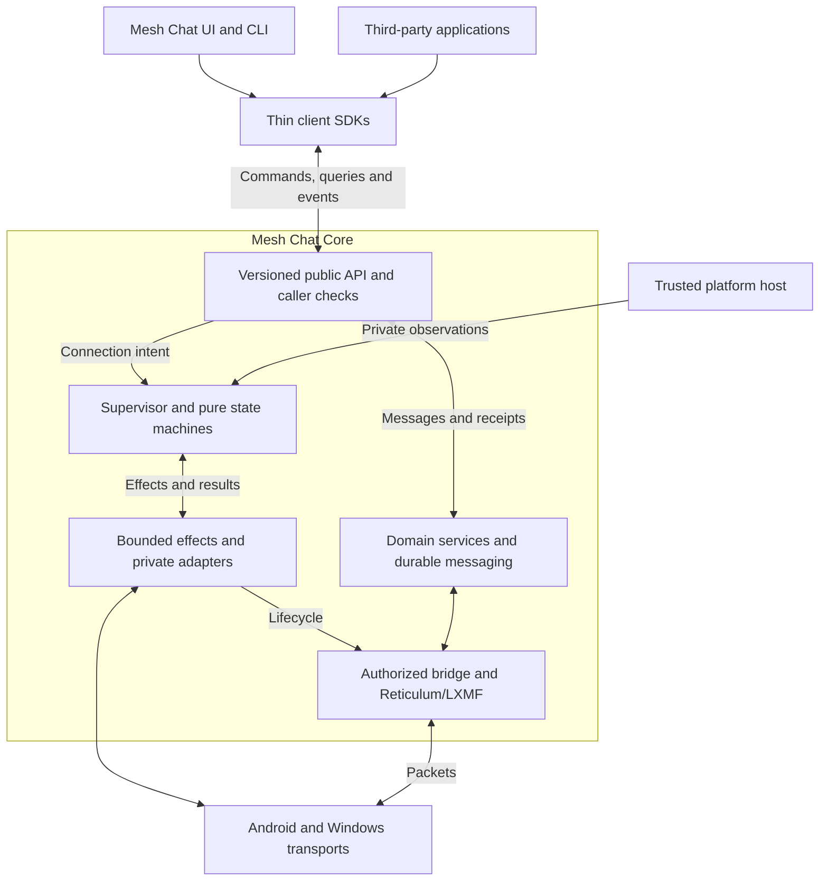

# Mesh Chat Connection Runtime Implementation Specification

Version 1.1 | October 29 2026 | Status Proposed implementation baseline

Repository baseline: `ahouchens/mesh-chat`, release `v0.9.65`, commit `59e3f713cfd7288fca537214f3c57476bb0a51d7`.

This specification defines a shared connection runtime for Mesh Chat. Its purpose is to make connection behavior easier for engineers and AI coding agents to understand, change, and verify while preserving the application's security and delivery guarantees. The primary decision is to place lifecycle policy in the protected Python service, behind deterministic state transitions and explicit adapter contracts. Windows and Android retain platform-specific transport implementations. The target product boundary is a reusable Mesh Chat Core, consumed through the same versioned public API by the Mesh Chat application, its production CLI, and third-party applications. This revision adds external integration requirements; it does not claim a new repository review or completed implementation.

The companion [implementation roadmap](Mesh_Chat_Connection_Runtime_Roadmap.md) divides this work into reviewable changes with dependencies, acceptance evidence, and rollback rules. Both files are intended for the repository's `docs/` directory. Creating this specification does not mark any implementation phase complete.

## 1 Objectives and completion boundaries

The implementation MUST achieve the following outcomes.

1. A connection policy change has one authoritative implementation shared by foreground and background execution.
2. Most policy changes can be verified without sockets, real-time sleeps, a WebView, or native application builds.
3. Late callbacks, duplicate events, cancellation, and restart cannot transfer ownership to an obsolete attempt.
4. Transport connectivity, bridge attachment, peer authentication, messaging readiness, and application delivery remain distinct evidence.
5. Existing consent, identity, workspace authorization, encrypted storage, logical message IDs, and authenticated receipts retain their semantics.
6. Real transport and packaged platform tests remain explicit qualification requirements.
7. CI selects dependent suites safely and proves which required tests actually executed.
8. Architecture checks and scoped agent instructions prevent policy from spreading back into UI and platform adapters.
9. The supported messaging surface is usable by an independent application without importing Mesh Chat internals or reproducing connection policy.

Three completion boundaries avoid overstating progress:

- **Shared policy complete:** one service-owned policy drives Android native WebRTC and the transitional desktop WebView adapter; bridge recovery and automatic reconnect use the same ownership model.
- **Headless messaging complete:** the production Windows and Android messaging paths can establish connections and deliver messages without React or a WebView. Windows requires a separately qualified native DataChannel adapter to reach this milestone. Audio and video calls are outside this milestone.
- **External integration complete (M5):** separately packaged Windows and Android consumers use supported SDKs and the public API to manage authorized messaging, durable work, and receipts; independent integration and compatibility gates pass. M4 headless operation alone does not satisfy this boundary.

### 1.1 Scope

In scope: automatic reconnect, adoption of manually established messaging transports, bridge recovery, transport retirement, platform lifecycle input, deterministic testing, adapter conformance, a common scenario runner, CI restructuring, documentation of ownership, a versioned application-facing messaging API, thin SDKs, redistributable runtime packaging, and independent consumer qualification.

The runtime initially controls WebRTC messaging. Existing native QUIC and other connectivity mechanisms receive narrow integration ports and common health observations. Their internal recovery implementations are not simultaneously rewritten. A later migration may consolidate their scheduling after parity is established.

Out of scope: rewriting Reticulum or LXMF; changing cryptography or signed peer wire formats; changing membership or consent defaults; replacing the encrypted vault; splitting into independently deployed services; changing media-call negotiation; guaranteeing connectivity through every NAT; guaranteeing execution after Android force-stop or other OS execution denial; headless media calls; a general-purpose raw networking SDK; a public network control daemon; a multi-tenant hosted service; or support for additional operating systems. Generalizing all workspace/admin features is not required for the first public messaging API.

No additional hosted infrastructure is required by this refactor. Preserve the current encrypted mailbox configuration, custom/self-hosted choices, explicit disabled settings, and transport disclosure/relay permissions. Local Worker and Coturn instances are test infrastructure.

## 2 Current implementation and reusable foundations

The baseline has several cooperating lifecycle owners:

| Current area | Existing responsibility | Target treatment |
| --- | --- | --- |
| `src/reconnect-coordinator.ts` | Foreground attempt scheduling and reconnect policy | Migrate policy into the service; retain only temporary compatibility translation |
| `service/src/mesh_chat/background_reconnect.py` | Android background attempt scheduling | Replace with the shared runtime after parity |
| `src/reconnect-runtime.ts` | Native, service, and renderer session reconciliation | Reduce to adapter registration and snapshot subscription |
| `src/webrtc-onboarding.ts` | Renderer packet bridge and repair loops | Move repair decisions into the service; keep required transitional packet plumbing |
| `src/WebRTCOnboarding.tsx` | Pairing UI plus transport orchestration | Keep user interaction; move messaging lifecycle orchestration behind commands |
| `service/src/mesh_chat/service.py` | Native events, claims, bridges, commands | Delegate connection policy to a composed runtime |
| `service/src/mesh_chat/reconnect_service.py` | Profiles, signatures, consent, mailbox operations | Preserve domain validation; expose narrow ports |
| `service/src/mesh_chat/direct_runtime.py` | Bounded leases and retirement epochs | Reuse its principles and compatible mechanisms |
| `NativeWebRtcHost.kt` | Android peer connections and JNI lifetime | Retain native ownership; implement the transport contract |
| `BackgroundRuntime.kt` | Android execution and service lifecycle | Emit capability/lifecycle observations; do not negotiate independently |
| `experiments/direct-app-host` | Shipping native dispatcher harness | Reuse for native QUIC qualification |

The existing v0.9.65 bridge recovery is a required regression case: a surviving desktop DataChannel must be able to resume messaging after a Python service interruption. Existing session reservations, stale-result checks, signed request reuse, and route-retirement safeguards MUST be preserved or superseded by tested equivalents.

Current docs contain historical descriptions that disagree with newer implementation, particularly foreground-only reconnect and Android WebView ownership. Phase 0 MUST record supersession explicitly rather than copy historical statements into new requirements.

## 3 Architecture and dependency rules

### 3.1 Runtime structure

The protected service contains one connection runtime. It manages a logical connection actor for each existing reconnect profile and device binding. An actor is serialized state and an inbox, not a dedicated OS process or thread.

During the first migration, the key MUST preserve the current personal/workspace profile distinction and include the local device, remote device when known, and profile/scope identity. A contact ID alone is insufficient for multiple devices. Do not merge authorization scopes or start sharing transports across scopes as part of this refactor.

A contact-wide Stop command expands to all currently relevant connection keys for that contact through the existing domain mapping. Unknown remote-device values must not collapse unrelated pending profiles into one key. Keep a bounded retirement record or equivalent epoch fencing so removing an actor does not allow a late completion to recreate it implicitly.

The runtime maintains durable desired state separately from ephemeral attempts, carriers, and bridge attachments. Adapters report observed facts. The runtime decides which actions to take. Snapshot projections expose derived status to the UI.



### 3.2 Proposed package

| Path under `service/src/mesh_chat/connection/` | Ownership |
| --- | --- |
| `model.py` | Immutable state variants, event/effect types, identifiers, policy configuration |
| `reducer.py` | Pure transitions and guards |
| `supervisor.py` | Serialized application of transitions, fairness, attempt admission |
| `effects.py` | Bounded execution and cancellation of external work |
| `ports.py` | Narrow transport, signaling, bridge, authority, persistence, and clock interfaces |
| `reconcile.py` | Reconstruct desired work and adopt surviving resources |
| `projection.py` | Stable, redacted UI snapshots and reason codes |
| `diagnostics.py` | Bounded transition records and counters |
| `adapters/` | Wrappers over existing service and native implementations |

Internal connection schemas and compatibility vectors belong under `contracts/connection/`. Public application API schemas belong separately under `contracts/core-api/`; `service/src/mesh_chat/core_api/` owns the application facade and caller checks, `sdk/typescript/` and `sdk/kotlin/` contain thin clients, and `examples/core-consumer/` is built against distributable packages only. The facade routes domain commands to existing domain services and connection intent to the supervisor; it does not funnel message payloads through the reducer. Simulator/scenario code belongs under `service/tools/connection_harness/`; tests belong under `service/tests/connection/`. Names may be adapted to repository conventions in Phase 0, but responsibility boundaries are mandatory.

### 3.3 Enforced dependency rules

- The model and reducer import only standard-library pure utilities and their own types. They cannot import `MeshChatService`, RNS, LXMF, sockets, platform APIs, UI code, or the vault.
- The reducer cannot read wall or monotonic time, create random values, sleep, start threads, perform I/O, or call callbacks. Time and randomness arrive as recorded inputs or explicit effects.
- The supervisor depends on ports, never on a concrete Kotlin, WebView, or Tauri implementation.
- Adapters cannot import UI components or determine retry policy. They may serialize native operations, enforce native resource limits, and translate native observations.
- The service composes domain ports; a new mixin that accesses arbitrary private service fields is not an acceptable boundary.
- UI code can submit intent and display projections. It cannot own messaging retry timers, author service connection status, or independently choose replacement attempts after migration.
- The supported Mesh Chat messaging UI and production CLI use the same public facade as external consumers. Privileged platform/bootstrap code uses separate private capabilities, never a public event-injection command.
- Public SDKs cannot import reducer, native adapter, vault, or private service implementations. Generated types do not grant access to internal operations. SDKs contain no independent peer retry policy.
- Media calls remain separately owned and must not close messaging carriers.
- Reticulum/LXMF process-global runtime ownership remains unchanged: one initialized runtime per production service context. Test peers requiring separate globals run in separate processes.

Enforce imports using AST/dependency checks. Enforce behavioral contracts with executing tests, not only assertions that particular strings occur in source files.

### 3.4 Reusable core and supported integration model

Mesh Chat Core is a logical product/package boundary around the existing protected Python service, domain services, and required native hosts/adapters. It is not another independently deployed network service or a rewrite into a single language. The core owns keys, authorized relationships, encrypted persistence, connection policy, transport bindings, and delivery semantics. Clients own presentation and application workflows.

The initial external integration targets are Windows and Android. On Windows, prefer an application-owned runtime process/sidecar reached through private, authenticated local IPC. On Android, package an app-owned service/runtime with a Kotlin facade; the host app supplies the documented lifecycle and permission integration. Verify both packaging models in PR15 before promising support. Running headlessly does not imply one Python library can be imported into any process, that native dependencies disappear, or that background execution is always available.

Each host application owns an isolated runtime/data directory and bootstrap authority. Do not attach arbitrary apps to the user's installed Mesh Chat identity, share vaults, or introduce cross-application identity sharing by default. Preserve one RNS/LXMF runtime per service context; independent peers/apps requiring independent runtime globals use process isolation. The API must enforce profile/scope access within its authenticated caller context. The host application remains part of its own runtime's trust boundary.

Define the public contract in M1, adopt it incrementally in Mesh Chat during M2–M4, and qualify its external distribution in M5. Until M5 acceptance, label the integration surface experimental. The production CLI uses this public interface; the fault-injection harness retains separate test-only capabilities that are absent from shipping distributions.

## 4 State and ownership model

### 4.1 Composed state

Use typed immutable variants or tagged dataclasses with a strict type checker. Each variant contains only the fields legal for that phase. Avoid one record with many unrelated optional flags. Do not duplicate WebRTC's own low-level state machine; translate its observations into application decisions.

| Region | States and meaning |
| --- | --- |
| Desired connection | `ENABLED`, `STOPPED`; reflects persisted user/domain intent |
| Runtime execution | `AVAILABLE`, `PAUSED`, `LOCKED`, `SHUTTING_DOWN`; actual execution and key availability |
| Negotiation | `IDLE`, `WAIT_NETWORK`, `WAIT_REQUEST`, `WAIT_OFFER`, `GATHERING_ICE`, `WAIT_ANSWER`, `CHECKING`, `BACKOFF`, `BLOCKED` |
| Carrier | `ABSENT`, `OPEN`, `SUSPECT`, `CLOSING`; current adopted transport resource |
| Bridge | `DETACHED`, `ATTACHING`, `PATH_PENDING`, `READY`, `RESTORING`, `DETACHING` |

Negotiation state includes role, phase deadline, request reference, and attempt ownership where applicable. Authentication is represented by validated, resource-bound evidence, not an independently writable `authenticated` flag. Profile/capability policy is a validated input with a revision.

The reducer MUST enforce cross-region invariants. For example, `READY` requires a current authorized carrier, a matching live bridge, and current messaging-path evidence. A carrier may remain `OPEN` while its bridge is `RESTORING`.

`STOPPED`, `BLOCKED`, and `WAIT_NETWORK` are legitimate stable outcomes. A peer remaining offline is not itself a stuck state if attempts are bounded, retry behavior is explicit, and the projection is accurate.

### 4.2 Correlation and ownership

Each command/effect/event MUST identify the relevant subset of:

| Field | Purpose |
| --- | --- |
| `runtime_epoch` | Fresh unpredictable identifier for each service runtime incarnation |
| `connection_key` | Exact profile, device, and authorization context |
| `attempt_generation` | Monotonic local generation for negotiation ownership within an epoch |
| `attempt_id` | Existing signed protocol attempt identity when applicable |
| `operation_id` | Identity of one dispatched operation and its duplicate completion |
| `resource_id` | Exact native carrier or bridge being referenced |
| `timer_id` | Exact timer instance; independent of its deadline |
| `policy_revision` | Consent/authority revision under which an action was authorized |
| `adapter_epoch` | Native/renderer adapter incarnation when it can outlive or restart separately from the service |

These are internal control identifiers. Their introduction MUST NOT silently change signed peer documents. A valid request is reused according to the existing protocol until expiration/completion; a local poll or timeout does not automatically create a new signed request.

Only the serialized owner mutates actor state. Blocking native, cryptographic, mailbox, and storage work runs outside the actor's critical section and returns correlated events. The adapter MUST serialize conflicting operations on the same peer connection.

An obsolete completion cannot advance state or retire another resource. If it contains a newly allocated handle, the effect runner disposes of that exact handle. Cleanup must remain possible even when the actor has already terminated.

For an adopted carrier, continuing health events are validated against its resource/adapter identity rather than a negotiation generation that has already completed. This prevents successful negotiation cleanup from invalidating a healthy session.

### 4.3 Concurrency and replacement

One owner may authorize a current negotiation for a connection key. A verified active carrier may coexist with one bounded replacement candidate. Adoption is a serialized compare-and-swap against the expected active resource and policy revision. Retire the old usable carrier only after the replacement is authorized and messaging-ready, unless security or confirmed failure requires immediate retirement.

Permit overlapping active/candidate resources only where the adapter supports distinct resources safely. Otherwise report the capability and use explicit break-before-create behavior for a failed carrier. Do not make an unsupported native adapter pretend to perform seamless handover.

Manual pairing and automatic reconnect must acquire ownership through the same registry before they can attach messaging bridges. Pending onboarding is a separate limited authorization scope. Closing a completed pairing dialog does not destroy an adopted messaging carrier; explicit cancel, lock, stop, or revocation follows its documented semantics.

## 5 Transition and effect requirements

The implementation MUST provide an exhaustive handler classification for every state/event variant: transition, guarded rejection, or expected no-op. Unrecognized/untrusted input is rejected safely with a bounded reason code. An internal impossible transition fails tests and produces a structured runtime fault without granting access.

The following cases are mandatory; the implementation registry must cover the remaining combinations.

| Current context and event | Required result | Required effects |
| --- | --- | --- |
| Eligible idle profile and usable execution/network | Begin role-appropriate negotiation | Reserve ownership; start permitted signaling work |
| Eligible profile with no usable network | `WAIT_NETWORK` | No polling storm or occupied negotiation worker |
| `GATHERING_ICE` and confirmed loss of the interface used by the attempt | Invalidate attempt; `WAIT_NETWORK` | Cancel work/timers; retire only its resources |
| Generic network-change hint while a carrier is usable | Reassess health without immediate teardown | Ask adapter for evidence; preserve healthy path |
| Current verified offer and correct role | Gather answer for that attempt | Apply exact verified SDP; retain fingerprint binding |
| Stale, duplicate, wrong-role, or wrong-attempt signaling | No unauthorized advancement | Ignore/reject according to existing replay rules |
| Invalid signature or peer binding | Reject that document | Record typed error; never weaken verification or repeatedly retry the same bad document |
| Authentication/configuration failure requiring user action | `BLOCKED` when no usable alternative exists | Stop futile attempts; preserve independently authorized healthy carrier |
| Valid current DataChannel open | Adopt eligible carrier; `ATTACHING` | Attach authorized bridge; then request messaging readiness |
| Carrier open but messaging path absent | `PATH_PENDING` | Bounded path recovery; never report message delivered |
| Current path/ratchet readiness established | Bridge `READY` | Wake the existing durable outbox |
| ICE `disconnected` on the active resource | Carrier `SUSPECT` | Start one resource-bound grace timer |
| Same resource recovers before grace expires | Carrier `OPEN` | Cancel only its grace timer |
| Grace expires or carrier conclusively fails | Retire affected resource; schedule permitted recovery | Detach old bridge, preserve queued logical messages |
| Bridge missing while carrier remains healthy | Bridge `RESTORING` | Reattach under current authority; restore path readiness |
| Mailbox failure while messaging is healthy | Keep active carrier and bridge | Report degraded future-reconnect capability separately |
| Phase deadline expires | Close that attempt; `BACKOFF` or a classified stable state | Cancel matching effects and timers; preserve valid reusable request when allowed |
| Foreground/background transition | Same policy owner; reevaluate execution capabilities | Retain eligible native carrier; suspend unsupported work |
| User Stop | Persist stopped intent; quiesce that profile | Invalidate pending effects and close affected resources according to current Stop semantics |
| Lock or runtime shutdown | Block new work immediately | Invalidate epoch authority; bounded teardown; release keys through existing service lifecycle |
| Scope revoked or privacy permission withdrawn | Recheck/retire affected resources | Prevent new disallowed traffic before asynchronous cleanup completes |
| Old timer or completion after replacement/restart | No change to current connection | Drop safely; dispose only orphan resources |

### 5.1 Pure transition API

Illustrative shape, not a requirement to reuse these exact type names:

```python
@dataclass(frozen=True)
class Transition:
    state: ConnectionState
    effects: tuple[Effect, ...]
    records: tuple[TransitionRecord, ...]

def transition(state: ConnectionState, event: Event) -> Transition:
    ...
```

Time advance is an event. Scheduling a timer is an effect. Random jitter is supplied through a seeded policy input in tests and a production random source in the effect environment. IDs needed by the reducer are supplied, not generated implicitly.

Durable writes are acknowledged effects. A state that depends on a persisted mutation cannot claim durable success before the write completes. Stop/revocation also closes the immediate in-memory authorization gate so failed or delayed writes cannot permit continued disallowed work in the current process. Surface persistence failure explicitly; do not claim the preference survived restart.

### 5.2 Deadlines and retry budgets

Separate mailbox waiting, native gathering, answer waiting, DataChannel opening, bridge attachment, and path readiness deadlines. One slow gathering operation must not consume an unrelated subsequent phase's entire budget.

Phase 0 inventories current values. Initial extraction preserves behavior where possible: two concurrent reconnect attempts, a ten-second transient disconnect grace, and capped backoff based on the existing 1/2/5/15/30/60 second sequence. Android currently limits native sessions to 16. These are existing observations, not permission to raise capacity.

Where foreground/background values differ, document the chosen shared policy and parity tests before changing them. Use monotonic deadlines within a runtime. Reconstruct deadlines from validated persisted expiry information after restart; never persist a monotonic clock value as portable time. Cap clock-skew effects on expiry, and never extend a signed authorization because the local clock moved.

Use bounded jitter, honor server rate-limit cooldowns, and schedule peers fairly. Waiting for an offline peer must not monopolize scarce native creation slots. Manual retry cannot bypass consent, revocation, rate limits, or resource budgets.

### 5.3 Queue and cancellation behavior

Define count and byte limits for each queue. Keep bulk packet ingress distinct from lifecycle control. Coalesce redundant statistics and snapshot updates. Stop, lock, revocation, and cancellation must have a bounded admission path and cannot be silently discarded behind packet traffic.

If lifecycle delivery cannot be guaranteed, fail the affected adapter closed and reconcile; do not silently lose a critical terminal event. Packet overflow follows the existing transport loss/backpressure contract and records counters. The runtime must not accumulate unbounded callbacks during a slow native call.

Cancellation is cooperative plus fenced completion: marking work canceled does not prove JNI or another native operation has stopped. Keep allocation reservations until a late creation is accounted for. Native calls have deadlines; a wedged adapter is quarantined and produces explicit failure. Do not abandon threads while releasing keys they can still access. Existing process/isolation boundaries govern forced teardown.

## 6 Contracts and authority boundaries

### 6.1 Public commands and snapshots

Expose intent-oriented commands such as `connection_start`, `connection_stop`, `connection_retry`, and `connection_snapshot`. Platform lifecycle and adapter-result submission are private capabilities, not ordinary renderer-accessible authority changes. Existing public command names may remain compatibility wrappers during migration.

Every command has a schema version, bounded fields, correlation ID, defined idempotency, and typed errors. Reuse the existing command cache/durable operation semantics where applicable. Do not cache an obsolete success across runtime incarnations as evidence of a live resource.

Snapshots include sequence number, runtime epoch, profile identity, desired state, negotiation phase, carrier health, bridge readiness, safe reason code, next retry information, and age of relevant evidence. A renderer detecting a sequence gap or epoch change requests a fresh snapshot; it never reconstructs authoritative state by guessing missed events.

Keep existing IPC framing and bounds unless an explicitly reviewed compatibility change requires otherwise. The baseline uses version 1 length-prefixed JSON with a four-MiB frame ceiling. Additive connection contracts have their own version/capability negotiation. Local IPC versioning, peer signed-document versioning, and application release versioning are distinct.

### 6.2 Transport port

The transport port supports create offer, accept offer, apply answer, inspect current resource, close exact resource, packet/control I/O, and lifecycle observations. An optional restart/migration operation is capability-gated. It must not imply all adapters support ICE restart or live migration.

Each operation defines its deadline, ownership context, maximum payload sizes, duplicate behavior, and whether completion can occur after cancellation. An operation completion is not permission to adopt a resource; adoption belongs to the runtime after authority checks.

Preserve complete-SDP signaling and existing deterministic request/offer/answer roles during the initial migration. Do not introduce trickle ICE or a new glare algorithm in the same change. Verify signed SDP, DTLS fingerprint, peer identity, attempt identity, and channel purpose before allowing the corresponding application traffic.

### 6.3 Signaling and authority ports

Reuse current mailbox encryption, signature verification, expiry, replay checks, capability storage, and request reuse. A verification port returns typed verified evidence bound to a specific request and resource context. External JSON cannot instantiate trusted evidence directly.

Classify failures into transient transport, rate-limited, unavailable configuration, invalid external document, authorization revoked, unsupported capability, and internal fault. Do not convert all failures into generic ICE failure or infinite retry.

Reconnect cannot create contact approval, workspace membership, or new disclosure/relay consent. Pending onboarding may exchange only the control traffic its existing scope permits. Ordinary contact/workspace messages require their existing authorization. A change in privacy policy must not silently fall back from relay-only to direct disclosure.

### 6.4 Bridge and delivery ports

Bridge attach/detach operations are exact-resource and idempotent. Attachment preserves bounded startup packets and installs consumers before an announce can be lost. A detached old interface cannot remove a route or cached LXMF link that belongs to a replacement.

Retain existing logical message IDs and atomic message/outbox transactions. Duplicate transport delivery must not duplicate visible messages. `RECEIVED_BY_ENDPOINT`, propagation storage, and `DELIVERED` retain their current distinct meanings; only the existing authenticated application receipt can establish `DELIVERED`.

Removing one scope must not invalidate unrelated profiles or messages. A failed replacement must not destroy a still-authorized healthy path. Lack of fresh health evidence is reported as unknown/suspect, not silently promoted to success.

### 6.5 Supported application API

The versioned core API is distinct from the private transport contract in 6.2. The following operation families are proposed contract scope, not claims that these methods already exist. PR02 defines initial schemas, PR14 implements the experimental facade, and PR17 freezes the first supported version after PR16 consumer validation.

| Family | Required behavior |
| --- | --- |
| Runtime and capabilities | Attach/start through the host's bootstrap; query readiness, supported operations, limits, versions, and platform availability; owner-authorized graceful stop |
| Profile and identity | Create/select and unlock an authorized profile; lock it; expose public identity metadata without exporting private key material |
| Peer relationship | Create/accept pairing material, inspect peer identity evidence, explicitly approve or revoke within caller scope; never make reconnect imply trust |
| Connection intent | Start, stop, retry, and query a permitted profile/device connection; return truthful negotiation, carrier, and messaging readiness projections |
| Messaging | Enqueue supported message types to an authorized recipient, return a durable logical message ID after commit, query message/receipt state, and enumerate received messages |
| Events and recovery | Subscribe to bounded connection/message/receipt events, detect gaps, resume where retention permits, and resynchronize through scoped queries |
| Diagnostics | Query safe reason codes and bounded redacted diagnostics; never expose keys, raw SDP, mailbox secrets, or private adapter control |

Every operation declares its permission, scope, request/result bounds, error taxonomy, idempotency, cancellation, and durability semantics. Keep public handles opaque and scoped; clients cannot submit internal resource IDs as authority. Invalid/unsupported requests return stable typed errors rather than raw exceptions. A retryable error is a hint subject to declared cooldown and permissions, not an instruction to start another policy loop.

The runtime authenticates local callers and binds them to allowed operations/profile scopes. The Windows IPC design must specify OS access controls and a protected bootstrap/ownership binding; the Android design must specify application/service access and trusted host binding. Localhost reachability alone grants no authority. Untrusted clients cannot submit native completion events, lifecycle facts, consent evidence, arbitrary filesystem paths, or a claimed authenticated receipt. Remote administration is outside this API version.

Use the same facade for Mesh Chat's supported messaging workflows and external applications. Existing workspace/admin or media operations outside that scope remain explicit separate interfaces; do not declare the entire application API public by accident. An owner may initiate approved identity/pairing workflows, but no SDK can silently grant a peer consent or bypass vault locking.

### 6.6 Messaging, event, and lifecycle semantics

- A successful enqueue acknowledges the existing message/outbox transaction, not delivery. Only the existing authenticated application receipt establishes `DELIVERED`.
- Mutating requests carry caller/profile-scoped idempotency keys. A retried enqueue with the same key and payload resolves to the original logical message; conflicting payload reuse fails. Define durable retention of the key and behavior after expiration. A timeout/cancel after dispatch is an unknown outcome until queried, not proof that the write did not occur.
- Event streams are bounded, ordered within a declared stream, and may redeliver after reconnect. Events carry an event ID and message ID where applicable. Consumers deduplicate notifications and may query durable message state; do not promise exactly-once callback execution.
- Connection snapshots retain runtime epoch and sequence semantics from 6.1. Durable message/receipt cursors are separately scoped and survive runtime restart within a documented retention window. A stale cursor yields an explicit resynchronization response; clients cannot silently skip missing records. Define a snapshot/high-watermark plus replay handshake that prevents a query/subscribe race.
- Subscription acknowledgment advances consumer progress only. It cannot manufacture a peer delivery receipt. A slow consumer receives a bounded gap/resync outcome or disconnect; it cannot stall connection control or create an unbounded queue.
- Detaching an SDK or closing a window does not imply stopping the runtime or deleting durable work. Document who owns the runtime process/service, when it may outlive its UI, how clients reattach, and which explicit owner operation stops it. Platform execution denial is reported truthfully.
- SDK connection recovery reconnects to the existing local runtime and resynchronizes observations. It does not create competing runtime instances or reimplement peer reconnect. Exclusive runtime/data-directory ownership must be checked before startup.

### 6.7 Packaging, SDKs, and compatibility

Start with a TypeScript client for the supported Windows host integration and a Kotlin client for Android. They wrap the same language-neutral schemas and semantics while using platform-appropriate bindings. Do not imply browser JavaScript can directly launch a sidecar or access privileged IPC. Additional language bindings and OS targets require separate conformance and packaging evidence.

Distribute the production CLI, runtime/native dependencies, SDK packages, schemas, and reference documentation with a support matrix. Record OS/architecture, required host permissions, runtime/SDK/API versions, package digests, upgrade/data compatibility, shutdown behavior, and redistribution/license obligations. Validate clean installation and upgrades from released/staged packages without repository imports. Document storage paths, ownership, safe uninstall/export behavior, and the policy for preserving user data. Packaging must not expose test identities or fault-injection controls.

Keep public API, SDK/package, internal IPC, and peer wire versions distinct. Publish a supported compatibility matrix; capability negotiation rejects incompatible combinations before side effects. Within a supported public API major version, preserve existing operations, error meanings, message semantics, and documented defaults. Additive fields/capabilities require tolerant clients and conformance fixtures. A breaking public contract requires a new major version and migration guidance, not a silent change to reconnect or delivery semantics. Freeze release compatibility windows explicitly; do not promise unlimited historical support.

## 7 Persistence and process recovery

Persist desired connection preferences, approved relationships, capabilities, replay state, and durable message work through existing stores. Do not persist a live peer connection, reusable DTLS state, or `CONNECTED` as proof of post-restart readiness.

On startup:

1. Establish a fresh runtime epoch after the protected service can access its authorized profile.
2. Load current desired profiles and scope revisions, respecting explicit Stop and disabled settings.
3. Inspect supported adapters for surviving resources without trusting renderer-supplied identity claims.
4. Reconcile each reported resource with protected profile authority and its stored/validated binding evidence.
5. Adopt and reattach a surviving carrier only when that evidence suffices; otherwise retire it and perform a fresh permitted negotiation.
6. Resume existing outbox work after messaging readiness is established.

Desktop transitional recovery needs special care because the WebView carrier can outlive the Python service. Adapter registration includes a fresh private binding to the service epoch and enough verifiable evidence to preserve the current v0.9.65 recovery behavior. An old session handle or a peer destination string alone is not proof. Define and test this handshake before replacing renderer repair logic.

Android process death destroys native connections in that process. On permitted restart and unlock, negotiate new sessions. A fixture that merely reopens a vault is not evidence of actual process-death recovery. Force-stop and explicit lock remain stopped until the platform/user permits execution again.

Use additive persistence changes during rollout. Do not require rollback to reinterpret partially migrated records. A full event-sourced database is not required: the reducer's trace supports diagnostics and deterministic testing, while existing transactional stores remain authoritative for durable domain state.

## 8 Mandatory invariants

| ID | Invariant |
| --- | --- |
| INV01 | One policy owner and at most one current negotiation per connection key |
| INV02 | Obsolete epochs, generations, operations, and timers cannot mutate current ownership |
| INV03 | Late successful allocation is either adopted by its current owner or disposed of exactly |
| INV04 | Revoked, stopped, locked, or incompatible authorization cannot start or adopt disallowed work |
| INV05 | Reconnect cannot grant trust, membership, or privacy/relay permissions |
| INV06 | Every adopted carrier is bound to verified peer/session evidence |
| INV07 | Messaging-ready requires a current authorized bridge and current route/readiness evidence |
| INV08 | A healthy carrier can survive bridge repair or mailbox outage when its authority remains valid |
| INV09 | Old cleanup cannot detach a replacement's bridge, route, or link |
| INV10 | Logical messages survive retry/restart without duplicate visible delivery |
| INV11 | Delivery status cannot advance to application-delivered without its authenticated receipt |
| INV12 | All queues, workers, native resources, traces, and retries have explicit bounds |
| INV13 | Every active phase has a deadline, cancellation path, and classified exit |
| INV14 | Scheduling eventually serves eligible peers under fair execution and available capacity |
| INV15 | Explicit Stop and disabled settings survive restart when the command reports durable success |
| INV16 | Foreground/background transitions retain one policy owner |
| INV17 | UI closure and media-call teardown do not destroy an adopted messaging connection |
| INV18 | Identical initial state and event trace produce identical transitions and effects |
| INV19 | Failed persistence never masquerades as committed durable state |
| INV20 | Required release suites cannot silently pass by skipping their environment-dependent tests |
| INV21 | Public clients and SDKs cannot bypass caller/profile authority or invoke private adapter/lifecycle control |
| INV22 | SDK/UI consumers do not own peer policy, native resources, or a second runtime for an already-owned data directory |
| INV23 | A committed enqueue retains one logical message ID across retries within its documented idempotency window; acknowledgments do not imply delivery |
| INV24 | Event gaps, restart, and cursor expiry are explicit and recoverable without silently losing durable message visibility |
| INV25 | Supported API/SDK combinations preserve declared semantics; incompatible combinations fail before side effects |
| INV26 | Independent consumers run from supported packages with isolated app-owned state and no private source imports or test authority |

Safety invariants hold under arbitrary modeled event order. Recovery is conditional: both peers execute, authority remains valid, a permitted path and required signaling are usable, and the network remains stable long enough for bounded phases. No guarantee assumes that Internet access alone creates a reachable peer.

## 9 Test architecture and evidence

### 9.1 Deterministic simulation

Run the production reducer and supervisor against a virtual monotonic clock, seeded random source, fake effect completion queue, and real contract validation. Hypothesis stateful tests generate actions and their interleavings. An independent oracle checks ownership, resources, durable intent, message identity, and deadlines rather than merely restating the transition table.

Inject completion delay, duplication, cancellation, partitions, stale signatures/documents, role collisions, old callbacks, service/adapter epoch changes, bridge loss, rate limits, and persistence failures. For conditional liveness tests, stop introducing faults, restore stated assumptions, advance simulated time, and require progress within the configured bound. Do not infer liveness from a randomly generated trace that never permits recovery.

Initial workload targets: 1,000 sequences of up to 100 events for relevant PRs; a larger scheduled corpus capped by an explicit compute budget. Store minimized failing traces and deterministic regression fixtures. Seeds alone are insufficient if dependencies change: retain the normalized event trace, policy, schema, and implementation version. Use test identities only.

### 9.2 Contract conformance

Run the same command/result scenarios against each supported adapter: duplicate close, delayed create completion after cancel, close during gathering, terminal event delivery, payload limits, invalid SDP, wrong resource, missing capability, and shutdown.

Fake adapters establish orchestration behavior. Real adapters establish native behavior. Keep both evidence labels. Existing source-string checks may remain narrowly for packaging rules, but cannot qualify runtime ownership or recovery.

### 9.3 Real network impairment

Use the existing isolated NAT harness as a foundation. Add `tc netem` for UDP/TCP delay, jitter, loss, duplication, and reordering. Use Toxiproxy for TCP signaling failures only. Run a local encrypted signaling Worker and Coturn when the scenario requires them.

For each topology, prove that traffic traverses the impaired link. Record selected ICE path type and packet counters; add a negative control that blocks that path and observes failure. Prevent alternate LAN or host candidates from bypassing the scenario. Apply impairment independently in each direction. Use network namespaces/firewall/NAT rules for address and mapping changes; packet delay alone does not emulate NAT.

Linux namespace tests do not prove Windows routing behavior. Cross-platform qualification requires a routed lab/VM topology that carries the actual Windows and Android traffic through the impairment gateway. Hosted runners are not assumed to share a LAN. Keep impairment inside disposable test networks.

### 9.4 Required scenario matrix

| ID | Scenario | Required evidence |
| --- | --- | --- |
| SC01 | Clean connection in both protocol roles | Verified peer binding, bridge/path readiness, messages and receipts both ways |
| SC02 | Simultaneous start and duplicate signaling | One current attempt/adoption per profile; deterministic role behavior |
| SC03 | Old answer, native callback, and timer after cancel/replacement | Current connection unchanged; obsolete allocation cleaned up |
| SC04 | Thirty-second total partition then restoration | Same logical queued messages deliver once; bounded recovery |
| SC05 | One-way loss and delayed control traffic | No false readiness/delivery; recovery when assumptions return |
| SC06 | Mailbox outage while carrier is healthy | Existing messages continue; future-reconnect degradation is explicit |
| SC07 | Carrier fails while mailbox remains healthy | New permitted negotiation and application receipt recovery |
| SC08 | Python service crash while desktop carrier survives | Verified carrier adoption, bridge repair, idle and queued-message recovery |
| SC09 | Peer and adapter process restart | New epoch/session; explicit preferences and identities preserved |
| SC10 | Stop, lock, revocation, or privacy change during native creation | No late resurrection or disallowed traffic; resources accounted for |
| SC11 | Foreground/background changes during negotiation and ready state | Single policy owner; supported native transport retained |
| SC12 | Direct path, forced relay, UDP denial, and NAT rebinding | Actual selected path and negative-control evidence |
| SC13 | Multiple contacts and multiple devices | Fairness, scope isolation, no unrelated teardown |
| SC14 | Delayed bridge attachment and missing path | Bounded startup queues; truthful readiness; eventual receipts when possible |
| SC15 | Retry across lost receipt, duplicate packet, and service restart | Stable logical IDs and exactly one visible message per logical ID |
| SC16 | Queue saturation and shutdown | Enforced budgets; control remains responsive; no leaked owned resources |
| SC17 | Repeated media calls and pairing-dialog closure | Messaging transport and delivery remain usable |
| SC18 | Compatibility with the baseline peer protocol | Existing signed fixtures verify; no unexpected wire-version change |
| SC19 | Persistence failure during intent change or adoption bookkeeping | No false durable success; safe in-memory behavior and classified recovery |
| SC20 | Release environment missing a required native/test artifact | Gate fails explicitly instead of silently skipping |
| SC21 | Independent Windows and Android applications install packages and exchange messages | Public SDK/API only; no repository/private imports; production headless transports and authenticated receipts |
| SC22 | Wrong caller, wrong profile/scope, and attempts to invoke private control | Rejected before effects; no key exposure, forged receipt, or cross-app vault access |
| SC23 | Enqueue reply lost, timeout/cancel, and duplicate request after restart | Original durable message resolved by idempotency key; conflicting payload rejected; truthful outcome |
| SC24 | Slow subscriber, stream disconnect, restart, and expired cursor | Bounded queues, explicit gaps, safe snapshot/replay resync, duplicate notifications handled |
| SC25 | Supported and incompatible SDK/API/package version pairs | Compatibility matrix passes; incompatible pair rejected before mutation; upgrade preserves data |
| SC26 | UI/client closes, multiple local clients attach, and owner stops the runtime | Documented runtime lifetime; no competing instance, leaked owned resource, or lost queued work |

### 9.5 Common headless scenario runner

Provide one scenario format and runner controlling production entry points through private IPC or Android instrumentation. Share scenario assertions; do not create a separate implementation of negotiation inside the harness.

Target commands to implement, not commands available in the baseline:

```sh
python -m tools.connection_harness simulate --scenario stale_completion --seed 42
python -m tools.connection_harness run --pair windows-android --scenario partition_30s
python -m tools.connection_harness soak --pair windows-android --iterations 100
```

The runner accepts explicit artifact paths, allocates isolated test profiles/identities, validates readiness, injects faults, asserts application receipts, and performs bounded cleanup. It refuses to target an ordinary user profile or the production mailbox by default. Test keys and localhost overrides must be absent from shipping artifacts.

Use a minimal automated WebView2 host for transitional Windows qualification with the production adapter code. This reaches automation without claiming fully headless production transport. True headless Windows qualification requires the native desktop adapter. Android instrumentation can drive the existing native service path without React. Two real Reticulum peers require isolated process contexts.

The 100-iteration gate includes both roles, real messages, receipts, resource accounting, and periodic cold starts. Passing 100 clean handshakes alone is not proof of fault recovery. Run the fault matrix separately. Keep expensive repetitions in scheduled and release qualification rather than every UI PR.

### 9.6 Initial acceptance budgets

These are proposed test ceilings and engineering targets, not measured capabilities. Phase 0 records the actual baseline and Phase 2 commits the policy values.

- Fast deterministic connection suite: target at most two minutes on the selected CI runner, measured separately from setup and queue time.
- Nominal bridge repair with a healthy carrier and available restarted service: messaging-ready within 20 seconds.
- Automatic recovery after the 30-second partition: messaging-ready within 240 seconds of fault removal, with permitted signaling/path, running peers, valid authority, and a declared 150 ms RTT profile with bounded jitter/loss.
- After messaging-ready: application receipts for the queued test batch within 30 seconds under that profile.
- Resource cleanup: no actor-owned carrier/bridge/timer remains after a terminal close acknowledgement and the adapter's bounded cleanup interval. Native allocation completing late remains counted until disposed of.
- Soak: 100 iterations with zero invariant violations, zero duplicate visible logical messages, and no growth in live owned handles or queued work after each quiescence checkpoint. Memory is tracked against a warmed baseline to distinguish caches from retained resources.

Specify latency as RTT or one-way delay explicitly. A default lab profile may use 75 ms delay in each direction to approximate 150 ms RTT, plus separately declared jitter and loss. Virtual-time recovery tests must not be reported as satisfying real-clock budgets.

### 9.7 Independent consumer qualification

M5 requires a small application built in a separate consumer workspace with access only to versioned distribution artifacts and public documentation. No source checkout, private Python imports, test dispatcher, or fault-injection API may be needed by the application. The test infrastructure may impair its network or terminate processes externally.

Provide a minimal Windows consumer using the TypeScript SDK and an Android consumer using the Kotlin SDK. Run the actual packaged runtime, create isolated app-owned identities, complete explicit pairing/approval, exchange durable messages in both roles, and verify authenticated receipts. Exercise SC21–SC26 plus the applicable partition, lock/revocation, process restart, and receipt recovery cases from SC01–SC20. Prove the same release candidate supports Mesh Chat's messaging UI through that facade.

Record runtime, native adapter, SDK, API, package, and platform identities in the evidence manifest. Build examples against pinned staged release packages so unpublished source changes cannot masquerade as compatibility. Release candidates may be qualified in a private staging repository; external publication is a separate release action. A sample that merely invokes the internal test harness does not qualify M5.

## 10 CI selection and release gates

### 10.1 Observed baseline

These are single-run observations from the review, not percentiles or promises.

| Workflow/job | Duration | Dominant measured step |
| --- | --- | --- |
| Main CI verification | 5m 56s | Validation/test step 5m 29s |
| PR Android WebRTC | 15m 24s | Interoperability/recovery tests 10m 04s; debug APK build 2m 15s |
| PR Direct Fabric Linux | 21m 55s | Durable recovery step 12m 23s |
| PR Direct Fabric Windows | 27m 13s | Durable recovery step 15m 27s |
| Release Windows | 11m 13s | Build/verify artifacts 7m 05s |

The first optimization target is repeated real-time recovery and broad suite selection. Caching alone will not remove the dominant waits. Preserve a representative real-clock suite while moving exhaustive policy combinations to simulation.

### 10.2 Dependency-aware selection

| Changed area | Minimum required coverage |
| --- | --- |
| UI presentation only, with enforced isolation | UI tests, typecheck/build, command/snapshot consumer contract |
| Public core API, SDK, or runtime packaging | Producer/consumer schemas, caller isolation, event/idempotency semantics, supported compatibility matrix, independent packaged consumer smoke on affected platforms |
| Pure connection policy | Deterministic/property corpus, contracts, representative real service integration, affected adapter smoke |
| IPC or connection contract | Producer and all consumer contracts; Windows/Android adapter checks; compatibility fixtures |
| Signaling/identity/consent/serialization | Security/protocol corpus, Worker tests where relevant, both platform integrations |
| Android adapter/lifecycle | Native conformance, optimized smoke/JNI checks, actual lifecycle scenarios, packaging checks |
| Desktop adapter/lifecycle | WebView2 or native conformance as shipped, sidecar restart and packaged host checks |
| QUIC/direct adapter | Relevant Rust tests, service binding/recovery, isolated NAT/packet harness |
| Shared dependencies, lockfiles, toolchains, build scripts, test selector, or unknown path | Conservative expanded coverage |
| Release | Complete declared automated matrix and exact-artifact qualification |

Until boundaries and the dependency graph are enforced, broad changes to `service.py`, `workspace_service.py`, or adapter dispatchers retain broad coverage. Do not narrow YAML path filters merely because a directory name suggests isolation.

Use a single required final gate that always runs. It validates the selected-suite manifest, success status, and required execution counts. An unexpected canceled, failed, or skipped required job fails the gate. Handle new files, deletions, renames, shared configurations, and merge-queue events conservatively.

Split the current serial generic verification into independent suites where safe. Shard expensive process-isolated scenarios with unique ports/profiles. Build adapters once per compatible artifact set and reuse those artifacts for tests. Cache keys include relevant source, dependencies, target, toolchain, features, and build profile; a cache hit is not test evidence.

### 10.3 Qualification manifest

Each required suite emits machine-readable evidence containing source commit/tree, artifact digest where applicable, internal and public contract versions, SDK/package versions and digests where applicable, policy profile, platform/runtime versions, scenario IDs, tests collected/executed/passed/failed/skipped, skip reasons, duration, seed/trace references, and cleanup outcome.

Release publication depends on an aggregator validating the full required matrix for the exact release source and artifacts. A successful PR run on a different merge commit is not automatically qualification. Environment-dependent native and packaged suites fail if required binaries are missing; expected platform exclusions must be declared in the matrix.

Do not label emulator, simulated lifecycle, local peer, or native packet-count evidence as physical cross-device messaging evidence. Maintain a separate physical Windows/Android checklist for Wi-Fi/cellular switching, screen-off/Doze, real process death, Stop/lock, and end-to-end receipts. The roadmap defines which gates must be satisfied for each completion milestone.

## 11 Diagnostics and AI agent workflow

Keep a bounded redacted ring buffer of transitions with sequence, monotonic offset, runtime/connection correlation, previous state, event class, next state, effect class, reason, and evidence age. Correlation identifiers in exported diagnostics must not expose private identities or raw endpoints. Exclude plaintext messages, raw SDP, keys, credentials, mailbox codes, and sensitive native exception text.

Track stale events rejected, attempt counts, phase duration, adoption/retirement, bridge repair, queue drops, active handles, and application receipt latency. Diagnostics must distinguish parsing/decryption/signature failure from native negotiation failure. Synthetic replay traces may contain test fixtures; production traces are redacted and are not assumed sufficient for exact replay.

Add concise scoped agent instructions beside the new package:

1. Identify the owning state/event and invariant before editing.
2. List affected ports, consumers, and contract versions.
3. Make policy changes in the reducer; do not add retry policy to UI/adapters.
4. Add the smallest meaningful regression trace and run the appropriate property corpus.
5. Run adapter/platform checks only as required by the dependency graph, without omitting mandatory checks.
6. Preserve protocol, consent, transaction, and supported public API semantics unless the task explicitly changes them. Update compatibility fixtures and affected SDK consumers when changing public contracts.
7. Describe old code removed and remaining compatibility wrappers.
8. Report exactly which evidence is simulated, real transport, emulator, packaged, or physical.

Every PR must state the behavior change, relevant invariant IDs, affected scopes, tests/evidence, migration behavior, and rollback. Do not ask an agent to perform a wholesale rewrite of the connection manager in one change.

## 12 Migration and rollback requirements

Use one implementation selector at the service composition boundary. A profile/runtime uses either legacy or new policy, never two active supervisors. Shadow execution may compare deterministic decisions only if it performs no network, storage, timer, or native effects.

Switch implementations only at a controlled quiescent boundary or a documented resource-adoption boundary. Rollback closes or transfers resources explicitly; it cannot start the legacy supervisor while the new owner still has active authority. Preserve the selected user preferences and durable outbox throughout.

Move narrow behavior slices with regression evidence. Retain compatibility commands temporarily, but require a deletion owner and milestone for every wrapper. A migrated path is complete only when the previous policy loop cannot run on that path. After qualification, remove selectors and duplicate policy that no longer serve a supported rollback.

Do not combine the first policy extraction with a wire-format change, database redesign, native desktop SDK replacement, broad workspace-service rewrite, or media-call refactor. Each materially increases the proof burden and obscures regressions.

## 13 Definition of done

Shared policy is complete when INV01–INV19 pass in their applicable suites; Android foreground/background and desktop transitional messaging use one policy owner; baseline compatibility and surviving-carrier bridge repair pass; replaced scheduling/repair loops are removed; dependency checks enforce the boundary; and existing required coverage remains intact with explicit skip reporting. Selective CI and complete release-gate enforcement are the subsequent M3 milestone in the roadmap.

Headless messaging is complete when production Windows and Android data transports no longer require a WebView; the scenario runner exercises those exact implementations; messages and authenticated receipts pass the fault and 100-iteration matrices; and the defined physical qualification checklist passes on the release candidate. Audio/video WebViews may remain.

External integration is complete at M5 when INV21–INV26 and SC21–SC26 pass; independently built Windows and Android consumers use packaged SDKs/runtime through the public API; the supported Mesh Chat messaging UI uses the same facade; installation, upgrade, caller isolation, event resynchronization, and compatibility evidence pass; and the API documentation/support matrix is ready for release. The M4 headless and M3 release requirements remain prerequisites. Experimental APIs and test harnesses alone do not qualify.

Release gating is complete when INV20 is enforced for exact source/artifact evidence, required suite skips fail, and publication cannot bypass the declared automated qualification matrix.

## 14 Source references

Repository references below are pinned to the reviewed baseline. Implementation must reassess drift before starting.

- [Reviewed commit](https://github.com/ahouchens/mesh-chat/commit/59e3f713cfd7288fca537214f3c57476bb0a51d7)
- [Release notes](https://github.com/ahouchens/mesh-chat/blob/59e3f713cfd7288fca537214f3c57476bb0a51d7/docs/RELEASES.md)
- [Foreground reconnect coordinator](https://github.com/ahouchens/mesh-chat/blob/59e3f713cfd7288fca537214f3c57476bb0a51d7/src/reconnect-coordinator.ts)
- [Background reconnect supervisor](https://github.com/ahouchens/mesh-chat/blob/59e3f713cfd7288fca537214f3c57476bb0a51d7/service/src/mesh_chat/background_reconnect.py)
- [Native session and bridge service](https://github.com/ahouchens/mesh-chat/blob/59e3f713cfd7288fca537214f3c57476bb0a51d7/service/src/mesh_chat/service.py)
- [Session leases](https://github.com/ahouchens/mesh-chat/blob/59e3f713cfd7288fca537214f3c57476bb0a51d7/service/src/mesh_chat/direct_runtime.py)
- [Android ownership ADR](https://github.com/ahouchens/mesh-chat/blob/59e3f713cfd7288fca537214f3c57476bb0a51d7/docs/adr/0024-android-background-availability-native-webrtc.md)
- [Android mailbox evidence and limits](https://github.com/ahouchens/mesh-chat/blob/59e3f713cfd7288fca537214f3c57476bb0a51d7/docs/ANDROID_SIGNAL_MAILBOX_TESTS.md)
- [Real NAT harness](https://github.com/ahouchens/mesh-chat/blob/59e3f713cfd7288fca537214f3c57476bb0a51d7/service/tools/direct_nat_harness.py)
- [Durable recovery scenarios](https://github.com/ahouchens/mesh-chat/blob/59e3f713cfd7288fca537214f3c57476bb0a51d7/service/tests/test_direct_recovery_pipeline.py)
- [CI observation](https://github.com/ahouchens/mesh-chat/actions/runs/40813981730), [Android observation](https://github.com/ahouchens/mesh-chat/actions/runs/40811319340), [Direct Fabric observation](https://github.com/ahouchens/mesh-chat/actions/runs/40811319394), [release observation](https://github.com/ahouchens/mesh-chat/actions/runs/40813999470)
- [Hypothesis stateful testing](https://hypothesis.readthedocs.io/en/latest/stateful.html)
- [Toxiproxy TCP transport](https://github.com/Shopify/toxiproxy)
- [Netem upstream documentation](https://kernel.googlesource.com/pub/scm/network/iproute2/iproute2-next/+/refs/heads/main/man/man8/tc-netem.8)
- [Coturn deployment](https://github.com/coturn/coturn/blob/master/docker/coturn/README.md)
- [W3C WebRTC state and negotiation specification](https://www.w3.org/TR/webrtc/)
